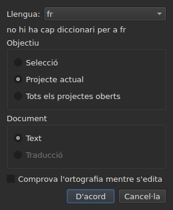
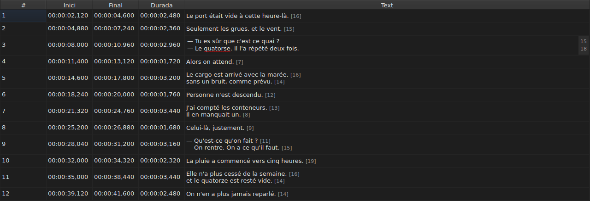
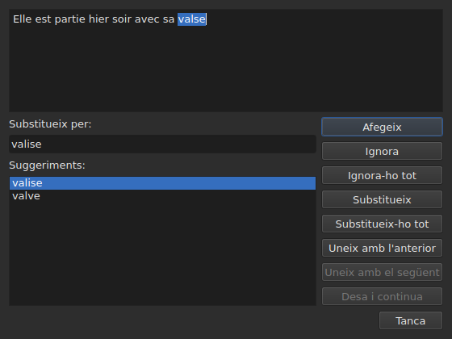

# Comprova l'ortografia…

<!-- machine-translated -->
> Aquesta pàgina és una traducció automàtica i encara no l'ha revisada cap lector de la llengua.

`Eines ▸ Comprova l'ortografia…` recorre les paraules que el diccionari no coneix,
una cada vegada, seguint el model del corrector ortogràfic de Gaupol. Té una companya,
`Eines ▸ Configuració de la comprovació ortogràfica…`, que fixa la llengua, l'objectiu i el document, i el subratllat mentre s'escriu.
Totes dues es basen en els diccionaris del sistema, a través d'Enchant.

L'etiqueta de la primera s'escriu `Chec&k Spelling…`: `C` ja és
l'accelerador de `Correct Texts…`, i `k` és lliure al menú `Tools`.
Cap de les dues no té drecera.

**Totes dues estan desactivades en un document sense cap subtítol**, com
[`Correct Texts…`](correct-texts.md): no hi ha res per comprovar. `Check Spelling…`
també està desactivada sense diccionari per a la llengua fixada, vegeu
[Sense diccionari](#sense-diccionari).

## Configuració de la comprovació ortogràfica…




| Grup | Opcions | Per defecte |
| :---- | :------ | :------ |
| `Language` | els codis de llengua que ofereix el sistema, i el que ja s'ha triat | la llengua del sistema, si és entre ells |
| `Target` | `Selection`, `Current Project`, `All Open Projects` | `Current Project` |
| `Document` | `Text`, `Translation` | `Text` |
| `Check spelling while editing` | una casella, vegeu [Subratllar mentre s'escriu](#subratllar-mentre-sescriu) | no marcada |

`Selection` està desactivada sense cap línia triada a la pestanya mostrada; `Translation`
està desactivada mentre cap projecte obert no porta una traducció. Un paràmetre
recordat que ja no està disponible — una selecció buida, una traducció absent —
s'obre a `Current Project` o `Text`. `OK` conserva la configuració, `Cancel` no canvia
res.

**Aquesta finestra no depèn del diccionari**: continua activada mentre el
document té subtítols, fins i tot sense diccionari per a la llengua fixada, i és
la que permet sortir d'una llengua que no en té. La llengua per a la qual no
existeix cap diccionari continua sent editable i apareix a la llista, amb, a sota,
la frase `no dictionary for` seguida del seu codi.

**Els quatre paràmetres es recorden** d'una sessió a la següent, al
fitxer de configuració de `subedit` — vegeu [Les preferències](preferences.md) per saber-ne
la ubicació:

| Clau | Valors | Per defecte |
| :-- | :----- | :------ |
| `spell-check.language` | un codi de llengua, com ara `fr_FR`; buit: la llengua del sistema | buit |
| `spell-check.target` | `selection`, `current-project`, `all-projects` | `current-project` |
| `spell-check.document` | `main`, `translation` | `main` |
| `spell-check.inline` | `true` o `false` — subratlla les paraules desconegudes a l'editor d'una cel·la | `false` |

Un valor que la clau no accepta s'ignora, s'aplica el valor per defecte, i l'opció
s'anomena a la sortida d'error quan s'obre la finestra — vegeu
[Les preferències](preferences.md#què-passa-quan-el-fitxer-no-diu-el-que-sespera).

## Subratllar mentre s'escriu




La casella `Check spelling while editing` de `Spell-Check Settings…` subratlla,
**amb una línia ondulada vermella i mentre escriviu**, cada paraula desconeguda a l'editor d'una
cel·la de text — tant el de la columna `Text` com el de la
columna `Translation`. El subratllat segueix el que s'escriu: apareix, es mou i
desapareix amb la paraula. **No està marcada per defecte**, com a Gaupol: sense
ella, no canvia res a l'editor.

**La llengua és la de `Language:`**, a la mateixa finestra, i les paraules desconegudes
són les que trobaria `Check Spelling…`: els mateixos casos d'anglès col·loquial
(`goin'`, `we'd`, `1st`), la mateixa divisió en paraules. Una paraula subratllada no es corregeix
des d'un menú: la casella només la mostra.

**Sense diccionari per a la llengua fixada, l'editor calla**: no es subratlla res
i no falla res, i la frase `no dictionary for` de la finestra diu
per què. La casella s'aplica als editors oberts després d'ella; un editor ja
obert conserva el que tenia.

## El recorregut




La finestra mostra el text del subtítol on s'ha aturat, amb la paraula desconeguda
seleccionada. **A cada paraula desconeguda, la pestanya del projecte torna i la
línia del subtítol queda seleccionada a la taula.** El recorregut va subtítol
rere subtítol, i després projecte rere projecte quan l'objectiu en designa diversos.

Sota el text: el quadre `Replace with:`, emplenat amb el primer suggeriment, i la
llista `Suggestions:`. Triar un suggeriment el copia al quadre; escriure al
quadre renova la llista.

| Botó | Què fa |
| :----- | :----------- |
| `Add` | afegeix la paraula al diccionari personal de l'usuari i passa a la següent |
| `Ignore` | deixa aquesta paraula i passa a la següent |
| `Ignore All` | deixa aquesta paraula, i totes les seves altres aparicions durant aquest recorregut |
| `Replace` | substitueix la paraula pel contingut de `Replace with:`; desactivat mentre el quadre és buit |
| `Replace All` | fa el mateix amb les seves altres aparicions; desactivat mentre el quadre és buit |
| `Join with Previous` | uneix la paraula a la paraula d'abans; desactivat si no n'hi ha cap, o si no estan separades per un espai |
| `Join with Next` | uneix la paraula a la paraula de després, amb les mateixes condicions |
| `Save and Resume` | conserva el text tal com el porta la zona de text, i reprèn la lectura d'**aquest text des del seu inici** |
| `Close` | tanca la finestra |

**La zona de text és editable.** Tan bon punt hi escriviu, només `Save and Resume`
continua activat: els altres gestos actuen sobre la paraula triada, que ja no és
la del text.

**El recorregut acaba per si mateix** quan ja no queda cap paraula desconeguda: els
botons es desactiven, el text es buida. Un objectiu sense cap paraula desconeguda
no mostra cap finestra.

### Tancar a mig camí

`Close`, o la creu de la finestra, **aplica el que s'ha fet**, com el final
del recorregut: els textos ja deixats, **i** els gestos — substituir,
substituir-ho tot, unir — ja fets en el text actual. És una diferència respecte de
Gaupol, que perd el text actual. El que no compta és el que queda del recorregut, ni
els retocs escrits a la zona de text que `Save and Resume` no ha
validat.

**Una sola entrada de l'historial per projecte tocat**, sigui quin sigui el nombre de
substitucions: `Undo` desfà totes les correccions d'aquest projecte alhora.
El menú l'anomena `Undo: correcting texts`. La barra d'estat dona llavors el
recompte:

```text
Edited 2 and removed 0 subtitles
```

**La llista de substitucions** — el que l'usuari ha substituït, i per què —
s'escriu en tancar a `spell-check/<language>.repl`, sota el directori de
configuració de `subedit`, i no al de Gaupol, que no es llegeix mai.
A partir de llavors compta entre els suggeriments del corrector ortogràfic, aquí com a
[`Correct Texts…`](correct-texts.md#uneix-o-divideix-paraules--unir-i-separar-segons-el-corrector-ortogràfic).
Si no es pot escriure, un quadre d'error ho diu, `Could not save the
replacements for` seguit de la llengua i del motiu, sense anul·lar les
correccions.

## Sense diccionari

Quan la llengua fixada — la del sistema, si no se n'ha triat cap — no té
diccionari, **`Check Spelling…` està desactivada**, i el seu indicador de funció, així com la barra
d'estat quan es passa per sobre de l'entrada, diuen per què:

```text
no dictionary for fr
```

`Spell-Check Settings…` hi continua sent, per triar una llengua que en tingui. Una finestra
compilada sense cap proveïdor de diccionaris diu el mateix i no comprova
res.

## Els missatges

| Missatge | On | Què el provoca |
| :------ | :---- | :--------------- |
| `no dictionary for fr` | indicador de funció i barra d'estat | cap diccionari per a la llengua fixada |
| `Nothing to check.` | barra d'estat | l'objectiu no designa cap text — una selecció buida, per exemple |
| `Edited N and removed M subtitles` | barra d'estat | al final o en tancar; `M` es queda a `0` |
| `Could not save the replacements for fr: …` | quadre d'error | la llista de substitucions no s'ha escrit |

## Un exemple

Un fitxer obert porta `Elle est partie hier soir avec sa valse`. El diccionari
francès hi és: `Eines ▸ Comprova l'ortografia…` s'atura a `valse`, selecciona la
línia a la taula, i proposa `valise`, ja a `Replace with:`. `Replace`
i després `Close`: la línia esdevé `Elle est partie hier soir avec sa valise`, i la
barra d'estat diu:

```text
Edited 1 and removed 0 subtitles
```
