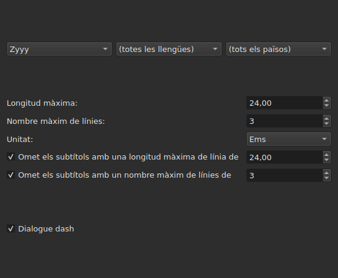
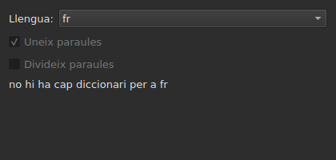
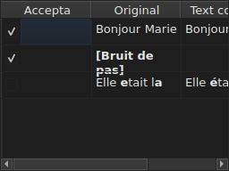

# Corregeix els textos…

<!-- machine-translated -->
> Aquesta pàgina és una traducció automàtica i encara no l'ha revisada cap lector de la llengua.

`Eines ▸ Corregeix els textos…` obre un assistent de diverses pàgines, inspirat en el
de Gaupol: una pàgina d'objectiu i tasques, una pàgina per cada tasca marcada,
una pàgina de progrés, i una pàgina de confirmació que proposa els
canvis sense imposar-los mai.

**Desactivat en un document buit**: no hi ha res per corregir.

**La línia d'ordres fa el mateix** per a totes les tasques: [`subedit-cli correct`](../subedit-cli/correct.md), amb els
mateixos patrons i els mateixos recomptes — i en caràcters allà on la finestra mesura en ems.
**Llegeix quatre dels paràmetres recordats d'aquest assistent** per defecte — les dues classes
d'errors comuns (`Human`, `OCR`), `Remove all blank subtitles` i el nombre màxim de línies de
`Line Break` — i pren tota la resta (les tasques, el seu codi, la longitud de línia, la llengua,
les caselles dels patrons) de la seva pròpia línia. Vegeu
[Dos blocs, un compartit amb la línia d'ordres](preferences.md#dos-blocs-un-compartit-amb-la-línia-dordres)
i [`subedit-cli config`](../subedit-cli/config.md).

## Tasques i objectiu — la primera pàgina

| Grup | Opcions | Per defecte |
| :---- | :------ | :------ |
| `Target` | `Selection`, `Current Project`, `All Open Projects` | `Current Project` |
| `Document` | `Text`, `Translation` | `Text` |
| `Tasks` | `Mentions`, `Join or Split Words`, `Common Errors`, `Capitalization`, `Line Break` — per marcar, una o més | `Common Errors` i `Capitalization` marcades, les tres altres no |

`Selection` està desactivada si no hi ha cap línia triada a la pestanya mostrada; `Translation`
està desactivada mentre cap projecte obert no porti una traducció.

**L'objectiu i el document no es recorden**: l'assistent sempre es torna a obrir
amb `Current Project` i `Text`. Les tasques marcades, en canvi, sí que es recorden.

**Què designa cada objectiu**:

| Objectiu | S'aplica a |
| :----- | :------ |
| `Selection` | les línies triades a la pestanya mostrada |
| `Current Project` | tot el fitxer de la pestanya mostrada |
| `All Open Projects` | tot el fitxer de cada pestanya oberta |

**`All Open Projects` sobre `Translation` omet els projectes sense traducció**:
un projecte que no en porta cap no té res a proposar en una columna buida, i
l'assistent no el compta.

**Les pàgines de tasques segueixen, en l'ordre de Gaupol — `Mentions`,
`Join or Split Words`, `Common Errors`, `Capitalization`, `Line Break` —, mai aquell en què es van
marcar les caselles.** Una tasca no marcada no té cap pàgina; els seus paràmetres
recordats no canvien per això. **Cap pàgina de tasca no porta la seva pròpia
casella «activa»**: és la d'aquesta primera pàgina, i només ella, la que
decideix si la tasca s'executa.

## Les pàgines de tasques

Cadascuna de les quatre pàgines de patrons — totes excepte `Join or Split Words`, que no en té — porta la mateixa base: tres menús
desplegables en cascada — escriptura, llengua, país — per triar el codi dels patrons que cal
aplicar, i després la llista dels patrons d'aquest codi, un per marcar per cada nom. **Els
tres menús només ofereixen el que el catàleg de patrons porta
realment** — els distribuïts amb el programa i els que un usuari hi ha
dipositat (vegeu [Els patrons dipositats](#els-patrons-dipositats)) — mai una llista
de llengües o de països llegida en un altre lloc. `Zyyy` («qualsevol escriptura») és el codi
de partida de `Common Errors`, que dona els patrons vàlids a tot arreu. **Els tres
altres tipus només tenen patrons sota una escriptura**: la seva pàgina s'obre amb la
primera que ofereix el catàleg, `Latn` amb els patrons distribuïts, i no amb `Zyyy`.

**La descripció de cada patró és l'indicador de funció de la seva casella.** Els noms i les descripcions segueixen la
llengua de la finestra per als patrons distribuïts amb el programa; un patró propi es mostra tal com
l'escriu el seu fitxer ([Llengua](invocation.md#llengua)).

**Un patró desmarcat es queda desmarcat fins que es torna a marcar**, fins i tot quan
es canvia de codi i després s'hi torna, i aquesta elecció es recorda d'una obertura
de l'assistent a la següent. Tornat a marcar, simplement retroba el seu paràmetre
original, i l'elecció recordada desapareix.

| Pàgina | Què afegeix a la base |
| :--- | :----------------------- |
| `Mentions` | dues caselles, `Sound in brackets` i `Sound in parentheses`, no marcades per defecte |
| `Common Errors` | dues caselles, `Human` i `OCR`, marcades per defecte |
| `Capitalization` | res més |
| `Line Break` | una longitud màxima (`24`, per defecte), un nombre màxim de línies (`3`), una unitat — `Characters` o `Ems`, `Ems` per defecte —, i dues condicions d'omissió, descrites més avall |

**Les dues caselles de `Mentions` no anomenen cap patró compilat**:
dirigeixen una exploració del text al nucli, la mateixa que
[`Remove Hearing-Impaired Mentions…`](operations.md#remove-hearing-impaired-mentions)
ja fa en un gest directe. N'hi ha prou que una **o** l'altra estigui marcada per llançar-la. **La llista de patrons de la pàgina no les repeteix**: aquests dos noms només hi apareixen una vegada, com a caselles.

**`Common Errors` filtra per classe**: un patró que porta totes dues classes
s'aplica tan bon punt una de les dues caselles està marcada; les tres altres pàgines no
coneixen aquesta distinció.

### Salt de línia — la unitat i l'omissió




| Paràmetre | Què fa | Per defecte |
| :------ | :----------- | :------ |
| `Maximum length` | la longitud d'una línia, en la unitat triada; de `1` a `1000` | `24` |
| `Maximum lines` | el nombre de línies a què s'aspira; de `1` a `100` | `3` |
| `Unit` | `Characters` compta caràcters; `Ems` mesura l'amplada amb el tipus de lletra de la finestra, on una lletra minúscula mitjana val `0.55` — la unitat de Gaupol | `Ems` |
| `Skip subtitles with maximum line length of` | deixa tal com és un subtítol la línia més llarga del qual cap dins d'aquesta longitud, en la unitat triada | marcat, `24` |
| `Skip subtitles with maximum line amount of` | deixa tal com és un subtítol el nombre de línies del qual cap dins d'aquest nombre | marcat, `3` |

**L'omissió té els seus propis llindars**, diferents dels límits a què s'aspira: és
la regla de Gaupol. Un subtítol es deixa tal com és si cap dins de **tots els
llindars la casella dels quals està marcada**; si no, es trenca, i el trencament
només es conserva si apropa el subtítol a un llindar que superava — menys
longitud, o menys línies. Cap casella marcada: cada subtítol es trenca,
tant si ja hi cap com si no.

**Canviar la unitat canvia el que es proposa**: la longitud de cada línia es
mesura a cada càlcul, en la unitat de la pàgina en aquell moment, i no
queda res d'una mesura anterior. Un text de vint-i-nou caràcters, la meitat
dels quals són lletres estretes, supera `24` en `Characters` i hi cap de sobres
en `Ems`.

**Els set paràmetres es recorden** d'una sessió a la següent, unitat inclosa.

### Uneix o divideix paraules — unir i separar segons el corrector ortogràfic




Una pàgina a part, entre `Mentions` i `Common Errors`, per reparar el que
el programari de reconeixement de text fa als espais. No té cap llista de
patrons: es basa en els diccionaris del sistema, a través d'Enchant.

| Paràmetre | Què fa | Per defecte |
| :------ | :----------- | :------ |
| `Language` | la llengua del diccionari; els codis que ofereix el sistema, i el que ja s'ha triat | la llengua del sistema, si és entre ells |
| `Join words` | uneix una paraula mal escrita a la paraula veïna | marcat |
| `Split words` | talla en dues una paraula mal escrita | no marcat |

**Unir**: una paraula mal escrita s'uneix a la paraula que la precedeix o a la que
la segueix **si, i només si, només una de les dues direccions dona una paraula ben
escrita**. Quan totes dues en donen una, o cap, no es fa res.
`bon jour` esdevé `bonjour`; dos espais seguits primer es redueixen a
un, però un text on no s'uneix res es retorna tal com era, espais
inclosos.

**Separar**: una paraula mal escrita es talla si, entre els suggeriments del
corrector ortogràfic, **només un** és aquesta paraula amb un espai — les mateixes
lletres, en el mateix ordre. Dos suggeriments d'aquesta mena, o cap: no es fa
res. Una paraula de la qual només la inicial és majúscula (`Bonjourtous`) no es
separa mai: sovint és un nom, i els diccionaris no en tenen.

**La llista de substitucions de l'usuari** (`spell-check/<language>.repl`,
al directori de configuració del programa) compta entre els suggeriments del
corrector ortogràfic; l'assistent la llegeix i no l'escriu.

**Sense cap diccionari per a la llengua triada, la pàgina es manté i queda en gris**: les
dues caselles estan desactivades i la pàgina diu `no dictionary for` seguit del codi de
la llengua. La llengua continua sent editable — pot ser que hi hagi un diccionari per a una
altra — i la tasca, marcada o no a la primera pàgina, llavors no fa res i
no informa de cap error.

**La llengua, les dues caselles i la casella de la primera pàgina es recorden** d'una
obertura de l'assistent a la següent.

### Els patrons dipositats

Un patró que un usuari ha dipositat al seu propi directori de patrons
s'afegeix als distribuïts amb el programa, al mateix catàleg i sota els
mateixos menús — un cop carregats, res no els distingeix.

| Patrons | On |
| :------- | :---- |
| distribuïts | `<prefix>/share/subedit/patterns`, al costat de `<prefix>/bin` |
| els de l'usuari | `$XDG_DATA_HOME/subedit/patterns`, o `~/.local/share/subedit/patterns` si la variable no està definida o no és un camí absolut |

**El format és el de Gaupol, llegit tal qual**: un fitxer `<Code>.<type>` per escriptura,
llengua i país — `Latn-en.common-error` —, amb el seu `.conf` d'activació al costat. Els tipus
són `common-error`, `capitalization`, `hearing-impaired` i `line-break`. Els fitxers
distribuïts serveixen de model. **Els patrons es llegeixen una vegada, en el llançament**: un fitxer
dipositat mentre la finestra és oberta només es veu en el llançament següent.

## Progrés

Un cop premut `Next` des de l'última pàgina de tasca marcada (o des de la
primera pàgina si no hi ha cap tasca marcada), l'assistent calcula les correccions
proposades en un fil de fons, amb una barra de progrés indeterminada a la
pantalla. Un cop acabat el càlcul, la pàgina de confirmació s'obre sola.

**`Cancel` en aquest pas abandona el càlcul sense interrompre'l**: no
s'aplica res, però l'assistent espera, abans de tancar-se, que el càlcul en
curs acabi — una espera limitada pel temps màxim que el motor de
patrons imposa a cada cerca.

**`Back` en aquest pas torna a la pàgina anterior sense esperar**: el càlcul
acaba en segon pla i el seu resultat es descarta — l'assistent no salta
per si sol a la confirmació. `Next` comença un càlcul nou.

## Confirmació — l'última pàgina




Una línia per cada text que l'assistent canviaria — mai una línia per a un
text que una tasca ha deixat tal com és.

| Columna | Què mostra |
| :----- | :------------ |
| `Accept` | una casella, marcada per defecte: la correcció s'aplicarà o no |
| `Original` | el text tal com és, amb la part que canviaria **en negreta** |
| `Corrected Text` | el text proposat, amb la part canviada en negreta, **editable** — retocar-lo canvia el que s'escriurà, sense canviar la casella `Accept` |

**El canvi es marca en negreta, mai en color**: la mateixa diferència es llegeix
en totes dues paletes sense dependre de cap tint.

**Una línia la proposta de la qual és una supressió** — al subtítol no li quedaria
cap text — mostra la columna `Corrected Text` buida, i tot el seu `Original` en
negreta.

| Botó | Què fa |
| :----- | :----------- |
| `Mark All` | marca `Accept` a totes les línies |
| `Unmark All` | desmarca `Accept` a totes les línies |
| `Preview` | posa el reproductor integrat al subtítol de la línia triada, si el projecte té una pel·lícula — res si no en té |
| `Finish` | aplica les línies marcades i tanca l'assistent |

`Remove all blank subtitles`, marcada per defecte, suprimeix els subtítols
que una correcció deixaria sense cap text en lloc de conservar-los buits.

**Un patró que el càlcul no ha pogut aplicar s'anomena sota la taula**, amb
el motiu:

```text
Not applied: some pattern (will not compile)
```

Un patró anomenat així s'anomena **una vegada per motiu**, sigui quin sigui el nombre de
textos o de projectes en què ha fallat: la pantalla no diu quins.

| Motiu | Què el provoca |
| :----- | :--------------- |
| `cannot be translated` | l'expressió usa el que la traducció de la sintaxi de Python rebutja |
| `will not compile` | el motor rebutja l'expressió |
| `has an invalid replacement` | la substitució no es llegeix com la llegeix Python |
| `timed out` | una cerca ha superat el temps que el motor li concedeix en un text |
| `never settled` | `Repeat` encara canviava el text després de cent passades |
| `grew the text too long` | el text ha superat els 16.384 bytes mentre el patró hi treballava |

**Un patró que falla en un text el deixa tal com era abans d'ell**: una substitució
feta a mitges val menys que cap substitució. Els altres patrons s'apliquen.

**Una línia d'un fitxer de patrons que no es pot llegir s'anomena al mateix
lloc**, pel seu fitxer, la seva línia i el motiu — a cada obertura de
l'assistent, ja que els patrons només es llegeixen una vegada, en el llançament:

```text
Could not be read: Zyyy.common-error, line 8 (malformed line)
```

| Motiu | Què el provoca |
| :----- | :--------------- |
| `directory cannot be read` | no s'ha pogut recórrer el directori dels patrons distribuïts |
| `file cannot be read` | no s'ha pogut llegir un fitxer de patrons |
| `malformed line` | una línia que no és ni una capçalera, ni un comentari, ni `Key=Value` |
| `field outside any pattern` | un `Key=Value` abans de la primera capçalera de patró |
| `unknown field` | una clau que aquest tipus de patró no fa servir — el patró es conserva |
| `missing field` | una clau sense la qual aquest tipus de patró no pot fer res — el patró es descarta |
| `invalid value` | un valor que la clau no accepta — el patró es descarta |
| `malformed activation` | un element `<pattern>` d'un `.conf` que no anomena res |

Els altres patrons, els que s'han llegit i aplicat correctament, no en
queden afectats.

## Què diu desfer, i què no fa mai `Cancel`

**`Finish` fa una entrada de l'historial per cada projecte tocat**, mai una per
correcció: `Undo` desfà d'una vegada totes les correccions acceptades en aquell
projecte, cadascuna amb el text que tenia. El menú l'anomena
`Undo: correcting texts`.

La barra d'estat dona el recompte, primer els textos canviats, després els subtítols
suprimits:

```text
Edited 3 and removed 1 subtitles
```

**`Cancel`, a qualsevol pàgina, no aplica res i no recorda res** — ni
els paràmetres triats durant aquesta obertura, ni la més mínima correcció. La
propera obertura de l'assistent torna a començar des dels paràmetres d'abans.

## Un exemple

Un fitxer obert porta dos espais entre dues paraules d'una línia i una
menció entre claudàtors sense cap altre text. `Eines ▸ Corregeix els textos…`,
`Common Errors` ja marcada, `Next` fins a la confirmació: la línia amb els dos espais
mostra `Bonjour  Marie` a l'esquerra, `Bonjour Marie` a la dreta, la correcció en
negreta i ja acceptada. `Finish` l'aplica, i la barra d'estat diu:

```text
Edited 1 and removed 0 subtitles
```
