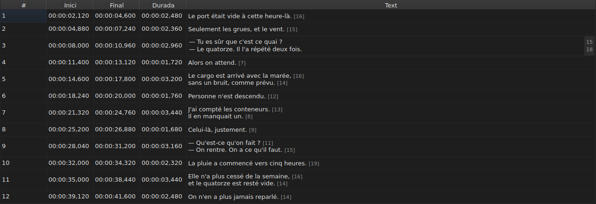
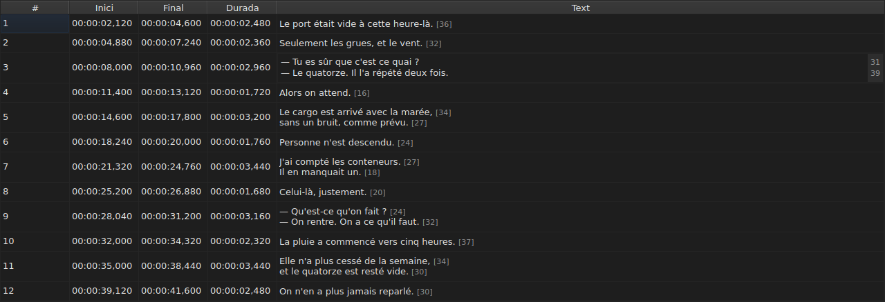

# Editar una cel·la

<!-- machine-translated -->
> Aquesta pàgina és una traducció automàtica i encara no l'ha revisada cap lector de la llengua.

Quatre columnes s'editen al mateix lloc: `Start`, `End`, `Duration` i `Text` — cinc
amb la columna `Translation`, quan el projecte té una traducció. `#` no es pot
editar — el número és el rang de la línia, no una dada del fitxer.

**Obrir l'editor d'una cel·la:** feu-hi doble clic, o seleccioneu-la
i premeu `F2`.

## El text

**La traducció s'edita com el text**, amb el mateix camp de diverses línies i les
mateixes regles; només canvia la cel·la, i el text principal es queda tal com
era. Una validació que no canvia res no fa res, tant per a l'un com per a
l'altre — vegeu [més avall](#una-validació-que-no-canvia-res-no-fa-res).

L'editor és un camp **de diverses línies**, i s'obre a l'altura del subtítol:
un subtítol de dues línies s'hi escriu tal com s'escriurà, amb les dues línies
llegibles i sense barra de desplaçament. Un `Shift+Enter` que n'afegeix una
eixampla l'editor; la fila de la taula s'ajusta en validar.

| Tecla | Efecte |
| :-- | :----- |
| `Enter` | valida i tanca l'editor |
| `Shift+Enter` | insereix un salt de línia al text |
| `Esc` | tanca l'editor; la cel·la conserva el que tenia |
| `Tab` | valida i passa a la cel·la següent |

Fer clic en un altre lloc també valida: perdre el focus val per un `Enter`.

**Onze gestos sense diàleg validen de la mateixa manera** abans de calcular el seu objectiu:
`Italic`, `Majúscules i minúscules ▸ …`, `Dialogue`, `Merge Subtitles`, `Split Subtitle`,
`Cut Texts`, `Paste Texts`, `Copy Texts`, `Remove Subtitles`, `Undo` i `Redo`.
Llançats des del menú, la barra d'eines o una drecera de la finestra,
prenen el text tal com l'editor l'acaba de validar, com després d'un clic
en un altre lloc. `Ctrl+X`, `Ctrl+C` i `Ctrl+V`, però, es queden amb l'editor mentre
és obert — vegeu [Retallar, copiar i enganxar](clipboard.md): llavors és el
menú el que llança `Cut Texts`, `Copy Texts` i `Paste Texts`.

`Undo` i `Redo` llegeixen l'historial i no el document: vegeu
[Desfer i refer](undo.md). Un gest que obre un diàleg no
necessita aquesta regla, ja que el diàleg pren el focus en obrir-se, cosa que
ja valida l'entrada.

### Les etiquetes són les del fitxer

El text que es mostra i que s'escriu és **el del fitxer, etiquetes incloses**: un
`<i>…</i>` d'un SubRip s'escriu així, i un `{\i1}…{\i0}` d'un Advanced SSA
també. No es tradueix res per mostrar-lo — la taula
d'[`Italic`](operations.md#italic) diu què escriu cada format.

Per a la cursiva, per tant, no cal saber res: `Ctrl+I` posa l'etiqueta correcta
per al document obert, i un format que no en porta cap — TMPlayer, LRC —
desactiva l'entrada en lloc de deixar-vos-la cercar. La negreta i el subratllat
s'escriuen a mà, com a Gaupol.

**I les etiquetes no segueixen les operacions de text**: posar un subtítol
en minúscules no converteix el seu `<I>` en `<i>`, i un guió de diàleg es
posa davant del text i no davant d'una etiqueta d'obertura. Vegeu
[`Case` i `Dialogue`](operations.md#case-i-dialogue).

## La longitud de les línies

**L'editor de text mostra, en un marge a la dreta, la longitud de cada
línia**, alineada amb la primera fila d'aquesta línia. El marge és tan ample
com el nombre més gran, s'actualitza **mentre escriviu**, i segueix el desplaçament.
Un text buit no mostra res. Les longituds són les de la taula — sense les
etiquetes, arrodonides per sota, en la unitat fixada — i es treuen amb la
casella `Show line lengths in the editor` d'`Edita ▸ Preferències…`. Vegeu
[Les longituds de les línies](preferences.md#les-longituds-de-les-línies).

## L'inici i el final

L'editor és un camp d'una sola línia, **restringit a la forma d'una marca de temps**:
rebutja mentre s'escriu el que mai no en podria ser una.

Les formes acceptades són les que ja accepta la lectura d'un fitxer:

| Element | Què passa |
| :------ | :---------- |
| camps | `MM:SS` o `HH:MM:SS`, una o dues xifres cadascun |
| decimals | d'un a tres, després d'una coma o d'un punt, o cap |
| signe | un `-` al davant, per a una posició anterior a l'inici del vídeo |
| límits | minuts i segons per sota de 60 |

`00:01:02,500`, `1:02.5` i `-0:01,000` són, per tant, tres entrades vàlides.

**Una entrada que la lectura rebutja deixa la cel·la sense canvis.** És el cas
de `00:70:00,000`, la forma del qual és correcta però els minuts del qual són fora
de límits: l'editor es tanca i no s'ha mogut res. No s'inventa cap posició
— equivocar-se en una posició és silenciós, res a la pantalla no distingeix un
subtítol mal sincronitzat d'un de ben sincronitzat.

Canviar un inici o un final actualitza la `Duration` immediatament.

## La durada

**Escriure una durada mou el final, i mai l'inici**: el final esdevé
`Start + Duration`. Moure l'inici mouria tot el subtítol, que
és la feina de [`Shift Positions…`](operations.md), i a la columna `Start` ja
s'hi pot escriure.

La durada s'escriu **amb la forma d'una marca de temps**, la que mostra la
columna, i s'hi apliquen les formes de la taula anterior — amb una diferència:

| Element | Inici, final | Durada |
| :------ | :--------- | :------- |
| forma | la d'una marca de temps | la mateixa |
| signe `-` al davant | acceptat | **rebutjat mentre s'escriu** |

`0:02.5` i `00:00:02,500` són, per tant, dues entrades vàlides d'una durada de dos
segons i mig; `-0:01,000` no es pot escriure. S'accepta una durada zero:
el subtítol llavors desapareix en l'instant en què apareix.

**Es permet un final que passi per sobre del subtítol següent.** L'encavalcament
es tenyeix a la taula, amb el seu indicador de funció — vegeu
[La taula](table.md#les-anomalies) —: un avís, no un rebuig; potser és el que
volíeu. La [llista de diagnòstics](files.md#els-diagnòstics-duna-lectura)
també el porta, i el treu quan l'heu corregit.

**Un final escrit més enllà del final de la pel·lícula no s'indica**, a diferència
d'una operació del menú `Tools` que l'hi empenyés — vegeu
[Les operacions](operations.md#més-enllà-del-final-de-la-pellícula). Una cel·la ja mostra
el valor que acabeu d'escriure.

Una entrada il·legible deixa la cel·la sense canvis, com per a una posició, i
una durada idèntica a la que es mostra no entra a l'historial.

## Una validació que no canvia res no fa res

Obriu una cel·la, no escriviu res, premeu `Enter`: no passa res.
No es registra cap modificació, i el fitxer encara es considera idèntic al
del disc.

La comparació es fa sobre la **posició**, no sobre la cadena: escriure `0:01.0`
en una cel·la que mostra `00:00:01,000` designa el mateix instant, i
per tant tampoc no canvia res.

## Què esdevé una cel·la editada

**Es pot desfer** — una cel·la, una entrada. Vegeu
[Desfer i refer](undo.md).

**Es desa**, i tancar la finestra sense haver-ho fet demana
confirmació. Vegeu [Obrir i desar](files.md).
