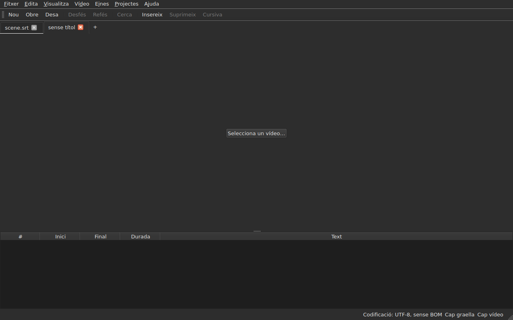
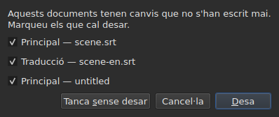
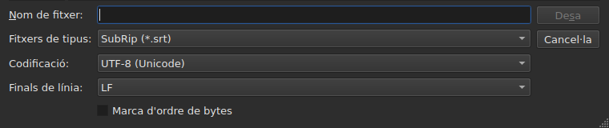
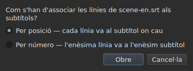
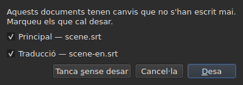

# Obrir i desar

<!-- machine-translated -->
> Aquesta pàgina és una traducció automàtica i encara no l'ha revisada cap lector de la llengua.

El menú **Fitxer** porta les tres ordres, dues per a les pestanyes, i tres
més per a la traducció; el menú **Projectes** actua sobre totes les pestanyes alhora.

| Ordre | Drecera | Què fa |
| :------ | :------- | :----------- |
| Projecte nou | `Ctrl+N` | un projecte buit, en una pestanya nova — també el botó `+` després de l'última pestanya |
| Obre… | `Ctrl+O` | tria un fitxer i l'obre en una pestanya nova — o en el lloc d'un projecte en blanc |
| Obre una traducció… | — | tria un fitxer de traducció i l'alinea sobre el fitxer principal de la pestanya actual |
| Desa | `Ctrl+S` | torna a escriure el fitxer obert |
| Anomena i desa… | `Ctrl+Shift+S` | tria un camí i un format, i després escriu |
| Desa la traducció | — | torna a escriure el fitxer de la traducció |
| Anomena i desa la traducció… | — | tria un camí i un format per a la traducció, i després escriu |
| Tanca | `Ctrl+W` | tanca la pestanya actual — desactivada si només n'hi ha una |

`New Project`, `Open…` i `Save` també són a la
[barra d'eines](index.md#la-barra-deines), amb les paraules `New`, `Open` i
`Save`. **Les tres entrades de la
traducció no són a la barra**: només serveixen a qui té una
traducció, i la barra és de tothom.

## Diversos projectes, en pestanyes

**Cada projecte obert té la seva pestanya**, a sobre de la imatge i de la taula:
la seva etiqueta és el nom del fitxer, o `untitled` per a un projecte que encara no en
té. Fer clic en una pestanya hi canvia; `Ctrl+PageDown` i `Ctrl+PageUp` fan
el mateix, sense el ratolí, i tornen a la primera pestanya després de l'última.
**El botó `+`, just després de l'última pestanya**, obre un projecte buit en una
pestanya nova, com `New Project`.




**`Open…` no les toca mai.** Obrir un fitxer ja no substitueix el que
mostrava la finestra: arriba en una pestanya nova, al costat, i la pestanya que
miràveu abans conserva tot el que tenia — el seu historial, la seva selecció, el seu
vídeo associat. Per això, a més, obrir ja no pregunta res: no hi ha
res a perdre, ja que no hi ha res a substituir.

**Una excepció: el projecte en blanc cedeix el seu lloc.** Iniciada sense fitxer, o
després de `New Project`, la finestra mostra un projecte `untitled` sense res a dins.
Un fitxer obert — amb `Open…` igual que deixant-lo anar — **pren llavors la seva pestanya,
al mateix lloc de la barra**, en lloc d'obrir-ne una altra al costat d'un
projecte inútil. Un projecte és en blanc quan **no té fitxer, ni subtítol,
ni res a desfer o refer, ni pel·lícula, i no s'ha modificat mai**: qualsevol
d'aquestes coses n'hi ha prou perquè conservi la seva pestanya. Un projecte en blanc que no és
la pestanya actual no es toca.

**Un fitxer ja obert no s'obre una segona vegada.** `Open…` sobre un
fitxer que ja té una altra pestanya torna el focus a aquesta pestanya, i ho diu
a la barra d'estat:

```text
premier.srt: already open
```

**Cada pestanya és un projecte sencer, independent dels altres**: el seu
historial, la seva selecció, el seu vídeo associat i el que ha trobat la seva última
lectura només es mostren quan aquesta pestanya és l'actual, i no
canvien mentre ho és una altra. **Una excepció, i és a l'ADR
0033**: el reproductor de vídeo és únic per a tota la finestra — un sol procés
mpv — i la seva pel·lícula canvia amb la pestanya; **cada pestanya recorda on era la seva pel·lícula**,
i la reprèn allà, en pausa, quan hi torneu. El porta-retalls, per la seva banda, pertany a la finestra: copiar
en una pestanya i enganxar en una altra és el motiu per obrir-ne dues.

**`Close` tanca la pestanya actual**, plantejant si cal
[la pregunta dels canvis no desats](#els-canvis-no-desats) —
la d'aquesta pestanya sola, ja que les altres no hi tenen res a veure. **Desactivada quan només hi ha
una pestanya**: la finestra en conserva sempre almenys una, i tancar-la
seria tancar la finestra — cosa que ja fa el botó del sistema.

**Cada pestanya porta també una creu**, que tanca **el seu** projecte, amb la mateixa
pregunta. La creu d'una pestanya que no és l'actual tanca aquella, i
la pestanya que mireu continua mostrant-se; si aquell projecte té canvis, la seva
pestanya passa al davant durant la pregunta. **No hi ha creu quan només queda
una pestanya**, per la mateixa raó que `Close` està desactivada.

**Una pestanya diu que està modificada**: una estrella segueix el seu nom, `premier.srt*`,
mentre un dels seus documents difereixi del seu fitxer — com ho diu el títol de la finestra
del projecte que mireu. Desapareix en desar.

## El menú Projectes

Dues ordres actuen sobre tots els projectes alhora.

| Ordre | Drecera | Què fa |
| :------ | :------- | :----------- |
| Desa-ho tot | `Ctrl+Shift+L` | escriu cada document modificat, pestanya per pestanya |
| Tanca-ho tot | `Ctrl+Shift+W` | tanca tots els projectes — és a dir, la finestra |

**`Save All` segueix l'ordre de les pestanyes**, el document principal abans de la traducció.
Un document que té fitxer s'hi torna a escriure **sense que la seva pestanya passi al davant**;
**un document que no en té obre `Save As…`, un cada vegada**, a la seva pestanya —
l'únic cas en què `Save All` canvia de pestanya, perquè el quadre mostri de quin
projecte es tracta. **Cancel·lar un `Save As…`, o un
desament que falla, atura la resta**: els projectes següents no es
toquen, i un quadre diu què s'ha escrit.

```text
Save All stopped: 1 of 3 documents saved
```

Quan tot s'ha escrit, la barra d'estat ho diu — `2 documents saved`, o
`Nothing to save` quan no s'ha modificat res. Si un `Save As…` ha portat
una pestanya al davant, la finestra torna llavors a aquella on es va
llançar l'ordre.

**`Close All` i la creu de la finestra són una sola i mateixa cosa**: la finestra
conserva sempre un projecte, i tancar-los tots és tancar-la. Per tant plantegen
**una sola pregunta per a tots els projectes**, la mateixa que amb
[dos documents modificats](#tancar-amb-dos-documents-modificats), amb una casella
per document modificat de cada pestanya:




**`Cancel` no tanca res**, i no deixa res escrit. `Save` escriu els
documents marcats com `Save All`: darrere de la seva pestanya, excepte un document sense
nom, la pestanya del qual passa al davant per al seu `Save As…`. Amb un sol document
modificat entre tots els projectes, és la pregunta senzilla que hem tingut
sempre, plantejada a la seva pestanya. `Save All As…` no existeix: és una successió de
`Save As…`, que `Save All` ja demana, un cada vegada, per als documents sense nom.

## Obrir

El diàleg filtra **els nou formats que es llegeixen**, una entrada cadascun, i una primera
entrada que els mostra tots. El format es reconeix llavors **pel contingut, no per
l'extensió**: un `.txt` que conté SubRip s'obre, i el filtre no decideix
res — només amaga fitxers.

| Entrada del filtre | Extensió |
| :----------- | :-------- |
| `SubRip` | `.srt` |
| `WebVTT` | `.vtt` |
| `SubViewer 2` | `.sub` |
| `Sub Station Alpha` | `.ssa` |
| `Advanced SSA` | `.ass` |
| `MicroDVD` | `.sub` |
| `MPL2` | `.txt` |
| `TMPlayer` | `.txt` |
| `LRC` | `.lrc` |

**Dues extensions designen dos formats cadascuna** — `.sub` és SubViewer 2 i
MicroDVD, `.txt` és MPL2 i TMPlayer. No té cap conseqüència en obrir,
ja que decideix el contingut; en desar, és el **nom** de
l'entrada triada el que dona el format, mai el seu patró.

**Un fitxer il·legible no obre res.** Inexistent, rebutjat pel sistema, escrit
en una codificació amb la qual els seus bytes no es descodifiquen, o de cap format
conegut: un quadre modal **anomena la causa**, no s'obre cap pestanya, i les que
hi havia no es mouen.

| Missatge | Què ha passat |
| :------ | :------------ |
| `does not exist` | el camí no designa cap fitxer |
| `cannot be opened: permission denied` | el sistema es nega a obrir-lo |
| `cannot be read` | el sistema s'hi ha negat per un altre motiu |
| `cannot be decoded in the chosen encoding` | els bytes no es llegeixen en la codificació triada |
| `is in no format this tool knows` | cap format no reconeix el contingut |
| `holds nothing recognisable as a subtitle` | el format es reconeix, però res del que conté no és un subtítol |

El missatge va precedit del camí: `notes.txt: is in no format this tool knows`.
Són les paraules de la línia d'ordres, i no és casualitat — totes dues
superfícies llegeixen un fitxer amb la mateixa recepta.

### Deixar anar fitxers a la finestra

**Deixar anar fitxers a qualsevol lloc de la finestra els obre**, des del
gestor de fitxers: la taula, la barra de pestanyes, el
botó `Select Video…`, i **la mateixa imatge de la pel·lícula**, tant en reproducció com aturada.
La imatge és una finestra separada dibuixada pel reproductor, i res no garantia
que deixés passar un deixar anar; s'ha comprovat a mà en un escriptori real,
en una sessió Wayland. `subedit-gui` s'hi inicia sota X11 per poder mostrar
la pel·lícula, de manera que el deixar anar passa pel protocol X11 — el d'una
sessió X11, on no s'ha provat per separat.

- **Cada fitxer de subtítols obre la seva pestanya**, en l'ordre en què s'han
  deixat anar — exactament com `Open…`. Un fitxer **ja obert** no es torna
  a llegir: la seva pestanya passa al davant, i la barra d'estat ho diu
  (`premier.srt: already open`).
- **Un vídeo deixat anar s'associa a la pestanya actual**, com amb
  `Select Video…`. Deixat anar amb subtítols, va a l'última pestanya
  que aquests han obert, sigui quin sigui l'ordre del deixar anar. Un vídeo es reconeix per
  la seva extensió — la mateixa llista que la que proposa una pel·lícula al costat del
  fitxer.
- **Dos vídeos o més alhora no s'obren**: un projecte mira una
  sola pel·lícula. Els subtítols del mateix deixar anar, per la seva banda, s'obren.
- **Un fitxer que no s'obre no atura els altres.** Un sol quadre diu llavors
  què no s'ha pogut fer, una línia per fitxer, amb les paraules
  d'`Open…`:

  ```text
  /films/notes.txt: is in no format this tool knows
  /films/absent.srt: does not exist
  ```

Només s'accepten fitxers locals: un enllaç arrossegat des d'un navegador
no designa res que la finestra pugui llegir.

Obrir des de la línia d'ordres continua funcionant: `subedit-gui film.srt`.
Allà, el mateix motiu s'escriu a la sortida d'error, i la finestra s'obre
buida — vegeu [Invocació](invocation.md#quan-falla-lobertura).

## Els diagnòstics d'una lectura

Un fitxer real poques vegades és perfecte, i la lectura recupera en lloc de
rendir-se: un número que falta, una línia que no va enlloc, finals de línia
barrejats. **El que ha trobat cap en un botó de la barra d'estat**
— `2 diagnostics`, a l'esquerra del que la barra ja diu del document —, i **la llista s'obre amb un clic
en una finestra flotant** a sobre del botó. No s'hi dedica cap línia de la finestra:
la taula conserva tota la seva alçada, tant si la lectura tenia alguna cosa a dir com si no. La llista
es tanca amb un clic en un altre lloc o amb `Esc`.

```
a SubRip block without its number, settled by the reader: 5
```

**Cada línia compta**: què s'ha trobat, què s'hi ha fet, i
quantes vegades. Un fitxer mal fet en troba centenars, i saber
quants de cada mena és el que permet actuar; el número de línia de cada aparició al
fitxer, per la seva banda, es llegeix a la línia d'ordres, amb el nivell de detall `-vvv`. El
botó compta aquestes línies — una per mena —, no les aparicions.

**La codificació endevinada també hi apareix**, una vegada: s'ha proposat sospesant els
bytes, abans que existís cap línia del fitxer.

```
an encoding nothing declared, settled by the reader: 1
```

Només es mostra quan la codificació s'ha **endevinat i no és
UTF-8** — un fitxer UTF-8 llegit com a tal no és cap esdeveniment, i dir-ho a
cada obertura posaria un botó a la barra d'estat de qualsevol document
corrent. Un fitxer que porta una marca d'ordre de bytes tampoc no el provoca:
ha declarat la seva codificació, no s'ha endevinat res.

**La mateixa llista compta també el que no va bé en els mateixos subtítols**: un
subtítol que comença abans que s'hagi acabat l'anterior, un final abans del seu
inici, un inici abans del del subtítol de sobre. La taula els acoloreix, però
un color es troba desplaçant-se, i en un fitxer de dues mil línies
se'n perd un fàcilment; aquí les menes són totes juntes, **una per
línia i amb el seu nombre**, amb les paraules de l'informe d'`inspect`:

```
subtitle starts before the previous one ends: 12
subtitle starts before the previous one starts: 3
```

**Un clic en una porta al primer subtítol afectat**, seleccionat a la
taula. Aquestes línies **segueixen les correccions** — ordenar o corregir una durada
en fa desaparèixer algunes, o en redueix el nombre —, sense tancar la llista que
esteu llegint. Un subtítol es pot comptar dues vegades: començar abans del final de
l'anterior i abans del seu inici són dues constatacions, corregides de dues
maneres. Per anomenar-los un per un, `subedit-cli inspect --detail`.

El botó **no apareix** quan no hi ha res a indicar, ni a la lectura ni
als subtítols, i **segueix la pestanya**: cada projecte conserva els
diagnòstics de la seva pròpia lectura, i el botó mostra els del projecte que es veu.

## La codificació a la barra d'estat

**La barra d'estat indica sempre la codificació del document obert**, a l'esquerra del que
diu de la [graella de fotogrames](frame-grid.md) i del
[vídeo associat](video.md):

| Situació | Què s'escriu |
| :-------- | :-------------- |
| el fitxer s'ha llegit com a UTF-8, sense marca | `Encoding: UTF-8, no BOM` |
| … amb una marca | `Encoding: UTF-8, BOM` |
| un fitxer en Latin-1 | `Encoding: ISO-8859-1, no BOM` |

**El diagnòstic i aquesta línia no responen a la mateixa pregunta**, i per això
existeixen tots dos. El diagnòstic diu què **ha fet** la lectura — ha
endevinat, i potser ho voleu comprovar; per tant només es mostra quan hi ha
hagut una endevinada. La barra d'estat diu què **és** el document,
permanentment, fins i tot per a un fitxer que declara ell mateix la seva codificació i sobre
el qual la lectura no té res a dir.

**D'on ve la resposta no hi apareix.** `inspect` ho indica — `detected`,
`from its byte order mark`, `as asked for` — perquè un informe té espai per
dir-ho; una línia de la barra d'estat no, i la llista de diagnòstics ja ho porta quan
importa.

## Desar

`Save` torna a escriure el fitxer obert **en la seva forma original**: el seu format, la seva
codificació, els seus finals de línia, la seva marca d'ordre de bytes i la seva capçalera. Un
fitxer obert i després desat sense modificació no es mou ni un byte — vegeu
la garantia exacta més avall.

L'escriptura és **atòmica**: passa per un fitxer temporal que es reanomena
sobre l'original. Un desament interromput en qualsevol moment deixa intacta la versió
anterior.

Desar un document que no ha estat mai al disc equival a `Save As…`.

**Una escriptura que falla ho diu i no perd res**: un disc ple, un
fitxer de només lectura, un directori que no existeix — o **un caràcter que la codificació
del fitxer no pot escriure**, una `ł` en un fitxer Latin-1. El missatge és
llavors `holds a character the chosen encoding cannot write`, i no s'escriu
res: substituir el caràcter per un `?` perdria text davant dels ulls de qui
l'acaba d'escriure. El missatge anomena el fitxer i el motiu, la finestra conserva
les seves modificacions, i la marca del títol es manté.

## Anomenar i desar

`Save As…` demana un camí, un format, **i la forma dels bytes escrits**:
la codificació, els finals de línia, la marca d'ordre de bytes. El document **viu llavors
allà**: el títol canvia, `Save` apunta al fitxer nou i escriu en la
forma triada, i el fitxer original es queda tal com era.

**S'ofereixen els nou formats**, i l'entrada seleccionada quan s'obre el
quadre és **la del document**. Desar amb un altre nom sense tocar el
filtre, per tant, no canvia el format.




**Les imatges només mostren la part inferior del quadre**, no la llista de fitxers
de sobre: aquesta depèn de la màquina — els seus directoris, les seves dates, les seves
dreceres laterals —, de manera que la seva fotografia no seria mai la mateixa dues vegades.
Aquesta franja sí que ho és, i és on passa tot.

| Camp | Què ofereix | Per defecte |
| :---- | :------------- | :------ |
| `Encoding` | catorze codificacions que porta a la pràctica un fitxer de subtítols, més `Other…` | **la del fitxer llegit** |
| `Other…` | un camp per escriure qualsevol codificació que ICU pugui escriure, **amb compleció** — `cp1257`, `EUC-KR` | — |
| `Line endings` | `LF`, `CRLF` o `CR` | els del fitxer llegit |
| `Byte order mark` | la marca, **desactivada per a una codificació que no en porta** | la del fitxer llegit |

**Els valors per defecte són els del fitxer llegit, i això és una garantia més que una
comoditat**: un fitxer obert i desat de nou sense tocar aquests tres
camps torna els mateixos bytes.

**La llista és curta, i no és un sostre.** ICU en coneix dos-cents
vint-i-una; el que ofereix el menú és el que porta a la pràctica un fitxer de subtítols,
perquè un menú de dues-centes entrades no ajuda ningú. `Other…`
obre la resta.

**El camp completa sobre les dues-centes vint-i-una**, de manera que no cal
saber el nom exacte: escriure `1252` proposa `windows-1252`, escriure `koi`
proposa `KOI8-R` i `KOI8-U`. La compleció es fa sobre el que el nom **conté**
i no sobre el que comença — el nom canònic de l'occidental de Windows és
`windows-1252`, i `cp1252` és el que la gent té al cap. Tots dos es poden
escriure també sencers sense compleció: ICU accepta els seus propis àlies.

**Un nom que ningú no coneix no escriu res.** Escriure `klingon-1` no
recorre a UTF-8: no s'escriu res, i el missatge ho diu.

**Tampoc no ho fa un nom que no indica el seu ordre de bytes.** `UTF-16` i `UTF-32` són
noms que ICU coneix, el convertidor dels quals escriu **la seva pròpia marca**: la
casella `Byte order mark` deixaria llavors de decidir res. Tots dos
es rebutgen, i el missatge remet a `UTF-16LE` o `UTF-16BE`, que escriuen
els mateixos bytes sota el control de la casella. És el mateix rebuig, amb les
mateixes paraules, que el de la línia d'ordres.

**Un caràcter que la codificació triada no pot escriure atura el desament**
— una `ł` en Latin-1. El missatge és
`holds a character the chosen encoding cannot write`, la finestra conserva les seves
modificacions, i el fitxer de destinació no es toca.

**El document tampoc no es mou**: es queda al seu fitxer, en el seu
format i la seva codificació, i el següent `Save` torna a escriure el que s'havia obert.
Un desament que no ha tingut lloc no canvia absolutament res — ni al disc,
ni a la finestra.

Canviar de format canvia el que mostra la taula — el separador decimal segueix el
format, una coma per a SubRip, un punt per a WebVTT, i **les etiquetes es tornen a escriure
en el vocabulari del format de destinació**: un `<i>` esdevé `{\i1}` en Sub
Station Alpha, `{Y:i}` en MicroDVD, `/` al començament d'una línia en MPL2. El document
**ha esdevingut** aquest fitxer, de manera que la taula mostra el que porta el fitxer.

**No és una ordre, i `Ctrl+Z` no la desfà.** Un document el format del qual
digués LRC i els textos del qual diguessin encara `<i>` seria un document
incoherent; no hi ha cap meitat a desfer.

## Què no portarà un format, dit abans d'escriure

**Un quadre modal avisa, i encara podeu respondre que no.** Enumera el que
el format de destinació no contindrà, element per element, amb les paraules que la línia
d'ordres escriu després:

```
ends are not carried by LRC, line breaks were joined in 2 subtitles, 1 tag dropped
```

| Botó | Efecte |
| :----- | :----- |
| `Save` | escriu igualment, acceptant la pèrdua |
| `Cancel` | no escriu res; el document no es mou, ni el fitxer ni el format |

`Cancel` és el botó per defecte: una tecla de retorn premuda sense llegir conserva el
fitxer tal com és.

**No es pregunta res quan no es perd res.** Un quadre que anunciés «no es
perdrà res» us ensenyaria a descartar el que importa.

El que es pot anunciar:

| Element | Quan |
| :--- | :--- |
| els finals | el format de destinació no en porta — TMPlayer, LRC |
| els salts de línia | el format de destinació no en porta — LRC |
| les etiquetes | una etiqueta de l'origen no té equivalent a la destinació, o el pivot no la coneix |
| la capçalera | el fitxer llegit en portava una, i no passa a l'altre costat |
| els camps declarats | l'ordre de les columnes SSA, la forma del temps TMPlayer |
| la precisió | el format de destinació compta de manera més grollera — la dècima d'MPL2, el segon de TMPlayer |

**El que pertany a l'altre format es deixa de banda.** Un fitxer WebVTT
porta identificadors d'indicació i paràmetres de col·locació; SubRip porta coordenades
de visualització. Escriure en l'altre format els ignora en lloc de
traduir-los a l'atzar — no es perden per això, simplement no
s'escriuen.

## La garantia del viatge d'anada i tornada

Té dues meitats, i calen totes dues:

- **fidel byte a byte** en un fitxer que ja té la disposició que
  escriu `subedit` — la de Gaupol, línia buida final inclosa —, i **sigui quina sigui
  la seva codificació**: un fitxer en CP1252 o en UTF-16 es torna a escriure en
  la seva, marca inclosa;
- **idempotent** altrament: el primer desament normalitza la disposició,
  i cap dels següents ja no toca res.

Concretament, un fitxer l'últim bloc del qual no va seguit d'una línia buida
en guanya una, una vegada. És l'únic canvi que pot produir un desament sense
modificació.

## Obrir una traducció

`Fitxer ▸ Obre una traducció…` posa un **segon fitxer** al costat del principal.
L'entrada està desactivada mentre no hi hagi cap subtítol al qual donar les línies de
la traducció.

**Dues preguntes, l'una darrere de l'altra.** El selector de fitxers, el
d'`Open…` — el mateix filtre, la mateixa carpeta d'inici, la codificació reconeguda com per al
fitxer principal — i després **el mètode d'alineació**:




| Mètode | Què fa |
| :----- | :----------- |
| `By position` (per defecte) | cada línia va al subtítol on cau el seu punt mitjà |
| `By number` | l'enèsima línia va a l'enèsim subtítol, sense mirar les posicions |

**La posició és el valor per defecte**, perquè una sola línia que falti al mig fa
lliscar per número *totes* les següents, mentre que per posició un sol
subtítol es queda sense traducció.

**Què es fa, què s'escriu:**

- els textos de les línies lligades entren a la columna `Translation`, que
  apareix;
- **una línia que no troba cap subtítol en fa néixer un**, amb **les
  posicions d'aquesta línia** — amb qualsevol dels dos mètodes;
- **no s'ordena res**, ni el fitxer ni el document: les línies es recorren
  en ordre temporal, i es dona el recompte de les que no ho estaven;
- **una traducció ja oberta se substitueix**, després d'esborrar primer tots els seus textos.

**Es diu què ha passat.** Quan cada línia ha trobat el seu subtítol i
no n'ha quedat cap sol, la barra d'estat ho escriu; si no, **un quadre per tancar**,
com per a qualsevol gest que té alguna cosa a dir:

```text
translation: 3 lines attached
translation: 2 lines attached; 1 subtitle left without a translation
translation: 3 lines attached; 1 subtitle born of a line; 2 lines out of order
```

Els elements només s'escriuen si no són zero: les línies lligades, els
subtítols nascuts d'una línia, aquells als quals no ha arribat cap línia, les línies fora
d'ordre. Un fitxer sense cap línia ho diu
(`translation: the file holds no line`) en lloc de culpar-ne els
subtítols.

**Una traducció desplaçada es reconeix, i es torna a obrir desplaçada.** Una traducció sincronitzada dos
segons massa tard s'alinea sobre els subtítols equivocats sense que res no la distingeixi d'una
lligadura correcta. Quan l'obertura **per posició** no és neta, la finestra cerca
**un desplaçament constant**: les diferències entre l'inici de cada línia i el dels subtítols
que l'envolten donen candidats, agrupats a la desena de mil·lisegons, i **cadascun
es jutja amb la mateixa lligadura de l'obertura**. Si un sol desplaçament fa neta l'obertura,
el quadre ho diu després del seu recompte i **ofereix tornar a obrir desplaçat**:

```text
translation: 4 subtitles born of a line; 4 subtitles left without a translation
the lines sit 2.000 s later than the subtitles; moved back, 4 lines would attach instead of 0
```

`Yes` desfà l'obertura i la refà amb les línies retornades per aquest desplaçament; `No`, la
resposta per defecte, deixa l'obertura tal com és. **El resultat és una sola entrada de
l'historial**: desfer-la ho torna tot, com per a qualsevol obertura.

**No es proposa res quan el desplaçament no és constant** — una deriva, un desplaçament que
només afecta una part del fitxer —, quan dos desplaçaments farien l'obertura igual de
neta, o quan cap no la fa neta: la frase llavors no diu que n'hi hagi un. Tampoc
per número, on no es miren les posicions. **No hi ha cap línia d'ordres** per
a això.

**Obrir una traducció és una sola entrada de l'historial**, `Undo: opening a translation`,
i desfer-la ho torna tot: els textos, els subtítols nascuts suprimits,
el fitxer de la traducció deslligat — la columna desapareix amb ell. Per obrir-la amb
l'altre mètode, primer es desfà.

**La traducció que s'acaba d'obrir no està modificada**: no s'ha escrit res, i
tancar-la no ofereix desar-la. Si han nascut subtítols, és el
document principal el que està modificat.

**Una traducció modificada s'ofereix per desar abans de ser
substituïda**, amb els tres desenllaços de la secció sobre
[els canvis no desats](#els-canvis-no-desats).

| Missatge | Què ha passat |
| :------ | :------------ |
| `the file is already open as the main document` | el fitxer triat és el mateix document principal, s'escrigui com s'escrigui el seu camí |
| `does not exist`, `cannot be decoded in the chosen encoding`, … | les mateixes causes que per a `Open…` |

El missatge va precedit del camí, i **no canvia res**: la finestra conserva el seu
historial i les seves modificacions.

**Els problemes que ha trobat la lectura**, si n'hi ha — una línia reparada,
un camp ignorat —, van a la llista de diagnòstics, la de
[l'última lectura](#els-diagnòstics-duna-lectura).

**El que la traducció no conserva**: els paràmetres **per subtítol** del seu
fitxer — un estil SSA, la posició d'un subtítol WebVTT. Un subtítol
només porta un joc de paràmetres, el del document principal; no es tornen a llegir ni a escriure.

## Desar la traducció

**Cada document es desa per separat**, al seu fitxer, en el seu format, la seva
codificació i els seus finals de línia: una traducció en `.ass` sota un fitxer principal en
`.srt`, en Windows-1252 sota un fitxer principal en UTF-8, torna tal com era.

| Entrada | Què fa |
| :---- | :----------- |
| `Save Translation` | torna a escriure el fitxer de la traducció — aquell d'on prové |
| `Save Translation As…` | el selector de `Save As…`, obert sobre el fitxer **de la traducció**, amb el seu format i la seva codificació |

Totes dues estan **desactivades mentre el projecte no té traducció**.
`Save Translation As…` és `Save As…` sobre l'altre document: els mateixos camps, el mateix
[avís de pèrdua](#què-no-portarà-un-format-dit-abans-descriure), que
compta **el que perdria el fitxer escrit** — les etiquetes del text principal
no són les de la traducció, i un format que no escriu cursiva
només se'n queixa si la traducció en té.

**Cada document té el seu propi estat de modificació.** Desar el document principal deixa la
traducció modificada, i a l'inrevés; **el títol de la finestra està modificat si ho està l'un o l'altre
dels dos**, i només té un asterisc.

**Res de l'un no toca l'altre**: desar la traducció no escriu el
document principal, i no en canvia ni el fitxer, ni el format, ni els textos.

## Tancar amb dos documents modificats

Tancar la pestanya actual, o la finestra, mentre **dos documents** o més
difereixen dels seus fitxers planteja **una sola pregunta**, una casella per
document:




| Botó | Què passa |
| :----- | :----------- |
| `Save` | escriu els documents que tenen la casella marcada, i després continua — desactivat quan no n'hi ha cap |
| `Close Without Saving` | perd tots dos, siguin quines siguin les caselles |
| `Cancel` | no passa res; la finestra es queda tal com era |

**Desmarcar un document vol dir perdre'l**: `Save` escriu els altres i
continua. **Si un desament falla, l'acció no continua.** Tancar el
quadre sense respondre equival a `Cancel`.

**Amb un sol document modificat, la pregunta és la que hem tingut sempre**,
descrita més avall, i la frase diu quin: `The translation has changes that were never written.`
o `The document has …`.

**Un fitxer desaparegut del disc compta com a modificat**, i la llista ho diu —
`(file is gone from the disk)`: el que conté la finestra és llavors **l'única
còpia**, i tancar sense escriure la destruiria. Amb un sol document en aquest cas,
la frase és `The document is no longer where it was read from.`

## Els canvis no desats

Tancar la finestra, la pestanya actual, o obrir una traducció que substituiria
la que ja hi és, mentre el document difereix del que hi ha al disc **demana
confirmació**, amb tres desenllaços:

| Resposta | Què passa |
| :----- | :----------- |
| `Save` | el document s'escriu, i després l'acció continua |
| `Discard` | les modificacions es perden, i l'acció continua |
| `Cancel` | no passa res; la finestra es queda tal com era |

Tancar el quadre sense respondre equival a `Cancel`.

**Si el desament falla**, l'acció no continua: la feina ni
s'escriu ni es perd.
