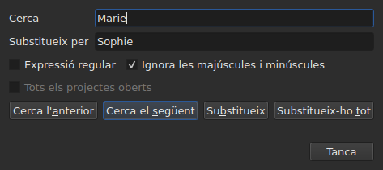
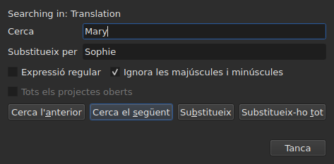

# Cercar i substituir

<!-- machine-translated -->
> Aquesta pàgina és una traducció automàtica i encara no l'ha revisada cap lector de la llengua.

`Edita ▸ Cerca i substitueix…`, o `Ctrl+F`, obre el diàleg de cerca.




**El diàleg no és modal**: es queda obert mentre mireu la taula,
editeu una cel·la, torneu a cercar. `Close` el tanca; tornar-lo a obrir
el retorna tal com l'havíeu deixat, patró i substitució inclosos.

| Camp | Què porta |
| :---- | :-------------- |
| `Find` | el patró que es cerca |
| `Replace with` | el que el substitueix |
| `Regular expression` | el patró és una expressió regular en lloc de text pla |
| `Ignore case` | «marie» troba «Marie» |
| `All open projects` | la cerca recorre totes les pestanyes — [vegeu més avall](#en-tots-els-projectes-oberts) |

L'entrada està desactivada en un document buit: no hi ha res per cercar.

## Els quatre gestos

| Botó | Què fa |
| :----- | :----------- |
| `Find Previous` | troba la coincidència anterior, i la taula hi va |
| `Find Next` | troba la següent — és el botó que prem `Enter` |
| `Replace` | substitueix la coincidència trobada, i després troba la següent |
| `Replace All` | substitueix totes les de l'objectiu |

Tots quatre estan desactivats mentre `Find` és buit.

**La taula va a la coincidència** seleccionant-ne la línia. Un cop arribat a
l'última, `Find Next` torna a començar per la primera; `Find Previous` fa el mateix en
l'altre sentit.

**`Replace` sense cap coincidència trobada primer cerca**: la primera pulsació
mostra el que se substituirà, la següent ho substitueix. És el que
fa Gaupol.

## Què abasta la cerca

**La selecció, o el document sencer si no hi ha res seleccionat** — la regla del
menú `Tools`. Vegeu [Les operacions](operations.md#a-què-sapliquen).

**L'objectiu es pren en el primer gest i es conserva** mentre la cerca
continua: `Find Next` selecciona la línia d'una coincidència, i aquesta
selecció no redueix l'objectiu. **Seleccionar vosaltres mateixos altres línies
canvia l'objectiu** per al gest següent.

La cerca abasta el text dels subtítols; no es cerquen ni les posicions ni el
número.

### En tots els projectes oberts

La casella **`All open projects`** amplia l'abast a totes les pestanyes. **Desactivada amb
un sol projecte obert** — no hi ha res per ampliar —, s'activa tan bon punt s'obre una
segona pestanya, i es desmarca sola quan només en queda una.

**Marcada, la selecció ja no compta**: cada projecte es cerca sencer,
en **el document a què s'adreça** — el de la columna actual, el principal o la
traducció, com per a un sol projecte.

- **`Find Next` i `Find Previous` van de pestanya en pestanya, en l'ordre de les
  pestanyes.** Primer el projecte mostrat; quan ja no té més coincidències, el
  següent, la pestanya del qual mostra la finestra i la línia del qual selecciona.
- **La volta acaba on ha començat**: quan la cerca passa més enllà de l'última
  pestanya per tornar a la primera — o a l'inrevés quan puja —, la línia del
  diàleg ho diu, en lloc de tornar a començar sense dir res:

  ```text
  Search wrapped around
  ```

  El pas següent és un pas ordinari, i la línia s'esborra.
- **`Replace` substitueix allà on és la cerca**, i després passa a la coincidència
  següent, que pot ser en una altra pestanya.
- **`Replace All` recorre tots els projectes**, i **fa una entrada de l'historial
  per projecte tocat**: desfer en una pestanya només desfà el que ha rebut aquesta
  pestanya. El recompte diu quants projectes han canviat, no només quantes
  substitucions:

  ```text
  replaced 4 matches in 3 projects
  ```

  Un projecte on el patró és absent no es toca, i no té res per desfer.
  **Cap pestanya no passa al davant**: cada projecte rep les seves substitucions
  darrere la seva pestanya, que pren el seu asterisc, i la pestanya des d'on ha
  començat el gest continua mostrada, amb la seva pel·lícula.

### En quin text

**Amb una traducció, la cerca només abasta un dels dos textos: el de
la columna de la cel·la actual** — la traducció si la cel·la actual és
a la columna `Translation`, el text principal a tot arreu més. És la
regla de totes les operacions de text, i no hi ha cap paràmetre addicional:
vegeu [El text a què s'adrecen les operacions](table.md#el-text-a-què-sadrecen-les-operacions).

**El diàleg diu en quin text cerca**, en una línia damunt de
`Find`, i la canvia quan canvia la columna actual — fins i tot mentre és obert:




| La cel·la actual és a | La línia diu |
| :--------------------- | :------------ |
| la columna `Translation` | `Searching in: Translation` |
| qualsevol altra columna | `Searching in: Main` |
| — el projecte no té traducció, o la columna s'ha tret | res: la línia no hi és |

**Substituir escriu en aquest text, i només en aquest.** `Replace` i `Replace
All` sobre la traducció deixen el text principal tal com era, i
a l'inrevés; `Undo` torna el que han escrit. **Les etiquetes són les del format
del fitxer d'aquest text**: una traducció en Advanced SSA es llegeix amb els seus
`{\i1}`, fins i tot quan el text principal és un SubRip. `Replace with` s'hi escriu
amb les mateixes etiquetes.

**La taula es queda a la columna on era.** `Find Next` selecciona la línia
d'una coincidència sense moure la cel·la actual d'una columna a l'altra:
una cerca començada a la traducció continua a la traducció.

**Cercar els dos textos alhora no existeix**: cada coincidència
seria un parell (subtítol, text), i la taula que hi anés no tindria
cap lloc clar on anar. Es cerca en un, i després es canvia de columna.

**Què torna a començar de zero**:

| Gest | Què s'oblida |
| :------ | :---------------- |
| canviar `Find`, `Replace with` o una opció | la coincidència actual, i la línia d'estat |
| seleccionar vosaltres mateixos altres línies | l'objectiu i la coincidència |
| moure la cel·la actual d'un text a l'altre — de `Text` a `Translation`, o a l'inrevés | la coincidència: és un lloc en un text |
| obrir un altre fitxer | l'objectiu i la coincidència; el diàleg continua obert, patró inclòs |

## El text cercat és el text visible

**Les etiquetes no són text.** Cercar `<i>` no troba res, i cercar
`Bonjour` troba un `<i>Bon</i>jour` tallat per una etiqueta.

**La substitució es fa al text del fitxer, sense trencar les etiquetes**:

| Text | Cercat → posat al seu lloc | Què s'escriu |
| :--- | :-------------------------- | :-------------- |
| `<i>Bonjour</i>` | `Bonjour` → `Salut` | `<i>Salut</i>` |
| `<i>Bon</i>jour` | `Bonjour` → `Salut` | `<i>Salut</i>` |
| `<i>Bonjour</i> Marie` | `Bonjour Marie` → `Salut Sophie` | `<i>Salut Sophie</i>` |

Una etiqueta que talla una paraula abasta la paraula sencera, i qualsevol estil que toca la
coincidència cobreix la substitució. **Les etiquetes que la coincidència no
toca es queden on són**, fins i tot una que talla una altra paraula del mateix
subtítol: substituir `Marie` a `<i>Bon</i>jour Marie` dona
`<i>Bon</i>jour Sophie`. Una paraula està feta de lletres i xifres — un espai
indivisible o unes cometes no en formen part. **`Replace with` es llegeix amb les etiquetes del
text a què s'adreça**: escriure-hi `<b>Salut</b>` en un SubRip posa la paraula en negreta.

## Les dues opcions

| Opció | Per defecte | Què canvia |
| :----- | :------ | :-------------- |
| `Regular expression` | no marcada | `.` ja no cerca un punt sinó qualsevol caràcter |
| `Ignore case` | marcada | les majúscules i minúscules no compten, lletres accentuades incloses: `élise` troba `Élise` |

Són els valors per defecte de Gaupol. **Totes dues es recorden** d'una obertura a
la següent i d'una sessió a la següent, a les opcions `search.regex` i
`search.ignore-case` del [fitxer de preferències](preferences.md#el-fitxer).

### Una expressió regular

El patró el llegeix ICU. Com a Gaupol, `.` travessa un salt de línia, i `^`
i `$` s'apliquen a l'inici i al final **de cada línia** d'un subtítol:
substituir `^` per `- ` posa un guió davant de cada línia.

A `Replace with`, i només per a una expressió regular:

| S'escriu | Què posa |
| :------ | :----------- |
| `$1` a `$9` | el grup d'aquest número; un grup absent no posa res |
| `$0` | la coincidència sencera |
| `\n` | un salt de línia |
| `\$`, `\\` | un `$`, una barra inversa |
| `\` seguida de qualsevol altre caràcter | aquest caràcter: `\t` posa una `t` |

**`\1` no és un grup**, i posa un `1`. És la sintaxi de Gaupol, que llegeix
les seves expressions en Python; la d'aquí és la d'ICU, que llegeix el patró.

## Què diu el diàleg

Sota els botons, una línia diu el que la cerca no ha pogut fer, o el que ha fet
un `Replace All`:

| Situació | Què es mostra |
| :-------- | :------------ |
| cap coincidència a l'objectiu | `"Sophie" not found` |
| una expressió regular que no es pot llegir | `not a regular expression (U_REGEX_MISMATCHED_PAREN)` |
| `Replace All` ha substituït | `replaced 3 matches` |
| `Replace All` ha trobat el patró, però la substitució no canvia cap text | `nothing to change` |

**Una cerca que no troba res no toca res**: la selecció es queda on
era, i no entra res a l'historial.

**`not found` i `nothing to change` no diuen el mateix.** `not found`
diu que el patró no és enlloc de l'objectiu. `nothing to change` diu que
hi és, però que la substitució deixa cada text tal com era — substituir
`Marie` per `Marie`, per exemple. En tots dos casos no entra res a
l'historial. El nombre de `replaced N matches` compta les coincidències dels
subtítols el text dels quals ha canviat.

## Què en diu l'acció de desfer

| Gest | Què llegeix `Undo` |
| :------ | :---------------- |
| `Replace` | `Undo: replacing` — una per substitució |
| `Replace All` | `Undo: replacing all` — **una sola entrada**, sigui quin sigui el nombre de coincidències |

Vegeu [Desfer i refer](undo.md).
