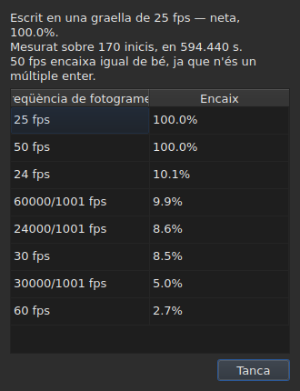

# La graella de fotogrames

<!-- machine-translated -->
> Aquesta pàgina és una traducció automàtica i encara no l'ha revisada cap lector de la llengua.

Un fitxer de subtítols **no declara** la freqüència de fotogrames a partir de la
qual es van calcular les seves posicions: SubRip no té capçalera, la de
WebVTT és text lliure. La finestra la **dedueix** de les mateixes posicions,
en obrir el fitxer, i la mostra en dos llocs que no responen la mateixa
pregunta.

| Superfície | Què dona |
| :------ | :------------ |
| la barra d'estat | **la resposta**, permanentment i sense que se li demani |
| `Eines ▸ Anàlisi de la freqüència de fotogrames…` | **el raonament**, quan el voleu veure |

## Què mostra la barra d'estat

A la dreta, entre el que diu de la
[codificació](files.md#la-codificació-a-la-barra-destat) del fitxer llegit i el que
diu del [vídeo associat](video.md#què-mostra-la-barra-destat):

| Situació | Què s'escriu |
| :-------- | :-------------- |
| les posicions són en una graella | `Grid: 24 fps` |
| només algunes | `Grid: 29.97 fps (partial)` |
| no hi encaixa cap graella coneguda | `No grid` |

**`No grid` no anomena cap freqüència de fotogrames, i és volgut.** El conjunt de
candidates és tancat — les vuit que ofereix el diàleg de conversió — i
indicar la menys errònia seria donar una resposta errònia allà on
«no ho sé» és la correcta.

**`No grid` té dues causes, i no són la mateixa resposta.** O bé no hi encaixa
cap graella, o bé el fitxer té massa pocs subtítols per poder-ne dir
res — dos inicis sempre semblen perfectament alineats, i això no demostra
res. La barra d'estat diu el mateix de tots dos casos;
**l'anàlisi els distingeix**, i en el primer cas indica per quant falla la
millor candidata.

La línia **s'actualitza després de cada operació**. Alinear un fitxer a una altra
freqüència de fotogrames canvia la graella, i la barra d'estat no ha de continuar
anunciant l'antiga.

### Un document comptat en fotogrames no té graella, té una freqüència de fotogrames

**MicroDVD és l'únic dels nou que compta en fotogrames.** Cadascuna de les seves línies
porta dos números de fotograma i res més, i el fitxer **no diu** a quina
freqüència de fotogrames s'han de llegir. El mateix lloc de la barra d'estat escriu llavors:

| Situació | Què s'escriu |
| :-------- | :-------------- |
| el document es compta en fotogrames | `Frames: 24000/1001 fps` |

**No és la graella, i aquí la graella seria circular.** Les posicions
d'un document MicroDVD es van calcular *a partir dels* seus fotogrames a aquesta mateixa
freqüència; deduir-ne una graella tornaria aquest nombre, és a dir, una dada
disfressada de mesura.

**D'on prové es diu una sola vegada**, en la lectura, a la
[llista de diagnòstics](files.md#els-diagnòstics-duna-lectura):
`counts in frames and states no rate; it was read at ("24000/1001")`. La línia de la
barra d'estat, per la seva banda, diu el que és, permanentment.

**Equivocar-se de freqüència de fotogrames desplaça tot el fitxer**, i el
diàleg [`Convert Frame Rate…`](operations.md#convert-frame-rate) és on es corregeix:
s'obre a la freqüència de lectura i diu que és aquesta.

## Què mostra l'anàlisi

`Eines ▸ Anàlisi de la freqüència de fotogrames…` **no modifica res.** S'obre amb un resum i
la classificació de les vuit candidates amb la seva puntuació.




El resum dona la resposta, i després el que la matisa — cada frase només
apareix si té alguna cosa a dir:

| Què s'hi pot llegir | Quan |
| :--------------------- | :--- |
| sobre quants inicis, i sobre quin abast | sempre |
| quant es desvia el fitxer de la seva graella | les seves posicions hi són llevat d'una constant |
| que una altra freqüència de fotogrames hi encaixa igual de bé | és un múltiple enter de la retinguda |
| que l'abast no permet distingir dues freqüències de fotogrames | el fitxer és massa curt per separar-les |
| quants inicis surten de la graella, **i en quantes sèries** | el fitxer és parcial |

**El nombre de sèries és el que distingeix dues històries** que el
percentatge sol confon. Moltes sèries d'un sol inici són posicions
corregides a mà, una per una. Unes poques sèries llargues són una secció
resincronitzada, o un fitxer muntat a partir de dos altres.

**Es mostra la classificació completa en lloc d'una sola resposta.** Un fitxer que
encaixa amb 25 al cent per cent i amb 50 al cent per cent diu una cosa que un
veredicte sol amagaria.

## Quan la conversió era errònia

Un fitxer que no cau en cap graella és de vegades un fitxer que es va **convertir a una
freqüència de fotogrames equivocada**: llavors és en una graella ben real, però desplaçada per una raó que no és la de
cap de les vuit. Quan la deducció retorna `none` o `partial`, l'anàlisi cerca **entre els
cinquanta-sis parells ordenats de les vuit freqüències de fotogrames estàndard** — aquest és el conjunt, tancat — aquell
la conversió del qual torna a posar les posicions en una graella. Cada raó s'aplica a les posicions, i
**és la mateixa deducció la que jutja el resultat**: la confiança és la que ella diria, mai un
nombre inventat. Dos parells que donen la mateixa raó, com ara 30 a 25 i 60 a 50, són una sola
conversió.

La frase s'afegeix al resum:

```text
converting from 24 to 25 fps puts the positions on a 24 fps grid: 99.9%, against 11.8% as they are and 14.9% for the next best conversion
```

Dona la conversió, la graella on cauen les posicions i com hi cauen de bé,
**i després la diferència amb les posicions tal com són i amb la millor de les altres
conversions.** Un botó `Convert Frame Rate…` tanca l'anàlisi i obre [el diàleg de
conversió](operations.md#convert-frame-rate) **emplenat amb el parell trobat** — no s'aplica res
mentre no s'accepta el diàleg, i n'hi ha prou de cancel·lar per tornar enrere. El vídeo, obert al costat,
permet jutjar sobre la imatge si la resposta és la bona.

**Quan dos parells són igual de bons, no se'n proposa cap, i la frase ho diu:**

```text
converting from 30 to 25 fps and converting from 25 to 24 fps fit equally well (99.7% and 99.6%), so none is proposed
```

És el cas ordinari més que no pas l'excepció: una graella a 28,8 fotogrames per segon torna
a 24 tan bé com a 30, i un fitxer amb tots els temps duplicats es queda a la graella de 25.
El gest que té una sola reparació és convertir un fitxer que **ja** és a la freqüència de destinació. En
cas d'empat, decideix el vídeo: obriu vosaltres mateixos `Convert Frame Rate…` amb un dels dos parells.

**No es diu res** d'un fitxer que ja és en una graella, d'un fitxer massa curt perquè un veredicte
valgui res, ni d'un fitxer que cap conversió del conjunt no torna a posar en una graella — una deriva, una
raó fora de les vuit freqüències, posicions sense estructura.

## Què no mostra la taula

**Cap línia de la taula no es marca a causa de la graella**, mai.

Tan bon punt corregiu una posició a mà, deixa d'estar alineada. Un
marcatge automàtic indicaria, per tant, la feina de l'usuari com una
anomalia, en un fitxer que precisament està corregint. La deducció
parla del **document**, i l'anàlisi és l'única excepció — perquè l'heu
obert per a això.

Les marques de la taula, per la seva banda, afecten el que no es manté: un final
abans del seu inici, un encavalcament, un ordre trencat. Vegeu [La taula](table.md).
