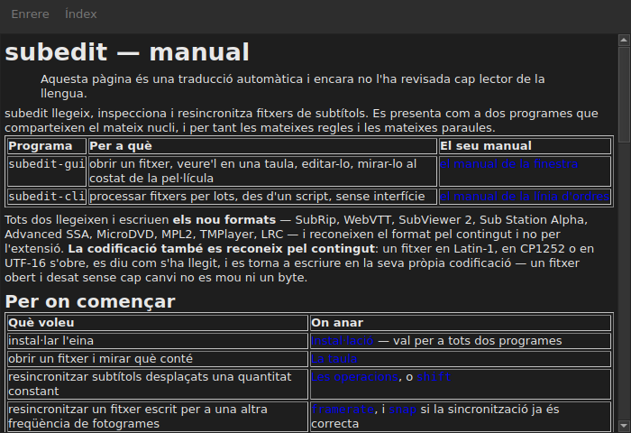

# El manual a la finestra

<!-- machine-translated -->
> Aquesta pàgina és una traducció automàtica i encara no l'ha revisada cap lector de la llengua.

`Ajuda ▸ Manual`, o `F1`, obre **aquest mateix manual** en una finestra pròpia.




## Què obre, i per què no una adreça

**El manual instal·lat al costat del programa**, no una pàgina d'Internet.

Una adreça descriuria la versió en desenvolupament, no la que teniu a mà.
Un usuari que llegeix el manual d'una versió que no té està pitjor servit que un
usuari sense cap manual — per això la finestra llegeix els fitxers que deixa
la instal·lació, a `<prefix>/share/subedit/manual`. Vegeu
[Instal·lació](../subedit-cli/installation.md).

S'obre a la [pàgina d'inici](../index.md), la que diu per on començar.

## En quina llengua

**En la llengua de la finestra.** El manual s'obre en la llengua que parla
la interfície: la triada a `Edita ▸ Preferències…`, o si no la de
l'entorn — vegeu
[La llengua de la interfície](preferences.md#la-llengua-de-la-interfície).

| La finestra parla | El manual s'obre en |
| :---------------- | :------------------ |
| anglès | anglès |
| una llengua el manual de la qual està instal·lat — català, txec, alemany, espanyol, finès, francès, gallec | aquesta llengua |
| una llengua el manual de la qual no està instal·lat | anglès |

**Pàgina per pàgina, no tot o res**: una pàgina que la traducció no té
s'obre en anglès, i totes les altres pàgines es queden en la llengua de la finestra. Un
enllaç porta de l'una a l'altra de la mateixa manera.

Les traduccions s'instal·len al costat del manual anglès, cadascuna en un directori
que porta el nom de la seva llengua: `<prefix>/share/subedit/manual/fr` per al francès. La
llengua és aquella amb què ha arrencat la finestra, de manera que una llengua triada a les
preferències s'aplica també al manual, al següent inici.

## Navegar

| Què feu | Què passa |
| :---------- | :----------- |
| feu clic en un enllaç del manual | la pàgina s'obre a la mateixa finestra |
| feu clic en un enllaç que apunta a una secció | la pàgina s'obre, i la finestra s'hi desplaça |
| feu clic en un enllaç que només apunta a una secció | la finestra s'hi desplaça, sense canviar de pàgina |
| `Back` | torna a la pàgina anterior; desactivat a la primera |
| `Contents` | torna a la pàgina d'inici; desactivat quan hi sou |

La finestra **no és modal**: es queda oberta mentre treballeu, que és tot el
sentit de tenir el manual a mà. Tornar a triar l'entrada no crea una
segona finestra, sinó que porta aquesta al davant.

## Què no pot obrir, i ho diu

El manual de vegades remet al **full de ruta** o a una **decisió
d'arquitectura**. Són documents del repositori, no del paquet: no
s'instal·len, i la finestra ho diu amb paraules clares en lloc de deixar el
clic sense efecte.

```
../../feuille-de-route.md is not part of the installed manual;
it lives in the project's repository.
```

Es poden llegir al repositori, l'adreça del qual és a `Ajuda ▸ Quant a subedit`.

## Quan l'entrada està desactivada

**`Ajuda ▸ Manual` està desactivada quan no hi ha cap manual al costat del programa.** Dos
casos, i cap dels dos no és una avaria:

| Cas | Per què |
| :--- | :-- |
| el binari s'executa des del seu arbre de compilació | no s'hi ha instal·lat res, per tant no hi ha res per llegir |
| la instal·lació és parcial | el manual s'ha suprimit, o no s'hi ha copiat mai |

Passar per sobre de l'entrada indica quin dels dos: «No hi ha cap manual instal·lat al costat
d'aquest programa».

Una pàgina que falta mentre el manual hi és — un fitxer suprimit a mà — no
tanca la finestra: anomena el fitxer que no ha pogut llegir i manté a la pantalla el que
mostrava.

## On es cerca el manual

**Al costat de l'executable**, a `../share/subedit/manual` — la disposició que produeix tota
instal·lació, sigui quin sigui el prefix. Això és el que permet a una instal·lació
a `~/.local` trobar el seu manual igual que un paquet instal·lat a `/usr`.
