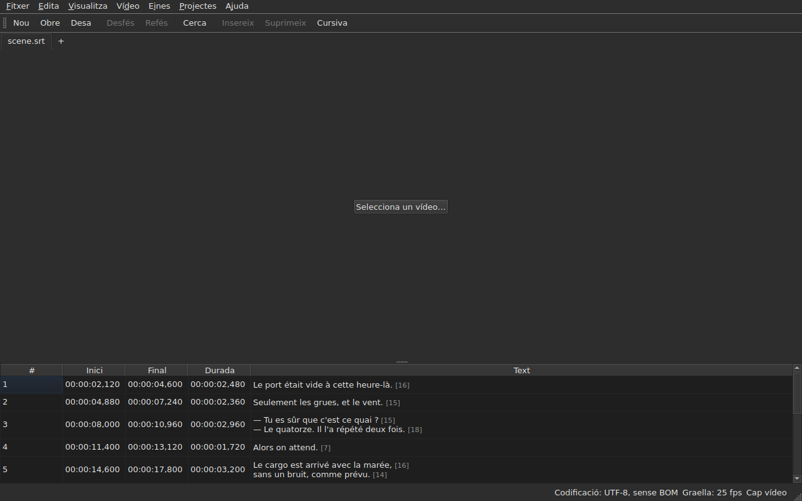

# subedit-gui — manual

<!-- machine-translated -->
> Aquesta pàgina és una traducció automàtica i encara no l'ha revisada cap lector de la llengua.

La finestra de subedit: obrir un fitxer de subtítols i veure'l en una taula. Per a
l'altre programa i per saber per on començar, vegeu [el manual](../index.md).

> **Estat actual.** La finestra **obre diversos fitxers, una pestanya cadascun**, sigui
> quina sigui la seva codificació — amb `Open…` o deixant-los anar a sobre —, **els mostra**,
> **edita les seves cel·les**, **insereix i suprimeix línies**,
> **desfà**, **desa — triant la codificació, els finals de línia i la
> marca d'ordre de bytes** —, i **marca els subtítols les posicions dels quals
> no són coherents**. **Fusiona i divideix** línies, **retalla,
> copia i enganxa** textos, i **cerca i substitueix** en el text visible
> sense trencar les etiquetes, en un projecte o en tots. **Obre una traducció
> al costat del fitxer principal**, alineada per posició o per número, en una columna més,
> i la desa per separat. El menú `Tools` porta setze operacions i dues entrades d'ortografia —
> desplaçar, transformar, convertir la freqüència de fotogrames, ajustar les durades,
> **afegir un fitxer al final, dividir el projecte en dos**, posar en
> cursiva, afegir guions de diàleg, canviar les majúscules i minúscules de quatre maneres,
> suprimir les mencions per a persones sordes, **corregir textos amb un
> assistent de diverses pàgines**, **comprovar l'ortografia paraula per paraula**, alinear a una freqüència de fotogrames, tornar a portar
> a la graella — i l'anàlisi de la graella, que no modifica res. El menú `Projects`
> **ho desa i ho tanca tot** d'un sol gest. **Associa un vídeo
> al document**, triat o endevinat, i **el reprodueix a la finestra**, amb la línia
> actual dibuixada sobre la imatge; **fixa un inici, un final o un
> subtítol a partir de la posició de la pel·lícula**, **avança fotograma a fotograma** i **mou una vora un fotograma**. La barra de reproducció **salta, regula el
> volum i la posició**, la taula **segueix la reproducció** sense desfer un desplaçament manual, les posicions
> es poden mostrar **en fotogrames**, i el menú `Video` **tria la pista d'àudio**. Dues deteccions
> **proposen sense aplicar mai res**: una traducció desplaçada una quantitat constant, que es pot **tornar a obrir
> desplaçada**, i la conversió de freqüència de fotogrames que torna a posar un fitxer en una graella. **Recorda la seva geometria, l'ordre, l'amplada i la presència de les seves
> columnes, i la seva configuració** d'una
> sessió a l'altra, i es presenta **clara o fosca**, com vulgueu. `Ajuda ▸ Manual`
> obre **aquest manual** en una finestra. Aquest manual descriu el que existeix, mai
> el que està previst; el que ve després és al
> [full de ruta](../../../../feuille-de-route.md).

> **Les imatges d'aquest manual es generen, la prosa no.** Els exemples de
> `subedit-cli` es generen executant l'ordre; les captures de pantalla
> es generen construint la finestra real i fotografiant-la — `make
> manual` fa totes dues coses. Per tant, una imatge no pot descriure una interfície que
> ja no existeix, i una interfície que canvia es veu al diff
> del repositori. El que queda sense xarxa de seguretat és el text que les envolta, l'exactitud
> del qual depèn de la revisió.

**Cada pantalla es mostra dues vegades, amb les dues paletes que defineix
l'aplicació** — `Light` i `Dark`, les que ofereixen
[les preferències](preferences.md#el-tema). En un escriptori el
tema del qual mana, `System` dona l'una o l'altra segons el que hagi triat l'escriptori.

## Els menús

`File`, `Edit`, `View`, `Video`, `Tools`, `Projects`, `Help` — en l'ordre en
què els feu servir: el document, el que li feu, com el mireu, el que
l'acompanya, el que l'examina, el que val per a tots els projectes oberts, el que
l'explica.

`View` porta un submenú, `Columns`, una entrada marcable per columna excepte `Text`
— vegeu [La taula](table.md#amagar-i-moure-les-columnes) — i un paràmetre, `Positions in Frames`, que mostra
`Start` i `End` com a números de fotograma — vegeu [Les posicions en fotogrames](table.md#les-posicions-en-fotogrames).

`Projects` porta dues entrades, `Save All` i `Close All` — vegeu
[El menú Projectes](files.md#el-menú-projectes).

`Edit` porta cinc blocs, cadascun sota un separador: desfer; el
porta-retalls — retallar, copiar, enganxar textos; `Find and Replace…`;
inserir, suprimir, fusionar i dividir línies; finalment
`Preferences…`. Desfer és el que feu *a* una edició, moure un text
no afegeix ni suprimeix cap línia, les quatre del bloc següent canvien el nombre de
línies, i definir el tema no és pas una edició.

**Les tecles s'anomenen com les mostra el menú**, en anglès com la resta
de la interfície: `Ins`, `Del`, `Ctrl+Shift+Z`. Una tecla que premeu i
que cap menú no anomena conserva el seu nom anglès: `Enter`, `Esc`, `Shift`.

`Help` porta dues entrades, en l'ordre en què les mostra el menú. `Manual`, o
`F1`, obre aquest manual en una finestra — vegeu
[El manual a la finestra](help.md). `About subedit` indica la versió, la
llicència, i les biblioteques amb què funciona la finestra, amb les seves versions — vegeu
[`--version`](invocation.md#--version).

## La barra d'eines

Sota els menús, una barra porta **els gestos més freqüents**, en grups.
Cada botó mostra una paraula curta; el menú conserva l'entrada sencera, i la
drecera és la mateixa.

| Botó | Entrada del menú | Drecera |
| :----- | :--------- | :------- |
| Nou | Fitxer ▸ Projecte nou | `Ctrl+N` |
| Obre | Fitxer ▸ Obre… | `Ctrl+O` |
| Desa | Fitxer ▸ Desa | `Ctrl+S` |
| Desfés | Edita ▸ Desfés | `Ctrl+Z` |
| Refés | Edita ▸ Refés | `Ctrl+Shift+Z` |
| Cerca | Edita ▸ Cerca i substitueix… | `Ctrl+F` |
| Insereix | Edita ▸ Insereix subtítols… | `Ins` |
| Suprimeix | Edita ▸ Suprimeix els subtítols | `Del` |
| Cursiva | Eines ▸ Cursiva | `Ctrl+I` |

**Un botó desactivat ho està per la mateixa raó que la seva entrada**: `Undo` sense
res a desfer, `Remove` sense cap línia triada. Les entrades de la traducció
i les operacions del menú `Tools`, excepte `Italic`, es queden als seus
menús: es fan servir menys sovint, o no tothom les fa servir.

## Seccions

| Secció | Contingut |
| :------ | :------- |
| [Instal·lació](../subedit-cli/installation.md) | compilar i instal·lar — la pàgina val per a tots dos programes |
| [Invocació](invocation.md) | iniciar la finestra, arguments, codis de sortida |
| [Obrir i desar](files.md) | les ordres, les pestanyes, el menú `Projects`, deixar anar fitxers, la traducció i tornar-la a obrir desplaçada, els diagnòstics, la codificació a la barra d'estat, el viatge d'anada i tornada, el tancament |
| [La taula](table.md) | què mostra cada columna, amagar-les i moure-les, les posicions en fotogrames, la columna de traducció i el text a què s'adrecen les operacions |
| [Editar una cel·la](editing.md) | quines cel·les es poden editar, i com |
| [Retallar, copiar i enganxar textos](clipboard.md) | les tres entrades, què viatja, les línies afegides, les etiquetes traduïdes |
| [Cercar i substituir](find-and-replace.md) | el diàleg, els quatre gestos, les dues opcions, què abasta la cerca, en tots els projectes oberts |
| [Inserir, suprimir, fusionar i dividir línies](lines.md) | les quatre entrades, les seves dreceres, on van les línies noves |
| [Desfer i refer](undo.md) | l'historial, les dues accions, la marca de modificació |
| [La graella de fotogrames](frame-grid.md) | la freqüència de fotogrames deduïda de les posicions, l'anàlisi, i la conversió que torna a posar un fitxer en una graella |
| [Les operacions](operations.md) | desplaçar, transformar, convertir, ajustar les durades, afegir un fitxer, dividir el projecte, posar en cursiva, les majúscules i minúscules, els guions, suprimir les mencions, alinear, tornar a portar a la graella, i el que passa del final de la pel·lícula |
| [Corregeix els textos…](correct-texts.md) | l'assistent de correcció: l'objectiu i les tasques, cada pàgina de tasca, el progrés, la confirmació |
| [Comprova l'ortografia…](check-spelling.md) | la comprovació ortogràfica: la seva configuració, el recorregut, tancar a mig camí, l'absència de diccionari |
| [El vídeo associat](video.md) | triar un vídeo, la proposta automàtica, la pista d'àudio, la barra d'estat, `ffmpeg` |
| [El reproductor](player.md) | la vista de vídeo, la barra de reproducció, reproduir, moure's, el volum, la taula que segueix, la línia dibuixada |
| [Sincronitzar des del vídeo](timing.md) | fixar l'inici o el final d'un subtítol, inserir, seleccionar a partir de la posició de la pel·lícula, avançar fotograma a fotograma, moure una vora |
| [Les preferències](preferences.md) | el tema, el fitxer de preferències, les seves opcions, i què passa amb un valor il·legible |
| [El manual a la finestra](help.md) | `Ajuda ▸ Manual`, què obre i com s'hi navega |
