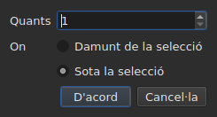

# Inserir, suprimir, fusionar, dividir, ordenar i fer disjuntes les línies

<!-- machine-translated -->
> Aquesta pàgina és una traducció automàtica i encara no l'ha revisada cap lector de la llengua.

Vuit entrades del menú `Edit`, sota un separador que les distingeix de
`Find and Replace…`. Quatre tenen en comú que canvien el nombre de línies, mentre que
retallar, copiar i enganxar, més amunt, mouen textos; `Sort Subtitles` només canvia
**l'ordre** de les línies, `Join Repeated Subtitles` torna a fer un sol
subtítol dels trossos consecutius d'un mateix text, i `Make Ranges Disjoint…`
els torna a tallar allà on s'encavalquen.

| Entrada | Drecera | Què fa |
| :---- | :------- | :----------- |
| Insereix subtítols… | `Ins` | obre un diàleg, i després afegeix línies en blanc |
| Suprimeix els subtítols | `Del` | suprimeix la selecció, sense preguntar res |
| Fusiona els subtítols | cap | fa una sola línia d'un bloc de línies veïnes |
| Divideix el subtítol | cap | talla una línia en dues al mig de la seva durada |
| Uneix els subtítols repetits | cap | fa un sol subtítol dels trossos consecutius d'un mateix text |
| Ordena els subtítols | cap | torna a posar les línies en l'ordre del seu inici, sobre tot el projecte |
| Fes disjuntes les franges… | cap | talla les línies que s'encavalquen perquè cap franja no se n'encavalqui amb una altra |
| Repara els subtítols… | cap | encadena les tres entrades precedents — unir les repeticions, ordenar, tallar les franges — d'una sola vegada |

Totes vuit entren a l'historial: `Ctrl+Z` les desfà com la resta.

## Inserir

| Camp | Què conté | Per defecte |
| :---- | :------------ | :------ |
| `How many` | un nombre enter d'1 a 99.999 | `1` |
| `Where` | `Above the selection` o `Below the selection` | l'última elecció, `Below` en el primer llançament |

`OK` afegeix les línies, `Cancel` no afegeix res.

### On van

**A l'última seleccionada**, no a la primera. Seleccionar les línies 1 i 3
i després inserir a sota posa la línia nova a la posició 4 — no a la
posició 2. És el que Gaupol fa des de fa vint anys, i el que la mà
espera després d'escombrar de dalt a baix.

`Above the selection` la posa just abans d'aquesta mateixa línia.

### Quant duren

Una línia en blanc no té text, però té posicions. Es dedueixen
de l'espai disponible:

| Situació | Inici | Durada |
| :-------- | :---- | :------- |
| entre dos subtítols | el final de l'anterior | l'espai fins al següent, repartit a parts iguals |
| després de l'últim | el final de l'últim | tres segons cadascuna |
| al començament d'un fitxer | l'origen | l'espai fins al primer, repartit |
| en un fitxer buit | l'origen | tres segons cadascuna |

Quan el fitxer s'encavalca al lloc triat, **no hi ha espai per
repartir**: les línies reben una durada nul·la, que la taula mostra, en lloc
d'una durada inventada que passaria per sobre del veí.

### El document buit

**No cal cap selecció**, i és l'única manera de començar un
fitxer nou: les línies van a l'índex zero. L'elecció del costat queda llavors desactivada
al diàleg — no hi ha cap selecció respecte a la qual situar-les.

Tan bon punt el document porta una línia, l'entrada `Insert Subtitles…` **queda desactivada mentre
no hi hagi res seleccionat**: sense selecció, l'índex s'endevinaria.

### Després

Les línies afegides queden **seleccionades**, i la taula hi va. Prémer
`Ins` una segona vegada, per tant, insereix després d'elles, sense haver de fer clic entre
les dues.

### El costat es recorda

`Above` o `Below` es recorda **d'una inserció a la següent, i d'una sessió a
la següent**: és l'opció `edit.insert-placement` del
[fitxer de preferències](preferences.md#el-fitxer). No s'insereix una vegada,
s'insereixen deu línies seguides, sempre del mateix costat.

## Suprimir

`Remove Subtitles`, o `Del`, suprimeix les línies seleccionades — inclosa una
selecció discontínua, i cada línia torna al seu lloc si desfeu.

**No es demana cap confirmació**, i no és un descuit:
l'operació es desfà amb `Ctrl+Z`. Un quadre modal abans d'un gest que es pot desfer
costaria un clic cada vegada per estalviar un `Ctrl+Z` de tant en tant.

**L'entrada està desactivada quan no hi ha res seleccionat.** A la resta de la finestra,
«res seleccionat» vol dir «tot el fitxer» — és el que fa que un
desplaçament sigui útil sense seleccionar quatre mil línies. Aquí, aquesta lectura
buidaria un document amb un `Del` desafortunat, i per això no s'ofereix.

Després de la supressió, **queda seleccionada la línia que ha pres el lloc de la primera suprimida**
— o l'última que queda, si la supressió s'ha endut el final del
fitxer. Prémer `Del` diverses vegades seguides, per tant, suprimeix les línies una
per una.

Un fitxer buidat del tot deixa la finestra utilitzable: `Insert Subtitles…`
torna a estar activada, ja que en un document buit s'insereix sense selecció.

## Fusionar

`Merge Subtitles` fa **una sola línia** de les línies seleccionades:

| Què rep la línia fusionada | D'on prové |
| :---------------------------- | :------------------ |
| el seu inici | l'inici de la primera |
| el seu final | el final de l'última |
| el seu text | els textos de totes, en ordre, amb un salt de línia entre dos |
| la seva traducció | les traduccions, unides de la mateixa manera |
| el que el format porta a més — un estil, una capa, unes coordenades | la primera |

**Un text buit no deixa cap línia buida**: fusionar `Un.`, una línia sense
text i `Trois.` dona dues línies de text, no tres.

Les línies fusionades desapareixen, i la línia que les substitueix pren el lloc
de la primera.

**L'entrada està desactivada** mentre la selecció no sigui **un bloc d'almenys
dues línies veïnes**. Una sola línia no té res amb què fusionar-se; les línies
1 i 3 sense la 2 tampoc, ja que el resultat passaria per sobre de la 2 i
la cobriria.

Després de la fusió, **queda seleccionada la línia fusionada**: `Split Subtitle` està
a punt per tornar-la a tallar.

## Dividir

`Split Subtitle` talla la línia seleccionada **al mig de la seva durada**, al
mil·lisegon:

| Meitat | Inici | Final | Text |
| :--- | :---- | :-- | :--- |
| la primera | l'inici original | el mig | **tot** el text, i la traducció |
| la segona | el mig | el final original | buit |

**El text no es talla pel seu salt de línia.** Seria correcte per a un
subtítol de dues línies i incorrecte per a un subtítol d'una línia o de tres;
tot el text es queda a la primera meitat, i sou vosaltres qui moveu el que ha
d'anar a la segona.

La primera meitat conserva el que el format portava a més del text; la segona
neix com una línia inserida, sense res.

**L'entrada està desactivada** mentre la selecció no compti **exactament una
línia**. Aquí, no tenir res seleccionat no vol dir «tot el fitxer».

Després de la divisió, **queden seleccionades totes dues meitats** — és el que Gaupol
fa després de qualsevol inserció, i `Merge Subtitles` està llavors a punt per desfer el
gest.

## Ordenar

`Sort Subtitles` torna a posar **tot el projecte** en l'ordre dels inicis. Mai la
selecció: un ordre és una propietat del document, i ordenar la meitat d'un
fitxer no vol dir res. L'ordenació és **estable**: dos subtítols que
comencen alhora conserven l'ordre que els donava el fitxer.

**Una barra avança a la barra d'estat durant l'ordenació, i el cursor esdevé un
rellotge de sorra**: en un fitxer llarg, la finestra deixa de respondre una estona — la
taula es reconstrueix línia per línia —, i sense això no sabríeu si hi ha alguna cosa
en curs. La barra no mostra cap fracció, l'ordenació no n'informa de cap,
i se'n va amb ella.

La barra d'estat diu quantes línies han canviat de lloc — `3 subtitles moved`
— o, quan tot era en ordre, `already in order`. **Un projecte que ja és en ordre
no entra a l'historial**: una operació que no canvia res no és
una operació per desfer. L'entrada està desactivada per a un projecte d'un sol subtítol.

Un fitxer **amb alguna cosa per corregir en obrir-se** ho ofereix per si sol,
[en un sol quadre](#en-obrir-un-sol-quadre): vegeu més avall. Els subtítols
mal situats també es [compten amb els diagnòstics](files.md#els-diagnòstics-duna-lectura),
perquè els trobeu sense recórrer la taula.

A la línia d'ordres, [`sort`](../subedit-cli/sort.md) fa el mateix amb
fitxers, i `--sort` ho fa de passada a
[`convert`](../subedit-cli/convert.md#ordenar-en-escriure),
[`append`](../subedit-cli/append.md#ordenar-el-resultat) i
[`split-file`](../subedit-cli/split-file.md#tallar-en-ordre-temporal).

## Unir els subtítols repetits

`Join Repeated Subtitles` fa **un sol subtítol** dels subtítols que mostren la
mateixa cosa seguida: un text tallat en trossos consecutius, tal com
el deixen algunes eines de segmentació. S'aplica a **tot el projecte**.

**Una repetició** té el mateix text, la mateixa traducció i la mateixa configuració de format
(un estil, una posició, uns paràmetres de cue) que un altre, **i comença com a
molt tard quan aquell acaba**. Una sèrie de repeticions esdevé el que comença
primer, amb el final més gran de la sèrie; els altres desapareixen.
`Alpha [1, 2]`, `Alpha [2, 4]` i `Alpha [4, 6]` donen `Alpha [1, 6]`.

- **L'ordre del fitxer no hi canvia res, i ella no el canvia**: el subtítol que es conserva
  és el que comença primer, siguin on siguin els altres.
- **No s'uneix res per error**: un altre text, una altra configuració, un interval
  entre dos trossos, un subtítol sense text o el final del qual precedeix el seu inici
  es queden separats.
- La barra d'estat diu el que s'ha fet — `2 repeated subtitles joined`, o
  `no repeated subtitles`.

**Cal fer-ho abans d'ordenar i de tallar**, que llegeixen millor una sèrie neta: un
text en tres trossos, més un altre text sobre tota la franja, donats fora
d'ordre, s'ordena i es talla en línies que salten d'un tros a l'altre; unit
primer, queda en ordre i es fusiona netament. El quadre de l'obertura, més avall, fa
totes tres coses en aquest ordre.

## Fer disjuntes les franges

`Make Ranges Disjoint…` talla els subtítols que s'encavalquen perquè **cap
franja `[start, end]` no se n'encavalqui amb una altra**. S'aplica a **tot el
projecte**, mai a la selecció: un grup de subtítols que s'encavalquen
es talla allà on s'encavalquen, i la meitat d'un grup no vol dir res.

**No s'escurça ni s'allarga res.** A cada instant, la finestra mostra els
mateixos textos que abans. El que canvia és com es talla la línia de temps:
es talla a cada inici i a cada final d'un grup; un interval cobert
per un sol subtítol continua sent aquest subtítol; un interval cobert per diversos
esdevé **un** subtítol les línies del qual són les seves, **el més primerenc a la línia 1**.
`A [0, 5]` i `B [3, 8]` donen `[0, 3] A`, `[3, 5] A / B`, `[5, 8] B`.

El diàleg demana tres paràmetres, recordats d'una vegada a la següent:

| Camp | Què conté | Per defecte |
| :---- | :------------ | :------ |
| `Shortest interval kept` | de 0 a 10.000 ms: un interval més curt és absorbit per un veí | `80 ms` (uns dos fotogrames) |
| `Most lines in a subtitle` | de 0 a 10; `No limit` a 0 | `2` |
| `Put a dash before each subtitle's text` | un guió davant del que cada subtítol aporta a un subtítol fusionat | no marcat |

`OK` talla, `Cancel` no fa res. **Les línies escrites queden seleccionades**
després, i la barra d'estat diu el que s'ha fet: `2 subtitles split, 1 merged`.
Una segona passada no canvia res i ho diu: `already disjoint`.

- **Una línia no es duplica mai.** Dos subtítols amb el mateix text donen una
  sola línia allà on s'encavalquen, i dos trossos veïns que mostren la
  mateixa cosa només fan un subtítol. El text d'un subtítol tallat en diversos
  trossos, altrament, es repeteix en cadascun: és el que hi ha a la pantalla en aquell instant.
- **Un interval molt curt és absorbit per un veí**: aquell les línies del qual
  ja contenen les seves, si no el més llarg, estén la seva franja per cobrir-lo.
  Un subtítol sencer més curt que el llindar no és absorbit mai.
- **Més línies que el límit: finestres.** Tres línies durant tres segons
  esdevenen dues meitats, les dues primeres línies i després les dues últimes;
  quatre línies, tres terços, i així successivament. No es trunca res.
- La traducció segueix els mateixos talls; es conserven l'estil i la posició del primer
  subtítol que cobreix.

**El que no s'ha pogut fer del tot es diu en un quadre que cal tancar**, no a
la barra d'estat: finestres, intervals absorbits, subtítols massa curts
deixats sencers, estils que difereixen, subtítols el final dels quals precedeix el seu
inici (deixats on són).

**L'entrada es rebutja, amb el motiu, quan els subtítols no estan en
l'ordre del seu inici**: els grups són sèries de veïns, i el nucli no
ordena mai per si sol. Primer `Sort Subtitles` — o el quadre de l'obertura, que
fa totes dues coses en aquest ordre.

### Tot d'una vegada: `Repair Subtitles…`

`Repair Subtitles…` fa les tres entrades precedents **l'una després de l'altra**, en l'únic ordre que funciona: s'uneixen les
repeticions, es posen els subtítols en l'ordre del seu inici, i després es fan disjuntes les franges. És l'entrada
per a un fitxer mal segmentat, mal ordenat i amb encavalcaments, quan sabeu que voleu les tres coses. El diàleg demana els
paràmetres de tall (els mateixos que `Make Ranges Disjoint…`, recordats d'una vegada a la següent) i diu que primer uneix i
ordena. La barra d'estat — o el quadre que cal tancar, quan alguna cosa no s'ha pogut fer del tot — dona **un sol informe**
de totes tres: `2 repeated subtitles joined; already in order; 2 subtitles split, 1 merged`. Cada correcció és la seva pròpia
entrada de l'historial: `Ctrl+Z` les desfà una per una. A la línia d'ordres: [`repair`](../subedit-cli/repair.md).

### En obrir, un sol quadre

Un fitxer que s'obre amb alguna cosa que sabem corregir **ho ofereix en
un sol quadre**, `Problems found in this file`, en lloc d'obrir-ne un per
problema. Cada problema trobat és una línia amb la seva casella, marcada:

- `Join the repeated subtitles` — hi ha subtítols que repeteixen un altre que
  toquen, amb el seu nombre;
- `Sort the subtitles` — els subtítols no estan en l'ordre del seu inici,
  amb el seu nombre;
- `Make the ranges disjoint` — hi ha subtítols que comencen abans del final de l'anterior,
  comptats **un cop el fitxer està en ordre**, ja que és allà on es corregeixen.

**Cada problema es compta allà on es corregeix**, en una còpia a la qual ja s'han
fet les correccions que el precedeixen: un text tallat en trossos és la
causa d'un cert desordre, i unir-lo primer pot no deixar-ne gens — el quadre
llavors no ofereix l'ordenació.

Un problema que no s'ha trobat no té cap línia. Desmarcar l'ordenació **posa en gris i
desmarca** l'altra casella: les franges només es fan disjuntes en ordre.
`Fix` aplica el que està marcat — la unió, després l'ordenació, després el tall, amb la
configuració de l'últim `Make Ranges Disjoint…` — i en dona **un sol informe**;
`Keep as is` no toca res. **No es fa res sense un sí**, cada correcció
és una entrada de l'historial, i un fitxer sense res per corregir no és objecte
de cap pregunta.

A la línia d'ordres, [`disjoint`](../subedit-cli/disjoint.md) fa el mateix amb fitxers, i `--disjoint`
ho fa de passada a [`convert`](../subedit-cli/convert.md#fer-disjuntes-les-franges),
[`append`](../subedit-cli/append.md#fer-disjuntes-les-franges) i
[`split-file`](../subedit-cli/split-file.md#fer-disjuntes-les-franges).

### Per què no les dreceres de Gaupol

Gaupol fusiona amb `M` i divideix amb `S`. Una lletra sola la prendria la
taula abans d'arribar a una cel·la que s'està editant, i `Ctrl+S`
ja desa: a les dues entrades s'hi arriba pel menú.

## Què en diu l'acció de desfer

**Una entrada de l'historial per gest.** Fusionar cinc línies es desfà amb un sol
`Ctrl+Z`, i retorna les cinc línies tal com eren — posicions, textos i
tot el que portava el format.

| Operació | Què llegeix `Undo` |
| :-------- | :---------------- |
| una inserció | `Undo: inserting` |
| una supressió | `Undo: removing` |
| una fusió | `Undo: merging` |
| una divisió | `Undo: splitting` |
| una unió de repeticions | `Undo: joining repeated subtitles` |
| un tall de les franges | `Undo: making the ranges disjoint` |

Una correcció oferta en obrir és una entrada de l'historial per correcció: la unió, l'ordenació i després el tall es desfan l'un darrere l'altre.

Vegeu [Desfer i refer](undo.md).

## Dreceres mentre una cel·la és oberta

`Ins` i `Del` pertanyen al camp d'entrada mentre hi hagi un editor de cel·la
obert: la tecla de supressió hi esborra un caràcter, no un
subtítol. Tancar l'editor — `Enter` o `Esc` — els torna el seu significat. Llançat
des del menú, `Remove Subtitles` primer valida l'entrada, com els altres
gestos d'[Editar una cel·la](editing.md).

Aquest manual anomena les tecles tal com les mostra el menú — vegeu
[Els menús](index.md#els-menús).
