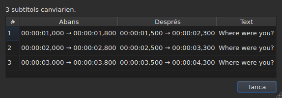
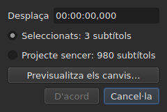
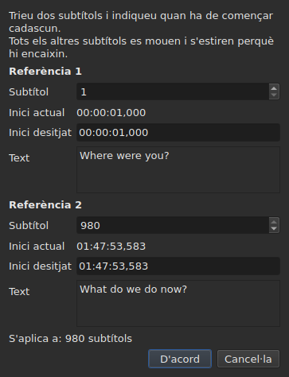
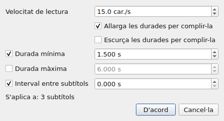
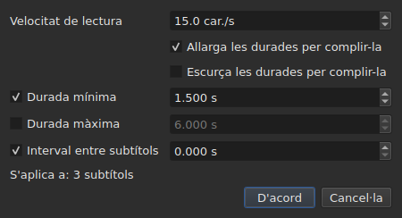
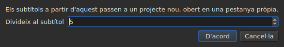

# Les operacions

<!-- machine-translated -->
> Aquesta pàgina és una traducció automàtica i encara no l'ha revisada cap lector de la llengua.

El menú **Eines** porta setze operacions, una anàlisi i dues entrades d'ortografia. Cadascuna de les
setze es desfà amb un `Ctrl+Z`; l'anàlisi no modifica res. `Check Spelling…` també es desfà, i `Spell-Check Settings…` no toca cap text.

| Entrada | Diàleg | Què fa |
| :---- | :----- | :----------- |
| `Shift Positions…` | sí | desplaça l'objectiu una durada |
| `Transform Positions…` | sí | corregeix l'objectiu a partir de dues referències |
| `Convert Frame Rate…` | sí | resincronitza l'objectiu d'una freqüència de fotogrames a una altra |
| `Adjust Durations…` | sí | mou els finals per complir una velocitat de lectura, unes durades i un interval |
| `Append File…` | un selector de fitxers | afegeix un fitxer al final del projecte |
| `Split Project…` | sí | talla el projecte en dos, la resta va a una pestanya nova |
| `Italic` | **no** | posa l'objectiu en cursiva, o l'hi treu |
| `Dialogue` | **no** | posa un guió de diàleg al començament de cada línia, o el treu |
| `Majúscules i minúscules ▸ Format de títol` | **no** | cada paraula pren una majúscula |
| `Majúscules i minúscules ▸ Format de frase` | **no** | la primera lletra del text, i només ella |
| `Majúscules i minúscules ▸ MAJÚSCULES` | **no** | tot en majúscules |
| `Majúscules i minúscules ▸ minúscules` | **no** | tot en minúscules |
| `Remove Hearing-Impaired Mentions…` | sí, sense paràmetres | suprimeix les mencions per a persones sordes |
| `Correct Texts…` | sí, un assistent de diverses pàgines | proposa correccions — mencions, unir i separar paraules, errors comuns, majúscules, trencament de línies — i les aplica un cop acceptades, vegeu [Corregeix els textos…](correct-texts.md) |
| `Check Spelling…` | sí, un recorregut paraula per paraula | recorre les paraules que el diccionari no coneix i aplica el que s'ha corregit, vegeu [Comprova l'ortografia…](check-spelling.md) |
| `Spell-Check Settings…` | sí | tria la llengua, l'objectiu i el document de la comprovació, i el subratllat mentre s'escriu, vegeu [Comprova l'ortografia…](check-spelling.md#configuració-de-la-comprovació-ortogràfica) |
| `Snap to Frame Rate…` | sí | torna a posar cada marca de temps al fotograma més proper |
| `Shift Whole File onto Grid (…)` | **no** | torna a portar tot el fitxer a la seva graella |
| `Frame Rate Analysis…` | sí, sense paràmetres | **no modifica res** — vegeu [La graella de fotogrames](frame-grid.md) |

**El que ha fet una operació es diu en un quadre d'informació que cal
tancar, excepte per a `Italic`, `Case` i `Dialogue`**: aquestes tres no obren cap
diàleg, i el seu informe — «no hi ha res per canviar» inclòs — es mostra
a la barra d'estat, sense res per tancar. `Split Project…` també dona el seu
a la barra d'estat: el seu resultat ja és davant vostre, a la pestanya nova. Els missatges es citen a la
secció de cada operació.

Inserir, suprimir, fusionar i dividir línies no són aquí sinó al
menú `Edit`, perquè canvien el nombre de línies. Vegeu
[Inserir, suprimir, fusionar i dividir línies](lines.md).

## A què s'apliquen

**A les línies seleccionades, o a tot el fitxer si no n'hi ha cap.** És la mateixa
regla per a totes, i els diàlegs, quan n'hi ha, la recorden amb paraules
clares:

```
Applies to: 4 subtitles
```

Seleccionar totes les línies equival a no seleccionar-ne cap.

**Quan només n'hi ha una part seleccionada, el diàleg pregunta
a què s'ha d'aplicar.** Es mostren dues opcions, amb el seu recompte, i **la selecció
és la marcada**:

```
(•) Selected: 2 subtitles
( ) Whole project: 4 subtitles
```

Marcar `Whole project` amplia l'operació a tot el fitxer sense haver de
canviar abans la selecció. Quan no hi ha res a triar — res
seleccionat, o tot —, la línia `Applies to:` de més amunt es queda sola.

Els diàlegs de `Shift Positions…`, `Transform Positions…`,
`Convert Frame Rate…`, `Adjust Durations…`, `Snap to Frame Rate…` i
`Remove Hearing-Impaired Mentions…` ofereixen aquesta opció.

### Veure abans d'aplicar

`Shift Positions…`, `Transform Positions…`, `Convert Frame Rate…`,
`Adjust Durations…` i `Snap to Frame Rate…` porten un botó **`Preview changes…`**.
Obre una petita finestra que diu quants subtítols canviaria l'operació
**amb el que hi ha escrit en aquell moment, sobre l'objectiu marcat**, i
enumera els dotze primers: el seu número, la seva posició abans, la seva posició
després, i la primera línia del seu text. **No s'aplica res**: tancar la
finestra torna al diàleg, on podeu canviar un valor i tornar a
mirar.




S'obre prou gran per mostrar totes les columnes, i es pot redimensionar
a mà.

Si l'operació no canviaria res, la finestra ho diu (`Nothing would change.`).
Mentre el que hi ha escrit no defineix cap operació — una durada il·legible, dues
referències sobre el mateix subtítol —, la previsualització és buida per la mateixa raó que el
botó `OK` està en gris. `Remove Hearing-Impaired Mentions…` no té previsualització: el que
canvia és text, i l'informe que dona després
ho diu.

**Amb una traducció, quin text?** Les operacions de posició i d'estructura
s'apliquen al subtítol sencer — els seus dos textos el segueixen. Les que
tornen a escriure un text — `Italic`, `Case`, `Dialogue`,
`Remove Hearing-Impaired Mentions…` — s'adrecen **al text de la columna de la cel·la actual**: la
traducció a la seva columna, el text principal a qualsevol altre lloc. L'altre es queda intacte, i
la barra d'estat diu a quin s'adreça. Vegeu [La taula](table.md#el-text-a-què-sadrecen-les-operacions).

**Una excepció, i la seva etiqueta ho diu**: `Shift Whole File onto Grid`
ignora la selecció. Una graella és una propietat del document, i mig
document no té graella pròpia; per això l'entrada ho diu al seu nom en lloc de
dir-ho només en aquest manual.

**`Append File…` també ignora la selecció**, per una altra raó: no és
un objectiu que torna a escriure, és un final que fa recular. Vegeu la seva
[pròpia secció](#append-file). **`Split Project…` tampoc no la té en compte**: talla on se li
diu. Vegeu [la seva](#split-project).

**`Correct Texts…` tria el seu objectiu a la seva pròpia pàgina**, en lloc de seguir
la selecció actual: la selecció, el projecte actual o tots els projectes
oberts. Vegeu [Corregeix els textos…](correct-texts.md). **`Check Spelling…` el tria a
`Spell-Check Settings…`**, i el recorda: vegeu [Comprova l'ortografia…](check-spelling.md).

**Les dues operacions de graella no parlen de la mateixa cosa que la graella.**
Una operació s'aplica a la selecció; l'anàlisi i la barra d'estat parlen del
**document sencer**. Alinear cinc línies de cent setanta-sis canvia ben bé aquestes
cinc — la taula ho mostra — sense que cap de les dues es mogui, cosa que
sembla una actualització que no s'ha fet. No ho és: no tenen res a
dir. Vegeu [`Snap to Frame Rate…`](#snap-to-frame-rate) i
[La graella de fotogrames](frame-grid.md).

### Què vol dir «res seleccionat», entrada per entrada

La regla s'aplica al menú `Tools` i a la cerca. Les entrades del
menú `Edit` que toquen les línies o les buiden la interpreten d'una altra manera — si no, un
`Del` o un `Ctrl+X` desafortunat buidaria el document.

| Entrada | Sense selecció | Què requereix |
| :---- | :------------------ | :--------------- |
| les operacions del menú `Tools` | tot el fitxer | un document no buit |
| `Shift Whole File onto Grid` | tot el fitxer, **sempre** | una graella trobada |
| `Find and Replace…` | tot el fitxer | un document no buit |
| `Cut Texts`, `Copy Texts`, `Paste Texts` | **desactivades** | almenys una línia seleccionada |
| `Remove Subtitles` | **desactivada** | almenys una línia seleccionada |
| `Merge Subtitles` | **desactivada** | un bloc d'almenys dues línies veïnes |
| `Split Subtitle` | **desactivada** | exactament una línia |
| `Insert Subtitles…` | desactivada, excepte en un document buit | una línia respecte a la qual col·locar-los |

Cada pàgina en dona el motiu: [el porta-retalls](clipboard.md#a-què-sapliquen),
[les línies](lines.md), [la cerca](find-and-replace.md#què-abasta-la-cerca).

Les entrades estan **desactivades en un fitxer buit**: no hi hauria res per
desplaçar. `Italic` té una segona condició, que descriu la seva secció: el format
obert ha de poder escriure un estil. Les majúscules i minúscules i els guions no en tenen cap — un
text és un text en tots nou formats.

## `Shift Positions…`

Mou l'objectiu una durada, endavant o enrere. Tots dos límits de
cada subtítol es mouen la mateixa quantitat: cap no es queda a la pantalla més o menys temps
que abans.

La durada s'escriu **com una marca de temps, signe inclòs** — `00:00:02,500` avança,
`-0:01,250` fa recular. Les formes acceptades són les d'una cel·la de posició.




| Rebuig | Per què |
| :------ | :-- |
| una durada il·legible | el botó es queda desactivat; no es desplaça res a l'atzar |
| un desplaçament de zero | no hi ha cap operació per registrar |
| un subtítol aniria abans del començament del vídeo | **cap fitxer no pot portar una posició així** |

El tercer cas anomena el culpable — «el subtítol 1 començaria abans de l'origen» —
i és el que cal mirar per veure quant us heu equivocat. No
s'aplica res.

## `Transform Positions…`

La correcció d'un fitxer sincronitzat amb un altre muntatge. Indiqueu on comencen realment **dos**
subtítols, i tota la resta segueix, proporcionalment.

El diàleg demana dues vegades la mateixa cosa: un número de subtítol, i la
posició on hauria de començar. Per a cada referència, mostra **què designa aquest
número** — el seu text (`Text`) i el temps en què comença
**ara** (`Now starts`), com a etiquetes simples — i segueixen el número
a mesura que el canvieu. El text conserva **espai per a tres línies** digui el que digui el
subtítol: un de més llarg, o una adreça llarga, s'hi desplaça a dins, i
el diàleg conserva la seva mida quan canvia la referència. **Per referència només cal escriure un camp:
`Should start`**, el temps en què aquest subtítol ha de començar. No cal cercar a la taula quina línia és la `980`.

`Should start` **es proposa amb el valor actual**: mentre no el
toqueu, la referència diu «aquest subtítol ja és on ha de ser». Només
canvieu el que voleu canviar. La segona referència s'emplena per endavant amb l'últim
subtítol del fitxer — dues referències allunyades donen una correcció més segura
que dues de veïnes.




**Totes dues referències arriben exactament on s'ha demanat.** No és
una aproximació: el càlcul es fa perquè sigui cert.

| Rebuig | Per què |
| :------ | :-- |
| dues referències sobre el mateix subtítol | no defineixen cap correcció |
| una posició il·legible | la mateixa raó que per al desplaçament |

No es pot escriure un número fora del fitxer: el camp està limitat pel
nombre de subtítols.

## `Convert Frame Rate…`

Resincronitza l'objectiu quan les posicions es van calcular amb una freqüència de
fotogrames i ho han d'estar amb una altra.

Totes dues llistes ofereixen les vuit freqüències de fotogrames estàndard.

> **Equivocar-se de freqüència de fotogrames d'entrada desplaça tot el fitxer sense indicar
> res.** És el pitjor mode d'error d'aquesta operació, i per això
> el diàleg diu d'on vénen els valors que proposa en lloc de
> definir-los en silenci.

### Les dues fonts, i què responen

El diàleg porta fins a dues línies més, cadascuna de les quals apareix quan té
alguna cosa a dir:

| Línia | Què diu | Què emplena per endavant |
| :--- | :----------- | :---------------- |
| `The positions say` | la [graella de fotogrames](frame-grid.md) deduïda de les posicions del fitxer | `Timed against` |
| `The video declares` | la freqüència de fotogrames que anuncia el contenidor, per exemple `24000/1001` | `Should play at` |
| `The file was read at` | la freqüència de fotogrames amb què s'ha llegit un fitxer **comptat en fotogrames** | `Timed against` |

**Cada proposta va al camp al qual respon.** La graella diu amb què s'ha
*escrit* el fitxer — és la llista de dalt. El que anuncia el contenidor és
la freqüència de fotogrames a què *va* la pel·lícula, i per tant aquella a què han
d'arribar els subtítols — és la llista de baix.

**Només una graella neta emplena per endavant l'entrada.** Una graella parcial és un
indici que la mateixa deducció qualifica de parcial, i aquest camp decideix una
operació sobre tot el fitxer. La [barra d'estat](frame-grid.md) i l'anàlisi
porten aquest cas; aquest camp no.

**Un fitxer comptat en fotogrames substitueix la graella en lloc d'afegir-s'hi.**
MicroDVD porta números de fotograma, i les posicions del document es van
calcular a partir d'ells amb la freqüència de lectura: una graella deduïda d'aquestes posicions
només pot tornar a trobar aquest número. `The positions say` desapareix, per tant, i
`The file was read at` en pren el lloc — és la mateixa elecció que fa
[la barra d'estat](frame-grid.md#un-document-comptat-en-fotogrames-no-té-graella-té-una-freqüència-de-fotogrames).

**Així és com es canvia la freqüència de fotogrames d'un MicroDVD.** Posar la freqüència llegida
com a entrada i la real com a sortida torna a calcular cada posició a partir dels
fotogrames del fitxer — sense tornar a llegir res, i l'operació es desfà com les
altres.

### Un desacord no és una contradicció

Les dues línies es poden mostrar juntes i anunciar números diferents.
**No és un error per arbitrar**: la pel·lícula va a una freqüència de fotogrames, el
fitxer es va escriure en una altra graella. Un fitxer a 24 per a una pel·lícula a 25 és
exactament el cas per al qual existeix l'alineació — `snap` a la línia
d'ordres.

Per tant, no es tria res en lloc de l'usuari: totes dues llistes continuen
editables, i és deliberat. Una font que s'imposa impedeix contrastar.

Les línies no apareixen quan no hi ha res a dir: cap vídeo
associat, cap `ffprobe`, o cap graella neta. El diàleg és llavors el
descrit més amunt, i **cap operació no es rebutja per això** — la
freqüència de fotogrames la dona l'usuari. Vegeu
[El vídeo associat](video.md#ffmpeg-no-és-obligatori).

Una freqüència de fotogrames que la pel·lícula anuncia però que no és cap de les vuit estàndard
**es mostra sense triar-se**: saber que la pel·lícula va a una
freqüència inusual és la informació, i aquí no hi ha res a què convertir-la.

Convertir una freqüència de fotogrames en ella mateixa no canvia res: el botó es queda desactivat.

## `Adjust Durations…`

Allarga o escurça la durada dels subtítols de l'objectiu **movent-ne el
final, mai l'inici**. Moure l'inici mouria el subtítol, que és
la feina de [`Shift Positions…`](#shift-positions).





### Les quatre restriccions

| Camp | Què demana | Valors | Per defecte |
| :---- | :--------------- | :----- | :------ |
| `Reading speed` | el temps necessari per llegir el text | d'1 a 99 caràcters per segon, a la dècima | 15 car./s |
| `Lengthen durations to match it` | allargar el que és massa curt per llegir-se | marcat o no | marcat |
| `Shorten durations to match it` | escurçar el que es queda a la pantalla més del necessari | marcat o no | no marcat |
| `Minimum duration` | una durada mínima | de 0 a 99 s, al mil·lisegon | marcat, 1,5 s |
| `Maximum duration` | una durada màxima | de 0 a 99 s, al mil·lisegon | no marcat, 6 s |
| `Gap between subtitles` | l'interval que cal deixar abans del subtítol següent | de 0 a 99 s, al mil·lisegon | marcat, 0 s |

Són els valors per defecte de Gaupol.

**Una restricció no marcada és absent**: el seu camp està en gris i no es llegeix.
Una restricció marcada a zero val zero — un interval de 0 s impedeix que un
subtítol s'encavalqui amb el següent. La velocitat de lectura només es llegeix si
`Lengthen` o `Shorten` està marcat.

**Quan no hi ha res marcat, `OK` està desactivat**: no hi ha res a demanar.

El diàleg es torna a obrir amb els valors de l'últim ajust, **i els conserva d'una
sessió a l'altra** — com les dues opcions de cerca. **Una casella no marcada
conserva el seu valor**: desmarcar `Minimum duration` després d'haver-hi posat 2 s no torna a
1,5 s, i tornar-la a marcar retroba 2 s. Els nou paràmetres són al
[fitxer de preferències](preferences.md#el-fitxer), sota `duration-adjust.`.

**La línia d'ordres els comparteix.** [`subedit-cli adjust`](../subedit-cli/adjust.md) llegeix
els mateixos nou paràmetres per defecte, de manera que una velocitat definida aquí és la velocitat que fa servir, tret que les seves pròpies opcions
diguin el contrari; [`subedit-cli config`](../subedit-cli/config.md) els mostra i els canvia. Vegeu
[Dos blocs, un compartit amb la línia d'ordres](preferences.md#dos-blocs-un-compartit-amb-la-línia-dordres).

### En quin ordre, i quina guanya

Cada subtítol de l'objectiu passa per les quatre restriccions **en aquest ordre**, i
cadascuna fixa el final al seu torn:

| Rang | Restricció | Què fixa |
| ---: | :--------- | :----------- |
| 1 | velocitat de lectura | `end = start + length ÷ speed`, si el subtítol és massa curt (`Lengthen`) o massa llarg (`Shorten`) |
| 2 | durada mínima | `end = start + minimum`, si la durada és més curta |
| 3 | durada màxima | `end = start + maximum`, si la durada és més llarga |
| 4 | interval | `end = next start − gap`, si el final hi és massa a prop — mai abans de l'inici |

**L'última que s'aplica guanya.** L'interval ve en últim lloc i pot tornar a portar una
durada per sota del mínim que s'acaba de fixar: dos subtítols a la pantalla al mateix
temps són un defecte que l'espectador veu, un subtítol una mica curt no
ho és.

**La longitud del text es compta sense etiquetes**, en caràcters, salts de línia
inclosos: `<i>été</i>` compta tres caràcters. La velocitat de lectura parla del
que llegeix l'espectador.

**El següent és el subtítol següent del fitxer**, tant si és a l'objectiu com
si no. **L'últim subtítol del fitxer no té següent**: l'interval no el
restringeix.

### Es diu el que cap final no pot satisfer

Un cop fet l'ajust, la finestra diu quants finals s'han mogut, i **què
no s'ha pogut mantenir** — una restricció només apareix si s'ha
sacrificat per a almenys un subtítol:

```text
adjusted the durations of 12 subtitles; could not satisfy the reading speed in 9 subtitles, the minimum duration in 4 subtitles
```

Les tres mencions possibles són `the reading speed`, `the minimum duration` i
`the gap`. **La durada màxima es manté sempre**: ve després de la velocitat
i del mínim, i només la segueix l'interval, que només pot escurçar. Un mínim
més gran que el màxim hi cedeix, i és el mínim el que es compta. L'interval
només se sacrifica quan el següent comença abans de l'inici del mateix
subtítol.

El recompte abasta tot l'objectiu, **inclosos els subtítols el final dels quals no
s'ha mogut**: un subtítol ja ajustat contra el seu següent i massa curt per al
mínim es compta. Quan no es mou cap final, la finestra ho diu —
`no duration to adjust` — i no entra res a l'historial.

## `Append File…`

Afegeix un fitxer al final del projecte obert. **No s'insereix res entre
tots dos**: el fitxer triat es desplaça fins al final de l'últim subtítol del
projecte, exactament com fa Gaupol.

**Desactivat en un document buit**: no hi hauria cap final des del qual desplaçar. S'obre un
selector de fitxers, sense cap codificació per triar — com `Open…`.

**El fitxer afegit passa per la conversió**, amb les paraules de `Save As…` i
d'[enganxar des d'un altre format](clipboard.md#les-etiquetes-dun-altre-format-es-tradueixen):
les seves etiquetes es tradueixen al format del projecte, i es diu el que aquest format no pot
escriure:

```text
appended 12 subtitles; Advanced SSA into SubRip: 1 tag dropped
```

**El que portava el fitxer afegit no sobreviu sencer.** Les seves posicions
segueixen, etiquetes incloses; la seva capçalera, els seus camps propis del format — nom
d'estil, marges — i el que una etiqueta no pot esdevenir en el format del projecte no
segueixen, i ho diuen. **No té traducció**: una traducció continua sent
pròpia del document que l'ha rebuda, i el fitxer afegit arriba sol.

**Seleccionat després**, com les línies que una operació d'enganxar ha escrit més enllà
del final. Quan no es perd res, el recompte es mostra a la barra d'estat en lloc de
en un quadre per tancar — la mateixa regla que
[obrir una traducció](files.md#obrir-una-traducció).

**Una sola entrada de l'historial**, sigui quin sigui el nombre de subtítols
afegits: `Ctrl+Z` els suprimeix tots alhora.

**Un fitxer ja obert es pot afegir a si mateix**: res no ho impedeix, com
a Gaupol.

**A la línia d'ordres**, [`append`](../subedit-cli/append.md) fa el mateix per a diversos fitxers
alhora, en un sol resultat.

## `Split Project…`

Talla el projecte en dos: **l'invers exacte d'`Append File…`**. Un quadre
pregunta a partir de quin subtítol cal tallar — del segon a l'últim, numerats
com a la taula — i s'obre sobre la línia actual.

**La taula mostra on talleu abans que talleu**: cada número que
pren el quadre en selecciona la línia. `Cancel` torna la selecció anterior.




**Desactivat per sota de dos subtítols**: un tall vol un subtítol a cada
costat.

**La resta es copia en un projecte nou, obert en una pestanya nova, i
se suprimeix del projecte original.** El projecte nou es **desplaça menys el final de
l'últim subtítol que s'hi ha quedat**: dividir i després afegir torna el projecte de partida.
Els seus dos textos, principal i traducció, segueixen els seus subtítols, i
conserva el format i la codificació de l'original — **sense camí**: cap fitxer
no el conté encara. La seva pestanya s'escriu per tant `untitled*` des que neix, i
tancar-la sense desar planteja la pregunta que es planteja per a tot el que no està
escrit.

**La barra d'estat diu quants subtítols se n'han anat**, sense cap quadre per
tancar — la pestanya nova ja mostra el resultat:

```text
split 12 subtitles into a new project
```

**Una sola entrada de l'historial**, al projecte original:
`Undo: splitting the project` li torna la resta. El projecte nou té un historial
propi, buit; desfer no el toca, i es queda obert.

**Es rebutja quan cap fitxer no podria escriure el resultat.** Si les dues
meitats s'encavalquen al tall, el desplaçament portaria un subtítol abans del
començament del vídeo — una posició negativa, que cap format no escriu. El quadre
que ho rebutja **anomena el subtítol** i suggereix tallar en un altre lloc:

```text
Cannot split at subtitle 3: subtitle 3 would fall before the start of the video. Cut somewhere else.
```

Arribar exactament al començament està permès: zero és una posició.

**A la línia d'ordres**, [`split-file`](../subedit-cli/split-file.md) talla un fitxer de la mateixa manera, en dos
fitxers amb nom.

## `Snap to Frame Rate…`

Posa **cada marca de temps** — inici i final — al fotograma més proper de la
freqüència de fotogrames triada. Una sola llista, i aquesta és tota la diferència amb la
conversió: una conversió necessita dues freqüències perquè escala el
fitxer de l'una a l'altra; una alineació només necessita la
graella on aterrar.

| | `Convert Frame Rate…` | `Snap to Frame Rate…` |
| :--- | :-------------------- | :-------------------- |
| moviment | proporcional al temps — **diversos segons** en un llargmetratge | mig fotograma com a màxim, **a tot arreu** |
| per a quin fitxer | un fitxer la **sincronització del qual és incorrecta** | un fitxer la sincronització del qual és **correcta** i la graella del qual és incorrecta |

**El cas d'ús**, detallat: una pel·lícula a 25 fotogrames per segon,
subtítols escrits en una graella a 24, línies ja aproximadament al seu
lloc amb uns pocs mil·lisegons de diferència. No hi ha res a resincronitzar — només
tornar a posar les marques de temps als fotogrames correctes.

La llista **s'obre sobre el que declara el vídeo**, i no sobre el que diuen les
posicions: la intenció és unir-se a la graella de la pel·lícula, i la
deducció anomena la que s'abandona. Sense vídeo o sense `ffprobe`, s'obre
sobre la freqüència de fotogrames del projecte.

Alinear un fitxer a la graella que ja ocupa no el canvia, i no és
cap error: l'operació s'aplica, no mou res, i es desfà com
qualsevol altra.

**Alinear una part del fitxer ho diu, un cop fet.** Es mostra un avís
quan la selecció no ho abasta tot i el document encara es llegeix en una altra
graella:

```
5 of 176 subtitles aligned to 25 fps; the document is still read on a 24 fps grid
```

Lliga el gest al seu efecte, i explica per què la barra d'estat i
l'anàlisi no s'han mogut: parlen del document, l'operació s'ha aplicat a
cinc línies. No s'impedeix res — alinear una part d'un fitxer pot ser
intencionat.

**Gairebé sempre no és intencionat, i això es mesura.** En els vuit fitxers de
graella del repositori, alinear tot el fitxer porta la freqüència deduïda a
l'objectiu i la seva concentració al 100 %; alinear cinc línies no mou mai la
freqüència deduïda i **redueix** la concentració en set casos de vuit — les
línies alineades han abandonat la graella en què viu la resta del fitxer. El vuitè és
50 a 25, on la graella objectiu divideix la del fitxer i on les posicions ja
hi eren.

L'avís no es mostra quan la selecció abasta tot el fitxer, quan
no es dedueix cap graella, o quan el document ara es llegeix a la
freqüència demanada — és llavors quan l'alineació ha fet el que se li demanava.

## `Shift Whole File onto Grid`

Desplaça **tot el fitxer** la quantitat que torna a posar les seves posicions a la graella
que han abandonat. Un fitxer les posicions del qual són en una graella llevat d'una
constant s'ha desplaçat, i aquesta constant es pot mesurar.

**L'entrada del menú porta la quantitat i l'abast** —
`Shift Whole File onto Grid (+0.001 s)`. No hi ha diàleg:
l'operació no pren cap opció, i una entrada que mourà tot un
fitxer ha de dir quant, i que ho farà íntegrament, abans de triar-se.
És l'única operació del menú que ignora la selecció.

**Està desactivada quan no s'ha trobat cap graella.** Llavors no hi ha res a
què unir-se, i una fase mesurada sobre soroll mouria el fitxer a l'atzar.
«No hi ha res a què unir-se» i «unir-se a zero» no diuen el mateix: la
segona es continua oferint, perquè un fitxer que ja és a la seva graella n'és un
cas normal.

**Això no és `Snap to Frame Rate…`.** Aquesta entrada ho desplaça tot la mateixa quantitat
i preserva la sincronització relativa **exactament**; l'alineació mou cada
posició independentment i absorbeix de passada les que s'havien corregit a
mà. En un fitxer net totes dues donen el mateix resultat; en un
fitxer parcial, no — i el [detall de l'anàlisi](frame-grid.md) diu quin dels
dos teniu al davant.

## `Italic`

Posa l'objectiu en cursiva escrivint les etiquetes del **format obert**, o
les treu si ja és en cursiva. Sense diàleg: l'operació no té cap paràmetre, i
es desfà amb un `Ctrl+Z` com les altres.

| Acció | Drecera | On |
| :----- | :------- | :---- |
| Cursiva | `Ctrl+I` | menú **Eines**, barra d'eines |

És l'única operació del menú `Tools` que té un botó a la
[barra d'eines](index.md#la-barra-deines).

### Què escriu, format per format

El text d'un subtítol és el del seu fitxer, etiquetes incloses — vegeu
[Editar una cel·la](editing.md). Cada format té les seves, i això és el que
aquesta entrada us estalvia de saber:

| Format | Què s'escriu |
| :----- | :-------------- |
| SubRip, WebVTT, SubViewer 2 | `<i>text</i>` |
| Sub Station Alpha, Advanced SSA | `{\i1}text{\i0}` |
| MicroDVD | `{Y:i}text` — l'etiqueta va fins al final del subtítol, no hi ha res per tancar |
| MPL2 | `/` al començament de **cada** línia, ja que el marcador només s'aplica a la seva |
| TMPlayer, LRC | res: aquests dos formats no escriuen cap estil |

**L'entrada està desactivada per a un TMPlayer i un LRC, no amagada.** Una entrada
absent no ensenya res; una entrada en gris respon «per què no
puc?».

**El format que es llegeix és el del text a què s'adreça.** Amb una traducció, el text principal
pot ser en SubRip i la traducció en Advanced SSA: `Italic` escriu `<i>` en
el primer i `{\i1}` en la segona. L'entrada també està desactivada quan el
text a què s'adreça és en un format que no escriu cap estil, encara que l'altre sí que en escrigui.

### En quin sentit va

Una sola entrada per als dos sentits, i és l'objectiu el que decideix:

- **n'hi ha prou amb un sol subtítol fora de cursiva** perquè tot l'objectiu passi a cursiva;
- l'objectiu en surt només quan hi és **sencer**.

És la regla de Gaupol, i és l'única que fa utilitzable un sol
botó: una selecció mixta va en bloc en lloc d'invertir-se
línia per línia, i prémer dues vegades la torna tal com era.

L'informe diu què s'ha fet, en el sentit en què s'ha fet:

```
2 subtitles put in italics
2 subtitles taken out of italics
```

**Una línia buida no guanya mai etiquetes** — un `<i></i>` al voltant de res
es veuria a la taula. Un objectiu que només conté línies així, per tant, no canvia res, i
ho diu: «no hi ha res per canviar». Llavors no entra cap entrada a l'historial.

### Què no toca

**Les altres etiquetes es queden exactament on són**: un color, un
tipus de lletra, un `{\pos(x,y)}` d'Advanced SSA travessen l'operació sense moure's.
Només es posen i es treuen les etiquetes de cursiva.

Una etiqueta que diu diverses coses alhora no es treu sencera:
`{\b1\i1}` esdevé `{\b1}`, i `{Y:bi}` esdevé `{Y:b}`. La negreta es queda, i el
text surt realment de la cursiva.

## `Case` i `Dialogue`

Dues transformacions del **text visible**, i les etiquetes no es toquen: un
subtítol posat en minúscules conserva el seu `<I>` tal com és, i un guió es posa
davant del text, no davant d'una etiqueta d'obertura. **Cap etiqueta no canvia
de lloc**: `<i>bon</i>jour` en majúscules dona `<i>BON</i>JOUR`, on
[una substitució](find-and-replace.md#el-text-cercat-és-el-text-visible) hauria
estès la cursiva a tota la paraula.

| Entrada | Drecera | Què fa |
| :---- | :------- | :----------- |
| Majúscules i minúscules ▸ Format de títol | — | `bonjour marie` esdevé `Bonjour Marie` |
| Majúscules i minúscules ▸ Format de frase | — | `BONJOUR MARIE` esdevé `Bonjour marie` |
| Majúscules i minúscules ▸ MAJÚSCULES | — | tot en majúscules |
| Majúscules i minúscules ▸ minúscules | — | tot en minúscules |
| Diàleg | — | afegeix o treu els guions |

### Què no toquen les majúscules i minúscules

**El que precedeix la primera lletra o la primera xifra es deixa tal com és.**
Un guió de diàleg, unes cometes d'obertura, un parèntesi sobreviuen:
`- bonjour` posat en format de frase dona `- Bonjour`, i no `- bonjour` amb un
guió en majúscula, que no tindria cap sentit.

**El format de frase torna a posar la resta en minúscules.** `BONJOUR MARIE` esdevé
`Bonjour marie`: és el que fa Gaupol, i és el que permet suavitzar un
subtítol escrit en majúscules.

**Els accents i els alfabets no llatins es tracten correctament.** `éléonore`
dona `ÉLÉONORE`, i un apòstrof no talla una paraula: `l'été` posat en format de
títol dona `L'été` i no `L'Été`. Una lletra que canvia de longitud conserva les seves
etiquetes al voltant: `fi <i>x</i>` en majúscules dona `FI <i>X</i>`.

**Les majúscules i minúscules no depenen de la llengua del sistema.** Segueixen les regles comunes
a totes les llengües: `istanbul` en majúscules dona `ISTANBUL`, tant si la màquina
està configurada en francès com en turc.

### En quin sentit va `Dialogue`

Una sola entrada per als dos sentits, i és l'objectiu el que decideix:

- **n'hi ha prou amb una sola línia sense guió** perquè tot l'objectiu en guanyi un;
- l'objectiu els perd només quan **totes** les seves línies en tenen un.

Prémer dues vegades torna l'objectiu tal com era. És la regla de
[`Italic`](#italic), i l'única que fa utilitzable un sol botó.

**Es reconeixen tres guions** — el guionet del teclat i els dos guions
del tipògraf, `–` i `—` — i és el guionet el que s'escriu.
Els espais de més després del guió desapareixen. Una línia buida no en guanya
cap.

### Què diuen

```
2 subtitles recased
2 subtitles dashed
2 subtitles undashed
```

I quan no canvia res — un objectiu que ja té les majúscules i minúscules demanades — «no hi ha res per
canviar», sense posar res a l'historial.

## `Remove Hearing-Impaired Mentions…`

Suprimeix les mencions destinades a les persones sordes o amb dificultats auditives — les
descripcions de sons entre claudàtors. **Els parèntesis es queden**: també serveixen per a
les rèpliques xiuxiuejades, i és `Correct Texts…` el que els suprimeix, amb la seva casella `Sound in parentheses`.
**Res més**: les lletres de cançons
entre coixinets i el nom de qui parla davant de dos punts només se suprimeixen amb
[`Correct Texts…`](correct-texts.md), pàgina `Mentions`.

El diàleg no pregunta res: l'operació no té cap paràmetre, i el diàleg només serveix per
confirmar i recordar a què s'aplica.

**És l'única del menú `Tools` que fa desaparèixer línies**, i l'única
de tot el programa que les fa desaparèixer sense que se li demani. Un
subtítol que *només* era una menció no té cap text un cop netejat, i un
subtítol sense text no té raó de ser: se suprimeix del fitxer. Els altres
es tornen a escriure sense la seva menció.

**Les etiquetes del format no compten com a text**: `<i>[SOUPIR]</i>` d'un
SubRip i `{\i1}[SOUPIR]{\i0}` d'un Advanced SSA se suprimeixen igualment.
Un `<i>` en un TMPlayer o un LRC, que no escriuen cap etiqueta, és text.

**Adreçada a la traducció, no suprimeix cap línia.** Una traducció que la
regla buida — un text que només era una menció — es **buida** i el subtítol
es queda: té un text principal, a què l'operació no s'adreçava, i suprimir-lo el
destruiria. L'informe el compta com a netejat:

```text
1 subtitle cleaned, 0 removed
```

Les etiquetes que es llegeixen són les del format de la traducció, que pot no ser el
del fitxer principal.

L'informe diu totes dues coses:

```
1 subtitle cleaned, 1 removed
```

**Quan no hi ha res que encaixi, no passa res** — i el diàleg ho diu: «cap menció
per suprimir». No entra cap entrada a l'historial, perquè una operació que
no canvia res no és una operació per desfer.

**Desfer ho torna tot a lloc**, tant els subtítols suprimits com els textos
reescrits, cadascun amb el text que tenia. Un subtítol que la regla ha buidat
no es torna a escriure mai abans de suprimir-se, precisament perquè torni
sencer.

> **La selecció es perd en aquesta ocasió**: suprimir línies canvia
> l'estructura de la taula, que es reconstrueix. Totes les altres operacions del
> menú `Tools` la conserven, `Italic`, `Case` i `Dialogue` incloses. Les quatre
> entrades d'estructura del menú `Edit` — inserir, suprimir, fusionar, dividir —
> també canvien l'estructura, i tornen una selecció en lloc de la que
> han tret — vegeu
> [Inserir, suprimir, fusionar i dividir línies](lines.md).

Una referència purament numèrica — «Vegeu [1] la nota» — no és una menció
i es queda tal com és.

## Més enllà del final de la pel·lícula

Quan hi ha un vídeo obert, una operació que **porta subtítols més enllà del
final de la pel·lícula** ho indica, un cop feta:

```
shifting leaves 3 subtitles past the end of the video, by 4.200 s at most
```

La frase anomena l'operació — `shifting`, `transforming`,
`converting the frame rate`, `adjusting durations`,
`aligning on the frame rate` —, quants subtítols passen del final, i quant
en passa el més llunyà. `Shift Whole File onto Grid` és un desplaçament, i s'anomena
`shifting`.

| Què es compta | Què no |
| :-------------- | :---------- |
| el que l'operació acaba de tocar, és a dir, l'objectiu | un subtítol que ningú no ha mogut |
| un subtítol que acaba **després** del final | un subtítol que acaba exactament amb ell |

**És un avís, i res més.** No es rebutja res, no es
corregeix res: un subtítol que cau després dels crèdits finals pot ser
exactament el que volíeu, i un rebuig que s'equivoca costa més que un
avís que ignoreu. L'operació és a l'historial, i `Undo`
la desfà com qualsevol altra.

**Un sol quadre per operació.** `Adjust Durations…` i `Align` ja tenen
alguna cosa a dir — el que un ajust no ha pogut mantenir, el que una alineació parcial
ha deixat de banda. Quan a més porten un subtítol més enllà del final,
el quadre porta totes dues frases, l'una sota l'altra, la de l'operació
primer:

```
adjusted the durations of 2 subtitles
adjusting durations leaves 1 subtitle past the end of the video, by 1.000 s at most
```

El missatge no apareix si no hi ha cap vídeo obert: la durada ve del
reproductor, i sense pel·lícula no hi ha cap final per sobrepassar. Només les cinc operacions
anomenades més amunt hi estan afectades — `Adjust Durations…` inclosa, que pot
allargar un final més enllà de la pel·lícula. Cap de les altres no ho està: les del
menú `Tools` que tornen a escriure un text, i al menú `Edit` la inserció,
la fusió, la divisió, l'enganxada, la substitució i les cel·les editades — un
final escrit a mà més enllà de la pel·lícula no s'indica.
