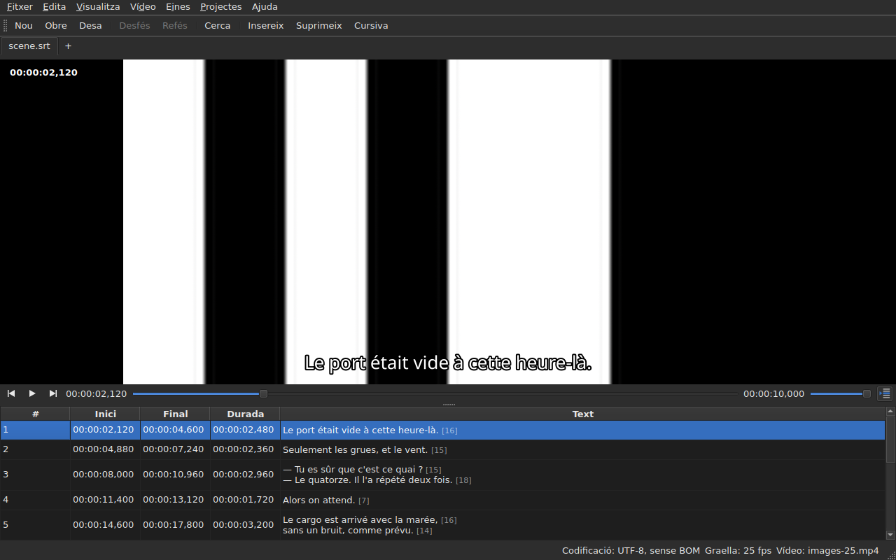

# El reproductor

<!-- machine-translated -->
> Aquesta pàgina és una traducció automàtica i encara no l'ha revisada cap lector de la llengua.

El vídeo associat es mira **a la finestra**, amb la línia actual
dibuixada a sobre. És el que permet comprovar sobre la pel·lícula el resultat
d'un desplaçament, d'una transformació o d'una conversió de freqüència de fotogrames.

Vegeu [El vídeo associat](video.md) per saber com associar una pel·lícula; aquesta
pàgina descriu què passa un cop associada.

## La vista del vídeo

| Situació | Què mostra la finestra |
| :-------- | :-------------------- |
| hi ha un vídeo associat i s'obre | la imatge ocupa la part de dalt, la taula a sota |
| cap vídeo associat | cap imatge, la taula ocupa tota la finestra |
| el vídeo no s'obre | cap imatge, un missatge, i la finestra continua sent utilitzable |

La separació entre la imatge i la taula **es mou amb el ratolí**. La imatge no
baixa de 180 píxels d'alçada. Ampliar la finestra dona l'espai guanyat
a la taula, no a la imatge: el que falta quan s'edita són línies.

Sota la imatge, **una barra de reproducció**: on és la pel·lícula, quant dura,
reproduir i pausar, i el volum. Vegeu [La barra de reproducció](#la-barra-de-reproducció).

## Reproduir i aturar

| Ordre | Drecera | Què fa |
| :------ | :------- | :----------- |
| Vídeo ▸ Reprodueix / Pausa | `Ctrl+P` | reprodueix si la reproducció està aturada, l'atura altrament |

L'ordre està **desactivada mentre no hi hagi cap vídeo obert**. Un vídeo que
s'acaba d'associar s'obre **aturat**: obrir una pel·lícula no és
mirar-la.

`Ctrl+P` allà on Gaupol té una `P` sola: una drecera d'una sola lletra d'abast de
finestra es pren abans que el giny que té el focus la vegi,
de manera que una `P` s'empassaria pel camí cap a un editor de cel·la. Aquí no
s'imprimeix res, la combinació és lliure.

## La barra de reproducció

Sota la imatge, d'esquerra a dreta — els tres botons són **icones**, les del tema de l'escriptori quan en té, les de l'estil de Qt altrament:

| Element | Què fa |
| :------ | :----------- |
| els dos botons de pas | fan retrocedir, avançar la pel·lícula **un pas de fotogrames** — vegeu [Fotograma a fotograma](timing.md#fotograma-a-fotograma) |
| reproduir / pausar | reprodueix o atura, com `Ctrl+P` — el botó mostra **el que farà**: un triangle quan està aturat, dues barres quan reprodueix; l'indicador de funció ho diu amb paraules clares |
| la posició | `HH:MM:SS,mmm`, escrita com la taula escriu una posició — **com a número de fotograma** quan [`Visualitza ▸ Posicions en fotogrames`](table.md#les-posicions-en-fotogrames) està marcada |
| el control lliscant | **llegeix i mou**: arrossegueu la nansa, feu clic a la ranura, useu les fletxes |
| la durada | la que declara el vídeo, escrita com la posició |
| el volum | de 0 a 100, vegeu [El volum](#el-volum) |
| seguiment de la taula | premut mentre la taula segueix la reproducció, i la torna a la línia que es reprodueix quan el premeu — vegeu [La taula segueix la reproducció](#la-taula-segueix-la-reproducció) |

**El control lliscant no cedeix a cada píxel.** Arrossegar la nansa demana desenes de
posicions per segon, i cadascuna costa un fotograma descodificat: la primera posició surt de
seguida, les següents esperen una vintena part de segon, i **l'última posició demanada és
sempre la que s'assoleix** — com a molt tard quan deixeu anar la nansa. La imatge, per tant, no
va endarrerida respecte a la mà, i no es posa a dibuixar un camí que ningú no mira.

**El control lliscant es mou sol durant la reproducció**, i això no compta com a gest:
només el que feu vosaltres mou la pel·lícula. Mentre manteniu la nansa, la reproducció no us la pren.

## El codi de temps

**La posició s'escriu sobre la imatge**, a dalt a l'esquerra, sobre un fons translúcid que la fa
llegible en qualsevol escena. La dibuixa la finestra, amb el seu tipus de lletra, i no demana
res al reproductor llevat de la posició que ja dona; s'actualitza amb cada gest,
sense esperar la ronda següent del seguiment.

## Desplaçar-se per la pel·lícula

Al menú **Vídeo**, **els gestos de Gaupol**, amb els seus noms. Tots estan **desactivats sense vídeo**, com
la reproducció; els tres que actuen sobre la selecció també estan desactivats mentre no hi hagi res seleccionat.

| Ordre | Drecera | Què fa |
| :------ | :------- | :----------- |
| Vídeo ▸ Reprodueix la selecció | `Ctrl+Shift+P` | reprodueix des d'**una mica abans de l'inici** de la selecció **fins al final del seu últim subtítol**, i s'atura sobre la imatge |
| Vídeo ▸ Vés a l'anterior | `Ctrl+Left` | posa la reproducció a l'inici de l'últim subtítol **acabat** abans de la posició |
| Vídeo ▸ Vés al següent | `Ctrl+Right` | posa la reproducció a l'inici del primer subtítol que **comença** després de la posició |
| Vídeo ▸ Salta enrere | `Ctrl+Shift+Left` | retrocedeix un salt — trenta segons per defecte |
| Vídeo ▸ Salta endavant | `Ctrl+Shift+Right` | avança un salt |
| Vídeo ▸ Vés a l'inici de la selecció | `Ctrl+Up` | posa la reproducció a l'inici de la selecció, **amb l'avançament abans** |
| Vídeo ▸ Vés al final de la selecció | `Ctrl+Down` | posa la reproducció al final de la selecció, **amb l'avançament abans** |

**Les dreceres són les de Gaupol**, excepte una: `Play Selection` hi és `O`, i una
lletra sola la pren la finestra abans que la vegi la cel·la que s'està editant — escriure una
`o` en un text engegaria la pel·lícula. `Ctrl+P` és la resposta de la reproducció, `Ctrl+Shift+P` la de
la selecció. Les fletxes del teclat es queden amb l'editor de cel·la quan és
obert: `Ctrl+Left` hi mou el cursor una paraula, no la reproducció.

- **El salt** és de 30 segons, i es pot fixar d'1 segon a una hora — vegeu
  [Les preferències](preferences.md#el-reproductor). No va més enllà ni de l'inici de la pel·lícula ni del seu final.
- **L'avançament** és d'un segon: es mira una mica **abans** del subtítol, per veure'l venir.
  Es pot fixar de 0 a 60 segons, i la reproducció no baixa de zero.
- **Un veí que no existeix** — res abans del primer subtítol, res després de l'últim — no fa
  res, i no diu res: la reproducció es queda on és.
- **Cada gest es veu immediatament**: la barra, el codi de temps i la línia dibuixada estan
  al dia quan acaba, sense esperar la ronda següent.

## El volum

El volum és el del **reproductor**, de 0 a 100, i no el del sistema. Es fixa amb el control lliscant de
la barra, o amb dos gestos, al submenú `Vídeo ▸ Àudio`, en passos de cinc:

| Ordre | Drecera | Què fa |
| :------ | :------- | :----------- |
| Vídeo ▸ Àudio ▸ Abaixa el volum | `Ctrl+-` | abaixa el volum cinc punts |
| Vídeo ▸ Àudio ▸ Apuja el volum | `Ctrl++` o `Ctrl+=` | l'apuja cinc punts — la segona per als teclats on el més necessita la tecla de majúscules |

**Es recorda d'una sessió a la següent**, i es dona a cada vídeo que obriu. Un valor fora
de 0 a 100 al fitxer de configuració no impedeix l'obertura: s'ignora, i la finestra ho diu.
**La pista d'àudio, en canvi, no es recorda** — un número de pista és el del seu fitxer; vegeu
[La pista d'àudio](video.md#la-pista-dàudio).

## La selecció i la reproducció

Totes dues van en tots dos sentits.

| Què feu | Què passa |
| :---------- | :----------- |
| seleccioneu una línia | la reproducció es mou **a l'inici d'aquell subtítol** |
| amplieu la selecció cap avall | res més: és la primera línia de la selecció la que compta |
| la reproducció avança | la **línia actual** segueix el subtítol en pantalla, **tenyida**, i la taula la **centra** — vegeu [La taula segueix la reproducció](#la-taula-segueix-la-reproducció) |

La línia actual i la selecció són dues coses diferents. La reproducció
mou la primera i **no toca mai la segona**: la selecció és allò a què
s'aplica una operació, i una pel·lícula que es reprodueix en un racó no té per què
reescriure l'objectiu de l'usuari línia rere línia.

El tint segueix aquesta mateixa regla: és una referència, no una selecció. **Una
anomalia hi guanya** — una línia que porta totes dues coses conserva el color del
seu defecte, ja que un defecte hi és per ser reparat mentre que una línia mostrada només ho és
durant una rèplica. Vegeu [La taula](table.md).

### La taula segueix la reproducció

**La taula centra la línia que es reprodueix** — al mig del que mostra, no a la vora on n'hi hauria prou per
fer-la visible. Ho fa **quan canvia la línia**, no a cada tic del seguiment: una rèplica dura
segons, i tornar a centrar cada dècima de segon seria desplaçar-se per res.

**Un desplaçament manual suspèn el seguiment.** La roda, la barra de desplaçament i un clic a la taula
el suspenen: la taula es queda on l'heu deixada, mentre que la línia actual, la línia dibuixada i la barra
continuen seguint la pel·lícula. El botó de seguiment — **la icona de les línies d'una taula, una marcada amb una fletxa**, a la dreta de la barra
de reproducció; el seu indicador de funció diu «Segueix la reproducció» — **està premut mentre la taula segueix** i llavors s'aixeca.

**El seguiment es reprèn amb un gest del reproductor**: la reproducció engegada, un salt, un pas, una referència fixada, una
inserció a la posició, o un moviment de la barra — la taula llavors es centra immediatament en la
línia que es reprodueix, encara que ja fos la mateixa. **O a petició**: prémer el botó el restableix, i
deixar-lo anar el suspèn. No hi ha cap temporitzador: el que reprèn el seguiment és sempre un gest.

Passar a una altra pestanya reprèn el seguiment sobre la pel·lícula d'aquesta pestanya.

**Una edició en curs no s'interromp.** Mentre hi hagi un editor de cel·la
obert, la línia actual es queda on és; la línia dibuixada sobre
la imatge, en canvi, continua seguint, ja que no molesta ningú.

## La línia dibuixada

El que es mostra sobre la imatge prové del **document obert**, mai d'un fitxer:
**el que veieu sobre la imatge és el que acabeu d'escriure**, sense passar pel
disc. El text apareix centrat, a la part de baix de la imatge, i desapareix entre dos
subtítols.

**Amb una traducció, la línia és la del text a què s'adreça l'operació**: la traducció quan
la cel·la actual és a la columna `Translation`, el text principal
a tot arreu més. És la regla de totes les operacions de text — vegeu [El
text a què s'adrecen les operacions](table.md#el-text-a-què-sadrecen-les-operacions) —
i **no hi ha cap paràmetre**: passar d'una columna a l'altra canvia el que
mostra la imatge, com a molt una dècima de segon després. Sense traducció, o
amb la columna retirada, no canvia res: és el text principal.

Un subtítol que la traducció encara no ha atrapat no mostra **res** mentre
la columna actual sigui la traducció: no és el text principal el que
n'ocupa el lloc.

**Les etiquetes del format s'interpreten, mai no es dibuixen tal qual.** El model porta el
text tal com l'escriu el fitxer, i és el pivot d'etiquetes — el de la conversió
de formats — el que el llegeix abans de donar-lo a la imatge:

| Al fitxer | Sobre la imatge |
| :---------- | :------------- |
| negreta, cursiva, subratllat | aplicats: `<i>no</i>` es mostra com a *no*, sense les seves etiquetes |
| color | aplicat |
| tipus de lletra, mida | retirats, el text es queda |
| posició, alineació, parlant, tot el que no té equivalent en pantalla | retirat, el text es queda |
| `{` i `}` al text | dibuixats: «{laughs}» es mostra com a «{laughs}» |

Un fitxer Advanced SSA es llegeix de la mateixa manera: els seus `{\i1}` s'apliquen, i el seu
`{\an8}` es retira — la línia es queda a la part de baix de la imatge. Cada text es llegeix **en el format
del seu propi fitxer**, la traducció igual que el text principal.

**El fitxer de subtítols veí no el carrega** el reproductor, encara que porti el nom de la
pel·lícula. Seria el que s'està editant, i la imatge mostraria llavors l'estat del disc
mentre la taula mostra una altra cosa.

## Previsualitzar un canvi

No cal **fer res especial**: apliqueu l'operació, mireu
la pel·lícula, i trieu `Undo: shifting` — o l'operació corresponent — si el
resultat no us convé. Vegeu [Desfer i refer](undo.md).

No existeix cap mode de previsualització separat, i és deliberat: el que
mireu és el document tal com és, no un estat provisional invisible.

## Quan la imatge no apareix

Dos missatges possibles, tots dos precedits pel camí del fitxer:

| Missatge | Què ha passat |
| :------ | :------------ |
| `<file>: <reason>` | el reproductor ha rebutjat el fitxer — format desconegut, fitxer que falta, directori |
| `<file>: no video player is available` | no s'ha pogut construir cap reproductor |

En tots dos casos, **el vídeo continua associat** — cal veure quin
fitxer és per triar-ne un altre — i **la finestra continua sent utilitzable**:
el document és obert, les operacions funcionen, i el desament també.

**La imatge es dibuixa a la mateixa finestra**: `libmpv` omple una memòria intermèdia de la
mida de la vista, en píxels reals, i la finestra la pinta. Res d'això no depèn de la
plataforma gràfica — la mateixa imatge amb X11, amb Wayland i sense pantalla — i
segueix els canvis de mida: es conserva la relació d'aspecte de la pel·lícula, la resta de la
vista és negra.

El segon missatge, per tant, només apareix si la biblioteca `libmpv` es nega a arrencar,
tot i que és obligatòria en compilar.

La renderització passa pel processador, però **la descodificació es pot fer a la targeta gràfica**:
descodifica, la imatge es torna a copiar a la memòria, i després es dibuixa com abans. Una màquina sense
targeta utilitzable descodifica amb el processador, sense cap missatge. Amb una pel·lícula 1080p en H.264, la reproducció segueix
el temps real amb marge de sobres. **Una pel·lícula 4K en HEVC pesant pot no seguir-lo**: mesurat amb dos
nuclis, descodifica a 0,6 vegades el temps real sense la targeta, i avançar-hi un fotograma triga diversos
segons quan el fotograma clau és lluny. La targeta redueix aquest temps — d'un terç a dos terços segons la pel·lícula
— sense eliminar-lo. **No canvia la imatge mostrada**: un pas o un salt arriben al
mateix fotograma amb ella i sense. Per desactivar-la, desmarqueu `Decode on the graphics card` a
[`Preferences…`](preferences.md#el-reproductor).

## El que no hi ha

**Fixar una referència, avançar fotograma a fotograma i moure una vora un fotograma** són a
[Sincronitzar des del vídeo](timing.md), no aquí. El que no existeix, i que és inútil buscar:

- una forma d'ona;
- la reproducció automàtica quan s'obre una pel·lícula;
- l'estil de la línia dibuixada (tipus de lletra, color, posició, fons): conserva el de la finestra;
- la descodificació per maquinari sense còpia: vegeu «Quan la imatge no apareix» més amunt.

Aquest manual descriu el que existeix: el que vindrà, i en quin ordre, és al
[full de ruta](../../../../feuille-de-route.md).
