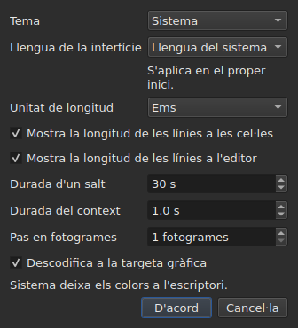

# Les preferències

<!-- machine-translated -->
> Aquesta pàgina és una traducció automàtica i encara no l'ha revisada cap lector de la llengua.

La finestra recorda el que heu fixat amb el ratolí — **on era**, **si
estava maximitzada**, **l'amplada de les seves columnes**, **la posició de la
nansa** entre la pel·lícula i la taula — i **on treballeu**, perquè
`Open…` s'obri al lloc adequat. Res d'això no es configura amb un diàleg:
moveu, arrossegueu, i queda recordat.

**Sis preferències tenen un diàleg propi**, `Edita ▸ Preferències…`, i aquest és el
criteri: una preferència que ja té un gest no necessita un camp. El
tema no en té cap, ni la unitat de les longituds de les línies, ni les dues caselles que
les mostren, ni el salt i l'avançament del reproductor. Vegeu [El tema](#el-tema),
[Les longituds de les línies](#les-longituds-de-les-línies) i [El reproductor](#el-reproductor).

**La llengua de la interfície és al mateix diàleg, i és la que espera**: s'aplica al
llançament següent, no immediatament. Vegeu [La llengua de la interfície](#la-llengua-de-la-interfície).

**El volum no en té**: la barra sota la imatge i dos gestos el fixen, i queda recordat.

**Una altra es configura allà on s'usa**: el costat on `Insert Subtitles…` posa les seves
línies és un camp d'aquell diàleg, i es recorda l'última elecció. Vegeu
[Inserir, suprimir, fusionar i dividir línies](lines.md#el-costat-es-recorda).

**També les dues opcions de la cerca**: `Regular expression` i
`Ignore case` es mantenen marcades o no marcades d'una obertura del diàleg a la
següent, i d'una sessió a la següent. Vegeu
[Cercar i substituir](find-and-replace.md#les-dues-opcions).

**També la configuració d'`Adjust Durations…`**: la velocitat de lectura, els seus dos
sentits, i les tres durades amb les seves caselles — cadascuna conserva el seu valor, marcada
o no. Vegeu [`Adjust Durations…`](operations.md#adjust-durations).

**I l'última codificació triada a `Save As…`**, amb la seva marca d'ordre de
bytes. Vegeu [el fitxer](#el-fitxer).

**I el que fixen l'assistent `Correct Texts…` i `Spell-Check Settings…`**: les
tasques marcades i el seu codi, les caselles dels patrons, la configuració del trencament de línies, la llengua,
l'objectiu de la comprovació i el subratllat mentre s'escriu. Vegeu [Corregeix els textos…](correct-texts.md) i
[Comprova l'ortografia…](check-spelling.md#configuració-de-la-comprovació-ortogràfica). **L'objectiu i el
document de `Correct Texts…` no es recorden.**

**El que no es recorda:** l'últim fitxer obert — vegeu
[El directori recordat](#el-directori-recordat).

## El reproductor

Quatre camps. **Durada d'un salt** i **Durada del context** són els de Gaupol i en tenen els valors; **Pas en fotogrames** i **Descodifica a la targeta gràfica** són propis de subedit:

| Camp | Què fixa | Per defecte | Límits |
| :---- | :----------- | ------: | :----- |
| `Seek length` | el salt de `Seek Backward` i `Seek Forward` | 30 s | d'1 s a una hora |
| `Context length` | l'avançament abans de la selecció, per a `Seek Selection Start`, `Seek Selection End` i `Play Selection` | 1 s | de 0 a 60 s, a la dècima |
| `Frame step` | el pas, **en fotogrames**, de `Step Backward` i `Step Forward`, i del moviment d'una vora | 1 fotograma | d'1 a 1000 fotogrames |
| `Decode on the graphics card` | deixa que la targeta gràfica descodifiqui la pel·lícula quan la màquina en té una; sense targeta, no canvia res | marcat | marcat o no |

S'apliquen **immediatament**, sense esperar un reinici, i es recorden d'una sessió a la següent
sota `video.seek-length` (en segons), `video.context-length-ms` (en mil·lisegons) `video.step-frames` (en fotogrames) i `video.hardware-decoding` (`true` o `false`).
**Un valor fora dels límits, o que no és un nombre**, no impedeix que la finestra s'obri: s'ignora,
es manté el valor per defecte, i la finestra ho diu en obrir-se. **El pas en fotogrames no és mai en mil·lisegons**: un pas de N fotogrames és sempre N fotogrames, sigui quina sigui la freqüència de fotogrames de la pel·lícula — vegeu [Sincronitzar des del vídeo](timing.md#fotograma-a-fotograma). El volum es recorda a `video.volume`,
de 0 a 100, amb la mateixa tolerància.

## El fitxer

```
~/.config/subedit/settings.conf
```

Més exactament `$XDG_CONFIG_HOME/subedit/settings.conf` quan aquesta variable
està definida. S'escriu **quan es tanca la finestra**, i es llegeix quan s'obre.
Un programa interromput — matat, o aturat per una fallada — no escriu res, i la
sessió següent troba el que l'anterior havia deixat.

El fitxer és text, i es pot editar a mà. És una propietat i no
un efecte secundari: és el que fa que un paràmetre es pugui corregir quan la interfície
que el fixa és precisament la que falla.

### Dos blocs, un compartit amb la línia d'ordres

El fitxer s'escriu en **dos blocs**, cadascun sota un comentari d'encapçalament:

| Bloc | Claus | Llegida per |
| :---- | :--- | :------ |
| `# Operation settings: shared by the window and the command line` | les claus `duration-adjust.*` i `correction.*` | la finestra **i** `subedit-cli` |
| `# Display preferences: the window's own` | totes les altres claus — geometria, columnes, tema, llengua de la interfície, cerca, comprovació ortogràfica, editor, vídeo, últim directori, codificació d'escriptura | només la finestra |

**`subedit-cli` llegeix el bloc de les operacions per defecte**: el que `Adjust Durations…` i
`Correct Texts…` recorden aquí és també el punt de partida de [`subedit-cli adjust`](../subedit-cli/adjust.md)
i d'una part de [`subedit-cli correct`](../subedit-cli/correct.md), llevat que una opció de
la línia d'ordres digui el contrari. **No llegeix mai les preferències de visualització.** La seva
ordre [`config`](../subedit-cli/config.md) llista les claus d'operació, en mostra els valors i
els canvia — `subedit-cli config set duration-adjust.speed 12` — i la finestra veu el canvi
en la seva obertura següent. **Un canvi fet mentre la finestra és oberta no sobreviu al seu tancament**: la
finestra reescriu tot el fitxer amb el que conté. `--no-config` fa que una línia d'ordres ignori el
fitxer. Vegeu
[El fitxer de configuració](../subedit-cli/invocation.md#el-fitxer-de-configuració).

El lector accepta les claus en qualsevol ordre, amb els encapçalaments o sense: un fitxer escrit abans que
existissin els dos blocs es llegeix sense canvis, i es reescriu en dos blocs en el tancament següent.

| Opció | Què conté | Per defecte |
| :----- | :------------ | :------ |
| `window.geometry` | `x,y,width,height`, en píxels; amplada i alçada no nul·les | la finestra es dimensiona sola |
| `window.maximised` | `true` o `false` | `false` |
| `table.columns` | quatre amplades en píxels, separades per comes — `#`, `Start`, `End`, `Duration`, fins i tot amagades | la taula es dimensiona sola |
| `table.order` | les sis columnes, **cadascuna una vegada**, en l'ordre en què la taula les mostra: `number`, `start`, `end`, `duration`, `text`, `translation` | `number,start,end,duration,text,translation` |
| `table.hidden` | les columnes retirades, entre `number`, `start`, `end` i `duration`; buit, cap | cap |
| `window.table-share` | la part de l'alçada donada a la taula, en percentatge, d'1 a 99 | la finestra reparteix com ho ha fet sempre |
| `file.directory` | un camí de directori **absolut** | cap: `Open…` s'obre on s'ha llançat el programa |
| `general.theme` | `system`, `light` o `dark` | `system` |
| `interface.language` | `system`, o el nom d'una llengua tal com s'anomena el seu catàleg: dues o tres lletres minúscules, i després opcionalment `_` i dues majúscules — `fr`, `pt_BR`; `en` per a l'anglès | `system` |
| `edit.insert-placement` | `above` o `below` | `below` |
| `file.write-encoding` | el nom d'una codificació que ICU sap escriure, i el convertidor de la qual no escriu la seva pròpia marca | cap |
| `file.write-bom` | `true` o `false` | `false` |
| `search.regex` | `true` o `false` — el patró és una expressió regular | `false` |
| `search.ignore-case` | `true` o `false` — s'ignoren les majúscules i minúscules | `true` |
| `duration-adjust.speed` | la velocitat de lectura, en caràcters per segon, estrictament positiva; un nombre decimal s'escriu tan curt com sigui possible (`15`, `12.5`) | `15` |
| `duration-adjust.lengthen` | `true` o `false` — allargar el que és massa curt per ser llegit | `true` |
| `duration-adjust.shorten` | `true` o `false` — escurçar el que es queda en pantalla més temps del necessari | `false` |
| `duration-adjust.minimum-enabled` | `true` o `false` — es demana la durada mínima | `true` |
| `duration-adjust.minimum-ms` | la durada mínima, en mil·lisegons, entera i no negativa | `1500` |
| `duration-adjust.maximum-enabled` | `true` o `false` — es demana la durada màxima | `false` |
| `duration-adjust.maximum-ms` | la durada màxima, en mil·lisegons, entera i no negativa | `6000` |
| `duration-adjust.gap-enabled` | `true` o `false` — es demana l'interval fins al subtítol següent | `true` |
| `duration-adjust.gap-ms` | l'interval, en mil·lisegons, enter i no negatiu | `0` |
| `correction.mentions.enabled`, `correction.common-errors.enabled`, `correction.capitalization.enabled`, `correction.line-break.enabled` | `true` o `false` — la tasca està marcada a la primera pàgina de `Correct Texts…` | `false`, `true`, `true`, `false` |
| `correction.mentions.code`, `correction.common-errors.code`, `correction.capitalization.code`, `correction.line-break.code` | el codi dels patrons de la tasca: `Zyyy`, o `Script[-language[-COUNTRY]]` — `Latn-en-US`; no buit | `Zyyy` |
| `correction.human`, `correction.ocr` | `true` o `false` — les classes d'errors comuns | `true`, `true` |
| `correction.sound-in-brackets`, `correction.sound-in-parentheses` | `true` o `false` — les dues caselles de la pàgina `Mentions` | `false`, `false` |
| `correction.line-break.max-length` | la longitud màxima d'una línia, decimal; el diàleg la limita d'1 a 1000 | `24` |
| `correction.line-break.max-lines` | el nombre màxim de línies, enter; el diàleg el limita d'1 a 100 | `3` |
| `correction.line-break.in-ems` | `true`: la longitud es mesura en *ems*; `false`: en caràcters | `true` |
| `correction.line-break.skip-on-length`, `correction.line-break.skip-on-lines` | `true` o `false` — es demanen les dues condicions d'omissió | `true`, `true` |
| `correction.line-break.skip-max-length`, `correction.line-break.skip-max-lines` | els dos llindars d'omissió, en la unitat triada | `24`, `3` |
| `correction.join-split.enabled` | `true` o `false` — la tasca `Join or Split Words` està marcada | `false` |
| `correction.join-split.join`, `correction.join-split.split` | `true` o `false` — unir, separar | `true`, `false` |
| `correction.join-split.language` | un codi de configuració regional — `fr`, `en_US`, `sr@Latn` —; buit: la llengua del sistema | buit |
| `correction.remove-blank` | `true` o `false` — `Remove all blank subtitles` | `true` |
| `correction.activations` | les caselles dels patrons que l'usuari ha canviat, `<type>:<code>:<name>:<0\|1>`, separades per comes; **una coma o una barra inversa en un nom s'escriu precedida d'una barra inversa** (`\,` i `\\`), i una entrada il·legible només perd el seu propi paràmetre — se'n dona avís, les altres es conserven | buit |
| `spell-check.language` | un codi de configuració regional, com ara `fr_FR`; buit: la llengua del sistema | buit |
| `spell-check.target` | `selection`, `current-project` o `all-projects` | `current-project` |
| `spell-check.document` | `main` o `translation` | `main` |
| `spell-check.inline` | `true` o `false` — subratllar les paraules desconegudes mentre s'escriu a l'editor d'una cel·la | `false` |
| `editor.length-unit` | `em` o `characters` — la unitat de les longituds de les línies que mostren la taula i l'editor | `em` |
| `editor.show-lengths-cell` | `true` o `false` — cada línia d'una cel·la de text va seguida de la seva longitud | `true` |
| `editor.show-lengths-edit` | `true` o `false` — l'editor d'una cel·la mostra la longitud de cada línia en un marge | `true` |

**El fitxer accepta més que el diàleg.** El lector accepta qualsevol velocitat
estrictament positiva i qualsevol durada no negativa; el diàleg `Adjust
Durations…`, per la seva banda, limita la velocitat d'1 a 99 caràcters per segon i cada
durada de 0 a 99 s. Un valor del fitxer fora d'aquests límits es porta al
límit quan s'obre el diàleg, i el fitxer el conserva així un cop
acceptat el diàleg i tancada la finestra. Un diàleg cancel·lat no canvia res del que
es recorda.

**`file.write-encoding` recorda l'última codificació triada a `Save As…`, i
no s'imposa mai a un fitxer.** Un document obert porta la seva pròpia codificació,
i és la que proposa el quadre: reescriure'l en una altra perquè un
paràmetre de fa tres setmanes ho diu perdria el que la lectura ha conservat.
El que aquest paràmetre recorda serveix al document que no té fitxer — el que
s'acaba de crear.

**És un «no» deliberat i no un descuit.** Qui sempre lliura en
la mateixa codificació i obre fitxers heretats en una altra la torna a triar per a
cada fitxer; el quadre els la proposa, i la garantia del viatge d'anada i tornada es manté
per a tothom.

**`file.write-bom` porta la marca de la mateixa codificació**, i calen ben bé dues
línies: el nom d'una codificació no diu si va precedida de la seva marca, de la mateixa manera
que `--encoding` no diu el que diu `--bom`. Totes dues es llegeixen juntes, en
qualsevol ordre, i un `file.write-bom` sense cap codificació recordada no fixa res.

**Una proporció i no unes alçades per a la nansa**, i això és el que la fa
útil: tres alçades en píxels ja no volen dir res tan bon punt la finestra
s'obre amb una altra mida, i una finestra sovint s'obre amb una altra mida.
La proporció es reprodueix a tot arreu. Es **porta al que la finestra accepta** si
és massa petita — la franja de la pel·lícula té una alçada mínima.

**Quatre amplades per a sis columnes**, i no és un descuit: són les
de `#`, `Start`, `End` i `Duration`, en aquest ordre sigui quin sigui el de la
taula, i **una columna amagada conserva la seva** — la retroba quan es torna a
mostrar. L'última columna mostrada pren el que les altres deixen, i donar-li
una amplada no faria res; les del text i de la traducció, per tant,
no es recorden.

## Què passa quan el fitxer no diu el que s'espera

Una configuració és una comoditat. **La seva fallada costa la comoditat i res
més**: la finestra s'obre en tots els casos.

| Cas | Què passa |
| :--- | :----------- |
| el fitxer no existeix | tots els valors per defecte, i no es diu res — és el primer llançament |
| el fitxer existeix i no es pot llegir | tots els valors per defecte, i el motiu s'escriu a la sortida d'error |
| falta una opció | el seu valor per defecte |
| una clau és desconeguda | s'ignora, sense dir res, i no apareix al fitxer reescrit |
| un valor no es pot llegir | es manté el seu valor per defecte, i l'opció s'anomena a la sortida d'error |

```console
$ subedit-gui film.srt
subedit-gui: /home/vous/.config/subedit/settings.conf: window.geometry: "plus tard" cannot be read, keeping the default
```

**El missatge va a la sortida d'error i enlloc més.** Una finestra
modal en arrencar per una preferència il·legible aturaria l'usuari per
un defecte que no li impedeix res, i abans que hagi demanat res.

## Les opcions en comentari

El fitxer reescrit conté **totes** les opcions conegudes, i les que s'han deixat al
seu valor per defecte s'escriuen en comentari:

```
#window.geometry = 0,0,1280,800
#window.maximised = false
#table.columns = 60,110,110,110
#table.order = number,start,end,duration,text,translation
#table.hidden = start,end
```

No és una afectació. Sense això, una opció mai tocada quedaria
congelada en el valor del dia en què es va escriure, i **un valor per defecte millorat
no arribaria mai a ningú**. Amb això, canviar un valor per defecte canvia el
comportament de tots els que no l'han substituït — que és exactament
el que ha de fer un valor per defecte.

Per substituir una opció: traieu el `#` i canvieu el valor. Per tornar
al valor per defecte: esborreu la línia, o torneu-la a posar en comentari.

La geometria, les amplades i les columnes retirades mostren una **forma** i
no un valor en vigor: el valor per defecte de la geometria i el de les amplades són
«el que tria la finestra», que no s'escriu en nombres, i el de
`table.hidden` és «cap», que no es pot llegir. La capçalera del fitxer també ho
diu. `table.order`, en canvi, sí que mostra l'ordre per defecte.

## El directori recordat

`Open…` s'obre al directori de l'**últim fitxer obert o desat**,
i no al d'un quadre que heu cancel·lat: el que compta és on
treballeu, no on heu mirat.

**L'últim fitxer, en canvi, no es recorda.** Recordar-lo voldria dir
tornar a obrir en el llançament un document que ningú no ha demanat. Recordar un directori
*orienta* un quadre de diàleg; recordar un fitxer n'obriria un.

## El tema

`Edita ▸ Preferències…` s'obre amb el tema, una preferència sense gest, a sobre de les
[longituds de les línies](#les-longituds-de-les-línies).

| Valor | Què fa |
| :---- | :----------- |
| `System` | **res** — els colors continuen sent els de l'escriptori |
| `Light` | aplica una paleta clara |
| `Dark` | aplica una paleta fosca |

El tema triat s'aplica **immediatament**, sense reiniciar.

**«Sistema» no fa res, i no és una mancança.** La versió de Qt sobre
la qual es compila subedit no té cap manera de preguntar a l'escriptori si vol ser
clar o fosc, ni de ser avisada quan canvia d'opinió. En lloc
d'inventar una lectura que no sabem fer, l'eina proporciona els dos temes
que es poden demanar i deixa que el joc d'eines gràfiques decideixi el tercer —
que és el que fa Gaupol en les mateixes condicions.

Amb un escriptori el tema del qual ja és fosc, `System` dona per tant una finestra
fosca; amb un escriptori clar, una finestra clara. `Light` i `Dark` hi passen
per sobre, sigui quin sigui l'escriptori.

**Els tints de les anomalies continuen sent llegibles en totes dues paletes** — vegeu
[La taula](table.md#les-anomalies). No és una suposició: el contrast
del text sobre cadascun dels tints el comprova una prova, sobre tots dos fons.

## La llengua de la interfície

`Edita ▸ Preferències…` tria la llengua de la finestra, sota el tema.

| Camp | Valors | Per defecte |
| :---- | :----- | :------ |
| `Interface language` | `System default`; `English`; després cada llengua instal·lada amb el programa, pel seu propi nom — `Français` | `System default` |

**Té efecte en el llançament següent**, i el diàleg ho diu sota el camp: la finestra es
tradueix a mesura que es construeix, i una finestra en marxa conserva la llengua amb què ha arrencat. L'elecció
es desa al fitxer de configuració, sota `interface.language`, i es llegeix la propera vegada que s'obre la finestra.

| Elecció | La finestra arrenca en |
| :----- | :------------------- |
| `System default` | la llengua de l'entorn, com abans de qualsevol elecció — `LANGUAGE`, `LC_ALL`, `LC_MESSAGES`, `LANG`; vegeu [Llengua](invocation.md#llengua) |
| `English` | anglès, digui el que digui l'entorn |
| una llengua instal·lada | aquella llengua, **digui el que digui l'entorn**, `LC_ALL=C` inclòs: una elecció feta aquí és explícita |

La llista conté les llengües el catàleg de les quals està instal·lat sota `<prefix>/share/subedit/locale`;
l'anglès hi és sempre, ja que és la llengua en què està escrit el programa. Una llengua es mostra
pel seu propi nom, que cap catàleg no tradueix, perquè cada lector trobi la que llegeix.

**Un valor que el programa no pot respectar només costa l'elecció:**

| Què diu el fitxer | Què passa |
| :----------------- | :----------- |
| el nom d'una llengua sense cap catàleg instal·lat — un fitxer portat d'una altra màquina | la finestra segueix l'entorn, sense dir res; `Preferences…` mostra aquella llengua, pel seu nom o pel seu codi, i la conserva llevat que se'n triï una altra |
| una cosa que no és el nom d'una llengua — `French`, `fr_FR.UTF-8` | `system`, el valor per defecte, i l'opció s'anomena a la sortida d'error, com qualsevol valor il·legible |

```console
$ subedit-gui film.srt
subedit-gui: /home/vous/.config/subedit/settings.conf: interface.language: "French" cannot be read, keeping the default
```

**La línia d'ordres no la llegeix mai**: `subedit-cli` tria la seva llengua només a partir de
l'entorn, i `subedit-cli config set interface.language fr` es rebutja com a preferència de visualització.

## Les longituds de les línies




`Edita ▸ Preferències…` també fixa **el que la taula i l'editor mostren de la
longitud de les línies** — el regle i el marge de Gaupol.

| Camp | Què fa | Per defecte |
| :---- | :----------- | :------ |
| `Length unit` | la unitat de les longituds: `Ems` o `Characters` | `Ems` |
| `Show line lengths in cells` | cada línia d'una cel·la de text va seguida de la seva longitud | marcat |
| `Show line lengths in the editor` | l'editor d'una cel·la mostra la longitud de cada línia en un marge a la dreta | marcat |

**`Length unit` està en gris quan cap de les dues caselles no està marcada**: sense
cap longitud per mostrar, la unitat no fixa res. L'elecció s'aplica **immediatament** a la
taula, i els editors que s'obren després la segueixen. Els tres valors es
recorden d'una sessió a la següent: `editor.length-unit`, `editor.show-lengths-cell`
i `editor.show-lengths-edit`, a la taula [del fitxer](#el-fitxer). Vegeu
[La longitud de les línies](table.md#la-longitud-de-les-línies) i
[a l'editor](editing.md#la-longitud-de-les-línies).

**No és el límit de l'assistent.** La unitat de `Correct Texts…` — la
longitud a la qual trenca les línies — és un paràmetre a part, al seu
assistent: podeu llegir ems a la taula i trencar en caràcters.

## Què no es pot configurar

**Nou paràmetres recordats es trien en un diàleg** — sense comptar els de
l'assistent de correcció i de la comprovació ortogràfica, que en tenen cadascun
el seu —, i cadascun en aquell on s'usa: el tema i els tres paràmetres de les longituds de les línies, aquí; el costat d'una inserció, al diàleg d'inserció;
les dues opcions de la cerca, al diàleg de cerca; la codificació i
la marca d'ordre de bytes, a `Save As…`; la velocitat de lectura, les durades
i l'interval de l'ajust de les durades, al seu propi diàleg. No n'hi ha
cap altre: no es pot configurar res per als diagnòstics, el volum del reproductor,
ni el format de desament per defecte — aquest prové del fitxer obert.

I **cap nombre que pertanyi a un document no es conserva d'una sessió a
la següent**: una quantitat de desplaçament, dues referències de transformació són certes d'un
fitxer i falses del següent. Els diàlegs les tornen a demanar a cada llançament,
deliberadament. La configuració d'`Adjust Durations…` és una excepció de la mateixa manera que
les dues opcions de la cerca: una velocitat de lectura, una durada mínima o
un interval són eleccions de mètode més que mesures d'un fitxer, i
persisteixen d'una sessió a la següent per aquest motiu.

Aquest manual descriu el que existeix: el que vindrà és al
[full de ruta](../../../../feuille-de-route.md).
