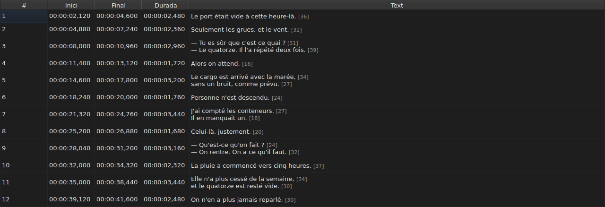
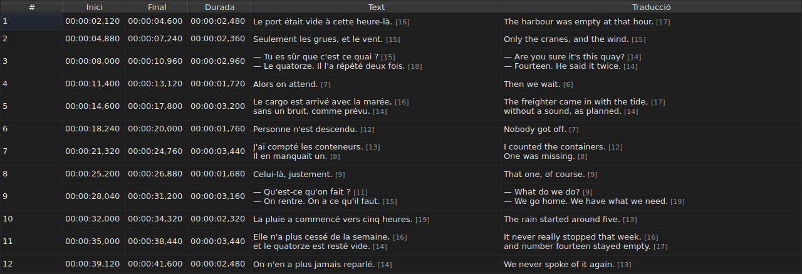
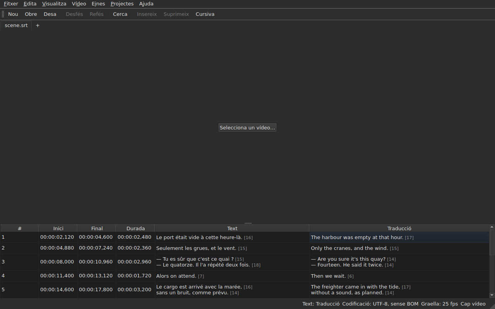

# La taula

<!-- machine-translated -->
> Aquesta pàgina és una traducció automàtica i encara no l'ha revisada cap lector de la llengua.

La finestra mostra els subtítols del fitxer obert, un per línia, en cinc
columnes — sis quan el projecte porta una traducció.

**Aquest manual cita els encapçalaments de la finestra tal com els mostra la finestra
anglesa**, com fa per a la línia d'ordres; una finestra traduïda els mostra en
la seva pròpia llengua.

| Columna | Què mostra |
| :----- | :------------ |
| `#` | el rang del subtítol, a partir d'1 |
| `Start` | la posició on apareix, `HH:MM:SS,mmm` |
| `End` | la posició on desapareix |
| `Duration` | `End − Start` |
| `Text` | el text del subtítol |
| `Translation` | la traducció del subtítol — **absent mentre el projecte no en tingui** |


## La longitud de les línies




**Cada línia d'una cel·la de text va seguida de la seva longitud**, `[N]`, més petita
i més pàl·lida — a la columna `Text` com a la columna `Translation`.
És el que fa Gaupol.

| Què compta | Què fa la taula |
| :---------- | :------------------ |
| **les etiquetes** | no compten: `<i>Bonjour</i>` fa `[7]`, com `Bonjour` |
| **l'arrodoniment** | cap avall: una línia de 12,9 ems es mostra `[12]` |
| **una línia buida** | no té longitud; un text buit tampoc |
| **la unitat** | *ems* per defecte, o caràcters — `Edita ▸ Preferències…` |
| **una línia massa llarga per a la columna** | es talla amb `…` **abans** del nombre, que continua visible |

**L'*em* és el de Gaupol, no el de la tipografia**: l'alfabet en minúscules
val 0,55 em per lletra, amb el tipus de lletra de la taula. Una longitud en *ems*, per tant,
depèn del tipus de lletra; una longitud en caràcters compta punts de codi, un
accent per un.

**La taula no marca una línia massa llarga.** Mostra el nombre, i correspon a
l'ull comparar-lo amb el límit que us heu fixat — com Gaupol. No és
el límit de l'assistent `Correct Texts…`, que té el seu propi paràmetre.

**Per no veure-les:** desmarqueu `Show line lengths in cells` a
`Edita ▸ Preferències…`. Vegeu [Les longituds de les línies](preferences.md#les-longituds-de-les-línies).

## Amagar i moure les columnes

**`Visualitza ▸ Columnes`** porta una entrada per marcar per cada columna, **excepte `Text`**:
sense el text principal, no quedaria res per editar.

| Entrada | Columna |
| :---- | :----- |
| `Visualitza ▸ Columnes ▸ Núm.` | `#` |
| `Visualitza ▸ Columnes ▸ Inici` | `Start` |
| `Visualitza ▸ Columnes ▸ Final` | `End` |
| `Visualitza ▸ Columnes ▸ Durada` | `Duration` |
| `Visualitza ▸ Columnes ▸ Traducció` | `Translation` — vegeu [La columna de traducció](#la-columna-de-traducció) |

Desmarcar una entrada retira la seva columna, tornar-la a marcar la torna a posar, amb l'amplada
que tenia. **El paràmetre s'aplica a tota la finestra**, totes les pestanyes
incloses: hi ha una sola taula, el projecte de la qual canvia amb la pestanya.

**La cel·la actual surt de la columna que es retira**: passa a `Text`,
a la mateixa línia, i la selecció no es mou. Una cel·la actual en una
columna que ningú no veu seria una cel·la que una tecla editaria
a cegues.

**Les columnes es mouen arrossegant-ne la capçalera**, qualsevol d'elles, `Text`
inclosa. L'última columna mostrada pren l'espai que les altres deixen.

**L'ordre i les columnes retirades es recorden d'una sessió a la següent**, amb
les amplades, al [fitxer de preferències](preferences.md) — `table.order`
i `table.hidden`. La columna de traducció no hi és: segueix la seva pròpia
regla, i torna amb cada traducció oberta.

**El número no és una dada del fitxer** sinó el rang de la línia. Una
inserció o una supressió, per tant, renumera tot el que segueix, sense que es
reescrigui res.

**El separador decimal segueix el format del fitxer**: una coma per a SubRip,
un punt per als vuit altres. SubRip és l'únic dels nou que escriu una coma.

**És el separador el que segueix, no tota la grafia.** La taula sempre escriu
les hores i sempre tres decimals; un fitxer WebVTT omet les
hores per sota d'una hora, SubViewer 2 i els dos Sub Station Alpha compten en
centèsimes, MPL2 en dècimes, TMPlayer en segons, MicroDVD en fotogrames. Una
columna l'amplada de la qual seguís el format seria més pesada de llegir que una
columna que simplement no és la grafia exacta del fitxer.

El que la taula garanteix, per tant, és **el valor i el separador**, no el nombre
de decimals. El que un format de destinació arrodoniria es diu en el moment de
desar — vegeu
[Què no portarà un format](files.md#què-no-portarà-un-format-dit-abans-descriure).

**La durada (`Duration`) es calcula**, mai no s'emmagatzema: escriure-la mou el
final. Un subtítol el final del qual precedeix el seu
inici mostra una durada negativa en lloc de zero: és una anomalia del
fitxer, i amagar-la la faria impossible de trobar.

**L'inici, el final, la durada, el text i la traducció s'editen al lloc**; el
número no. Vegeu [Editar una cel·la](editing.md).

**La selecció designa allò a què s'aplica una operació** — vegeu
[Les operacions](operations.md).

**L'alçada d'una línia segueix el subtítol que porta**: un subtítol de
dues línies n'ocupa dues, un de tres n'ocupa tres. El text es mostra
sencer, tal com s'escriurà.

**El que continua tallat és una línia massa llarga per a la seva columna**, i llavors
acaba amb punts suspensius. Eixamplar la columna `Text`, o la finestra, la mostra
sencera; obrir la cel·la, també. Les línies del text no es
reajusten mai: només un salt de línia real fa una línia, de manera que l'alçada
d'una fila de la taula no canvia quan arrossegueu la vora d'una columna.

## Les posicions en fotogrames

**`Visualitza ▸ Posicions en fotogrames`** — una entrada per marcar, un sol paràmetre per a la finestra — mostra les
columnes `Start` i `End` **com a números de fotograma** en lloc de marques de temps, i **accepta un número de fotograma com a entrada**. Les
capçaleres ho diuen: `Start (frames)` i `End (frames)`.

| Què canvia | Què no canvia |
| :----------- | :------------------- |
| el que escriuen `Start` i `End`, i el que accepten | la columna `Duration`, que continua sent un temps |
| les capçaleres d'aquestes dues columnes | el document: no es modifica res, l'historial no té cap entrada nova, i **el que escriu el fitxer és el que escrivia** |

**La freqüència de fotogrames que compta els fotogrames** és, en aquest ordre:

1. **la del fitxer**, quan es compta en fotogrames — MicroDVD, que porta números i cap
   freqüència de fotogrames: **la finestra mostra llavors les xifres del seu fitxer**, sigui quin sigui el vídeo;
2. **la que declara el vídeo associat**;
3. **la graella que dibuixen les posicions**, quan en dibuixen una.

L'indicador de funció de l'entrada diu quina s'ha retingut: *Les posicions són números de fotograma, comptats a 25 fps, la freqüència que
declara el vídeo*. **Sense cap de les tres, l'entrada està desactivada, i el seu indicador de funció diu per què**: el fitxer no
es compta en fotogrames, el vídeo no declara cap freqüència de fotogrames, i les posicions no cauen en cap graella.

- **Un número és el número del fotograma on cau la posició**, arrodonit al fotograma més proper. **Escrit, dona
  l'instant en què comença aquest fotograma**, arrodonit **una sola vegada** a partir de la raó exacta
  ([ADR 0013](../../../../adr/0013-mise-a-l-echelle-exacte-des-positions.md)): el fotograma 37 a 23,976 fotogrames per segon
  comença a 1.543,04 ms, és a dir `00:00:01,543`.
- **Només s'accepten nombres enters** — amb el signe menys, ja que un inici pot precedir la pel·lícula. Una
  marca de temps escrita en mode fotogrames, o un nombre que no ho és, deixa la cel·la com era.
- **La barra de reproducció segueix el mateix paràmetre**: la posició i la durada a banda i banda del control lliscant
  s'escriuen com a números de fotograma igual que `Start` i `End`, en el mateix instant — vegeu
  [La barra de reproducció](player.md#la-barra-de-reproducció). El rellotge dibuixat a dalt de la imatge continua sent una
  marca de temps.
- **Aquest paràmetre no es recorda** d'una sessió a la següent: és un paràmetre de la finestra, no d'un
  document, i es torna a activar amb un sol gest.

## Les anomalies

Un subtítol les posicions del qual no lliguen entre elles queda **tenyit a les seves
columnes de temps**, i passar-hi per sobre diu què no va bé.

| Tint | Què indica | Què cal fer |
| :--- | :-------------- | :--------- |
| vermell | `ends before it starts` | corregir-ne el final, o l'inici |
| blau | `starts before the previous one starts` | tornar-lo a posar al seu lloc en l'ordre |
| ambre | `starts before the previous one ends` | ajustar-ne la sincronització |


Només es tenyeixen les columnes `Start`, `End` i `Duration`: una anomalia
només parla del temps, i tenyir el text suggeriria que hi tenia alguna cosa
a veure.

**Un subtítol en pot portar diverses**, i l'indicador de funció les anomena totes. El
tint és el de la primera que cal reparar: un subtítol trencat en si mateix
està trencat facin el que facin els seus veïns; un subtítol mal situat es torna a posar al seu lloc,
i el seu encavalcament desapareix amb ell.

> No és casualitat que el desordre gairebé sempre guanyi sobre
> l'encavalcament: començar abans que comenci l'anterior és començar
> abans que acabi — llevat que l'anterior estigui ell mateix trencat.

**El marcatge es torna a calcular després de cada canvi de posició**, tant si prové
d'una cel·la editada, d'una operació o d'un desfer. Diu què és ara el
fitxer, no què era en obrir-lo.

No es basa en cap graella de fotogrames: tan bon punt una posició es corregeix a
mà, en surt, i un marcatge basat en ella indicaria la feina de
l'usuari.

## La columna de traducció

Un subtítol porta **dos textos i un sol parell de posicions**: la
traducció no té sincronització pròpia, està lligada a la del subtítol.
La taula la mostra en una sisena columna, `Translation`, a la dreta de `Text`.




**La columna només hi és si el projecte té una traducció.** Sense traducció, la taula
conserva les seves cinc columnes, i la finestra es comporta com si la traducció
no existís — no es posa res en gris ni s'afegeix res. `Fitxer ▸ Obre una traducció…` n'obre
una: vegeu [Obrir una traducció](files.md#obrir-una-traducció).

**Una entrada del menú `View` la mostra o la retira**:

| Entrada | Què fa |
| :---- | :----------- |
| `Visualitza ▸ Columnes ▸ Traducció` | marcada: es mostra la columna; no marcada: es retira |

L'entrada està **desactivada quan el projecte no té traducció** — no hi ha res per
mostrar — i marcada en arrencar. **La decisió de retirar-la és de
l'usuari**: es manté d'un fitxer al següent, fins que es torna a
marcar. Retirar la columna no retira la traducció: es queda al
projecte, i torna amb l'entrada. Obrir un fitxer que no en porta cap retira la
columna.

**A les cel·les de la traducció s'hi escriu com a les del text** — vegeu
[Editar una cel·la](editing.md).

### El text a què s'adrecen les operacions

Amb dos textos en una línia, les operacions de text han de saber quin
reescriuen. **És el de la columna de la cel·la actual**: la
traducció si la cel·la actual és a la columna `Translation`, el text
principal a tot arreu més — tant en una columna de temps com a `Text`.

| Operació | A què s'adreça |
| :-------- | :-------------- |
| `Italic`, `Case`, `Dialogue`, `Remove Hearing-Impaired Mentions…` | el text de la columna actual |
| `Cut Texts`, `Copy Texts`, `Paste Texts` | el text de la columna actual |
| `Find and Replace…` | el text de la columna actual — vegeu [Cercar i substituir](find-and-replace.md#en-quin-text) |
| les operacions de posició, la inserció, la supressió, la fusió, la divisió | **tots dos textos**: un subtítol és un tot |

**La barra d'estat ho diu quan hi ha dos textos**, a l'esquerra de les altres
indicacions:

```text
Text: Translation
```

o `Text: Main` per al text principal. No diu res quan la columna no es
mostra: llavors només hi ha un text, i no cal dir-ho.




**La línia dibuixada sobre la imatge segueix la mateixa regla**: és el text de la
columna actual. Vegeu [El reproductor](player.md#la-línia-dibuixada).

**No es posa res en gris.** Les operacions de text continuen disponibles sigui quina sigui
la columna actual, i sense columna de traducció s'adrecen al text
principal, com abans.

## Afegir i suprimir línies

`Edita ▸ Insereix subtítols…` i `Edita ▸ Suprimeix els subtítols` afegeixen i suprimeixen
línies, `Edita ▸ Fusiona els subtítols` i `Edita ▸ Divideix el subtítol` les fusionen i les
divideixen; la taula es renumera sola. Vegeu
[Inserir, suprimir, fusionar i dividir línies](lines.md).

## El que la taula no fa

**L'ordenació per columna no existeix.** L'ordre mostrat és el del fitxer, i
és l'únic que té sentit per als subtítols: el rang d'una línia *és*
el seu lloc en el temps.
