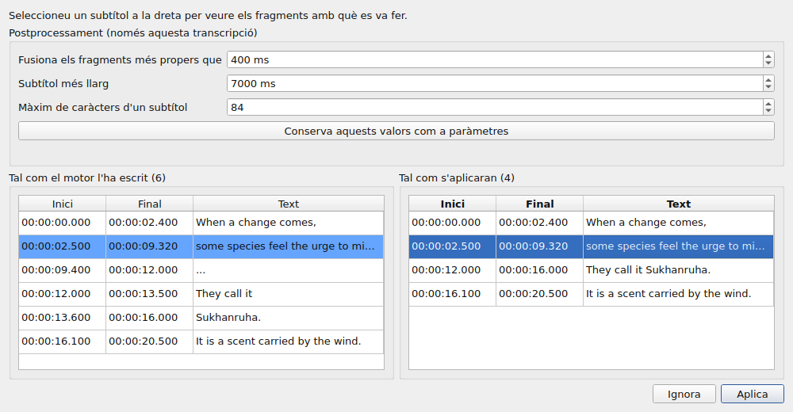
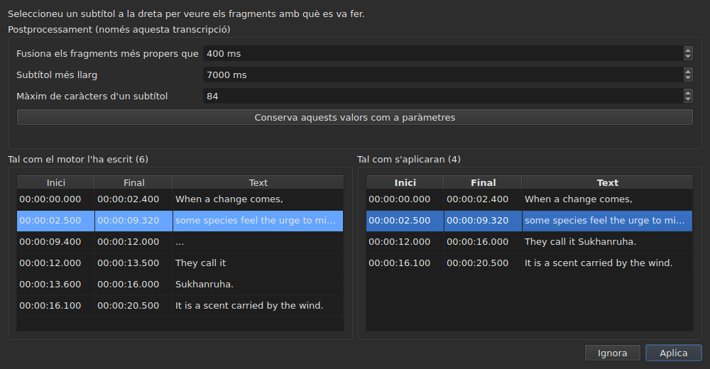

# El vídeo associat

<!-- machine-translated -->
> Aquesta pàgina és una traducció automàtica i encara no l'ha revisada cap lector de la llengua.

El menú **Vídeo** porta primer tres ordres, i els gestos que condueixen la pel·lícula
— vegeu [El reproductor](player.md#desplaçar-se-per-la-pellícula).

| Ordre | Drecera | Què fa |
| :------ | :------- | :----------- |
| Selecciona un vídeo… | cap | tria el fitxer de vídeo amb què va el document |
| Transcriu l'àudio… | cap | transcriu l'àudio de la pel·lícula en subtítols que substitueixen els del projecte — vegeu [Transcriure l'àudio](#transcriure-làudio) |
| Sincronitza amb l'àudio… | cap | mou els subtítols del projecte a on es diuen les seves paraules a l'àudio de la pel·lícula — vegeu [Sincronitzar amb l'àudio](#sincronitzar-amb-làudio) |
| Reprodueix / Pausa | `Ctrl+P` | reprodueix o atura el vídeo — vegeu [El reproductor](player.md#reproduir-i-aturar) |

El vídeo associat és **una propietat del document obert**, no un paràmetre de
l'aplicació: obrir un altre fitxer de subtítols torna a començar de zero. No
s'escriu a cap fitxer i desapareix amb la finestra.

## La pista d'àudio

Una pel·lícula pot portar diverses pistes de so — la versió original, un doblatge, un comentari. El
submenú **`Vídeo ▸ Àudio ▸ Llengua`** les llista, **una entrada per pista**, i **marca la que sona**:

| Què dona el fitxer | Què diu l'entrada |
| :------------------ | :------------------ |
| una llengua i un títol | `1: fra — Original` |
| només una llengua | `2: eng` |
| només un títol | `3: Commentary` |
| cap dels dos | `1` |

El número és **el lloc de la pista a la pel·lícula**, una per una, en l'ordre del fitxer: dues pistes
poden dir `eng`, i un fitxer que no diu res de les seves etiquetes continua tenint una primera i una segona.

**Triar una entrada reprodueix aquesta pista.** La marca és la resposta del reproductor, no el clic: indica la
pista que sona.

- **El submenú està desactivat** sense vídeo o sense pista d'àudio. Amb una sola pista, continua activat i
  la mostra, marcada: indica la llengua de la pel·lícula. Els dos gestos de volum, que hi són al costat, continuen
  activats en tot cas: vegeu [El volum](player.md#el-volum).
- **La pista no es recorda** d'un vídeo al següent, ni d'una sessió a la següent: un número de pista és
  el del seu fitxer, i traslladar-lo a la pel·lícula següent triaria el que hi porti aquest número.
  Tornar a una pestanya torna a obrir la seva pel·lícula a la pista que el reproductor tria per si mateix.
- Cap drecera: es canvia de llengua poques vegades, i el menú n'hi ha prou.

## Triar un vídeo

El diàleg s'obre al directori del fitxer de subtítols i filtra per
les extensions de vídeo reconegudes:

    .avi .flv .m2ts .mkv .mov .mp4 .ogg .ogv .vob .webm

També ofereix mostrar tots els fitxers. Cancel·lar el diàleg no canvia
res.

El fitxer triat **s'obre immediatament**: la imatge apareix a la finestra,
en pausa en el seu primer instant. Vegeu [El reproductor](player.md).

**Deixar anar un fitxer de vídeo a la finestra fa el mateix** — vegeu
[Deixar anar fitxers a la finestra](files.md#deixar-anar-fitxers-a-la-finestra).

**El vídeo és el del projecte de la pestanya actual.** Cada pestanya conserva
el seu; canviar de pestanya canvia de pel·lícula. **Tornar a una pestanya reprèn la seva
pel·lícula allà on l'havíeu deixat**, en pausa, com qualsevol obertura. Una altra pel·lícula
triada per a aquest projecte entretant comença, en canvi, des del principi.

## La proposta automàtica

Quan s'obre un fitxer de subtítols, **si no s'ha triat cap vídeo**,
la finestra en cerca un al mateix directori: un fitxer de vídeo el nom del qual
sense extensió és un prefix del nostre, fins a un punt.

| Fitxer de subtítols | Vídeo trobat | Per què |
| :------------ | :---------- | :-- |
| `film.fr.srt` | `film.mkv` | `film` és un prefix de `film.fr` |
| `film.en.forced.srt` | `film.mkv` | igualment, sigui quin sigui el nombre de segments |
| `film.fr.srt` | `film.fr.mkv` en lloc de `film.mkv` | guanya el nom més llarg |
| `film.fr.srt` | cap, si hi ha `film.mkv` **i** `film.mp4` | dos candidats no es poden distingir |
| `film.fr.srt` | cap, si només hi ha `fil.mkv` | `fil` no s'atura en un punt |

**Una proposta no és una elecció.** Es deixa substituir per una altra
proposta — obrir un altre fitxer, desar amb un altre nom. Una elecció
explícita, en canvi, no se sobreescriu mai: un cop s'ha fet servir `Select Video…`, la
proposta automàtica ja no hi torna al darrere.

És el que fa acceptable l'endevinalla: es pot corregir, i la seva
correcció es manté.

## Què mostra la barra d'estat

A la dreta de la barra d'estat, una línia diu amb què va el document.
És l'última de tres: la [codificació](files.md#la-codificació-a-la-barra-destat)
del fitxer llegit va primer, la [graella de fotogrames](frame-grid.md) deduïda de les
posicions després.

| Situació | Què s'escriu |
| :-------- | :-------------- |
| hi ha un vídeo associat | `Video: film.mkv` |
| … i `ffprobe` en dona la freqüència de fotogrames | `Video: film.mkv, 24000/1001 fps` |
| cap | `No video` |

**La freqüència de fotogrames va amb la pel·lícula en lloc d'anar al seu costat.** Són un sol fet — amb què
va aquest document — i una tercera menció la posaria al mateix rang que
la [graella deduïda de les posicions](frame-grid.md), que és un altre fet.

## Transcriure l'àudio

**`Transcribe Audio…`** escriu la parla de la pel·lícula en forma de subtítols. Està desactivada fins que s'obre una pel·lícula: és
l'àudio de **la pel·lícula del projecte**, i mai un fitxer que triaríeu — per transcriure un
fitxer d'àudio, useu [`transcribe`](../subedit-cli/transcribe.md) a la línia d'ordres.

El diàleg demana quatre coses, i diu si pot començar:

- **la pista d'àudio**, llistada com la llisten el menú [`Audio`](#la-pista-dàudio), amb la llengua
  i el títol que declara el fitxer;
- **la llengua**, triada en una **llista**: primer una entrada que la detecta, “Detecta a partir dels primers 30 segons de so”, després les llengües que el
  motor ofereix per al model, pel nom en la llengua de la finestra i seguides del seu codi — “Francès (fr)”. La llista és la del
  motor mateix: un centenar amb un model multilingüe; amb un model només per a l'anglès té una sola entrada, l'anglès, i no es pot
  canviar, i una línia diu que la pel·lícula sortirà en anglès sigui quina sigui la llengua que parli. La llista comença amb la llengua de la pista
  triada quan el fitxer en declara una i el motor l'ofereix, segueix la pista mentre no n'hàgiu triat cap, i
  **una línia sota seu diu d'on ve**. Quan el fitxer no declara cap llengua per a la pista, la línia ho diu, i avisa:
  el model la detectarà aleshores a partir dels primers trenta segons de so, i **una pel·lícula que comença amb música o silenci pot ser presa per
  una altra llengua i la seva parla traduïda a aquesta**. Trieu la llengua si la coneixeu;
- **els sons escrits com a notes**: un quadre, “No escriguis els sons com a notes”, marcat per defecte. Al motor se li diu aleshores que no escrigui els sons com a
  notes, com `(phone ringing)` o `[MUSIC PLAYING]`; allà on no té parla per escriure, escriu `...`, i els trossos que no tenen cap lletra ni cap xifra
  els descarta el postprocessament. Desmarqueu el quadre per conservar les notes, per a subtítols per a persones sordes o amb dificultats auditives. El quadre és gris, amb el motiu,
  per a un motor al qual no se li pot dir. És el paràmetre `transcription.suppress-notes`, que les [preferències](preferences.md#transcripció)
  també contenen;
- **la part de la pel·lícula**, d'un temps a un altre — vegeu [Provar primer una part](#provar-primer-una-part). Amb els dos
  camps buits, és tota la pel·lícula.

**També diu què hi falta.** Tres línies diuen si el motor, `ffmpeg` i el model hi són, i
on; quan un no hi és, `OK` queda apagat, i el diàleg ho diu amb la referència a
[Instal·lació de les eines de transcripció](../subedit-cli/install-transcription.md). Un botó `Preferences…` obre
les [preferències](preferences.md#transcripció), on s'indiquen el programa i el model — són fets
sobre la màquina, no eleccions que calgui refer a cada transcripció — i el diàleg torna a mirar quan es tanquen.

La llengua es conserva per a la vegada següent. El motor mateix i els límits dels subtítols són
[paràmetres](preferences.md) (`transcription.*`).

**Quan el projecte ja conté subtítols, la finestra pregunta abans de substituir-los**, i diu
quants se'n van. Pregunta abans de la feina, de manera que declinar no costa res. Quan el projecte és buit no
hi ha res a preguntar.

La feina s'executa **en segon pla**, amb un quadre i un botó `Cancel`; la finestra continua utilitzable al voltant. **El quadre
diu en quin punt és la feina**, perquè sapigueu que és viva i quant trigarà:

- **el pas**: primer “Extracció de l'àudio…” — el quadre és aleshores ocupat, sense xifra, ja que extreure no diu res de fins on ha
  arribat —, després “Transcripció de l'àudio…”, amb una barra;
- **el temps que queda**, “queden uns 38 min”: absent al principi, mostrat quan el motor ha informat prou progrés per extrapolar, i calculat a partir de la seva velocitat des de l'inici fins al darrer minut; és una precisió de pocs minuts, no una promesa;
- **el temps transcorregut**, “temps transcorregut: 0:05:12”, que avança fins i tot quan res més no es mou;
- **la posició**, “0:12:30 de 0:50:00”: fins on de la pel·lícula ha arribat el motor, tan bon punt ha produït el seu primer text, mostrada **just a sobre del darrer text** al qual correspon;
- **el darrer text** obtingut, perquè veieu que la feina té sentit.

En una pel·lícula llarga amb un model gran en un processador, els primers minuts poden ser llargs: el motor carrega el model i treballa en les seves
primeres finestres de trenta segons. La posició i el darrer text es mouen abans que el tant per cent propi del motor, que només ve a intervals
del 5 % de la pel·lícula.

### La previsualització

**Res no substitueix els subtítols del projecte fins que els heu vist.** Quan la feina acaba — i també quan la cancel·leu, o falla
després d'haver produït alguna cosa —, una finestra mostra el resultat en dues taules una al costat de l'altra, cadascuna amb **el seu propi inici i final**:

- **a l'esquerra, “Tal com el motor l'ha escrit”**: tot el que el motor ha retornat, tal com ho ha tallat, sense cap postprocessament — el que
  escriuria [`--raw`](../subedit-cli/transcribe.md) —, els marcadors de posició (`...`) inclosos;
- **a la dreta, “Tal com s'aplicaran”**: els subtítols després del postprocessament, exactament el que entrarà al projecte. Es fa en tres passos, cadascun sobre tota la transcripció abans que comenci el següent: es descarten els trossos sense lletra ni dígit (`...`); es fusionen els trossos propers d'una mateixa frase; es tallen els que són massa llargs — **primer en un final de frase (`. ? ! …`), després en una coma, un punt i coma o dos punts, i enmig d'una frase només quan no hi ha puntuació on tallar**. S'evita un tall que deixaria un subtítol massa petit per llegir-se (uns pocs caràcters, una fracció de segon) quan n'hi ha un altre. Un subtítol que comença un tros en conserva l'inici, i el que l'acaba en conserva el final: els temps de les paraules només serveixen per als talls dins d'un tros.

Per sobre de les taules, **“Postprocessament (només aquesta transcripció)”** conté els tres límits del postprocessament: “Fusiona els fragments més propers que”, “Subtítol més llarg” i “Màxim de caràcters d'un subtítol” — els paràmetres `transcription.merge-gap-ms`, `transcription.max-duration-ms` i `transcription.max-characters`. **Canviar-ne un refà a l'acte la taula de la dreta**, sense passar pel motor, i el subtítol que teníeu seleccionat continua seleccionat. Els valors que escriviu valen només per a **aquesta transcripció**: l'apliqueu o l'ignoreu, els paràmetres de l'aplicació queden com eren. **“Conserva aquests valors com a paràmetres”** lliura els tres valors als paràmetres de l'aplicació — els de les [preferències](preferences.md#transcripció), desats amb ells —, i la finestra ho diu; tancar la finestra no ho fa per si sol.

Les dues no s'alineen fila per fila, per això cadascuna té els seus temps. **Seleccionar un subtítol a la dreta ressalta, a l'esquerra, els trossos
amb què es va fer**, i hi desplaça l'esquerra; un subtítol alhora, només en aquest sentit. Cap de les dues taules no es pot editar: el que cap paràmetre no deixa bé s'edita després, a la taula del projecte, com qualsevol subtítol.

Dos botons la tanquen. **“Aplica”** substitueix els subtítols del projecte **com una sola operació**: un sol `Undo` retorna el que hi havia, textos de
traducció inclosos. **“Ignora”** descarta el resultat, i es perd. “Aplica” és apagat quan
no hi ha res a aplicar.

**Quan la feina s'ha aturat**, la finestra ho diu — “Resultat parcial: el treball s'ha aturat a …” — i ofereix el que s'havia obtingut fins aleshores, per aplicar-ho
o ignorar-ho, de manera que una execució llarga aturada tard no perdi la feina sense demanar-ho. Aquests trossos no tenen paraules amb temps (el motor les escriu al final), i el
postprocessament talla als límits propis dels trossos. Un error es diu primer en un quadre, com tot error; una cancel·lació no diu res d'aquest tipus.

### Provar primer una part

Un interval permet **jutjar un model o una llengua en dos minuts abans de comprometre's amb dues hores**. Els camps “Part de la pel·lícula” accepten un inici i un final, cadascun escrit `HH:MM:SS` i sobreescrit xifra a xifra, com en [el diàleg de desplaçament](operations.md#shift-positions) (un temps enganxat com `2:00` es posa en forma); se'n permet només un (d'allà fins al final, o del principi fins allà). `OK` queda apagat mentre un camp no
és un temps o el final no ve després de l'inici, i una línia sota els camps diu quin.

- **Els subtítols conserven el temps de la pel·lícula**: el que es diu a 2:10 és a `0:02:10` al resultat.
- **Passa per la previsualització com qualsevol transcripció**, i substitueix els subtítols del projecte un cop aplicada; un `Undo`
  els retorna. Per provar un interval sense tocar la vostra feina, ignoreu la previsualització, o deseu primer.

**El que necessita no es lliura**: un motor (whisper.cpp), un model, i `ffmpeg` per extreure l'àudio.
Vegeu [Instal·lació de les eines de transcripció](../subedit-cli/install-transcription.md).

## Sincronitzar amb l'àudio

**`Synchronize with Audio…`** resincronitza els subtítols del projecte segons l'àudio de la pel·lícula. És el cas del `.srt`
baixat d'internet, desfasat a l'inici i al final, que un sol desplaçament no arregla: cada subtítol es cerca en el que es
diu, i pren el lloc on es diu. **Només canvien els inicis i els finals** — mai el text, l'estil, el nombre de
subtítols ni el seu ordre. Com `Transcribe Audio…`, està desactivada fins que s'obre una pel·lícula, i és l'àudio de **la pel·lícula del projecte**; la
mateixa ordre a la línia d'ordres és [`sync`](../subedit-cli/sync.md).

Els subtítols han de ser en la llengua que es parla: no es tradueix res. La feina la fa el motor que transcriu — el de
les [preferències](preferences.md#transcripció), amb el mateix programa, `ffmpeg` i model — i **el diàleg diu què hi falta** exactament com el de la transcripció, amb la referència a [Instal·lació de les eines de transcripció](../subedit-cli/install-transcription.md) i un
botó `Preferences…`.

El diàleg demana:

- **la pista d'àudio** i **la llengua**, com per a la transcripció;
- **la part de la pel·lícula**, d'un temps a un altre, tots dos buits per a tota la pel·lícula: només els subtítols que **comencen** dins de l'interval
  es cerquen i es mouen;
- **“Només els subtítols seleccionats”**: un quadre, apagat quan no hi ha res seleccionat. Cerca només els subtítols seleccionats, a la part de la
  pel·lícula que comença un minut abans del primer i acaba un minut després de l'últim, de manera que un fitxer endarrerit o avançat
  continuï dins del que s'escolta;
- **“Paraules per sentir”**, en percentatge: la part de les paraules d'un subtítol que s'han de sentir perquè el subtítol es consideri trobat, 50 % per defecte — el
  paràmetre `alignment.min-match`;
- **“Desplaçament per revisar”**, en mil·lisegons: quant pot allunyar-se un subtítol del desplaçament dels veïns abans de ser assenyalat, 2000 ms per defecte —
  el paràmetre `alignment.doubt-gap`.

Els tres últims es conserven per a la vegada següent. La feina s'executa **en segon pla**, amb el mateix quadre i el mateix botó `Cancel` que la transcripció;
una execució que falla o que atureu no canvia res.

### El resultat

**Res no es mou fins que heu vist on anirien els subtítols.** Quan la feina acaba, una finestra mostra, per a cada subtítol cercat,
el seu número, el seu text, **l'inici que tenia, l'inici que pren, el desplaçament entre tots dos**, i què hi ha **per revisar**, amb paraules:

- **“no trobat a l'àudio, deixat tal com era”**: s'han sentit menys paraules de les que demana el quadre. El subtítol conserva els seus temps — **cap posició
  no s'inventa mai, i cap no s'endevina a partir dels veïns**;
- **“només sentit en part”**: trobat, però s'ha sentit menys del 80 % de les seves paraules;
- **“desplaçat de manera diferent dels veïns”**: trobat, però el seu desplaçament s'allunya del desplaçament mitjà dels dos subtítols de cada costat en més del
  “Desplaçament per revisar”;
- **“retallat fins a l'inici del subtítol següent”** i **“encara se superposa al subtítol següent”**: un subtítol que envairia el següent es retalla fins a
  on comença el següent; el que encara se superposa, que retallar no pot arreglar, es deixa i es diu.

Una línia sobre la taula diu en què ha acabat — quants subtítols s'han col·locat, quants s'han de revisar, el desplaçament mitjà i la deriva —, i
**“Només els subtítols per revisar”** mostra només aquests. La taula no es pot editar.

Dos botons la tanquen. **“Aplica”** mou els inicis i els finals **com una sola operació**: un sol `Undo` retorna els temps que hi havia. “Cancel·la”
deixa el projecte com és. “Aplica” és apagat quan no hi ha res a moure. Quan no s'ha pogut trobar cap dels subtítols, la finestra ho diu en un quadre
i no mostra res per aplicar: gairebé segur que és l'àudio equivocat o la llengua equivocada.

## Quan no hi ha pel·lícula

La finestra mostra un botó **`Select Video…`** allà on aniria la imatge, en lloc de
no res. És la mateixa ordre que la del menú `Video`, a l'abast
del ratolí: una absència sobre la qual no es pot actuar és difícil de distingir d'una
avaria.

El botó desapareix tan bon punt s'obre una pel·lícula, i la imatge n'ocupa **tot** el
lloc: l'altura que la taula li deixa a sobre — la que
[`window.table-share`](preferences.md) ha recordat d'una sessió a la següent —, i
mai menys que l'altura mínima de la imatge, que la taula cedeix si cal.
Quan la pel·lícula se'n va, el botó reprèn el mateix lloc.

**El nom del fitxer, mai el seu camí.** Un camí de dos-cents caràcters
empenyeria tota la resta fora de la barra; el camí complet és el que mostrava
el diàleg.

## `ffmpeg` no és obligatori

`subedit-gui` consulta `ffprobe` — distribuït amb `ffmpeg` — per a una cosa i
només una: **la freqüència de fotogrames que declara el contenidor**. Es llegeix una
vegada per pel·lícula, quan s'associa.

| Amb `ffprobe` | Sense |
| :------------- | :------ |
| la barra d'estat escriu la freqüència de fotogrames al costat del nom de la pel·lícula | només n'escriu el nom |
| el diàleg de conversió proposa la freqüència de fotogrames de la pel·lícula al camp inferior | no proposa res, i s'obre com abans |
| el diàleg d'alineació s'hi obre | s'obre a la freqüència de fotogrames del projecte |

**No en depèn res més, i cap operació no es nega.** El reproductor, per la seva banda,
no necessita gens `ffprobe`: es basa en `libmpv`, que és una
dependència de compilació. La durada de la pel·lícula, la que serveix per indicar el que
va més enllà del final, ve del reproductor i no de `ffprobe`.

**La transcripció és l'única cosa que sí que necessita `ffmpeg`**: n'extreu l'àudio de la pel·lícula. Vegeu
[Instal·lació de les eines de transcripció](../subedit-cli/install-transcription.md).
No és, per tant, un mode degradat sinó **el funcionament normal** d'una màquina
que no ha instal·lat mai `ffmpeg`: la dada ve de l'usuari, i `ffprobe`
la proposa quan hi és.

Una freqüència de fotogrames llegida és un **racional exacte** — `24000/1001`, no `23.976`.
És el motiu pel qual es conserva `ffprobe` per a aquesta resposta: el
reproductor sap el mateix com a nombre de coma flotant, i una freqüència de fotogrames aproximada
resincronitzaria tot el fitxer lleugerament desviat.
