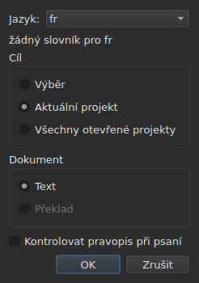
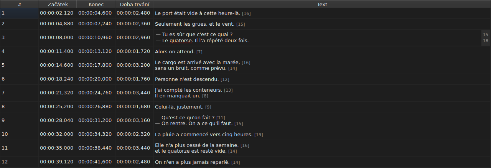
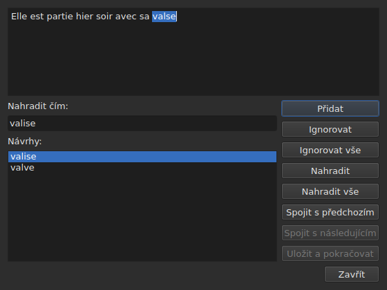

# Zkontrolovat pravopis…

<!-- machine-translated -->
> Tato stránka je strojovým překladem a dosud ji nezkontroloval žádný čtenář tohoto jazyka.

`Nástroje ▸ Zkontrolovat pravopis…` prochází slova, která slovník nezná,
jedno po druhém, po vzoru kontroly pravopisu v Gaupolu. Má svého společníka,
`Nástroje ▸ Nastavení kontroly pravopisu…`, který nastavuje jazyk, cíl a dokument a podtrhávání při psaní.
Oba se opírají o slovníky systému, prostřednictvím knihovny Enchant.

Popisek prvního se zapisuje `Chec&k Spelling…`: `C` je již
akcelerátorem `Correct Texts…` a `k` je v nabídce `Tools` volné.
Ani jeden z nich nemá klávesovou zkratku.

**Oba jsou nedostupné na dokumentu bez titulku**, stejně jako
[`Correct Texts…`](correct-texts.md): není co kontrolovat. `Check Spelling…`
je navíc nedostupné, když pro nastavený jazyk neexistuje slovník, viz
[Bez slovníku](#bez-slovníku).

## Nastavení kontroly pravopisu…




| Skupina | Volby | Výchozí |
| :---- | :------ | :------ |
| `Language` | kódy jazyků, které systém nabízí, a ten, který už je zvolen | jazyk systému, pokud je mezi nimi |
| `Target` | `Selection`, `Current Project`, `All Open Projects` | `Current Project` |
| `Document` | `Text`, `Translation` | `Text` |
| `Check spelling while editing` | zaškrtávací políčko, viz [Podtrhávání při psaní](#podtrhávání-při-psaní) | nezaškrtnuto |

`Selection` je nedostupné, když na zobrazené kartě není zvolen žádný řádek; `Translation`
je nedostupné, dokud žádný otevřený projekt nenese překlad. Zapamatované
nastavení, které už není k dispozici — prázdný výběr, chybějící překlad —,
se otevře na `Current Project` nebo `Text`. `OK` nastavení zachová, `Cancel` nic
nezmění.

**Toto okno na slovníku nezávisí**: zůstává dostupné, dokud má
dokument titulky, i když pro nastavený jazyk slovník neexistuje, a právě
ono umožňuje opustit jazyk, který žádný nemá. Jazyk, pro který žádný
slovník neexistuje, zůstává upravitelný a zobrazuje se v seznamu a pod
ním věta `no dictionary for`, za kterou následuje jeho kód.

**Čtyři nastavení se pamatují** od jedné relace k další, v
souboru nastavení programu `subedit` — jeho umístění viz [Předvolby](preferences.md):

| Klíč | Hodnoty | Výchozí |
| :-- | :----- | :------ |
| `spell-check.language` | kód jazyka, například `fr_FR`; prázdné: jazyk systému | prázdné |
| `spell-check.target` | `selection`, `current-project`, `all-projects` | `current-project` |
| `spell-check.document` | `main`, `translation` | `main` |
| `spell-check.inline` | `true` nebo `false` — podtrhávat neznámá slova v editoru buňky | `false` |

Hodnota, kterou klíč nepřijímá, se ignoruje, použije se výchozí hodnota a volba
se při otevření okna uvede na chybovém výstupu — viz
[Předvolby](preferences.md#co-se-stane-když-soubor-neříká-co-se-očekává).

## Podtrhávání při psaní




Zaškrtávací políčko `Check spelling while editing` v `Spell-Check Settings…` podtrhává
**červenou vlnovkou a už během psaní** každé neznámé slovo v editoru
textové buňky — v editoru sloupce `Text` stejně jako ve sloupci
`Translation`. Podtržení sleduje psaní: objevuje se, posouvá a
mizí spolu se slovem. **Ve výchozím stavu je nezaškrtnuto**, jako v Gaupolu: bez
něj se v editoru nic nemění.

**Jazyk je ten z `Language:`**, v témže okně, a neznámá slova
jsou ta, která by našlo `Check Spelling…`: stejné případy hovorové angličtiny
(`goin'`, `we'd`, `1st`), stejné dělení na slova. Podtržené slovo se neopravuje
z nabídky: zaškrtávací políčko ho jen ukazuje.

**Bez slovníku pro nastavený jazyk editor mlčí**: nic se
nepodtrhne a nic neselže, a proč, říká věta `no dictionary for`
v okně. Zaškrtávací políčko platí pro editory otevřené po jeho změně; editor, který
už je otevřený, si ponechá, co měl.

## Procházení




Okno ukazuje text titulku, u kterého se zastavilo, s neznámým slovem
v něm vybraným. **U každého neznámého slova se vrátí karta projektu a
řádek titulku se v tabulce vybere.** Procházení jde titulek
po titulku, a pak projekt po projektu, když cíl označuje více projektů.

Pod textem: pole `Replace with:`, vyplněné prvním návrhem, a
seznam `Suggestions:`. Volba návrhu ho zkopíruje do pole; psaní do
pole seznam obnoví.

| Tlačítko | Co dělá |
| :----- | :----------- |
| `Add` | přidá slovo do osobního slovníku uživatele a přejde na další |
| `Ignore` | ponechá toto slovo a přejde na další |
| `Ignore All` | ponechá toto slovo i všechny jeho další výskyty během tohoto procházení |
| `Replace` | nahradí slovo obsahem `Replace with:`; nedostupné, dokud je pole prázdné |
| `Replace All` | totéž pro jeho další výskyty; nedostupné, dokud je pole prázdné |
| `Join with Previous` | spojí slovo se slovem před ním; nedostupné, pokud žádné není nebo pokud je neodděluje mezera |
| `Join with Next` | spojí slovo se slovem za ním, za stejných podmínek |
| `Save and Resume` | ponechá text tak, jak ho nese textová oblast, a znovu začne číst **tento text od začátku** |
| `Close` | zavře okno |

**Textová oblast je upravitelná.** Jakmile do ní začnete psát, zůstane dostupné
jen `Save and Resume`: ostatní úkony působí na zvolené slovo, které už není
slovem textu.

**Procházení skončí samo**, když už nezbývá žádné neznámé slovo:
tlačítka se zneplatní, text se vyprázdní. Cíl, ve kterém není vůbec žádné neznámé slovo,
nezobrazí žádné okno.

### Zavření uprostřed

`Close` nebo křížek okna **použije, co bylo provedeno**, stejně jako konec
procházení: texty už opuštěné **a** úkony — nahrazení,
nahrazení všech, spojení — již provedené na aktuálním textu. To je odchylka od
Gaupolu, který aktuální text ztratí. Nepočítá se, co zbývá z procházení, ani
úpravy napsané v textové oblasti, které `Save and Resume`
nepotvrdilo.

**Jediná položka historie na každý dotčený projekt**, bez ohledu na počet
nahrazení: `Undo` vrátí všechny opravy tohoto projektu najednou.
Nabídka ji pojmenuje `Undo: correcting texts`. Stavový řádek pak uvede
počet:

```text
Edited 2 and removed 0 subtitles
```

**Seznam náhrad** — co uživatel nahradil a čím —
se při zavření zapíše do `spell-check/<language>.repl` v konfiguračním
adresáři programu `subedit`, a ne do adresáře Gaupolu, který se nikdy nečte.
Od té doby se počítá mezi návrhy kontroly pravopisu, zde stejně jako v
[`Correct Texts…`](correct-texts.md#spojit-nebo-rozdělit-slova--spojování-a-rozdělování-pomocí-kontroly-pravopisu).
Pokud ho nelze zapsat, řekne to chybové dialogové okno, `Could not save the
replacements for`, za kterým následuje jazyk a důvod, aniž by se
opravy zrušily.

## Bez slovníku

Když nastavený jazyk — jazyk systému, pokud žádný nebyl zvolen — nemá
slovník, **je `Check Spelling…` nedostupné** a jeho bublinová nápověda i stavový
řádek při najetí myší na položku říkají proč:

```text
no dictionary for fr
```

Zůstává `Spell-Check Settings…`, abyste mohli zvolit jazyk, který slovník má. Okno
sestavené bez jakéhokoli poskytovatele slovníků říká totéž a nekontroluje
nic.

## Hlášení

| Hlášení | Kde | Co ho způsobí |
| :------ | :---- | :--------------- |
| `no dictionary for fr` | bublinová nápověda a stavový řádek | pro nastavený jazyk není slovník |
| `Nothing to check.` | stavový řádek | cíl neoznačuje žádný text — například prázdný výběr |
| `Edited N and removed M subtitles` | stavový řádek | na konci nebo při zavření; `M` zůstává `0` |
| `Could not save the replacements for fr: …` | chybové dialogové okno | seznam náhrad se nezapsal |

## Příklad

Otevřený soubor nese `Elle est partie hier soir avec sa valse`. Francouzský
slovník je k dispozici: `Nástroje ▸ Zkontrolovat pravopis…` se zastaví na `valse`, vybere
řádek v tabulce a navrhne `valise`, již vyplněné v `Replace with:`. `Replace`
a pak `Close`: z řádku se stane `Elle est partie hier soir avec sa valise` a
stavový řádek říká:

```text
Edited 1 and removed 0 subtitles
```
