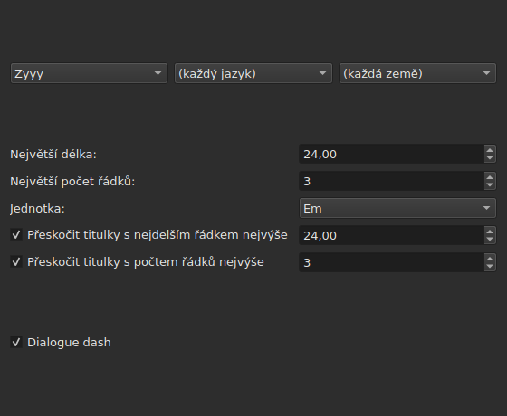
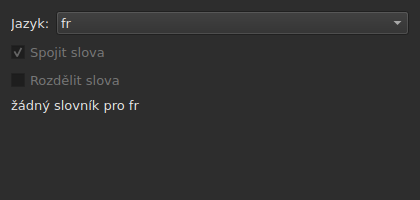
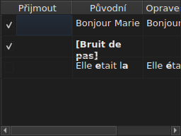

# Opravit texty…

<!-- machine-translated -->
> Tato stránka je strojovým překladem a dosud ji nezkontroloval žádný čtenář tohoto jazyka.

`Nástroje ▸ Opravit texty…` otevře vícestránkového průvodce podle vzoru
Gaupolu: stránku cíle a úloh, jednu stránku pro každou zaškrtnutou úlohu,
stránku průběhu a stránku potvrzení, která
změny navrhuje, aniž by je kdy vnucovala.

**Nedostupné u prázdného dokumentu**: není co opravovat.

**Příkazový řádek dělá totéž** pro všechny úlohy: [`subedit-cli correct`](../subedit-cli/correct.md), se
stejnými vzory a stejnými počty — a ve znacích tam, kde okno měří v em.
**Ve výchozím stavu čte čtyři ze zapamatovaných nastavení tohoto průvodce** — dvě třídy
běžných chyb (`Human`, `OCR`), `Remove all blank subtitles` a největší počet řádků úlohy
`Line Break` — a vše ostatní (úlohy, jejich kód, délku řádku, jazyk,
políčka vzorů) bere ze svého vlastního řádku. Viz
[Dva bloky, jeden sdílený s příkazovým řádkem](preferences.md#dva-bloky-jeden-sdílený-s-příkazovým-řádkem)
a [`subedit-cli config`](../subedit-cli/config.md).

## Úlohy a cíl — první stránka

| Skupina | Volby | Výchozí |
| :---- | :------ | :------ |
| `Target` | `Selection`, `Current Project`, `All Open Projects` | `Current Project` |
| `Document` | `Text`, `Translation` | `Text` |
| `Tasks` | `Mentions`, `Join or Split Words`, `Common Errors`, `Capitalization`, `Line Break` — k zaškrtnutí, jedna nebo více | `Common Errors` a `Capitalization` zaškrtnuté, ostatní tři ne |

`Selection` je nedostupné, není-li na zobrazené kartě zvolen žádný řádek; `Translation`
je nedostupné, dokud žádný otevřený projekt nenese překlad.

**Cíl a dokument se nepamatují**: průvodce se vždy znovu otevře
na `Current Project` a `Text`. Zaškrtnuté úlohy se naopak pamatují.

**Co který cíl označuje**:

| Cíl | Působí na |
| :----- | :------ |
| `Selection` | řádky zvolené na zobrazené kartě |
| `Current Project` | celý soubor zobrazené karty |
| `All Open Projects` | celý soubor každé otevřené karty |

**`All Open Projects` u `Translation` přeskočí projekty bez překladu**:
projekt, který žádný nenese, nemá v prázdném sloupci co navrhnout a
průvodce ho nezapočítá.

**Stránky úloh následují v pořadí Gaupolu — `Mentions`,
`Join or Split Words`, `Common Errors`, `Capitalization`, `Line Break` — nikdy v tom, v jakém byla políčka
zaškrtnuta.** Nezaškrtnutá úloha nemá stránku; její zapamatovaná
nastavení se tím nemění. **Žádná stránka úlohy nenese vlastní
políčko „aktivní“**: o tom, zda se úloha spustí, rozhoduje políčko této první stránky,
a jen ono.

## Stránky úloh

Každá ze čtyř stránek vzorů — všechny kromě `Join or Split Words`, která žádné vzory nemá — nese stejný základ: tři kaskádové
rozbalovací nabídky — písmo, jazyk, země — pro volbu kódu vzorů, které se mají
použít, a pak seznam vzorů tohoto kódu, jeden k zaškrtnutí pro každý název. **Tři
nabídky nabízejí jen to, co katalog vzorů skutečně
obsahuje** — vzory dodané s programem a ty, které tam uživatel
přidal (viz [Přidané vzory](#přidané-vzory)) — nikdy seznam
jazyků nebo zemí přečtený odjinud. `Zyyy` („jakékoli písmo“) je výchozí
kód úlohy `Common Errors`, který dává vzory platné všude. **Ostatní tři
typy mají vzory jen pod nějakým písmem**: jejich stránka se otevře na
prvním, které katalog nabízí, `Latn` s dodanými vzory, a ne na `Zyyy`.

**Popis každého vzoru je bublinovou nápovědou jeho políčka.** Názvy a popisy se řídí
jazykem okna u vzorů dodaných s programem; váš vlastní vzor se ukazuje tak,
jak ho zapisuje jeho soubor ([Jazyk](invocation.md#jazyk)).

**Nezaškrtnutý vzor zůstane nezaškrtnutý, dokud se znovu nezaškrtne**, i při
změně kódu a návratu k němu, a tato volba se pamatuje od jednoho otevření
průvodce k dalšímu. Po opětovném zaškrtnutí prostě najde své původní
nastavení a zapamatovaná volba zmizí.

| Stránka | Co přidává k základu |
| :--- | :----------------------- |
| `Mentions` | dvě zaškrtávací políčka, `Sound in brackets` a `Sound in parentheses`, ve výchozím stavu nezaškrtnutá |
| `Common Errors` | dvě zaškrtávací políčka, `Human` a `OCR`, ve výchozím stavu zaškrtnutá |
| `Capitalization` | nic dalšího |
| `Line Break` | největší délku (ve výchozím stavu `24`), největší počet řádků (`3`), jednotku — `Characters` nebo `Ems`, ve výchozím stavu `Ems` — a dvě podmínky přeskočení, popsané níže |

**Dvě políčka stránky `Mentions` neoznačují žádný zkompilovaný vzor**:
řídí procházení textu v jádru, totéž, které
[`Remove Hearing-Impaired Mentions…`](operations.md#remove-hearing-impaired-mentions)
už provádí přímým gestem. K jeho spuštění stačí jedno **nebo** druhé zaškrtnuté. **Seznam vzorů na stránce je neopakuje**: tyto dva názvy se tam objevují jen jednou, jako zaškrtávací políčka.

**`Common Errors` filtruje podle třídy**: vzor, který nese obě třídy,
se použije, jakmile je zaškrtnuto jedno z obou políček; ostatní tři stránky
toto rozlišení neznají.

### Zalomení řádků — jednotka a přeskočení




| Nastavení | Co dělá | Výchozí |
| :------ | :----------- | :------ |
| `Maximum length` | délka řádku ve zvolené jednotce; od `1` do `1000` | `24` |
| `Maximum lines` | cílový počet řádků; od `1` do `100` | `3` |
| `Unit` | `Characters` počítá znaky; `Ems` měří šířku písmem okna, kde průměrné malé písmeno má hodnotu `0.55` — jednotka Gaupolu | `Ems` |
| `Skip subtitles with maximum line length of` | ponechá beze změny titulek, jehož nejdelší řádek se vejde do této délky, ve zvolené jednotce | zaškrtnuto, `24` |
| `Skip subtitles with maximum line amount of` | ponechá beze změny titulek, jehož počet řádků se vejde do tohoto čísla | zaškrtnuto, `3` |

**Přeskočení má vlastní prahy**, odlišné od cílových mezí: to je
pravidlo Gaupolu. Titulek se ponechá beze změny, vejde-li se do **všech
prahů, jejichž políčko je zaškrtnuto**; jinak se zalomí a zalomení se
ponechá, jen pokud titulek přiblíží k prahu, který překračoval — menší
délka nebo méně řádků. Žádné políčko zaškrtnuté: zalomí se každý titulek,
ať se už vejde, nebo ne.

**Změna jednotky mění to, co se navrhuje**: délka každého řádku se
měří při každém výpočtu, v jednotce stránky v tu chvíli, a nic
nezůstává z předchozího měření. Text o dvaceti devíti znacích, z nichž polovina
jsou úzká písmena, překračuje `24` v `Characters` a snadno se vejde
v `Ems`.

**Sedm nastavení se pamatuje** od jedné relace k další, včetně jednotky.

### Spojit nebo rozdělit slova — spojování a rozdělování pomocí kontroly pravopisu




Samostatná stránka, mezi `Mentions` a `Common Errors`, k nápravě toho, co
software pro rozpoznávání textu dělá s mezerami. Nemá seznam
vzorů: spoléhá na slovníky systému, prostřednictvím Enchant.

| Nastavení | Co dělá | Výchozí |
| :------ | :----------- | :------ |
| `Language` | jazyk slovníku; kódy, které systém nabízí, a ten už zvolený | jazyk systému, je-li mezi nimi |
| `Join words` | připojí chybně napsané slovo k sousednímu slovu | zaškrtnuto |
| `Split words` | rozdělí chybně napsané slovo na dvě | nezaškrtnuto |

**Spojování**: chybně napsané slovo se připojí ke slovu před ním nebo ke slovu
za ním, **jestliže, a jen jestliže, jen jeden z obou směrů dá správně
napsané slovo**. Když ho dají oba, nebo žádný, neudělá se nic.
Z `bon jour` se stane `bonjour`; dvě mezery za sebou se nejprve sníží na
jednu, ale text, ve kterém se nic nespojí, se vrátí tak, jak byl, včetně
mezer.

**Rozdělování**: chybně napsané slovo se rozdělí, jestliže mezi návrhy
kontroly pravopisu je **jen jeden**, který je tímto slovem s mezerou uvnitř — stejná
písmena, ve stejném pořadí. Dva návrhy tohoto druhu, nebo žádný: nic se
neudělá. Slovo, jehož jediným velkým písmenem je počáteční (`Bonjourtous`), se
nikdy nerozdělí: často jde o jméno a slovníky jména nemají.

**Uživatelský seznam náhrad** (`spell-check/<language>.repl`,
v konfiguračním adresáři programu) se počítá mezi návrhy kontroly
pravopisu; průvodce ho čte a nezapisuje.

**Bez slovníku pro zvolený jazyk stránka zůstane a je zašedlá**:
obě políčka jsou nedostupná a stránka říká `no dictionary for` následované kódem
jazyka. Jazyk zůstává upravitelný — slovník pro jiný jazyk tam může
být — a úloha, zaškrtnutá na první stránce nebo ne, pak nedělá nic a
nehlásí žádnou chybu.

**Jazyk, obě políčka a políčko první stránky se pamatují** od jednoho
otevření průvodce k dalšímu.

### Přidané vzory

Vzor, který uživatel přidal do svého vlastního adresáře vzorů,
se připojí k vzorům dodaným s programem, ve stejném katalogu a pod
stejnými nabídkami — po načtení je nic neodlišuje.

| Vzory | Kde |
| :------- | :---- |
| dodané | `<prefix>/share/subedit/patterns`, vedle `<prefix>/bin` |
| uživatelovy | `$XDG_DATA_HOME/subedit/patterns`, nebo `~/.local/share/subedit/patterns`, není-li proměnná nastavena nebo není-li absolutní cestou |

**Formát je formátem Gaupolu, čteným tak, jak je**: jeden soubor `<Code>.<type>` pro každé písmo,
jazyk a zemi — `Latn-en.common-error` —, vedle něj jeho aktivační `.conf`. Typy
jsou `common-error`, `capitalization`, `hearing-impaired` a `line-break`. Dodané
soubory slouží jako vzor. **Vzory se čtou jednou, při spuštění**: soubor
přidaný při otevřeném okně se uvidí až při příštím spuštění.

## Průběh

Jakmile stisknete `Next` na poslední stránce zaškrtnuté úlohy (nebo na
první stránce, není-li zaškrtnuta žádná úloha), průvodce vypočítá navrhované
opravy ve vlákně na pozadí, s neurčitým ukazatelem průběhu na
obrazovce. Jakmile je výpočet hotov, stránka potvrzení se otevře sama.

**`Cancel` v tomto kroku opustí výpočet, aniž by ho přerušil**: nic se
nepoužije, ale průvodce před zavřením počká, až probíhající výpočet
skončí — čekání omezené časovým limitem, který stroj vzorů
ukládá každému hledání.

**`Back` v tomto kroku se vrátí na předchozí stránku bez čekání**: výpočet
doběhne na pozadí a jeho výsledek se zahodí — průvodce
sám nepřeskočí na potvrzení. `Next` spustí nový výpočet.

## Potvrzení — poslední stránka




Jeden řádek pro každý text, který by průvodce změnil — nikdy řádek pro
text, který úloha ponechala beze změny.

| Sloupec | Co ukazuje |
| :----- | :------------ |
| `Accept` | zaškrtávací políčko, ve výchozím stavu zaškrtnuté: oprava se použije, nebo ne |
| `Original` | text tak, jak je, s částí, která by se změnila, **tučně** |
| `Corrected Text` | navrhovaný text, změněná část tučně, **upravitelný** — jeho doladění změní to, co se zapíše, aniž by se změnilo políčko `Accept` |

**Změna se označuje tučně, nikdy barvou**: tentýž rozdíl se čte
v obou paletách, aniž by závisel na jakémkoli zabarvení.

**Řádek, jehož návrhem je odstranění** — titulku by nezůstal žádný
text — ukazuje sloupec `Corrected Text` prázdný a celý svůj `Original`
tučně.

| Tlačítko | Co dělá |
| :----- | :----------- |
| `Mark All` | zaškrtne `Accept` na všech řádcích |
| `Unmark All` | zruší zaškrtnutí `Accept` na všech řádcích |
| `Preview` | nastaví vestavěný přehrávač na titulek zvoleného řádku, má-li projekt film — nic, nemá-li žádný |
| `Finish` | použije zaškrtnuté řádky a zavře průvodce |

`Remove all blank subtitles`, ve výchozím stavu zaškrtnuté, odstraní titulky,
které by oprava zanechala zcela bez textu, místo aby je ponechala prázdné.

**Vzor, který výpočet nemohl použít, se uvede pod tabulkou**, s
důvodem:

```text
Not applied: some pattern (will not compile)
```

Takto uvedený vzor se uvede **jednou pro každý důvod**, bez ohledu na počet
textů nebo projektů, u kterých selhal: obrazovka neříká, u kterých.

| Důvod | Co ho způsobí |
| :----- | :--------------- |
| `cannot be translated` | výraz používá to, co překlad syntaxe Pythonu odmítá |
| `will not compile` | stroj výraz odmítá |
| `has an invalid replacement` | náhrada se nečte tak, jak ji čte Python |
| `timed out` | hledání překročilo čas, který mu stroj na jeden text poskytuje |
| `never settled` | `Repeat` stále měnil text i po stu průchodech |
| `grew the text too long` | text překročil 16 384 bajtů, zatímco na něm vzor pracoval |

**Vzor, který u textu selže, ho ponechá tak, jak byl před ním**: napůl
provedená náhrada má menší cenu než žádná náhrada. Ostatní vzory se použijí.

**Řádek souboru vzorů, který nelze přečíst, se uvede na stejném
místě**, svým souborem, svým řádkem a důvodem — při každém otevření
průvodce, protože vzory se čtou jen jednou, při spuštění:

```text
Could not be read: Zyyy.common-error, line 8 (malformed line)
```

| Důvod | Co ho způsobí |
| :----- | :--------------- |
| `directory cannot be read` | adresář dodaných vzorů nebylo možné projít |
| `file cannot be read` | soubor vzorů nebylo možné přečíst |
| `malformed line` | řádek, který není ani hlavičkou, ani komentářem, ani `Key=Value` |
| `field outside any pattern` | `Key=Value` před hlavičkou prvního vzoru |
| `unknown field` | klíč, který tento typ vzoru nepotřebuje — vzor se ponechá |
| `missing field` | klíč, bez kterého tento typ vzoru nemůže nic dělat — vzor se zahodí |
| `invalid value` | hodnota, kterou klíč nepřijímá — vzor se zahodí |
| `malformed activation` | prvek `<pattern>` souboru `.conf`, který nic neoznačuje |

Ostatních vzorů, těch, které byly správně přečteny a použity, se to
netýká.

## Co říká akce Zpět a co `Cancel` nikdy nedělá

**`Finish` vytvoří jednu položku historie pro každý dotčený projekt**, nikdy jednu pro každou
opravu: `Undo` vrátí najednou všechny opravy přijaté v tomto
projektu, každou s textem, který měl. Nabídka ji pojmenuje
`Undo: correcting texts`.

Stavový řádek uvede počet, nejprve změněné texty, pak odstraněné
titulky:

```text
Edited 3 and removed 1 subtitles
```

**`Cancel` na kterékoli stránce nic nepoužije a nic si nezapamatuje** — ani
nastavení zvolená během tohoto otevření, ani tu nejmenší opravu. Další
otevření průvodce začne znovu z dřívějších nastavení.

## Příklad

Otevřený soubor nese dvě mezery mezi dvěma slovy jednoho řádku a
popisek v hranatých závorkách bez dalšího textu. `Nástroje ▸ Opravit texty…`,
`Common Errors` už zaškrtnuté, `Next` až k potvrzení: řádek se dvěma mezerami
ukazuje vlevo `Bonjour  Marie`, vpravo `Bonjour Marie`, opravu
tučně a už přijatou. `Finish` ji použije a stavový řádek řekne:

```text
Edited 1 and removed 0 subtitles
```
