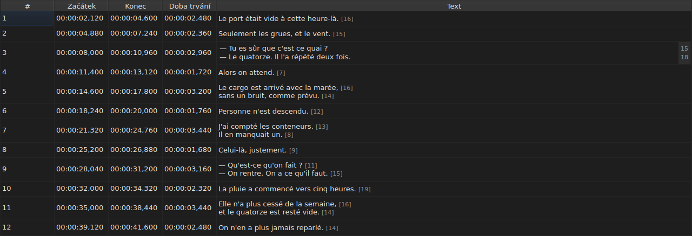

# Úprava buňky

<!-- machine-translated -->
> Tato stránka je strojovým překladem a dosud ji nezkontroloval žádný čtenář tohoto jazyka.

Čtyři sloupce se upravují přímo na místě: `Start`, `End`, `Duration` a `Text` — pět
se sloupcem `Translation`, když má projekt překlad. `#` nelze
upravovat — číslo je pořadím řádku, nikoli údajem souboru.

**Otevření editoru buňky:** poklepejte na ni, nebo ji vyberte
a stiskněte `F2`.

## Text

**Překlad se upravuje stejně jako text**, se stejným víceřádkovým polem a
stejnými pravidly; mění se jen buňka a hlavní text zůstane, jak
byl. Potvrzení, které nic nemění, nic nedělá, u jednoho jako u
druhého — viz [níže](#potvrzení-které-nic-nemění-nic-nedělá).

Editor je **víceřádkové** pole a otevře se ve výšce titulku:
dvouřádkový titulek se v něm píše tak, jak bude zapsán, oba jeho řádky
čitelné a bez posuvníku. `Shift+Enter`, který řádek přidá, editor
zvětší; řádek tabulky se přizpůsobí při potvrzení.

| Klávesa | Účinek |
| :-- | :----- |
| `Enter` | potvrdí a zavře editor |
| `Shift+Enter` | vloží do textu zalomení řádku |
| `Esc` | zavře editor; buňka si ponechá, co měla |
| `Tab` | potvrdí a přejde na další buňku |

Kliknutí jinam také potvrzuje: ztráta zaměření má stejný účinek jako `Enter`.

**Jedenáct úkonů bez dialogu stejně tak potvrdí** vstup, než spočítají svůj cíl:
`Italic`, `Velikost písmen ▸ …`, `Dialogue`, `Merge Subtitles`, `Split Subtitle`,
`Cut Texts`, `Paste Texts`, `Copy Texts`, `Remove Subtitles`, `Undo` a `Redo`.
Spuštěny z nabídky, z panelu nástrojů nebo klávesovou zkratkou okna
berou text tak, jak ho editor právě potvrdil, jako po kliknutí
jinam. `Ctrl+X`, `Ctrl+C` a `Ctrl+V` však zůstávají editoru, dokud
je otevřený — viz [Vyjmutí, kopírování a vložení textů](clipboard.md): `Cut Texts`, `Copy Texts` a `Paste Texts` pak
spouští nabídka.

`Undo` a `Redo` čtou historii, nikoli dokument: viz
[Zpět a znovu](undo.md). Úkon, který otevírá dialog, toto
pravidlo nepotřebuje, protože dialog si při otevření vezme zaměření, což
už vstup potvrdí.

### Značky jsou značkami souboru

Zobrazený a psaný text je **text souboru, včetně značek**:
`<i>…</i>` v SubRipu se píše takto a `{\i1}…{\i0}` v Advanced SSA
také. Pro zobrazení se nic nepřekládá — tabulka u
[`Italic`](operations.md#italic) říká, co který formát zapisuje.

U kurzívy tedy není co znát: `Ctrl+I` vloží správnou značku
pro otevřený dokument a formát, který žádnou nenese — TMPlayer, LRC —,
položku zneplatní, místo aby vás nechal hledat. Tučné písmo a podtržení se
píšou ručně, jako v Gaupolu.

**A značky nesledují textové operace**: převod titulku
na malá písmena nezmění jeho `<I>` na `<i>` a dialogová pomlčka se
vkládá před text, nikoli před otevírací značku. Viz
[`Case` a `Dialogue`](operations.md#case-a-dialogue).

## Délka řádků

**Textový editor ukazuje v okraji vpravo délku každého
řádku**, zarovnanou s prvním vizuálním řádkem tohoto řádku. Okraj je tak široký
jako největší číslo, aktualizuje se **během psaní** a sleduje posouvání.
Prázdný text neukazuje nic. Délky jsou tytéž jako v tabulce — bez
značek, zaokrouhlené dolů, v nastavené jednotce — a odeberou se
zaškrtávacím políčkem `Show line lengths in the editor` v `Úpravy ▸ Předvolby…`. Viz
[Délky řádků](preferences.md#délky-řádků).

## Začátek a konec

Editor je jednořádkové pole, **omezené na tvar časového údaje**:
už při psaní odmítá, co by jím nikdy nemohlo být.

Přijímané tvary jsou ty, které už přijímá čtení souboru:

| Prvek | Co projde |
| :------ | :---------- |
| pole | `MM:SS` nebo `HH:MM:SS`, každé o jedné nebo dvou číslicích |
| desetinná místa | jedno až tři, za čárkou nebo tečkou, nebo žádné |
| znaménko | úvodní `-`, pro pozici před začátkem videa |
| meze | minuty a sekundy pod 60 |

`00:01:02,500`, `1:02.5` a `-0:01,000` jsou tedy tři platné vstupy.

**Vstup, který čtení odmítne, ponechá buňku beze změny.** To je případ
`00:70:00,000`, jehož tvar je správný, ale minuty jsou mimo
meze: editor se zavře a nic se nepohnulo. Žádná pozice se nevymýšlí
— chyba v pozici je tichá, nic na obrazovce neodliší
špatně načasovaný titulek od dobře načasovaného.

Změna začátku nebo konce ihned aktualizuje `Duration`.

## Doba trvání

**Zápis doby trvání posune konec, nikdy začátek**: konec se stane
`Start + Duration`. Posun začátku by posunul celý titulek, což
je práce [`Shift Positions…`](operations.md), a do sloupce `Start` lze
psát i tak.

Doba trvání se píše **ve tvaru časového údaje**, tak, jak ji sloupec
zobrazuje, a platí tvary z tabulky výše — s jedním rozdílem:

| Prvek | Začátek, konec | Doba trvání |
| :------ | :--------- | :------- |
| tvar | tvar časového údaje | stejný |
| úvodní znaménko `-` | přijato | **odmítnuto už při psaní** |

`0:02.5` a `00:00:02,500` jsou tedy dva platné vstupy doby trvání dvou
a půl sekundy; `-0:01,000` napsat nelze. Nulová doba trvání se přijme:
titulek pak zmizí v okamžiku, kdy se objeví.

**Konec, který přesahuje přes následující titulek, je povolen.**
Překryv se v tabulce zabarví, se svou bublinovou nápovědou — viz
[Tabulka](table.md#anomálie) — jako upozornění, ne odmítnutí: možná je to, co
jste chtěli. [Seznam hlášení](files.md#hlášení-při-čtení)
ho nese také a odebere ho, když ho opravíte.

**Konec zapsaný za koncem filmu se nehlásí**, na rozdíl
od operace nabídky `Tools`, která by ho tam posunula — viz
[Operace](operations.md#za-koncem-filmu). Buňka už ukazuje
hodnotu, kterou jste právě napsali.

Nečitelný vstup ponechá buňku beze změny, stejně jako u pozice, a
doba trvání shodná se zobrazenou se do historie nedostane.

## Potvrzení, které nic nemění, nic nedělá

Otevřete buňku, nic nenapište, stiskněte `Enter`: nic se nestane.
Žádná úprava se nezaznamená a soubor se dál považuje za shodný
se souborem na disku.

Porovnává se **pozice**, nikoli řetězec: napsání `0:01.0`
do buňky, která zobrazuje `00:00:01,000`, označuje tentýž okamžik, a
tedy také nic nemění.

## Co se stane s upravenou buňkou

**Lze ji vrátit zpět** — jedna buňka, jedna položka. Viz
[Zpět a znovu](undo.md).

**Ukládá se**, a zavření okna, aniž by se tak stalo, si vyžádá
potvrzení. Viz [Otevírání a ukládání](files.md).
