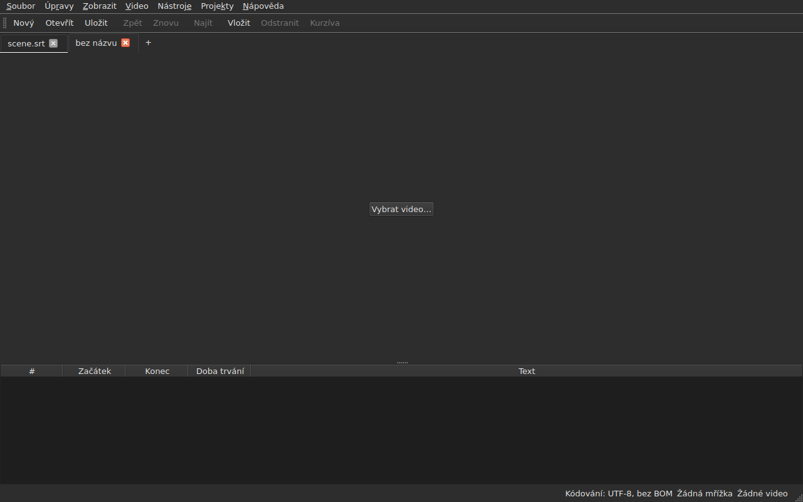
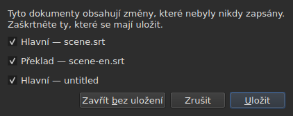
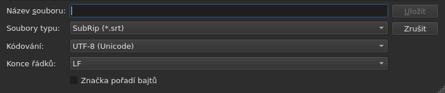
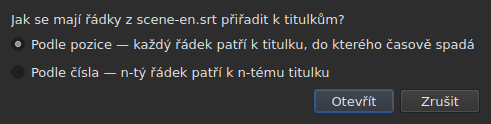
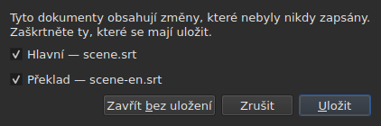

# Otevírání a ukládání

<!-- machine-translated -->
> Tato stránka je strojovým překladem a dosud ji nezkontroloval žádný čtenář tohoto jazyka.

Nabídka **Soubor** nese tři příkazy, dva pro karty a tři
další pro překlad; nabídka **Projekty** působí na všechny karty najednou.

| Příkaz | Zkratka | Co dělá |
| :------ | :------- | :----------- |
| Nový projekt | `Ctrl+N` | prázdný projekt na nové kartě — také tlačítko `+` za poslední kartou |
| Otevřít… | `Ctrl+O` | zvolí soubor a otevře ho na nové kartě — nebo místo prázdného projektu |
| Otevřít překlad… | — | zvolí soubor překladu a zarovná ho na hlavní soubor aktuální karty |
| Uložit | `Ctrl+S` | přepíše otevřený soubor |
| Uložit jako… | `Ctrl+Shift+S` | zvolí cestu a formát, pak zapíše |
| Uložit překlad | — | přepíše soubor překladu |
| Uložit překlad jako… | — | zvolí cestu a formát pro překlad, pak zapíše |
| Zavřít | `Ctrl+W` | zavře aktuální kartu — nedostupné, je-li jen jedna |

`New Project`, `Open…` a `Save` jsou také na
[panelu nástrojů](index.md#panel-nástrojů), pod slovy `New`, `Open` a
`Save`. **Tři položky
překladu na liště nejsou**: slouží jen těm, kdo mají
překlad, a lišta patří všem.

## Více projektů na kartách

**Každý otevřený projekt má svou kartu**, nad obrazem a tabulkou:
jejím popiskem je název souboru, nebo `untitled` u projektu, který ještě žádný
nemá. Kliknutím na kartu se na ni přepnete; `Ctrl+PageDown` a `Ctrl+PageUp` dělají
totéž bez myši a za poslední kartou se vracejí na první.
**Tlačítko `+`, hned za poslední kartou**, otevře prázdný projekt na
nové kartě, jako `New Project`.




**`Open…` se jich nikdy nedotkne.** Otevření souboru už nenahrazuje to, co
okno zobrazovalo: soubor přijde na nové kartě, vedle, a karta, na kterou jste se
předtím dívali, si ponechá vše, co měla — svou historii, svůj výběr, své
přidružené video. Proto se také otevírání na nic neptá: není
co ztratit, protože není co nahradit.

**Jedna výjimka: prázdný projekt přenechá své místo.** Při spuštění bez souboru nebo
po `New Project` okno ukazuje projekt `untitled`, ve kterém nic není.
Otevřený soubor — přes `Open…` stejně jako přetažením — **pak zaujme jeho kartu,
na stejném místě lišty**, místo aby otevřel další vedle
zbytečného projektu. Projekt je prázdný, když **nemá žádný soubor, žádný titulek,
nic k vrácení ani k zopakování, žádný film a nebyl nikdy změněn**: kterákoli
z těchto věcí stačí, aby si svou kartu ponechal. Prázdného projektu, který není
aktuální kartou, se nic netýká.

**Již otevřený soubor se neotevře podruhé.** `Open…` na
soubor, který už drží jiná karta, vrátí fokus na tuto kartu a oznámí to
ve stavovém řádku:

```text
premier.srt: already open
```

**Každá karta je celý projekt, nezávislý na ostatních**: jeho
historie, jeho výběr, jeho přidružené video a to, na co narazilo jeho poslední
čtení, se zobrazují, jen když je tato karta aktuální, a nemění se,
zatímco je aktuální jiná. **Jedna výjimka, a je v ADR
0033**: přehrávač videa je pro celé okno jediný — jediný proces
mpv — a jeho film se mění s kartou; **každá karta si pamatuje, kde její film
byl**, a pokračuje v něm tam, pozastavený, když se na ni vrátíte. Schránka naopak patří oknu: kopírovat
na jedné kartě a vkládat na jiné je to, kvůli čemu otevíráte dvě.

**`Close` zavře aktuální kartu**, a pokud je třeba, položí
[otázku neuložených změn](#neuložené-změny) —
pouze této karty, ostatních se netýká. **Nedostupné, když
je jen jedna karta**: okno si vždy ponechává alespoň jednu a zavřít ji
by znamenalo zavřít okno — což už dělá systémové tlačítko.

**Každá karta nese také křížek**, který zavře **její** projekt se stejnou
otázkou. Křížek karty, která není aktuální, zavře tu kartu a
karta, na kterou se díváte, zůstane zobrazená; má-li onen projekt změny, jeho
karta se po dobu otázky přesune do popředí. **Žádný křížek, když zůstává jen
jedna karta**, ze stejného důvodu, proč je `Close` nedostupné.

**Karta říká, že je změněná**: za jejím názvem následuje hvězdička, `premier.srt*`,
dokud se některý z jejích dokumentů liší od svého souboru — stejně jako titulek okna
říká o projektu, na který se díváte. Při uložení zmizí.

## Nabídka Projekty

Dva příkazy působí na všechny projekty najednou.

| Příkaz | Zkratka | Co dělá |
| :------ | :------- | :----------- |
| Uložit vše | `Ctrl+Shift+L` | zapíše každý změněný dokument, kartu po kartě |
| Zavřít vše | `Ctrl+Shift+W` | zavře všechny projekty — tedy okno |

**`Save All` postupuje v pořadí karet**, hlavní dokument před překladem.
Dokument, který má soubor, se do něj přepíše, **aniž by jeho karta přešla do popředí**;
**dokument, který žádný nemá, otevře `Save As…`, jeden po druhém**, na své kartě —
jediný případ, kdy `Save All` mění kartu, aby dialogové okno ukázalo, o který
projekt jde. **Zrušení `Save As…` nebo
uložení, které selže, zastaví zbytek**: následujících projektů se nic
netkne a dialogové okno řekne, co bylo zapsáno.

```text
Save All stopped: 1 of 3 documents saved
```

Když je vše zapsáno, řekne to stavový řádek — `2 documents saved`, nebo
`Nothing to save`, když nebylo nic změněno. Pokud `Save As…` přesunulo
kartu do popředí, okno se pak vrátí na tu, ze které byl příkaz
spuštěn.

**`Close All` a křížek okna jsou jedno a totéž**: okno
si vždy ponechává projekt a zavřít je všechny znamená zavřít okno. Kladou proto
**jedinou otázku pro všechny projekty**, stejnou jako u
[dvou změněných dokumentů](#zavření-se-dvěma-změněnými-dokumenty), s jedním zaškrtávacím políčkem
pro každý změněný dokument každé karty:




**`Cancel` nic nezavře** a nic nezapíše. `Save` zapíše
zaškrtnuté dokumenty jako `Save All`: za jejich kartou, kromě dokumentu bez
názvu, jehož karta přejde do popředí kvůli jeho `Save As…`. S jediným změněným
dokumentem ve všech projektech je to jednoduchá otázka, kterou jsme vždy
měli, položená na jeho kartě. `Save All As…` neexistuje: je to posloupnost
`Save As…`, kterou `Save All` už klade, jeden po druhém, u dokumentů bez názvu.

## Otevírání

Dialog filtruje **devět čtených formátů**, každý jednou položkou, a první
položkou, která ukazuje všechny. Formát se pak pozná **podle obsahu, ne podle
přípony**: soubor `.txt`, který obsahuje SubRip, se otevře, a filtr o ničem
nerozhoduje — jen skrývá soubory.

| Položka filtru | Přípona |
| :----------- | :-------- |
| `SubRip` | `.srt` |
| `WebVTT` | `.vtt` |
| `SubViewer 2` | `.sub` |
| `Sub Station Alpha` | `.ssa` |
| `Advanced SSA` | `.ass` |
| `MicroDVD` | `.sub` |
| `MPL2` | `.txt` |
| `TMPlayer` | `.txt` |
| `LRC` | `.lrc` |

**Dvě přípony označují každá dva formáty** — `.sub` je SubViewer 2 a
MicroDVD, `.txt` je MPL2 a TMPlayer. Při otevírání to nemá žádný následek,
protože rozhoduje obsah; při ukládání dává formát **název**
zvolené položky, nikdy její maska.

**Nečitelný soubor neotevře nic.** Chybějící, odmítnutý systémem, zapsaný
v kódování, ve kterém jeho bajty nelze dekódovat, nebo v žádném známém
formátu: modální okno **uvede příčinu**, žádná karta se neotevře a ty, které
otevřené byly, se nehnou.

| Hlášení | Co se stalo |
| :------ | :------------ |
| `does not exist` | cesta neoznačuje žádný soubor |
| `cannot be opened: permission denied` | systém ho odmítá otevřít |
| `cannot be read` | systém odmítl z jiného důvodu |
| `cannot be decoded in the chosen encoding` | bajty nejdou přečíst ve zvoleném kódování |
| `is in no format this tool knows` | obsah nepozná žádný formát |
| `holds nothing recognisable as a subtitle` | formát se pozná, ale nic v něm není titulek |

Hlášení předchází cesta: `notes.txt: is in no format this tool knows`.
Jsou to slova příkazového řádku, a není to náhoda — obě
rozhraní čtou soubor podle stejného receptu.

### Přetažení souborů do okna

**Přetažení souborů kamkoli do okna je otevře**, ze
správce souborů: do tabulky, na lištu karet, na
tlačítko `Select Video…` a **na samotný obraz filmu**, ať se přehrává, nebo stojí.
Obraz je samostatné okno kreslené přehrávačem a nic nezaručovalo,
že by přetažení předalo dál; bylo to ověřeno ručně ve skutečném pracovním prostředí,
v relaci Wayland. `subedit-gui` se tam spouští pod X11, aby mohl zobrazit
film, takže přetažení prochází protokolem X11 — stejně jako v
relaci X11, kde to zvlášť vyzkoušeno nebylo.

- **Každý soubor titulků otevře svou kartu**, v pořadí, v jakém byly
  přetaženy — přesně jako `Open…`. Soubor, který je **už otevřený**, se znovu
  nečte: jeho karta přejde do popředí a stavový řádek to oznámí
  (`premier.srt: already open`).
- **Přetažené video se přidruží k aktuální kartě**, jako přes
  `Select Video…`. Přetažené spolu s titulky jde na poslední kartu,
  kterou otevřely, bez ohledu na pořadí přetažení. Video se pozná podle
  své přípony — stejný seznam jako ten, podle kterého se navrhuje film vedle
  souboru.
- **Dvě nebo více videí najednou se neotevře**: projekt sleduje
  jediný film. Titulky ze stejného přetažení se naopak otevřou.
- **Soubor, který se neotevře, nezastaví ostatní.** Jediné dialogové okno pak řekne,
  co se nepodařilo, jeden řádek na soubor, slovy
  příkazu `Open…`:

  ```text
  /films/notes.txt: is in no format this tool knows
  /films/absent.srt: does not exist
  ```

Berou se jen místní soubory: odkaz přetažený z prohlížeče
neoznačuje nic, co by okno mohlo přečíst.

Otevření z příkazového řádku stále funguje: `subedit-gui film.srt`.
Tam se stejný důvod zapíše na chybový výstup a okno se otevře
prázdné — viz [Spuštění](invocation.md#když-otevření-selže).

## Hlášení při čtení

Skutečný soubor je málokdy dokonalý a čtení se zotavuje, místo aby
to vzdalo: chybějící číslo, řádek, který nikam nevede, smíšené konce
řádků. **To, na co narazilo, se vejde do tlačítka stavového řádku**
— `2 diagnostics`, nalevo od toho, co lišta už říká o dokumentu —, a **seznam se otevře kliknutím
v plovoucím okně** nad tlačítkem. Žádný řádek okna se tím nezabere:
tabulka si ponechá svou plnou výšku, ať čtení mělo co říct, nebo ne. Seznam
se zavře kliknutím jinam nebo klávesou `Esc`.

```
a SubRip block without its number, settled by the reader: 5
```

**Každý řádek počítá**: na co se narazilo, co se s tím udělalo a
kolikrát. Špatně udělaný soubor narazí na stovky a vědět,
kolik je kterého druhu, je to, co vám umožní jednat; číslo řádku každého výskytu v
souboru se naopak čte na příkazovém řádku, na úrovni výpisu `-vvv`.
Tlačítko počítá tyto řádky — jeden na druh —, ne výskyty.

**Objeví se tam i uhodnuté kódování**, jednou: bylo navrženo zvážením
bajtů, dříve než existoval jediný řádek souboru.

```
an encoding nothing declared, settled by the reader: 1
```

Zobrazí se jen tehdy, když bylo kódování **uhodnuto a není to
UTF-8** — soubor UTF-8 přečtený jako takový není událost a říkat to
při každém otevření by dalo tlačítko do stavového řádku každého běžného
dokumentu. Nespustí ho ani soubor, který nese značku pořadí bajtů:
své kódování deklaroval, nic se nehádalo.

**Tentýž seznam počítá i to, co je špatně v samotných titulcích**:
titulek, který začíná dříve, než skončil předchozí, konec před svým
začátkem, začátek před začátkem titulku nad ním. Tabulka je zabarví, ale
zabarvení se najde posouváním a v souboru o dvou tisících řádcích
ho snadno přehlédnete; tady jsou druhy pohromadě, **jeden na
řádek a s jejich počtem**, slovy zprávy `inspect`:

```
subtitle starts before the previous one ends: 12
subtitle starts before the previous one starts: 3
```

**Kliknutí na jeden vede k prvnímu dotčenému titulku**, vybranému v
tabulce. Tyto řádky **sledují opravy** — seřazení nebo oprava doby trvání
některé odstraní, nebo sníží jejich počet —, aniž by se zavřel seznam, který
čtete. Titulek může být započítán dvakrát: začít před koncem
předchozího a před jeho začátkem jsou dvě zjištění, opravovaná dvěma
způsoby. Chcete-li je jmenovat jedno po druhém, `subedit-cli inspect --detail`.

Tlačítko **se neobjeví**, když není co hlásit, ani ve čtení, ani
v titulcích, a **sleduje kartu**: každý projekt si ponechává
hlášení svého vlastního čtení a tlačítko ukazuje ta zobrazeného projektu.

## Kódování ve stavovém řádku

**Stavový řádek vždy uvádí kódování otevřeného dokumentu**, nalevo od toho, co
říká o [mřížce snímků](frame-grid.md) a o
[přidruženém videu](video.md):

| Situace | Co se zapíše |
| :-------- | :-------------- |
| soubor byl přečten jako UTF-8, bez značky | `Encoding: UTF-8, no BOM` |
| … se značkou | `Encoding: UTF-8, BOM` |
| soubor v Latin-1 | `Encoding: ISO-8859-1, no BOM` |

**Hlášení a tento řádek neodpovídají na stejnou otázku**, a proto
existují oba. Hlášení říká, co čtení **udělalo** —
hádalo a vy to možná budete chtít ověřit; zobrazí se proto jen tehdy, když
se hádalo. Stavový řádek říká, co dokument **je**,
trvale, včetně souboru, který své kódování sám deklaruje a o
kterém čtení nemá co říct.

**Odkud odpověď pochází, se tam neuvádí.** Uvádí to `inspect` — `detected`,
`from its byte order mark`, `as asked for` —, protože zpráva má místo
to říct; řádek stavového řádku ne, a seznam hlášení to už nese, když na tom
záleží.

## Ukládání

`Save` přepíše otevřený soubor **v jeho původní podobě**: jeho formát, jeho
kódování, jeho konce řádků, jeho značku pořadí bajtů a jeho hlavičku.
Soubor otevřený a pak uložený beze změny se nepohne ani o bajt — viz
přesnou záruku níže.

Zápis je **atomický**: prochází dočasným souborem, který se
přejmenuje přes původní. Uložení přerušené v kterémkoli okamžiku ponechá předchozí verzi
nedotčenou.

Uložení dokumentu, který nikdy nebyl na disku, se rovná `Save As…`.

**Zápis, který selže, to řekne a nic neztratí**: plný disk,
soubor jen pro čtení, chybějící adresář — nebo **znak, který kódování souboru
nedokáže zapsat**, `ł` v souboru Latin-1. Hlášení je
pak `holds a character the chosen encoding cannot write` a nic se
nezapíše: nahradit znak otazníkem `?` by ztratilo text před očima toho, kdo
ho právě napsal. Hlášení uvádí soubor a důvod, okno si ponechá
své změny a značka v titulku zůstane.

## Uložit jako

`Save As…` se ptá na cestu, formát **a podobu zapisovaných bajtů**:
kódování, konce řádků, značku pořadí bajtů. Dokument **pak žije
tam**: titulek se změní, `Save` míří na nový soubor a zapisuje ve
zvolené podobě a původní soubor zůstane, jak byl.

**Nabízí se devět formátů** a položka vybraná při otevření dialogového
okna je **položka dokumentu**. Uložení pod jiným názvem bez sáhnutí na
filtr proto formát nezmění.




**Obrázky ukazují jen spodní část dialogového okna**, ne seznam souborů
nad ní: ten závisí na počítači — jeho adresářích, jeho datech, jeho
bočních zkratkách —, takže jeho fotografie by nikdy nebyla dvakrát stejná.
Tento pruh ano, a právě v něm se všechno odehrává.

| Pole | Co nabízí | Výchozí |
| :---- | :------------- | :------ |
| `Encoding` | čtrnáct kódování, která soubor titulků v praxi nese, plus `Other…` | **kódování přečteného souboru** |
| `Other…` | pole pro zadání libovolného kódování, které ICU umí zapsat, **s doplňováním** — `cp1257`, `EUC-KR` | — |
| `Line endings` | `LF`, `CRLF` nebo `CR` | konce řádků přečteného souboru |
| `Byte order mark` | značka, **nedostupná u kódování, které žádnou nenese** | značka přečteného souboru |

**Výchozí hodnoty jsou hodnoty přečteného souboru, a je to spíš záruka než
pohodlí**: soubor otevřený a znovu uložený bez sáhnutí na tato tři
pole vrátí stejné bajty.

**Seznam je krátký, a není to strop.** ICU jich zná dvě stě
dvacet jedna; to, co nabízí nabídka, je to, co soubor titulků nese
v praxi, protože nabídka o dvou stech položkách nikomu nepomůže. `Other…`
otevírá zbytek.

**Pole doplňuje ze všech dvou set dvaceti jedna**, takže není třeba
znát přesný název: zadání `1252` navrhne `windows-1252`, zadání `koi`
navrhne `KOI8-R` a `KOI8-U`. Doplňuje se podle toho, co název **obsahuje**,
a ne podle toho, čím začíná — kanonický název západoevropského kódování Windows je
`windows-1252` a `cp1252` je ten, který lidé mají na mysli. Oba lze
také napsat celé bez doplňování: ICU přijímá své vlastní aliasy.

**Název, který nikdo nezná, nic nezapíše.** Zadání `klingon-1`
nepřejde na UTF-8: nic se nezapíše a hlášení to řekne.

**Stejně tak název, který neuvádí pořadí bajtů.** `UTF-16` a `UTF-32` jsou
názvy, které ICU zná a jejichž převodník zapisuje **svou vlastní značku**:
zaškrtávací políčko `Byte order mark` by pak přestalo o čemkoli rozhodovat. Obě
se odmítnou a hlášení odkáže na `UTF-16LE` nebo `UTF-16BE`, které zapisují
tytéž bajty pod kontrolou zaškrtávacího políčka. Je to stejné odmítnutí,
stejnými slovy, jako na příkazovém řádku.

**Znak, který zvolené kódování nedokáže zapsat, uložení zastaví**
— `ł` v Latin-1. Hlášení je
`holds a character the chosen encoding cannot write`, okno si ponechá své
změny a cílového souboru se nic nedotkne.

**Ani dokument se nepohne**: zůstává na svém souboru, ve svém
formátu a svém kódování, a příští `Save` přepíše ten, který byl otevřen.
Uložení, které neproběhlo, nemění vůbec nic — ani na disku,
ani v okně.

Změna formátu mění to, co ukazuje tabulka — desetinný oddělovač se řídí
formátem, čárka pro SubRip, tečka pro WebVTT, a **značky se přepíší
do slovníku cílového formátu**: z `<i>` se stane `{\i1}` v Sub
Station Alpha, `{Y:i}` v MicroDVD, `/` na začátku řádku v MPL2. Dokument
**se stal** tímto souborem, takže tabulka ukazuje, co soubor nese.

**Není to příkaz a `Ctrl+Z` ho nevrátí.** Dokument, jehož
formát by říkal LRC a jehož texty by stále říkaly `<i>`, by byl
nesouvislý dokument; není tu žádná polovina, kterou by šlo vrátit.

## Co formát nepřenese, řečeno před zápisem

**Modální okno varuje a stále můžete odpovědět ne.** Vypíše, co
cílový formát neudrží, položku po položce, slovy, která příkazový
řádek zapíše poté:

```
ends are not carried by LRC, line breaks were joined in 2 subtitles, 1 tag dropped
```

| Tlačítko | Účinek |
| :----- | :----- |
| `Save` | přesto zapíše, se ztrátou přijatou |
| `Cancel` | nic nezapíše; dokument se nepohne, ani soubor, ani formát |

`Cancel` je výchozí tlačítko: klávesa Enter stisknutá bez čtení ponechá
soubor, jak je.

**Na nic se neptá, když se nic neztrácí.** Dialogové okno, které by ohlásilo „nic
se neztratí“, by vás naučilo odmítnout to, na kterém záleží.

Co lze ohlásit:

| Položka | Kdy |
| :--- | :--- |
| konce | cílový formát žádné nenese — TMPlayer, LRC |
| zalomení řádků | cílový formát žádná nenese — LRC |
| značky | značka zdroje nemá v cíli žádný ekvivalent, nebo ji pivot nezná |
| hlavička | přečtený soubor ji nesl, a nepřejde |
| deklarovaná pole | pořadí sloupců SSA, podoba času TMPlayer |
| přesnost | cílový formát počítá hruběji — desetina u MPL2, sekunda u TMPlayer |

**To, co patří jinému formátu, se ponechá stranou.** Soubor WebVTT
nese identifikátory podnětů a nastavení umístění; SubRip nese souřadnice
zobrazení. Zápis do jiného formátu je ignoruje, místo aby je
překládal nazdařbůh — tím se neztrácejí, prostě se
nezapíšou.

## Záruka zpáteční cesty

Má dvě poloviny a obě jsou nutné:

- **věrnost bajt po bajtu** u souboru, který už má rozvržení, jež
  `subedit` zapisuje — rozvržení Gaupolu, včetně závěrečného prázdného řádku —, a **ať je
  jeho kódování jakékoli**: soubor v CP1252 nebo v UTF-16 se přepíše ve
  svém vlastním, včetně značky;
- jinak **idempotence**: první uložení normalizuje rozvržení,
  žádné další už na nic nesáhne.

Konkrétně soubor, jehož poslední blok nenásleduje prázdný řádek,
ho jednou získá. Je to jediná změna, kterou může uložení bez
úprav způsobit.

## Otevření překladu

`Soubor ▸ Otevřít překlad…` postaví vedle hlavního souboru **druhý soubor**.
Položka je nedostupná, dokud neexistuje žádný titulek, kterému by bylo možné dát řádky
překladu.

**Dvě otázky, jedna po druhé.** Výběr souboru, ten z
`Open…` — stejný filtr, stejná výchozí složka, kódování poznané jako u
hlavního souboru — a pak **metoda zarovnání**:




| Metoda | Co dělá |
| :----- | :----------- |
| `By position` (výchozí) | každý řádek jde k titulku, do kterého padne jeho střed |
| `By number` | n-tý řádek jde k n-tému titulku, bez ohledu na pozice |

**Pozice je výchozí**, protože jediný chybějící řádek uprostřed posune podle čísla
*všechny* následující, kdežto podle pozice zůstane bez překladu jediný
titulek.

**Co se udělá, co se zapíše:**

- texty přiřazených řádků vstoupí do sloupce `Translation`, který
  se objeví;
- **řádek, který nenajde žádný titulek, dá vznik novému**, s **pozicemi
  tohoto řádku** — u obou metod;
- **nic se neřadí**, ani soubor, ani dokument: řádky se procházejí
  v časovém pořadí a uvede se počet těch, které v něm nebyly;
- **již otevřený překlad se nahradí**, všechny jeho texty se nejprve vymažou.

**Co se stalo, se oznámí.** Když každý řádek našel svůj titulek a
žádný nezůstal sám, zapíše to stavový řádek; jinak **dialogové okno k zavření**,
jako u každého úkonu, který má co říct:

```text
translation: 3 lines attached
translation: 2 lines attached; 1 subtitle left without a translation
translation: 3 lines attached; 1 subtitle born of a line; 2 lines out of order
```

Položky se zapíší, jen pokud nejsou nulové: přiřazené řádky,
titulky zrozené z řádku, ty, ke kterým žádný řádek nedošel, řádky mimo
pořadí. Soubor bez jediného řádku to řekne
(`translation: the file holds no line`), místo aby z toho vinil
titulky.

**Posunutý překlad se pozná a znovu otevře s posunem.** Překlad načasovaný o dvě
sekundy pozdě se zarovná na nesprávné titulky, aniž by ho cokoli odlišilo od
správného přiřazení. Když otevření **podle pozice** není čisté, okno hledá
**stálý posun**: rozdíly mezi začátkem každého řádku a začátkem titulků
kolem něj dávají kandidáty, seskupené na deset milisekund, a **každý
se posuzuje samotným přiřazením otevření**. Pokud jediný posun učiní otevření
čistým, dialogové okno to řekne za svým počtem a **nabídne opětovné otevření s posunem**:

```text
translation: 4 subtitles born of a line; 4 subtitles left without a translation
the lines sit 2.000 s later than the subtitles; moved back, 4 lines would attach instead of 0
```

`Yes` vrátí otevření zpět a provede ho znovu s řádky vrácenými o tento posun; `No`,
výchozí odpověď, ponechá otevření, jak je. **Výsledkem je jediná položka
historie**: její vrácení zpět vrátí vše, jako u každého otevření.

**Nic se nenavrhne, když posun není stálý** — ujíždění, posun, který
se týká jen části souboru —, když by dva posuny učinily otevření stejně
čistým, nebo když ho čistým neučiní žádný: věta pak neříká, že nějaký existuje. Ani
podle čísla, kde se na pozice nehledí. **Příkazový řádek** pro to
neexistuje.

**Otevření překladu je jediná položka historie**, `Undo: opening a translation`,
a její vrácení zpět vrátí vše: texty, odstraněné zrozené titulky,
odpojený soubor překladu — sloupec zmizí s ním. Chcete-li ho otevřít
druhou metodou, nejprve vraťte zpět.

**Právě otevřený překlad není změněný**: nic se nenapsalo a
jeho zavření nenabízí uložení. Pokud vznikly titulky, je změněný
hlavní dokument.

**Změněný překlad se nabídne k uložení, než se
nahradí**, se třemi možnostmi z oddílu o
[neuložených změnách](#neuložené-změny).

| Hlášení | Co se stalo |
| :------ | :------------ |
| `the file is already open as the main document` | zvolený soubor je samotný hlavní dokument, ať je jeho cesta zapsána jakkoli |
| `does not exist`, `cannot be decoded in the chosen encoding`, … | stejné příčiny jako u `Open…` |

Hlášení předchází cesta a **nic se nezmění**: okno si ponechá svou
historii a své změny.

**Problémy, na které čtení narazilo**, pokud nějaké jsou — opravený řádek,
ignorované pole —, přejdou do seznamu hlášení, toho
[posledního čtení](#hlášení-při-čtení).

**Co si překlad neponechá**: nastavení **jednotlivých titulků** jeho
souboru — styl SSA, umístění titulku WebVTT. Titulek
nese jen jednu sadu, sadu hlavního dokumentu; tato nastavení se znovu nečtou ani nepřepisují.

## Uložení překladu

**Každý dokument se ukládá zvlášť**, do svého souboru, ve svém formátu, svém
kódování a se svými konci řádků: překlad v `.ass` pod hlavním souborem v
`.srt`, ve Windows-1252 pod hlavním souborem v UTF-8, se vrátí tak, jak je.

| Položka | Co dělá |
| :---- | :----------- |
| `Save Translation` | přepíše soubor překladu — ten, ze kterého pochází |
| `Save Translation As…` | výběr souboru z `Save As…`, otevřený na souboru **překladu**, s jeho formátem a jeho kódováním |

Obě jsou **nedostupné, dokud projekt nemá překlad**.
`Save Translation As…` je `Save As…` na druhém dokumentu: stejná pole, stejné
[varování o ztrátě](#co-formát-nepřenese-řečeno-před-zápisem), které
počítá, **co by zapsaný soubor ztratil** — značky hlavního textu
nejsou značky překladu a formát, který nezapisuje kurzívu,
si na to stěžuje, jen pokud ji překlad má.

**Každý dokument má svůj vlastní stav změny.** Uložení hlavního dokumentu ponechá
překlad změněný a naopak; **titulek okna je změněný, je-li změněný kterýkoli
z obou**, a má jen jednu hvězdičku.

**Nic z jednoho se nedotkne druhého**: uložení překladu nezapíše
hlavní dokument a nemění ani jeho soubor, ani jeho formát, ani jeho texty.

## Zavření se dvěma změněnými dokumenty

Zavření aktuální karty nebo okna, zatímco se **dva dokumenty** nebo více
liší od svých souborů, položí **jedinou otázku**, s jedním zaškrtávacím políčkem pro každý
dokument:




| Tlačítko | Co se stane |
| :----- | :----------- |
| `Save` | zapíše dokumenty, jejichž políčko je zaškrtnuté, a pak pokračuje — nedostupné, když není zaškrtnuto žádné |
| `Close Without Saving` | ztratí oba, bez ohledu na políčka |
| `Cancel` | nic se nestane; okno zůstane, jak bylo |

**Zrušit zaškrtnutí dokumentu znamená ho ztratit**: `Save` zapíše ostatní a
pokračuje. **Pokud uložení selže, akce nepokračuje.** Zavření
dialogového okna bez odpovědi platí jako `Cancel`.

**S jediným změněným dokumentem je otázka ta, kterou jsme měli vždy**,
popsaná níže, a věta říká, o který jde: `The translation has changes that were never written.`
nebo `The document has …`.

**Soubor, který zmizel z disku, se počítá jako změněný** a seznam to uvádí —
`(file is gone from the disk)`: to, co okno drží, je pak **jediná
kopie** a zavření bez zápisu by ji zničilo. S jediným dokumentem v takovém případě
je věta `The document is no longer where it was read from.`

## Neuložené změny

Zavření okna, aktuální karty nebo otevření překladu, který by nahradil
ten, který už tam je, zatímco se dokument liší od toho na disku, **si vyžádá
potvrzení**, se třemi možnostmi:

| Odpověď | Co se stane |
| :----- | :----------- |
| `Save` | dokument se zapíše, pak akce pokračuje |
| `Discard` | změny se ztratí a akce pokračuje |
| `Cancel` | nic se nestane; okno zůstane, jak bylo |

Zavření dialogového okna bez odpovědi platí jako `Cancel`.

**Pokud uložení selže**, akce nepokračuje: práce se ani
nezapíše, ani neztratí.
