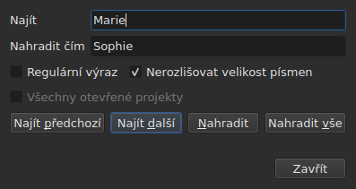
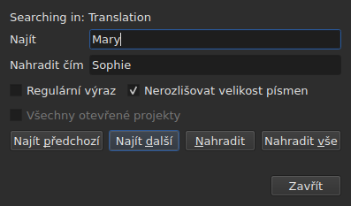

# Najít a nahradit

<!-- machine-translated -->
> Tato stránka je strojovým překladem a dosud ji nezkontroloval žádný čtenář tohoto jazyka.

`Úpravy ▸ Najít a nahradit…` nebo `Ctrl+F` otevře dialog hledání.




**Dialog není modální**: zůstává otevřený, zatímco se díváte do tabulky,
upravujete buňku nebo hledáte znovu. `Close` ho zavře; po opětovném otevření
je takový, jak jste ho opustili, včetně vzoru a náhrady.

| Pole | Co nese |
| :---- | :-------------- |
| `Find` | hledaný vzor |
| `Replace with` | čím se nahradí |
| `Regular expression` | vzor je regulární výraz, nikoli prostý text |
| `Ignore case` | „marie“ najde „Marie“ |
| `All open projects` | hledání projde všechny karty — [viz níže](#ve-všech-otevřených-projektech) |

Na prázdném dokumentu je položka nedostupná: není v čem hledat.

## Čtyři úkony

| Tlačítko | Co dělá |
| :----- | :----------- |
| `Find Previous` | najde předchozí shodu a tabulka na ni přejde |
| `Find Next` | najde následující — je to tlačítko, které stiskne `Enter` |
| `Replace` | nahradí nalezenou shodu a pak najde následující |
| `Replace All` | nahradí všechny shody v cíli |

Všechna čtyři jsou nedostupná, dokud je `Find` prázdné.

**Tabulka přejde na shodu** tím, že vybere její řádek. Po dosažení
poslední začne `Find Next` znovu od první; `Find Previous` dělá totéž
v opačném směru.

**`Replace` bez nalezené shody nejprve hledá**: první stisknutí
ukáže, co bude nahrazeno, další to nahradí. Tak to dělá
i Gaupol.

## Co hledání zahrnuje

**Výběr, nebo celý dokument, pokud není nic vybráno** — pravidlo
nabídky `Tools`. Viz [Operace](operations.md#na-co-se-vztahují).

**Cíl se určí při prvním úkonu a drží se**, dokud hledání
pokračuje: `Find Next` vybere řádek shody a tento
výběr cíl nezmenší. **Když sami vyberete jiné řádky,
změníte cíl** pro další úkon.

Hledání zahrnuje text titulků; pozice ani číslo se
neprohledávají.

### Ve všech otevřených projektech

Zaškrtávací políčko **`All open projects`** rozšíří rozsah na všechny karty. **Je nedostupné,
když je otevřen jediný projekt** — není co rozšiřovat —, zpřístupní se, jakmile se otevře
druhá karta, a samo se odškrtne, když zbude jen jedna.

**Když je zaškrtnuto, výběr se už nepočítá**: každý projekt se prohledá celý,
v **cílovém dokumentu** — v tom z aktuálního sloupce, hlavním nebo
v překladu, stejně jako u jediného projektu.

- **`Find Next` a `Find Previous` jdou z karty na kartu, v pořadí
  karet.** Nejprve zobrazený projekt; když už nemá žádnou shodu,
  další, jehož kartu okno zobrazí a jehož řádek vybere.
- **Okruh končí tam, kde začal**: když hledání přejde za poslední
  kartu a vrátí se na první — nebo naopak při hledání nahoru —, řádek dialogu
  to řekne, místo aby začal znovu beze slova:

  ```text
  Search wrapped around
  ```

  Další krok je obyčejný krok a řádek se vymaže.
- **`Replace` nahrazuje tam, kde se hledání nachází**, a pak přejde na další
  shodu, která může být na jiné kartě.
- **`Replace All` projde všechny projekty** a **vytvoří jednu položku historie
  na každý dotčený projekt**: vrácení zpět na kartě vrátí jen to, co tato karta
  dostala. Počet říká, kolik projektů se změnilo, nejen kolik
  nahrazení proběhlo:

  ```text
  replaced 4 matches in 3 projects
  ```

  Projekt, ve kterém vzor chybí, zůstane nedotčen a nemá co vracet.
  **Žádná karta se nedostane do popředí**: každý projekt dostane svá nahrazení
  za svou kartou, která získá hvězdičku, a karta, ze které úkon
  vyšel, zůstane zobrazena i se svým filmem.

### V jakém textu

**S překladem zahrnuje hledání jen jeden ze dvou textů: ten
ze sloupce aktuální buňky** — překlad, je-li aktuální buňka
ve sloupci `Translation`, jinde hlavní text. Je to
pravidlo všech textových operací a žádné další nastavení neexistuje:
viz [Text, na který operace míří](table.md#text-na-který-operace-míří).

**Dialog říká, ve kterém textu hledá**, na řádku nad
`Find`, a mění ho, když se změní aktuální sloupec — i když je otevřený:




| Aktuální buňka je v | Řádek říká |
| :--------------------- | :------------ |
| sloupci `Translation` | `Searching in: Translation` |
| jakémkoli jiném sloupci | `Searching in: Main` |
| — projekt nemá překlad nebo je sloupec odebrán | nic: řádek tam není |

**Nahrazení zapisuje do tohoto textu, a jen do něj.** `Replace` a `Replace
All` na překladu ponechají hlavní text tak, jak byl, a
naopak; `Undo` vrátí, co zapsaly. **Značky jsou značkami formátu
souboru tohoto textu**: překlad v Advanced SSA se čte se svými
`{\i1}`, i když je hlavní text SubRip. `Replace with` se tam zapisuje
stejnými značkami.

**Tabulka zůstane ve sloupci, kde byla.** `Find Next` vybere řádek
shody, aniž by přesunul aktuální buňku z jednoho sloupce do druhého:
hledání zahájené v překladu pokračuje v překladu.

**Hledání v obou textech najednou neexistuje**: každá shoda
by byla dvojicí (titulek, text) a tabulka by při přechodu na ni neměla
jasné místo, kam jít. Hledá se v jednom textu a pak se změní sloupec.

**Co začíná znovu od nuly**:

| Úkon | Co se zapomene |
| :------ | :---------------- |
| změna `Find`, `Replace with` nebo volby | aktuální shoda a řádek stavu |
| když sami vyberete jiné řádky | cíl a shoda |
| přesun aktuální buňky z jednoho textu do druhého — z `Text` do `Translation` nebo naopak | shoda: je to místo v textu |
| otevření jiného souboru | cíl a shoda; dialog zůstane otevřený, včetně vzoru |

## Prohledávaný text je viditelný text

**Značky nejsou text.** Hledání `<i>` nic nenajde a hledání
`Bonjour` najde i `<i>Bon</i>jour` rozdělené značkou.

**Nahrazení se provede v textu souboru, aniž by se porušily značky**:

| Text | Hledáno → vloženo místo toho | Co se zapíše |
| :--- | :-------------------------- | :-------------- |
| `<i>Bonjour</i>` | `Bonjour` → `Salut` | `<i>Salut</i>` |
| `<i>Bon</i>jour` | `Bonjour` → `Salut` | `<i>Salut</i>` |
| `<i>Bonjour</i> Marie` | `Bonjour Marie` → `Salut Sophie` | `<i>Salut Sophie</i>` |

Značka, která rozděluje slovo, obepne celé slovo a každý styl, který se
shody dotýká, pokryje náhradu. **Značky, kterých se shoda
nedotýká, zůstanou, kde jsou**, i taková, která rozděluje jiné slovo téhož
titulku: nahrazení `Marie` v `<i>Bon</i>jour Marie` dá
`<i>Bon</i>jour Sophie`. Slovo tvoří písmena a číslice — nezlomitelná
mezera ani uvozovka do něj nepatří. **`Replace with` se čte ve značkách
cílového textu**: když tam v SubRipu napíšete `<b>Salut</b>`, bude slovo tučně.

## Dvě volby

| Volba | Výchozí | Co mění |
| :----- | :------ | :-------------- |
| `Regular expression` | nezaškrtnuto | `.` už nehledá tečku, ale jakýkoli znak |
| `Ignore case` | zaškrtnuto | na velikosti písmen nezáleží, včetně písmen s diakritikou: `élise` najde `Élise` |

To jsou výchozí hodnoty Gaupolu. **Obě se pamatují** od jednoho otevření
k dalšímu a od jedné relace k další, ve volbách `search.regex` a
`search.ignore-case` [souboru předvoleb](preferences.md#soubor).

### Regulární výraz

Vzor čte ICU. Stejně jako v Gaupolu `.` přechází přes zalomení řádku a `^`
a `$` platí na začátku a konci **každého řádku** titulku:
nahrazení `^` za `- ` vloží pomlčku před každý řádek.

V `Replace with`, a jen u regulárního výrazu:

| Zapsáno | Co vloží |
| :------ | :----------- |
| `$1` až `$9` | skupinu s tímto číslem; chybějící skupina nevloží nic |
| `$0` | celou shodu |
| `\n` | zalomení řádku |
| `\$`, `\\` | znak `$`, zpětné lomítko |
| `\` následované jakýmkoli jiným znakem | tento znak: `\t` vloží `t` |

**`\1` není skupina** a vloží `1`. To je syntaxe Gaupolu, který čte
své výrazy v Pythonu; zde platí syntaxe ICU, které čte vzor.

## Co dialog hlásí

Pod tlačítky je řádek, který říká, co hledání nedokázalo, nebo co
provedlo `Replace All`:

| Situace | Co se zobrazí |
| :-------- | :------------ |
| v cíli žádná shoda | `"Sophie" not found` |
| regulární výraz, který nelze přečíst | `not a regular expression (U_REGEX_MISMATCHED_PAREN)` |
| `Replace All` nahradilo | `replaced 3 matches` |
| `Replace All` vzor našlo, ale náhrada nezmění žádný text | `nothing to change` |

**Hledání, které nic nenajde, se ničeho nedotkne**: výběr zůstane, kde
byl, a do historie nic nepřibude.

**`not found` a `nothing to change` neříkají totéž.** `not found`
říká, že vzor v cíli nikde není. `nothing to change` říká, že tam
je, ale náhrada ponechá každý text tak, jak byl — například nahrazení
`Marie` za `Marie`. V obou případech do historie nic
nepřibude. Číslo v `replaced N matches` počítá shody v
titulcích, jejichž text se změnil.

## Co o tom říká akce Zpět

| Úkon | Co ukazuje `Undo` |
| :------ | :---------------- |
| `Replace` | `Undo: replacing` — jedna na každé nahrazení |
| `Replace All` | `Undo: replacing all` — **jediná položka**, bez ohledu na počet shod |

Viz [Zpět a znovu](undo.md).
