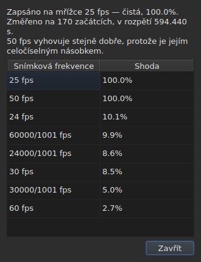

# Mřížka snímků

<!-- machine-translated -->
> Tato stránka je strojovým překladem a dosud ji nezkontroloval žádný čtenář tohoto jazyka.

Soubor titulků **neuvádí** snímkovou frekvenci, podle které
byly spočítány jeho pozice: SubRip nemá hlavičku, hlavička
WebVTT je volný text. Okno ji **odvodí** ze samotných pozic,
při otevření, a ukazuje ji na dvou místech, která neodpovídají na stejnou
otázku.

| Místo | Výsledek |
| :------ | :------------ |
| stavový řádek | **odpověď**, trvale a bez ptaní |
| `Nástroje ▸ Analýza snímkové frekvence…` | **úvahu**, když ji chcete vidět |

## Co ukazuje stavový řádek

Vpravo, mezi tím, co říká o
[kódování](files.md#kódování-ve-stavovém-řádku) přečteného souboru, a tím, co
říká o [přidruženém videu](video.md#co-ukazuje-stavový-řádek):

| Situace | Co se zapíše |
| :-------- | :-------------- |
| pozice leží na mřížce | `Grid: 24 fps` |
| jen některé z nich | `Grid: 29.97 fps (partial)` |
| nevyhovuje žádná známá mřížka | `No grid` |

**`No grid` neuvádí žádnou snímkovou frekvenci, a to záměrně.** Množina
kandidátů je uzavřená — osm frekvencí, které nabízí dialog převodu — a
ohlásit tu nejméně chybnou by znamenalo dát chybnou odpověď tam, kde
správná odpověď zní „nevím“.

**`No grid` má dvě příčiny a nejde o stejnou odpověď.** Buď
nevyhovuje žádná mřížka, nebo má soubor příliš málo titulků, aby se o něm dalo
něco říct — dva začátky vypadají vždy dokonale zarovnané, a to nic
nedokazuje. Stavový řádek říká o obou totéž;
**analýza je rozliší** a v prvním případě uvede, o kolik
nejlepší kandidát selhává.

Řádek **se aktualizuje po každé operaci**. Zarovnání souboru na jinou
snímkovou frekvenci mění mřížku a stavový řádek nesmí dál
ohlašovat tu starou.

### Dokument počítaný ve snímcích nemá mřížku, má snímkovou frekvenci

**MicroDVD je jediný z devíti formátů, který počítá ve snímcích.** Každý jeho řádek
nese dvě čísla snímků a nic dalšího a soubor **neříká**, při
jaké snímkové frekvenci je číst. Totéž místo stavového řádku pak zapíše:

| Situace | Co se zapíše |
| :-------- | :-------------- |
| dokument je počítaný ve snímcích | `Frames: 24000/1001 fps` |

**To není mřížka a mřížka by tu byla kruhová.** Pozice
dokumentu MicroDVD byly spočítány *z* jeho snímků právě při této
snímkové frekvenci; odvodit z nich mřížku by vrátilo toto číslo, tedy údaj
přestrojený za měření.

**Odkud pochází, se řekne jednou**, při čtení, v
[seznamu hlášení](files.md#hlášení-při-čtení):
`counts in frames and states no rate; it was read at ("24000/1001")`. Řádek
stavového řádku pak trvale říká, co platí.

**Chybná snímková frekvence posune celý soubor** a místem, kde se opravuje, je
dialog [`Convert Frame Rate…`](operations.md#convert-frame-rate):
otevře se na snímkové frekvenci čtení a řekne, že jde právě o ni.

## Co ukazuje analýza

`Nástroje ▸ Analýza snímkové frekvence…` **nic nemění.** Otevře se se shrnutím a
pořadím osmi kandidátů s jejich skóre.




Shrnutí podá odpověď a pak to, co ji upřesňuje — každá věta se objeví
jen tehdy, má-li co říct:

| Co se tam dá přečíst | Kdy |
| :--------------------- | :--- |
| na kolika začátcích a v jakém rozpětí | vždy |
| o kolik je soubor posunutý vůči své mřížce | jeho pozice na ní leží až na konstantu |
| že stejně dobře vyhovuje jiná snímková frekvence | je celočíselným násobkem té vybrané |
| že rozpětí neumožňuje rozlišit dvě snímkové frekvence | soubor je příliš krátký na to, aby je oddělil |
| kolik začátků mřížku opouští **a v kolika sériích** | soubor je částečný |

**Počet sérií rozlišuje dva příběhy**, které
samotné procento zaměňuje. Mnoho sérií o jediném začátku jsou pozice
opravené ručně, jedna po druhé. Několik dlouhých sérií je přečasovaný
úsek nebo soubor složený ze dvou jiných.

**Ukazuje se celé pořadí, nikoli jediná odpověď.** Soubor, který
vyhovuje 25 na sto procent a 50 na sto procent, říká něco, co by
samotný verdikt skryl.

## Když byl převod chybný

Soubor, který neleží na žádné mřížce, je někdy soubor, který byl **převeden při špatné
snímkové frekvenci**: leží pak na zcela skutečné mřížce, ale posunuté v poměru, který nepatří
žádné z osmi. Když odvození vrátí `none` nebo `partial`, analýza hledá **mezi
padesáti šesti uspořádanými dvojicemi osmi standardních snímkových frekvencí** — to je ta uzavřená množina — tu,
jejíž převod vrátí pozice na mřížku. Každý poměr se použije na pozice a
**výsledek posuzuje samo odvození**: spolehlivost je to, co by řeklo ono, nikdy
vymyšlené číslo. Dvě dvojice, které dávají stejný poměr, například 30 na 25 a 60 na 50, jsou jediný
převod.

Do shrnutí se přidá věta:

```text
converting from 24 to 25 fps puts the positions on a 24 fps grid: 99.9%, against 11.8% as they are and 14.9% for the next best conversion
```

Uvádí převod, mřížku, na kterou by pozice padly, a jak dobře na ni padnou,
**a pak rozdíl oproti pozicím v současném stavu a oproti nejlepšímu z ostatních
převodů.** Tlačítko `Convert Frame Rate…` zavře analýzu a otevře [dialog
převodu](operations.md#convert-frame-rate) **vyplněný nalezenou dvojicí** — nic se nepoužije,
dokud dialog nepřijmete, a k návratu stačí zrušit. Video otevřené vedle
umožňuje posoudit na obraze, zda je odpověď správná.

**Když jsou dvě dvojice stejně dobré, nenavrhne se žádná a věta to řekne:**

```text
converting from 30 to 25 fps and converting from 25 to 24 fps fit equally well (99.7% and 99.6%), so none is proposed
```

Je to spíše běžný případ než výjimka: mřížka 28,8 snímku za sekundu se vrátí
na 24 stejně dobře jako na 30 a soubor, jehož časy jsou všechny zdvojnásobené, zůstane na mřížce 25.
Úkon, který má jedinou opravu, je převod souboru, který **už** má cílovou snímkovou frekvenci. Při
shodě rozhodne video: `Convert Frame Rate…` otevřete sami na jedné z obou dvojic.

**Nic se neřekne** o souboru, který už na mřížce leží, o souboru příliš krátkém na to, aby verdikt
měl nějakou cenu, ani o souboru, který žádný převod z množiny nevrátí na mřížku — ujíždění,
poměr mimo osm snímkových frekvencí, pozice bez struktury.

## Co tabulka neukazuje

**Žádný řádek tabulky se kvůli mřížce neoznačí**, nikdy.

Jakmile ručně opravíte pozici, přestane být zarovnaná.
Automatické označování by tedy hlásilo práci uživatele jako
anomálii, a to v souboru, který právě opravuje. Odvození
mluví o **dokumentu** a analýza je jedinou výjimkou — protože jste
ji kvůli tomu otevřeli.

Značky tabulky se naproti tomu týkají toho, co do sebe nezapadá: konce
před začátkem, překryvu, porušeného pořadí. Viz [Tabulka](table.md).
