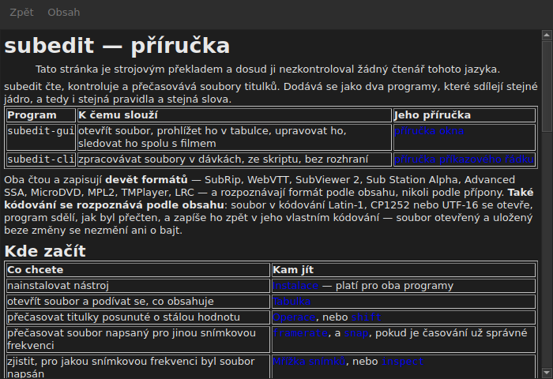

# Příručka v okně

<!-- machine-translated -->
> Tato stránka je strojovým překladem a dosud ji nezkontroloval žádný čtenář tohoto jazyka.

`Nápověda ▸ Příručka` neboli `F1` otevírá **právě tuto příručku** ve vlastním okně.




## Co otevírá a proč ne adresu

**Příručku nainstalovanou vedle programu**, ne stránku na internetu.

Adresa by popisovala verzi ve vývoji, ne tu, kterou máte v ruce.
Uživatel, který čte příručku k verzi, kterou nemá, je na tom hůř než
uživatel bez jakékoli příručky — proto okno čte soubory, které umístila
instalace, v `<prefix>/share/subedit/manual`. Viz
[Instalace](../subedit-cli/installation.md).

Otevře se na [úvodní stránce](../index.md), té, která říká, kde začít.

## V jakém jazyce

**V jazyce okna.** Příručka se otevře v jazyce, kterým mluví
rozhraní: v tom, který je zvolen v `Úpravy ▸ Předvolby…`, jinak v jazyce
prostředí — viz
[Jazyk rozhraní](preferences.md#jazyk-rozhraní).

| Okno mluví | Příručka se otevře |
| :---------------- | :------------------ |
| anglicky | anglicky |
| jazykem, jehož příručka je nainstalována — katalánsky, česky, německy, španělsky, finsky, francouzsky, galicijsky, hebrejsky, maďarsky, interlingue | v tomto jazyce |
| jazykem, jehož příručka není nainstalována | anglicky |

**Stránku po stránce, ne všechno, nebo nic**: stránka, kterou překlad nemá,
se otevře anglicky a každá jiná stránka zůstane v jazyce okna.
Odkaz vede z jedné na druhou stejným způsobem.

Překlady se instalují vedle anglické příručky, každý do adresáře
pojmenovaného podle svého jazyka: `<prefix>/share/subedit/manual/fr` pro francouzštinu.
Jazyk je ten, ve kterém se okno spustilo, takže jazyk zvolený v
předvolbách platí od příštího spuštění i pro příručku.

## Procházení

| Co uděláte | Co se stane |
| :---------- | :----------- |
| kliknete na odkaz příručky | stránka se otevře ve stejném okně |
| kliknete na odkaz, který míří na oddíl | stránka se otevře a okno se k němu posune |
| kliknete na odkaz, který míří jen na oddíl | okno se k němu posune, aniž by změnilo stránku |
| `Back` | vrátí se na předchozí stránku; na první je nedostupné |
| `Contents` | vrátí se na úvodní stránku; nedostupné, když na ní jste |

Okno **není modální**: zůstává otevřené, zatímco pracujete, což je celý
smysl mít příručku po ruce. Opětovná volba položky nevytvoří
druhé okno, ale přenese toto do popředí.

## Co otevřít nedokáže, a řekne to

Příručka někdy odkazuje na **plán vývoje** nebo na **architektonické
rozhodnutí**. To jsou dokumenty repozitáře, ne balíčku:
neinstalují se a okno to řekne srozumitelnými slovy, místo aby nechalo
kliknutí bez účinku.

```
../../feuille-de-route.md is not part of the installed manual;
it lives in the project's repository.
```

Lze je číst v repozitáři, jehož adresa je v `Nápověda ▸ O aplikaci subedit`.

## Když je položka nedostupná

**`Nápověda ▸ Příručka` je nedostupná, když vedle programu není žádná příručka.** Dva
případy a ani jeden není chyba:

| Případ | Proč |
| :--- | :-- |
| binární soubor se spouští ze svého stromu sestavení | nic se tam nenainstalovalo, takže není co číst |
| instalace je neúplná | příručka byla odstraněna, nebo nebyla nikdy zkopírována |

Najetí myší na položku řekne, o který z obou jde: „Vedle tohoto programu není nainstalována
žádná příručka“.

Chybějící stránka, zatímco příručka existuje — soubor smazaný ručně —
okno nezavře: uvede soubor, který nemohlo přečíst, a ponechá na obrazovce to, co
zobrazovalo.

## Kde se příručka hledá

**Vedle spustitelného souboru**, v `../share/subedit/manual` — v uspořádání, které vytváří každá
instalace, ať je prefix jakýkoli. Díky tomu instalace
v `~/.local` najde svou příručku stejně jako balíček nainstalovaný v `/usr`.
