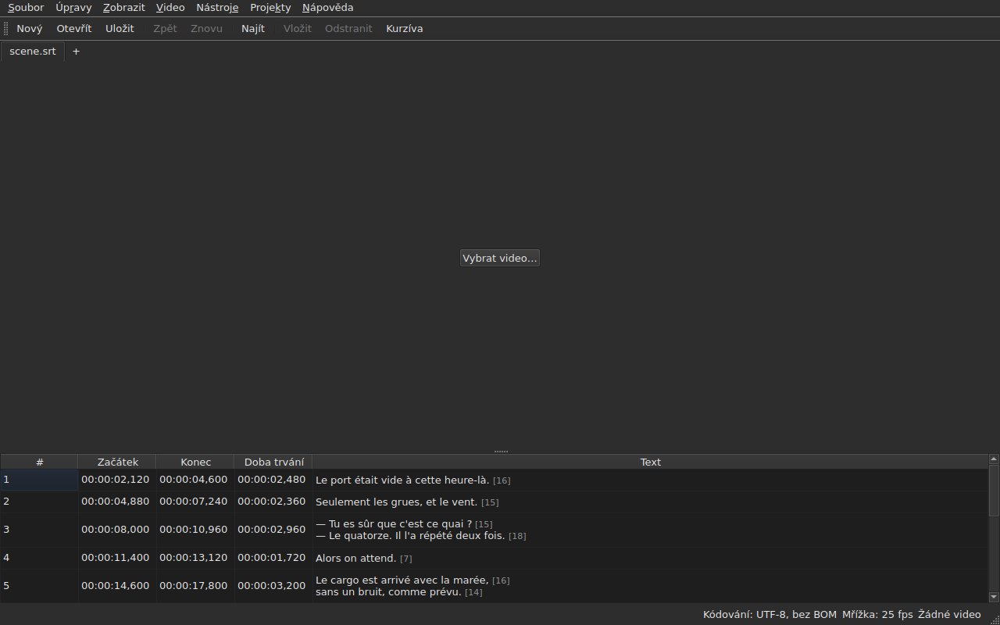

# subedit-gui — příručka

<!-- machine-translated -->
> Tato stránka je strojovým překladem a dosud ji nezkontroloval žádný čtenář tohoto jazyka.

Okno subedit: otevřete soubor titulků a uvidíte ho v tabulce. O druhém
programu a o tom, kde začít, viz [příručku](../index.md).

> **Současný stav.** Okno **otevírá více souborů, každý na vlastní kartě**, ať je
> jejich kódování jakékoli — přes `Open…` nebo jejich přetažením do okna —, **zobrazuje**,
> **upravuje své buňky**, **vkládá a odstraňuje řádky**,
> **vrací změny zpět**, **ukládá — s volbou kódování, konců řádků a
> značky pořadí bajtů** — a **označuje titulky, jejichž pozice
> nedávají smysl**. **Slučuje a rozděluje** řádky, **vyjímá,
> kopíruje a vkládá** texty a **hledá a nahrazuje** ve viditelném textu,
> aniž by porušilo značky, v jednom projektu nebo ve všech. **Otevírá překlad
> vedle hlavního souboru**, zarovnaný podle pozice nebo podle čísla, v jednom sloupci navíc,
> a ukládá ho zvlášť. Nabídka `Tools` nese šestnáct operací a dvě položky pro pravopis —
> posun, transformaci, převod snímkové frekvence, úpravu dob trvání,
> **připojení souboru, rozdělení projektu na dva**, převedení
> na kurzívu, přidání dialogových pomlček, změnu velikosti písmen čtyřmi způsoby,
> odstranění popisků pro neslyšící, **opravu textů pomocí
> vícestránkového průvodce**, **kontrolu pravopisu slovo po slově**, zarovnání na snímkovou frekvenci, návrat
> na mřížku — a analýzu mřížky, která nic nemění. Nabídka `Projects`
> **ukládá a zavírá vše** jediným pohybem. **Přidružuje k dokumentu
> video**, zvolené nebo uhodnuté, a **přehrává ho v okně**, s aktuálním
> řádkem vykresleným do obrazu; **nastavuje začátek, konec nebo
> titulek podle pozice filmu**, **posouvá se snímek po snímku** a **posouvá okraj o jeden snímek**. Lišta přehrávání **přetáčí, nastavuje
> hlasitost a pozici**, tabulka **sleduje přehrávání**, aniž by rušila ruční posunutí, pozice
> lze zobrazit **ve snímcích** a nabídka `Video` **volí zvukovou stopu**. Dvě detekce
> **navrhují, aniž by cokoli použily**: překlad posunutý o stálou hodnotu, který lze **znovu otevřít
> posunutý**, a převod snímkové frekvence, který vrací soubor na mřížku. **Pamatuje si svou geometrii, pořadí, šířku a přítomnost svých
> sloupců a svá nastavení** od jedné
> relace k další a je **světlé nebo tmavé** podle vaší volby. `Nápověda ▸ Příručka`
> otevírá **tuto příručku** v okně. Tato příručka popisuje to, co existuje, nikdy
> to, co se plánuje; co přijde dál, je v
> [plánu vývoje](../../../../feuille-de-route.md).

> **Obrázky této příručky se generují, text ne.** Příklady
> `subedit-cli` se generují spuštěním příkazu; snímky obrazovky
> se generují sestavením skutečného okna a jeho vyfotografováním — `make
> manual` dělá obojí. Obrázek proto nemůže popisovat rozhraní, které
> už neexistuje, a rozhraní, které se změní, je vidět v diffu
> repozitáře. Bez záchranné sítě zůstává text kolem nich, jehož
> přesnost závisí na kontrole.

**Každá obrazovka je zobrazena dvakrát, ve dvou paletách, které aplikace
nastavuje** — `Light` a `Dark`, ty, které nabízejí
[předvolby](preferences.md#motiv). V pracovním prostředí, jehož
motiv rozhoduje, dává `System` jednu nebo druhou podle toho, co zvolilo pracovní prostředí.

## Nabídky

`File`, `Edit`, `View`, `Video`, `Tools`, `Projects`, `Help` — v pořadí,
v jakém je používáte: dokument, co s ním děláte, jak se na něj díváte, co
k němu patří, co ho zkoumá, co platí pro všechny otevřené projekty, co
ho vysvětluje.

`View` nese podnabídku `Columns`, jednu zaškrtávací položku pro každý sloupec kromě `Text`
— viz [Tabulka](table.md#skrytí-a-přesun-sloupců) — a nastavení `Positions in Frames`, které zobrazuje
`Start` a `End` jako čísla snímků — viz [Pozice ve snímcích](table.md#pozice-ve-snímcích).

`Projects` nese dvě položky, `Save All` a `Close All` — viz
[Nabídka Projekty](files.md#nabídka-projekty).

`Edit` nese pět bloků, každý pod oddělovačem: vrácení zpět;
schránku — vyjmout, kopírovat, vložit texty; `Find and Replace…`;
vkládání, odstraňování, slučování a rozdělování řádků; nakonec
`Preferences…`. Vrácení zpět je to, co děláte *s* úpravou, přesun textu
nepřidává ani neodebírá řádek, čtyři položky dalšího bloku mění počet
řádků a nastavení motivu vůbec není úprava.

**Klávesy se jmenují tak, jak je zobrazuje nabídka**, anglicky jako zbytek
rozhraní: `Ins`, `Del`, `Ctrl+Shift+Z`. Klávesa, kterou stisknete a
kterou žádná nabídka nejmenuje, si ponechává svůj anglický název: `Enter`, `Esc`, `Shift`.

`Help` nese dvě položky v pořadí, v jakém je nabídka zobrazuje. `Manual` neboli
`F1` otevírá tuto příručku v okně — viz
[Příručka v okně](help.md). `About subedit` uvádí verzi,
licenci a knihovny, se kterými okno běží, s jejich verzemi — viz
[`--version`](invocation.md#--version).

## Panel nástrojů

Pod nabídkami nese lišta **nejčastější úkony**, ve skupinách.
Každé tlačítko nese krátké slovo; nabídka si ponechává celou položku a
zkratka je stejná.

| Tlačítko | Položka nabídky | Zkratka |
| :----- | :--------- | :------- |
| Nový | Soubor ▸ Nový projekt | `Ctrl+N` |
| Otevřít | Soubor ▸ Otevřít… | `Ctrl+O` |
| Uložit | Soubor ▸ Uložit | `Ctrl+S` |
| Zpět | Úpravy ▸ Zpět | `Ctrl+Z` |
| Znovu | Úpravy ▸ Znovu | `Ctrl+Shift+Z` |
| Najít | Úpravy ▸ Najít a nahradit… | `Ctrl+F` |
| Vložit | Úpravy ▸ Vložit titulky… | `Ins` |
| Odstranit | Úpravy ▸ Odstranit titulky | `Del` |
| Kurzíva | Nástroje ▸ Kurzíva | `Ctrl+I` |

**Nedostupné tlačítko je nedostupné ze stejného důvodu jako jeho položka**: `Undo`, když
není co vrátit, `Remove`, když není zvolen žádný řádek. Položky překladu
a operace nabídky `Tools` kromě `Italic` zůstávají ve svých
nabídkách: používají se méně často, nebo je nepoužívá každý.

## Oddíly

| Oddíl | Obsah |
| :------ | :------- |
| [Instalace](../subedit-cli/installation.md) | sestavení a instalace — stránka platí pro oba programy |
| [Spuštění](invocation.md) | spuštění okna, argumenty, návratové kódy |
| [Otevírání a ukládání](files.md) | příkazy, karty, nabídka `Projects`, přetažení souborů, překlad a jeho opětovné otevření s posunem, hlášení při čtení, kódování ve stavovém řádku, zpáteční cesta, zavření |
| [Tabulka](table.md) | co zobrazuje který sloupec, jejich skrytí a přesun, pozice ve snímcích, sloupec překladu a text, na který operace míří |
| [Úprava buňky](editing.md) | které buňky lze upravit a jak |
| [Vyjmutí, kopírování a vložení textů](clipboard.md) | tři položky, co se přenáší, přidané řádky, přeložené značky |
| [Najít a nahradit](find-and-replace.md) | dialog, čtyři úkony, dvě volby, co hledání zahrnuje, ve všech otevřených projektech |
| [Vkládání, odstraňování, slučování a rozdělování řádků](lines.md) | čtyři položky, jejich zkratky, kam jdou nové řádky |
| [Zpět a znovu](undo.md) | historie, dvě akce, značka změny |
| [Mřížka snímků](frame-grid.md) | snímková frekvence odvozená z pozic, analýza a převod, který vrací soubor na mřížku |
| [Operace](operations.md) | posun, transformace, převod, úprava dob trvání, připojení souboru, rozdělení projektu, převedení na kurzívu, velikost písmen, pomlčky, odstranění popisků, zarovnání, návrat na mřížku a to, co přesahuje konec filmu |
| [Opravit texty…](correct-texts.md) | průvodce opravami: cíl a úlohy, stránka každé úlohy, průběh, potvrzení |
| [Zkontrolovat pravopis…](check-spelling.md) | kontrola pravopisu: její nastavení, procházení, zavření uprostřed, chybějící slovník |
| [Přidružené video](video.md) | volba videa, automatický návrh, zvuková stopa, stavový řádek, `ffmpeg` |
| [Přehrávač](player.md) | zobrazení videa, lišta přehrávání, přehrávání, pohyb, hlasitost, tabulka, která sleduje, vykreslený řádek |
| [Časování podle videa](timing.md) | nastavení začátku nebo konce titulku, vkládání, výběr podle pozice filmu, posun snímek po snímku, posun okraje |
| [Předvolby](preferences.md) | motiv, soubor předvoleb, jeho volby a co se stane s nečitelnou hodnotou |
| [Příručka v okně](help.md) | `Nápověda ▸ Příručka`, co otevírá a jak se v ní pohybovat |
