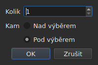

# Vkládání, odstraňování, slučování, rozdělování, řazení a převádění řádků na disjunktní

<!-- machine-translated -->
> Tato stránka je strojovým překladem a dosud ji nezkontroloval žádný čtenář tohoto jazyka.

Osm položek nabídky `Edit` pod oddělovačem, který je odděluje od
`Find and Replace…`. Čtyři z nich mají společné to, že mění počet řádků, zatímco
vyjmutí, kopírování a vložení, popsané výše, přesouvají texty; `Sort Subtitles` mění
jen **pořadí** řádků, `Join Repeated Subtitles` spojí po sobě jdoucí kusy
téhož textu znovu do jediného titulku a `Make Ranges Disjoint…`
je znovu rozdělí tam, kde se překrývají.

| Položka | Zkratka | Co dělá |
| :---- | :------- | :----------- |
| Vložit titulky… | `Ins` | otevře dialog, pak přidá prázdné řádky |
| Odstranit titulky | `Del` | odstraní výběr, aniž by se na cokoli ptal |
| Sloučit titulky | žádná | udělá z bloku sousedních řádků jediný řádek |
| Rozdělit titulek | žádná | rozdělí řádek na dva v polovině jeho doby trvání |
| Spojit opakované titulky | žádná | spojí po sobě jdoucí kusy téhož textu do jediného titulku |
| Seřadit titulky | žádná | vrátí řádky do pořadí podle jejich začátku, v celém projektu |
| Převést rozsahy na disjunktní… | žádná | rozdělí překrývající se řádky tak, aby se už žádný rozsah nepřekrýval s jiným |
| Spravit titulky… | žádná | zřetězí tři předchozí položky — spojení opakování, seřazení, rozdělení rozsahů — najednou |

Všech osm se zapisuje do historie: `Ctrl+Z` je vrátí zpět jako všechno ostatní.

## Vkládání

| Pole | Co obsahuje | Výchozí |
| :---- | :------------ | :------ |
| `How many` | celé číslo od 1 do 99 999 | `1` |
| `Where` | `Above the selection` nebo `Below the selection` | poslední volba, `Below` při prvním spuštění |

`OK` přidá řádky, `Cancel` nepřidá nic.

### Kam jdou

**K poslednímu vybranému**, ne k prvnímu. Výběr řádků 1 a 3
a následné vložení pod ně umístí nový řádek na pozici 4 — ne na
pozici 2. Tak to Gaupol dělá už dvacet let a to ruka
očekává po tažení shora dolů.

`Above the selection` ho umístí těsně před tentýž řádek.

### Jak dlouho trvají

Prázdný řádek nemá text, ale má pozice. Ty se odvodí
z dostupného místa:

| Situace | Začátek | Doba trvání |
| :-------- | :---- | :------- |
| mezi dvěma titulky | konec předchozího | místo do následujícího, rozdělené rovným dílem |
| za posledním | konec posledního | každý tři sekundy |
| na začátku souboru | počátek | místo do prvního, rozdělené |
| v prázdném souboru | počátek | každý tři sekundy |

Když se soubor na zvoleném místě překrývá, **není co
dělit**: řádky dostanou nulovou dobu trvání, kterou tabulka ukáže, místo
vymyšlené doby trvání, která by zasahovala do souseda.

### Prázdný dokument

**Výběr není nutný** a je to jediný způsob, jak začít
nový soubor: řádky jdou na index nula. Volba strany je pak v dialogu
nedostupná — není žádný výběr, vůči kterému by se umístily.

Jakmile dokument nese řádek, je položka `Insert Subtitles…` **nedostupná, dokud
není nic vybráno**: bez výběru by se index hádal.

### Potom

Přidané řádky jsou **vybrané** a tabulka na ně přejde. Druhé stisknutí
`Ins` proto vkládá za ně, aniž byste museli klikat mezi
ně.

### Strana se pamatuje

`Above` nebo `Below` se pamatuje **od jednoho vkládání k dalšímu a od jedné relace
k další**: je to volba `edit.insert-placement`
[souboru předvoleb](preferences.md#soubor). Nevkládá se jednou,
vkládá se deset řádků za sebou, vždy na stejnou stranu.

## Odstraňování

`Remove Subtitles` nebo `Del` odstraní vybrané řádky — i
nesouvislý výběr, přičemž se každý řádek při vrácení zpět vrátí na své místo.

**Nežádá se žádné potvrzení** a není to opomenutí:
operace se vrátí zpět pomocí `Ctrl+Z`. Modální okno před vratným gestem
by stálo pokaždé kliknutí, jen aby se tu a tam ušetřilo jedno `Ctrl+Z`.

**Položka je nedostupná, když není nic vybráno.** Jinde v okně
„nic nevybráno“ znamená „celý soubor“ — díky tomu je
posun použitelný bez vybírání čtyř tisíc řádků. Zde by takové čtení
nešťastným `Del` vyprázdnilo dokument, a proto se nenabízí.

Po odstranění je **vybrán řádek, který zaujal místo prvního odstraněného**
— nebo poslední zbývající, pokud odstranění odebralo konec
souboru. Několikeré stisknutí `Del` za sebou proto odstraňuje řádky jeden
po druhém.

Zcela vyprázdněný soubor ponechá okno použitelné: `Insert Subtitles…`
je znovu dostupné, protože do prázdného dokumentu se vkládá bez výběru.

## Slučování

`Merge Subtitles` udělá z vybraných řádků **jediný řádek**:

| Co sloučený řádek dostane | Odkud to pochází |
| :---------------------------- | :------------------ |
| svůj začátek | začátek prvního |
| svůj konec | konec posledního |
| svůj text | texty všech, v pořadí, mezi dvěma zalomení řádku |
| svůj překlad | překlady, spojené stejným způsobem |
| co formát nese kromě toho — styl, vrstvu, souřadnice | první |

**Prázdný text nezanechá prázdný řádek**: sloučení `Un.`, řádku bez
textu a `Trois.` dá dva řádky textu, ne tři.

Sloučené řádky zmizí a řádek, který je nahradí, zaujme místo
prvního.

**Položka je nedostupná**, dokud výběr není **blokem alespoň
dvou sousedních řádků**. Jediný řádek nemá s čím se sloučit; řádky
1 a 3 bez 2 také ne, protože výsledek by zasahoval do 2 a
zakryl ho.

Po sloučení je **vybrán sloučený řádek**: `Split Subtitle` je
připraveno ho znovu rozdělit.

## Rozdělování

`Split Subtitle` rozdělí vybraný řádek **v polovině jeho doby trvání**, na
milisekundu přesně:

| Polovina | Začátek | Konec | Text |
| :--- | :---- | :-- | :--- |
| první | původní začátek | střed | **celý** text a překlad |
| druhá | střed | původní konec | prázdný |

**Text se nerozděluje v místě zalomení řádku.** To by bylo správně u
dvouřádkového titulku a špatně u titulku s jedním nebo třemi řádky;
celý text zůstane v první polovině a to, co má jít
do druhé, přesunete sami.

První polovina si ponechá, co formát nesl kromě textu; druhá
vznikne jako vložený řádek, bez ničeho.

**Položka je nedostupná**, dokud výběr nečítá **právě jeden
řádek**. Nic nevybráno zde neznamená „celý soubor“.

Po rozdělení jsou **vybrány obě poloviny** — tak to Gaupol
dělá po každém vložení, a `Merge Subtitles` je pak připraveno gesto
vrátit.

## Řazení

`Sort Subtitles` vrátí **celý projekt** do pořadí podle začátků. Nikdy ne
výběr: pořadí je vlastností dokumentu a seřadit polovinu
souboru nic neznamená. Řazení je **stabilní**: dva titulky, které
začínají současně, si ponechají pořadí, které jim dal soubor.

**Během řazení běží ve stavovém řádku lišta a kurzor se změní na
přesýpací hodiny**: u dlouhého souboru okno chvíli nereaguje — tabulka
se přestavuje řádek po řádku — a bez toho nevíte, zda něco
probíhá. Lišta neukazuje žádný podíl, řazení žádný nehlásí,
a zmizí spolu s ním.

Stavový řádek řekne, kolik řádků změnilo místo — `3 subtitles moved`
— nebo, když bylo vše v pořadí, `already in order`. **Projekt, který už je v pořadí,
se do historie nezapíše**: operace, která nic nemění, není
operací k vrácení. Položka je nedostupná pro projekt s jediným titulkem.

Soubor, **který má při otevření co opravit**, to sám nabídne,
[v jediném dialogovém okně](#při-otevření-jediné-dialogové-okno): viz níže. Titulky mimo
pořadí se také [počítají mezi hlášeními](files.md#hlášení-při-čtení),
abyste je našli bez procházení tabulky.

Na příkazovém řádku dělá podpříkaz [`sort`](../subedit-cli/sort.md) totéž se
soubory a `--sort` to dělá mimochodem u
[`convert`](../subedit-cli/convert.md#řazení-při-zápisu),
[`append`](../subedit-cli/append.md#seřazení-výsledku) a
[`split-file`](../subedit-cli/split-file.md#dělení-v-časovém-pořadí).

## Spojení opakovaných titulků

`Join Repeated Subtitles` udělá **jediný titulek** z titulků, které ukazují
totéž za sebou: text rozdělený do po sobě jdoucích kusů, jak ho
zanechávají některé segmentační nástroje. Působí na **celý projekt**.

**Opakování** má stejný text, stejný překlad a stejná nastavení formátu
(styl, pozici, nastavení podnětu) jako jiný titulek **a začíná nejpozději
tehdy, když onen končí**. Série opakování se stane tím, který začíná
první, s největším koncem série; ostatní zmizí.
`Alpha [1, 2]`, `Alpha [2, 4]` a `Alpha [4, 6]` dají `Alpha [1, 6]`.

- **Pořadí souboru na tom nic nemění a ono ho nemění**: ponechaný titulek
  je ten, který začíná první, ať jsou ostatní kdekoli.
- **Nic se nespojí omylem**: jiný text, jiná nastavení, mezera
  mezi dvěma kusy, titulek bez textu nebo titulek, jehož konec předchází jeho začátku,
  zůstanou oddělené.
- Stavový řádek řekne, co se udělalo — `2 repeated subtitles joined`, nebo
  `no repeated subtitles`.

**Je třeba to udělat před řazením a dělením**, které čistou sérii čtou lépe:
text ve třech kusech plus jiný text přes celý rozsah, zadané mimo
pořadí, se seřadí a rozdělí na řádky, které přeskakují z jednoho kusu na druhý; spojený
nejprve, zapadne do pořadí a čistě se sloučí. Dialogové okno při otevření, níže, dělá
všechny tři v tomto pořadí.

## Převedení rozsahů na disjunktní

`Make Ranges Disjoint…` rozdělí překrývající se titulky tak, aby se **žádný
rozsah `[start, end]` už nepřekrýval s jiným**. Působí na **celý
projekt**, nikdy na výběr: skupina překrývajících se titulků
se rozdělí tam, kde se překrývají, a polovina skupiny nic neznamená.

**Nic se nezkracuje ani neprodlužuje.** V každém okamžiku okno ukazuje
tytéž texty jako předtím. Mění se to, jak je rozdělena časová osa:
dělí se v každém začátku a každém konci skupiny; interval pokrytý
jediným titulkem zůstane tímto titulkem; interval pokrytý několika
se stane **jedním** titulkem, jehož řádky jsou jejich, **nejdřívější na řádku 1**.
`A [0, 5]` a `B [3, 8]` dají `[0, 3] A`, `[3, 5] A / B`, `[5, 8] B`.

Dialog se ptá na tři nastavení, zapamatovaná od jednoho použití k dalšímu:

| Pole | Co obsahuje | Výchozí |
| :---- | :------------ | :------ |
| `Shortest interval kept` | od 0 do 10 000 ms: kratší interval převezme soused | `80 ms` (asi dva snímky) |
| `Most lines in a subtitle` | od 0 do 10; `No limit` při 0 | `2` |
| `Put a dash before each subtitle's text` | pomlčka před tím, čím každý titulek přispívá ke sloučenému titulku | nezaškrtnuto |

`OK` rozdělí, `Cancel` neudělá nic. **Zapsané řádky jsou poté
vybrány** a stavový řádek řekne, co se udělalo: `2 subtitles split, 1 merged`.
Druhý průchod nic nezmění a řekne to: `already disjoint`.

- **Řádek se nikdy nezdvojí.** Dva titulky se stejným textem dají
  jediný řádek tam, kde se překrývají, a dva sousední kusy, které ukazují
  totéž, tvoří jen jeden titulek. Text titulku rozděleného na několik
  kusů se jinak opakuje v každém z nich: je to to, co je v tu chvíli na obrazovce.
- **Velmi krátký interval převezme soused**: ten, jehož řádky
  už obsahují jeho vlastní, jinak nejdelší, rozšíří svůj rozsah tak, aby ho pokryl.
  Celý titulek kratší než práh se nikdy nepřevezme.
- **Více řádků, než je limit: okna.** Tři řádky přes tři sekundy
  se stanou dvěma polovinami, nejprve první dva řádky, pak poslední dva;
  čtyři řádky třemi třetinami a tak dále. Nic se neořízne.
- Překlad sleduje tatáž dělení; styl a pozice prvního
  pokrývajícího titulku se zachovají.

**Co nešlo udělat celé, se řekne v dialogovém okně, které je třeba zavřít**, ne ve
stavovém řádku: okna, převzaté intervaly, příliš krátké titulky
ponechané celé, odlišné styly, titulky, jejichž konec předchází jejich
začátku (ponechané, kde jsou).

**Položka se odmítne, s důvodem, když titulky nejsou v
pořadí podle svého začátku**: skupiny jsou série sousedů a jádro nikdy
neřadí samo. Nejprve `Sort Subtitles` — nebo dialogové okno při otevření, které
dělá obojí v tomto pořadí.

### Vše najednou: `Repair Subtitles…`

`Repair Subtitles…` provede tři předchozí položky **jednu po druhé**, v jediném pořadí, které funguje:
opakování se spojí, titulky se seřadí podle svého začátku a pak se rozsahy převedou na disjunktní. Je to položka
pro soubor, který je špatně segmentovaný, špatně seřazený a překrývající se, když víte, že chcete všechny tři. Dialog se ptá na
nastavení dělení (stejná jako u `Make Ranges Disjoint…`, zapamatovaná od jednoho použití k dalšímu) a říká, že nejprve spojuje a
řadí. Stavový řádek — nebo dialogové okno k zavření, když něco nešlo udělat celé — podá **jediný souhrn**
všech tří: `2 repeated subtitles joined; already in order; 2 subtitles split, 1 merged`. Každá oprava je vlastní
položkou historie: `Ctrl+Z` je vrací jednu po druhé. Na příkazovém řádku: [`repair`](../subedit-cli/repair.md).

### Při otevření jediné dialogové okno

Soubor, který se otevře s něčím, co umíme opravit, **to nabídne
v jediném dialogovém okně**, `Problems found in this file`, místo aby otevíral jedno pro každý
problém. Každý nalezený problém je řádek se svým zaškrtávacím políčkem, zaškrtnutým:

- `Join the repeated subtitles` — titulky opakují jiný, kterého se
  dotýkají, s jejich počtem;
- `Sort the subtitles` — titulky nejsou v pořadí podle svého začátku,
  s jejich počtem;
- `Make the ranges disjoint` — titulky začínají před koncem předchozího,
  počítané **až je soubor v pořadí**, protože tam se opravují.

**Každý problém se počítá tam, kde se opravuje**, na kopii, na které už byly
provedeny opravy, jež mu předcházejí: text rozdělený na kusy je
příčinou určitého nepořádku a jeho spojení napřed nemusí žádný ponechat — dialogové okno
pak řazení nenabídne.

Problém, který nebyl nalezen, nemá žádný řádek. Zrušení zaškrtnutí řazení **zašedí a
odškrtne** druhé políčko: rozsahy se převádějí na disjunktní jen v pořadí.
`Fix` použije, co je zaškrtnuto — spojení, pak řazení, pak dělení, s
nastaveními posledního `Make Ranges Disjoint…` — a podá o tom **jediný souhrn**;
`Keep as is` se ničeho nedotkne. **Nic se neudělá bez „ano“**, každá oprava
je položkou historie a soubor, který nemá co opravit, není předmětem
žádné otázky.

Na příkazovém řádku dělá podpříkaz [`disjoint`](../subedit-cli/disjoint.md) totéž se soubory a `--disjoint`
to dělá mimochodem u [`convert`](../subedit-cli/convert.md#převedení-rozsahů-na-disjunktní),
[`append`](../subedit-cli/append.md#převedení-rozsahů-na-disjunktní) a
[`split-file`](../subedit-cli/split-file.md#převedení-rozsahů-na-disjunktní).

### Proč ne zkratky Gaupolu

Gaupol slučuje pomocí `M` a rozděluje pomocí `S`. Samotné písmeno by zachytila
tabulka dřív, než by dorazilo do právě upravované buňky, a `Ctrl+S`
už ukládá: obě položky jsou dostupné přes nabídku.

## Co o tom říká akce Zpět

**Jedna položka historie na gesto.** Sloučení pěti řádků se vrátí jediným
`Ctrl+Z` a vrátí pět řádků tak, jak byly — pozice, texty a
vše, co nesl formát.

| Operace | Co ukazuje `Undo` |
| :-------- | :---------------- |
| vložení | `Undo: inserting` |
| odstranění | `Undo: removing` |
| sloučení | `Undo: merging` |
| rozdělení | `Undo: splitting` |
| spojení opakování | `Undo: joining repeated subtitles` |
| dělení rozsahů | `Undo: making the ranges disjoint` |

Oprava nabídnutá při otevření je jedna položka historie na opravu: spojení, řazení a pak dělení se vracejí jedno po druhém.

Viz [Zpět a znovu](undo.md).

## Zkratky při otevřené buňce

`Ins` a `Del` patří vstupnímu poli, dokud je otevřen editor
buňky: klávesa Delete v něm maže znak, ne
titulek. Zavření editoru — `Enter` nebo `Esc` — jim vrátí jejich význam. Spuštěno
z nabídky, `Remove Subtitles` nejprve potvrdí zadání, jako ostatní
gesta z [Úpravy buňky](editing.md).

Tato příručka pojmenovává klávesy tak, jak je ukazuje nabídka — viz
[Nabídky](index.md#nabídky).
