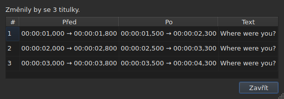
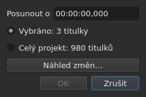
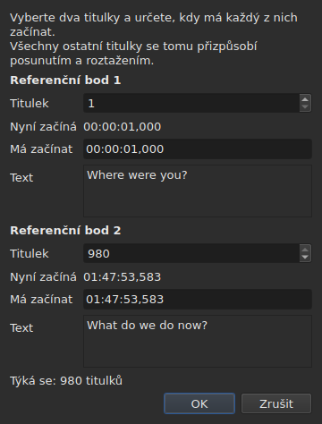
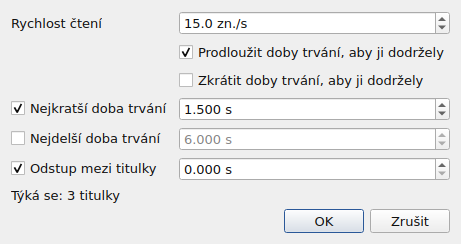
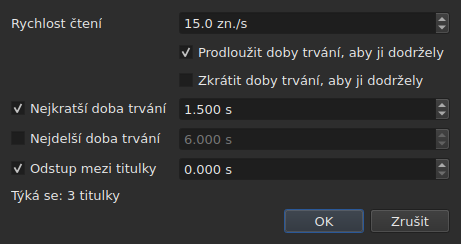
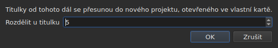

# Operace

<!-- machine-translated -->
> Tato stránka je strojovým překladem a dosud ji nezkontroloval žádný čtenář tohoto jazyka.

Nabídka **Nástroje** nese šestnáct operací, analýzu a dvě položky pro pravopis. Každá ze
šestnácti se vrací zpět pomocí `Ctrl+Z`; analýza nic nemění. Zpět se vrací i `Check Spelling…` a `Spell-Check Settings…` se žádného textu nedotýká.

| Položka | Dialog | Co dělá |
| :---- | :----- | :----------- |
| `Shift Positions…` | ano | posune cíl o dobu trvání |
| `Transform Positions…` | ano | opraví cíl podle dvou referenčních bodů |
| `Convert Frame Rate…` | ano | přečasuje cíl z jedné snímkové frekvence na jinou |
| `Adjust Durations…` | ano | posouvá konce, aby dodržel rychlost čtení, doby trvání a mezeru |
| `Append File…` | výběr souboru | připojí soubor na konec projektu |
| `Split Project…` | ano | rozdělí projekt na dva, zbytek jde na novou kartu |
| `Italic` | **ne** | převede cíl na kurzívu, nebo ji z něj odebere |
| `Dialogue` | **ne** | přidá na začátek každého řádku dialogovou pomlčku, nebo ji odebere |
| `Case ▸ Title Case` | **ne** | každé slovo dostane velké písmeno |
| `Case ▸ Sentence case` | **ne** | první písmeno textu, a jen ono |
| `Case ▸ UPPER CASE` | **ne** | vše velkými písmeny |
| `Case ▸ lower case` | **ne** | vše malými písmeny |
| `Remove Hearing-Impaired Mentions…` | ano, bez nastavení | odstraní popisky pro neslyšící |
| `Correct Texts…` | ano, vícestránkový průvodce | navrhne opravy — popisky, spojování a rozdělování slov, běžné chyby, velká písmena, zalamování řádků — a po přijetí je použije, viz [Opravit texty…](correct-texts.md) |
| `Check Spelling…` | ano, procházení slovo po slově | prochází slova, která slovník nezná, a použije, co bylo opraveno, viz [Zkontrolovat pravopis…](check-spelling.md) |
| `Spell-Check Settings…` | ano | zvolí jazyk, cíl a dokument kontroly a podtrhávání při psaní, viz [Zkontrolovat pravopis…](check-spelling.md#nastavení-kontroly-pravopisu) |
| `Snap to Frame Rate…` | ano | vrátí každý časový údaj na nejbližší snímek |
| `Shift Whole File onto Grid (…)` | **ne** | vrátí celý soubor na jeho mřížku |
| `Frame Rate Analysis…` | ano, bez nastavení | **nic nemění** — viz [Mřížka snímků](frame-grid.md) |

**Co operace udělala, se oznámí v informačním okně, které je třeba
zavřít, kromě `Italic`, `Case` a `Dialogue`**: tyto tři neotevírají žádný
dialog a jejich zpráva — včetně „nic ke změně“ — se zobrazí
ve stavovém řádku, bez čehokoli k zavření. `Split Project…` také podává svou
ve stavovém řádku: její výsledek už máte před sebou, na nové kartě. Hlášení jsou citována
v oddílu každé operace.

Vkládání, odstraňování, slučování a rozdělování řádků tu nejsou, ale v
nabídce `Edit`, protože mění počet řádků. Viz
[Vkládání, odstraňování, slučování a rozdělování řádků](lines.md).

## Na co se vztahují

**Na vybrané řádky, nebo na celý soubor, není-li vybrán žádný.** Je to stejné
pravidlo pro všechny a dialogy, pokud nějaký je, ho připomínají srozumitelnými
slovy:

```
Applies to: 4 subtitles
```

Vybrat všechny řádky vychází nastejno jako nevybrat žádný.

**Když je vybrána jen část řádků, dialog se ptá,
na co působit.** Zobrazí se dvě možnosti s jejich počtem a **zaškrtnutý
je výběr**:

```
(•) Selected: 2 subtitles
( ) Whole project: 4 subtitles
```

Zaškrtnutí `Whole project` rozšíří operaci na celý soubor, aniž by bylo nutné
nejprve měnit výběr. Když není z čeho volit — nic
není vybráno, nebo je vybráno vše —, zůstane sám řádek `Applies to:` výše.

Tuto volbu nabízejí dialogy `Shift Positions…`, `Transform Positions…`,
`Convert Frame Rate…`, `Adjust Durations…`, `Snap to Frame Rate…` a
`Remove Hearing-Impaired Mentions…`.

### Náhled před použitím

`Shift Positions…`, `Transform Positions…`, `Convert Frame Rate…`,
`Adjust Durations…` a `Snap to Frame Rate…` nesou tlačítko **`Preview changes…`**.
Otevře malé okno, které řekne, kolik titulků by operace
změnila **s tím, co je v tu chvíli zadáno, na zaškrtnutém cíli**, a
vypíše prvních dvanáct: jejich číslo, jejich pozici předtím, jejich pozici
potom a první řádek jejich textu. **Nic se nepoužije**: zavření
okna vrátí do dialogu, kde můžete změnit hodnotu a podívat se
znovu.




Otevře se dost velké, aby ukázalo všechny sloupce, a jeho velikost lze
měnit ručně.

Pokud by operace nic nezměnila, okno to řekne (`Nothing would change.`).
Dokud to, co je zadáno, nedefinuje operaci — nečitelná doba trvání, dva
referenční body na stejném titulku —, je náhled prázdný ze stejného důvodu, ze kterého je
tlačítko `OK` zašedlé. `Remove Hearing-Impaired Mentions…` náhled nemá: to, co
mění, je text, a zpráva, kterou podá poté,
to řekne.

**S překladem: který text?** Operace s pozicemi a se strukturou
působí na celý titulek — jeho dva texty jdou s ním. Ty, které
přepisují text — `Italic`, `Case`, `Dialogue`,
`Remove Hearing-Impaired Mentions…` — míří na **text sloupce aktuální buňky**:
na překlad v jeho sloupci, jinde na hlavní text. Druhý zůstane nedotčený a
stavový řádek řekne, na který se míří. Viz [Tabulka](table.md#text-na-který-operace-míří).

**Jedna výjimka, a nese ji její popisek**: `Shift Whole File onto Grid`
ignoruje výběr. Mřížka je vlastnost dokumentu a polovina
dokumentu žádnou vlastní mřížku nemá; položka to proto říká svým názvem, a ne
jen v této příručce.

**`Append File…` výběr také ignoruje**, z jiného důvodu: není to
cíl, který přepisuje, je to konec, který odsouvá. Viz její
[vlastní oddíl](#append-file). **Stejně tak `Split Project…`**: dělí tam, kde se mu
řekne. Viz [jeho oddíl](#split-project).

**`Correct Texts…` volí svůj cíl na vlastní stránce**, místo aby se řídil
aktuálním výběrem: výběr, aktuální projekt nebo všechny otevřené
projekty. Viz [Opravit texty…](correct-texts.md). **`Check Spelling…` ho volí v
`Spell-Check Settings…`** a pamatuje si ho: viz [Zkontrolovat pravopis…](check-spelling.md).

**Dvě operace s mřížkou nemluví o tomtéž co mřížka.**
Operace působí na výběr; analýza a stavový řádek mluví o
**celém dokumentu**. Zarovnání pěti řádků ze sto sedmdesáti šesti těchto pět
skutečně změní — tabulka to ukazuje —, aniž by se kterékoli z obou pohnulo, což
vypadá jako vynechané obnovení. Není to tak: nemají co
říct. Viz [`Snap to Frame Rate…`](#snap-to-frame-rate) a
[Mřížka snímků](frame-grid.md).

### Co znamená „nic nevybráno“, položku po položce

Pravidlo platí pro nabídku `Tools` a pro hledání. Položky
nabídky `Edit`, které se dotýkají řádků nebo je vyprazdňují, ho čtou jinak — jinak by
nešťastné `Del` nebo `Ctrl+X` vyprázdnilo dokument.

| Položka | Bez výběru | Co vyžaduje |
| :---- | :------------------ | :--------------- |
| operace nabídky `Tools` | celý soubor | neprázdný dokument |
| `Shift Whole File onto Grid` | celý soubor, **vždy** | nalezenou mřížku |
| `Find and Replace…` | celý soubor | neprázdný dokument |
| `Cut Texts`, `Copy Texts`, `Paste Texts` | **nedostupné** | alespoň jeden vybraný řádek |
| `Remove Subtitles` | **nedostupné** | alespoň jeden vybraný řádek |
| `Merge Subtitles` | **nedostupné** | blok alespoň dvou sousedních řádků |
| `Split Subtitle` | **nedostupné** | právě jeden řádek |
| `Insert Subtitles…` | nedostupné, kromě prázdného dokumentu | řádek, vůči kterému je umístit |

Každá stránka uvádí důvod: [schránka](clipboard.md#na-co-se-vztahují),
[řádky](lines.md), [hledání](find-and-replace.md#co-hledání-zahrnuje).

Položky jsou **nedostupné v prázdném souboru**: nebylo by co
posouvat. `Italic` má druhou podmínku, kterou popisuje jeho oddíl: otevřený
formát musí umět zapsat styl. Velikost písmen a pomlčky žádnou nemají —
text je text ve všech devíti formátech.

## `Shift Positions…`

Posune cíl o dobu trvání, dopředu nebo dozadu. Obě meze
každého titulku se posunou o stejnou hodnotu: žádný nezůstane na obrazovce déle ani kratší dobu
než předtím.

Doba trvání se zapisuje **jako časový údaj, včetně znaménka** — `00:00:02,500` posouvá dopředu,
`-00:00:01,250` posouvá zpět. **Pole se přepisuje, nepíše se do něj**: začíná jako `00:00:00,000`, číslice nahradí číslici pod kurzorem a kurzor sám přeskakuje `:` a `,`, takže tvar se nikdy nemění. Přijímají se jen číslice a `-` (nebo `+`) pro změnu znaménka; `Backspace` a `Delete` vrátí nulu. Totéž pole se používá všude, kde se zadává čas: v dialogu transformace, v buňkách pozic tabulky a v rozsahu přepisu.




| Odmítnutí | Proč |
| :------ | :-- |
| nečitelná doba trvání | tlačítko zůstane nedostupné; nic se neposouvá nazdařbůh |
| nulový posun | není žádná operace k zaznamenání |
| titulek by se dostal před začátek videa | **žádný soubor nemůže nést takovou pozici** |

Třetí případ jmenuje viníka — „titulek 1 by začínal před počátkem“ —
a právě na něj je třeba se podívat, abyste viděli, o kolik jste se spletli. Nic
se nepoužije.

## `Transform Positions…`

Oprava souboru načasovaného podle jiného střihu. Řeknete, kde **dva**
titulky skutečně začínají, a vše ostatní se úměrně přizpůsobí.

Dialog se dvakrát ptá na totéž: číslo titulku a
pozici, kam patří jeho začátek. U každého referenčního bodu ukazuje, **co toto
číslo označuje** — jeho text (`Text`) a čas, kdy začíná
**nyní** (`Now starts`), jako prosté popisky — a ty se řídí číslem,
jak ho měníte. Text si ponechává **místo na tři řádky**, ať
titulek říká cokoli: delší text nebo dlouhá adresa se v něm posouvá a
dialog si při změně referenčního bodu zachovává svou velikost. **Pro každý referenční bod se zadává jediné pole:
`Should start`**, čas, kdy má tento titulek začínat. Není třeba hledat v tabulce, který řádek je `980`.

`Should start` se **navrhuje s aktuální hodnotou**: dokud na ni
nesáhnete, referenční bod říká „tento titulek už je tam, kde má být“. Měníte jen
to, co změnit chcete. Druhý referenční bod je předvyplněn na posledním
titulku souboru — dva vzdálené referenční body dávají bezpečnější opravu
než dva sousední.




**Oba referenční body přistanou přesně tam, kde bylo požadováno.** Není to
přiblížení: výpočet je proveden tak, aby to platilo.

| Odmítnutí | Proč |
| :------ | :-- |
| dva referenční body na stejném titulku | nedefinují žádnou opravu |
| nečitelná pozice | stejný důvod jako u posunu |

Číslo mimo soubor nelze zadat: pole je omezeno
počtem titulků.

## `Convert Frame Rate…`

Přečasuje cíl, když byly pozice spočítány podle jedné snímkové
frekvence a mají být podle jiné.

Oba seznamy nabízejí osm standardních snímkových frekvencí.

> **Chybně zadaná vstupní snímková frekvence posune celý soubor, aniž by to
> cokoli ohlásilo.** Je to nejhorší způsob selhání této operace, a proto
> dialog říká, odkud pocházejí hodnoty, které navrhuje, místo aby
> je nastavoval mlčky.

### Dva zdroje a na co odpovídají

Dialog nese až dva další řádky, každý se objeví, když má
co říct:

| Řádek | Co říká | Co předvyplní |
| :--- | :----------- | :---------------- |
| `The positions say` | [mřížku snímků](frame-grid.md) odvozenou z pozic souboru | `Timed against` |
| `The video declares` | snímkovou frekvenci, kterou uvádí kontejner, například `24000/1001` | `Should play at` |
| `The file was read at` | snímkovou frekvenci, při které byl přečten soubor **počítaný ve snímcích** | `Timed against` |

**Každý návrh jde do pole, na které odpovídá.** Mřížka říká, podle čeho byl
soubor *zapsán* — to je horní seznam. To, co uvádí kontejner, je
snímková frekvence, při které film *běží*, a tedy ta, při které musí titulky
přicházet — to je dolní seznam.

**Vstup předvyplní jen čistá mřížka.** Částečná mřížka je
vodítko, které samo odvození označuje za částečné, a toto pole rozhoduje o
operaci na celém souboru. [Stavový řádek](frame-grid.md) a analýza
tento případ nesou; toto pole ne.

**Soubor počítaný ve snímcích mřížku nahrazuje, místo aby se k ní přidával.**
MicroDVD nese čísla snímků a pozice dokumentu byly
z nich spočítány při snímkové frekvenci čtení: mřížka odvozená z těchto pozic
může jen znovu najít toto číslo. `The positions say` proto zmizí a
jeho místo zaujme `The file was read at` — je to stejná volba, jakou dělá
[stavový řádek](frame-grid.md#dokument-počítaný-ve-snímcích-nemá-mřížku-má-snímkovou-frekvenci).

**Takto se mění snímková frekvence souboru MicroDVD.** Nastavení přečtené snímkové frekvence
jako vstupu a skutečné jako výstupu přepočítá každou pozici ze snímků
souboru — aniž by se cokoli znovu četlo, a operace se vrací zpět jako
ostatní.

### Neshoda není rozpor

Oba řádky se mohou zobrazit zároveň a uvádět různá čísla.
**Není to chyba, kterou by bylo třeba rozsoudit**: film běží při jedné snímkové frekvenci,
soubor byl zapsán na jiné mřížce. Soubor při 24 pro film při 25 je
přesně případ, kvůli kterému existuje zarovnání — `snap` na příkazovém řádku —,
aby ho řešilo.

Nic se proto nevolí za uživatele: oba seznamy zůstávají
upravitelné, a je to záměrné. Zdroj, který se vnucuje, znemožňuje křížovou kontrolu.

Řádky se neobjeví, když není co říct: žádné přidružené
video, žádný `ffprobe` nebo žádná čistá mřížka. Dialog je pak ten
popsaný výše a **žádná operace kvůli tomu neodmítá** —
snímková frekvence pochází od uživatele. Viz
[Přidružené video](video.md#ffmpeg-není-nutný).

Snímková frekvence, kterou film uvádí, ale která není jednou z osmi standardních,
se **zobrazí, aniž by byla zvolena**: vědět, že film běží při
neobvyklé snímkové frekvenci, je ta informace, a není tu nic, na co ji převést.

Převod snímkové frekvence na ni samotnou nic nemění: tlačítko zůstane nedostupné.

## `Adjust Durations…`

Prodlouží nebo zkrátí dobu trvání titulků cíle **posunutím jejich
konce, nikdy jejich začátku**. Posunutí začátku by posunulo titulek, což je
práce [`Shift Positions…`](#shift-positions).





### Čtyři omezení

| Pole | Co požaduje | Hodnoty | Výchozí |
| :---- | :--------------- | :----- | :------ |
| `Reading speed` | čas potřebný k přečtení textu | od 1 do 99 znaků za sekundu, s přesností na desetinu | 15 znaků/s |
| `Lengthen durations to match it` | prodloužit, co je příliš krátké na přečtení | zaškrtnuto nebo ne | zaškrtnuto |
| `Shorten durations to match it` | zkrátit, co zůstává zobrazeno déle, než je třeba | zaškrtnuto nebo ne | nezaškrtnuto |
| `Minimum duration` | spodní hranice doby trvání | od 0 do 99 s, s přesností na milisekundu | zaškrtnuto, 1,5 s |
| `Maximum duration` | horní hranice doby trvání | od 0 do 99 s, s přesností na milisekundu | nezaškrtnuto, 6 s |
| `Gap between subtitles` | mezera, kterou ponechat před dalším titulkem | od 0 do 99 s, s přesností na milisekundu | zaškrtnuto, 0 s |

To jsou výchozí hodnoty Gaupolu.

**Nezaškrtnuté omezení chybí**: jeho pole je zašedlé a nečte se.
Omezení zaškrtnuté na nule platí jako nula — mezera 0 s zakazuje
titulku překrývat se s následujícím. Rychlost čtení se čte, jen pokud je
zaškrtnuto `Lengthen` nebo `Shorten`.

**Když je vše nezaškrtnuté, `OK` je nedostupné**: není co požadovat.

Dialog se znovu otevírá s hodnotami poslední úpravy **a uchovává je od jedné
relace k další** — jako dvě volby hledání. **Nezaškrtnuté políčko
si ponechá svou hodnotu**: zrušení zaškrtnutí `Minimum duration` po nastavení 2 s nevrátí
1,5 s a opětovné zaškrtnutí najde 2 s. Devět nastavení je v
[souboru předvoleb](preferences.md#soubor), pod `duration-adjust.`.

**Příkazový řádek je sdílí.** [`subedit-cli adjust`](../subedit-cli/adjust.md) čte ve výchozím stavu
tatáž devět nastavení, takže rychlost nastavená zde je rychlost, kterou používá, pokud jeho vlastní volby
neříkají jinak; [`subedit-cli config`](../subedit-cli/config.md) je ukazuje a mění. Viz
[Dva bloky, jeden sdílený s příkazovým řádkem](preferences.md#dva-bloky-jeden-sdílený-s-příkazovým-řádkem).

### V jakém pořadí a které vyhraje

Každý titulek cíle prochází čtyřmi omezeními **v tomto pořadí** a
každé postupně nastaví konec:

| Pořadí | Omezení | Co nastaví |
| ---: | :--------- | :----------- |
| 1 | rychlost čtení | `end = start + length ÷ speed`, je-li titulek příliš krátký (`Lengthen`) nebo příliš dlouhý (`Shorten`) |
| 2 | minimální doba trvání | `end = start + minimum`, je-li doba trvání kratší |
| 3 | maximální doba trvání | `end = start + maximum`, je-li doba trvání delší |
| 4 | mezera | `end = next start − gap`, je-li konec příliš blízko — nikdy před začátkem |

**Vyhrává poslední použité.** Mezera přichází poslední a může
dobu trvání vrátit pod právě nastavené minimum: dva titulky na obrazovce ve stejnou
dobu jsou vada, kterou divák vidí, mírně krátký titulek
ne.

**Délka textu se počítá bez značek**, ve znacích, včetně zalomení
řádků: `<i>été</i>` se počítá jako tři znaky. Rychlost čtení mluví o
tom, co divák čte.

**Následující je další titulek souboru**, ať je v cíli, nebo
ne. **Poslední titulek souboru žádný následující nemá**: mezera ho
neomezuje.

### Co nelze splnit žádným koncem, se ohlásí

Po provedení úpravy okno řekne, kolik konců se posunulo, a **co
se nepodařilo dodržet** — omezení se objeví, jen pokud bylo
obětováno alespoň u jednoho titulku:

```text
adjusted the durations of 12 subtitles; could not satisfy the reading speed in 9 subtitles, the minimum duration in 4 subtitles
```

Tři možné zmínky jsou `the reading speed`, `the minimum duration` a
`the gap`. **Maximální doba trvání se dodrží vždy**: přichází po rychlosti
a minimu a následuje ji jen mezera, která může jen zkracovat. Minimum
větší než maximum mu ustoupí a započítá se minimum. Mezera
se obětuje jen tehdy, když následující titulek začíná před začátkem samotného
titulku.

Počet pokrývá celý cíl, **včetně titulků, jejichž konec se
neposunul**: titulek, který už je přisazený k následujícímu a je příliš krátký pro
minimum, se započítá. Když se žádný konec neposune, okno to řekne —
`no duration to adjust` — a do historie nic nevstoupí.

## `Append File…`

Připojí soubor na konec otevřeného projektu. **Mezi oba se nic
nevkládá**: zvolený soubor se posune o konec posledního titulku
projektu, přesně jako to dělá Gaupol.

**Nedostupné v prázdném dokumentu**: nebyl by konec, od kterého posouvat.
Otevře se výběr souboru, bez volby kódování — jako u `Open…`.

**Připojený soubor prochází převodem**, slovy `Save As…` a
[vložení z jiného formátu](clipboard.md#značky-jiného-formátu-se-překládají):
jeho značky se přeloží do formátu projektu a to, co tento formát nedokáže
zapsat, se ohlásí:

```text
appended 12 subtitles; Advanced SSA into SubRip: 1 tag dropped
```

**To, co připojený soubor nesl, nepřežije celé.** Jeho pozice
jdou s ním, včetně značek; jeho hlavička, jeho pole specifická pro formát — název
stylu, okraje — a to, čím se značka ve formátu projektu stát nemůže,
s ním nejdou, a ohlásí se to. **Nemá žádný překlad**: překlad zůstává
vlastní dokumentu, který ho dostal, a připojený soubor přichází sám.

**Poté vybrané**, jako řádky, které vložení zapsalo za
konec. Když se nic neztratí, počet se zobrazí ve stavovém řádku, a ne
v dialogovém okně k zavření — stejné pravidlo jako u
[otevření překladu](files.md#otevření-překladu).

**Jediná položka historie**, ať je připojených titulků
kolik chce: `Ctrl+Z` je odstraní všechny najednou.

**Již otevřený soubor lze připojit sám k sobě**: nic tomu nebrání, stejně jako
v Gaupolu.

**Na příkazovém řádku** dělá [`append`](../subedit-cli/append.md) totéž pro více souborů
najednou, v jediném výsledku.

## `Split Project…`

Rozdělí projekt na dva: **přesný opak `Append File…`**. Dialogové okno
se ptá, od kterého titulku dělit — od druhého po poslední, číslováno
jako v tabulce — a otevře se na aktuálním řádku.

**Tabulka ukazuje, kde dělíte, dříve než dělíte**: každé číslo, které
dialogové okno přijme, vybere svůj řádek. `Cancel` vrátí předchozí výběr.




**Nedostupné pod dva titulky**: dělení potřebuje titulek na každé
straně.

**Zbytek se zkopíruje do nového projektu, otevřeného na nové kartě, a
odstraní se z původního projektu.** Nový projekt se **posune o minus konec
posledního titulku, který zůstal**: rozdělení a pak připojení vrátí výchozí projekt.
Jeho dva texty, hlavní a překlad, jdou se svými titulky a
zachovává formát a kódování originálu — **bez cesty**: žádný soubor
ho zatím nedrží. Jeho karta se proto od zrodu píše `untitled*` a
jeho zavření bez uložení položí otázku, která se klade u všeho, co není
zapsáno.

**Stavový řádek řekne, kolik titulků odešlo**, bez dialogového okna k
zavření — nová karta už výsledek ukazuje:

```text
split 12 subtitles into a new project
```

**Jediná položka historie**, v původním projektu:
`Undo: splitting the project` mu vrátí jeho zbytek. Nový projekt má vlastní
historii, prázdnou; vrácení zpět se ho nedotkne a zůstane otevřený.

**Odmítne se, když by výsledek nemohl zapsat žádný soubor.** Pokud se obě
poloviny v místě dělení překrývají, posun by přenesl titulek před
začátek videa — záporná pozice, kterou nezapisuje žádný formát. Dialogové okno,
které odmítá, **jmenuje titulek** a navrhne dělit jinde:

```text
Cannot split at subtitle 3: subtitle 3 would fall before the start of the video. Cut somewhere else.
```

Dopadnout přesně na začátek je dovoleno: nula je pozice.

**Na příkazovém řádku** dělí [`split-file`](../subedit-cli/split-file.md) soubor stejným způsobem, do dvou
pojmenovaných souborů.

## `Snap to Frame Rate…`

Umístí **každý časový údaj** — začátek i konec — na nejbližší snímek
zvolené snímkové frekvence. Jediný seznam, a v tom je celý rozdíl oproti
převodu: převod potřebuje dvě snímkové frekvence, protože
soubor přepočítává z jedné na druhou; zarovnání potřebuje jen
mřížku, na kterou dopadnout.

| | `Convert Frame Rate…` | `Snap to Frame Rate…` |
| :--- | :-------------------- | :-------------------- |
| pohyb | úměrný času — **několik sekund** u celovečerního filmu | nanejvýš půl snímku, **všude** |
| pro jaký soubor | soubor, jehož **časování je chybné** | soubor, jehož časování je **správné** a jehož mřížka je chybná |

**Případ použití**, rozepsaný: film při 25 snímcích za sekundu,
titulky zapsané na mřížce při 24, řádky už zhruba na svém
místě s přesností na několik milisekund. Není co přečasovat — jen
vrátit časové údaje na správné snímky.

Seznam **se otevře na tom, co uvádí video**, a ne na tom, co
říkají pozice: záměrem je připojit se k mřížce filmu a
odvození jmenuje tu, kterou opouštíte. Bez videa nebo bez `ffprobe` se otevře
na snímkové frekvenci projektu.

Zarovnání souboru na mřížku, na které už je, ho nezmění, a není to
chyba: operace se použije, nic neposune a vrací se zpět jako
každá jiná.

**Zarovnání části souboru to po provedení řekne.** Zobrazí se upozornění,
když výběr nepokrývá vše a dokument se stále čte na jiné
mřížce:

```
5 of 176 subtitles aligned to 25 fps; the document is still read on a 24 fps grid
```

Spojuje úkon s jeho účinkem a vysvětluje, proč se stavový řádek a
analýza nepohnuly: mluví o dokumentu, operace působila na
pět řádků. Nic se nebrání — zarovnání části souboru může být
zamýšlené.

**Téměř vždy je nezamýšlené, a je to změřeno.** U osmi souborů
repozitáře s mřížkou zarovnání celého souboru přivede odvozenou snímkovou frekvenci na
cílovou a její koncentraci na 100 %; zarovnání pěti řádků nikdy nepohne
odvozenou snímkovou frekvencí a v sedmi případech z osmi koncentraci **sníží** —
zarovnané řádky opustily mřížku, na které žije zbytek souboru. Osmý je
50 na 25, kde cílová mřížka dělí mřížku souboru a kde pozice na ní
už byly.

Upozornění se nezobrazí, když výběr pokrývá celý soubor, když
není odvozena žádná mřížka, nebo když se dokument nyní čte na
požadované snímkové frekvenci — tehdy zarovnání udělalo, co se po něm chtělo.

## `Shift Whole File onto Grid`

Posune **celý soubor** o hodnotu, která vrátí jeho pozice na mřížku,
kterou opustily. Soubor, jehož pozice leží na mřížce až na
konstantu, byl posunut, a tuto konstantu lze změřit.

**Položka nabídky nese hodnotu a rozsah** —
`Shift Whole File onto Grid (+0.001 s)`. Žádný dialog není:
operace nemá žádnou volbu a položka, která se chystá posunout celý
soubor, musí říct o kolik a že to udělá celé, dříve než je zvolena.
Je to jediná operace nabídky, která ignoruje výběr.

**Je nedostupná, když nebyla nalezena žádná mřížka.** Pak není k čemu
se připojit a fáze změřená na šumu by soubor posunula nazdařbůh.
„Není k čemu se připojit“ a „připojit se o nulu“ neříkají totéž:
druhé zůstává nabízeno, protože soubor, který už je na své mřížce, je jeho
běžným případem.

**Toto není `Snap to Frame Rate…`.** Tato položka posune vše o stejnou hodnotu
a zachová relativní časování **přesně**; zarovnání posouvá každou
pozici nezávisle a mimochodem pohltí ty, které byly opraveny
ručně. U čistého souboru dávají obě stejný výsledek; u
částečného souboru ne — a [podrobnosti analýzy](frame-grid.md) říkají, který z
obou máte před sebou.

## `Italic`

Převede cíl na kurzívu zápisem značek **otevřeného formátu**, nebo
je odebere, pokud už kurzívou je. Žádný dialog: operace nemá žádné nastavení a
vrací se zpět pomocí `Ctrl+Z` jako ostatní.

| Akce | Zkratka | Kde |
| :----- | :------- | :---- |
| Kurzíva | `Ctrl+I` | nabídka **Nástroje**, panel nástrojů |

Je to jediná operace nabídky `Tools`, která má tlačítko na
[panelu nástrojů](index.md#panel-nástrojů).

### Co zapisuje, formát po formátu

Text titulku je text jeho souboru, včetně značek — viz
[Úprava buňky](editing.md). Každý formát má své vlastní, a právě to
vám tato položka ušetří znát:

| Formát | Co se zapíše |
| :----- | :-------------- |
| SubRip, WebVTT, SubViewer 2 | `<i>text</i>` |
| Sub Station Alpha, Advanced SSA | `{\i1}text{\i0}` |
| MicroDVD | `{Y:i}text` — značka platí do konce titulku, není co zavírat |
| MPL2 | `/` na začátku **každého** řádku, protože značka platí jen pro svůj vlastní |
| TMPlayer, LRC | nic: tyto dva formáty nezapisují žádný styl |

**Položka je u TMPlayer a LRC nedostupná, ne skrytá.** Chybějící
položka nic nenaučí; zašedlá položka odpovídá na otázku „proč
to nejde?“.

**Čtený formát je formát cílového textu.** S překladem může být hlavní text
v SubRip a překlad v Advanced SSA: `Italic` zapíše `<i>` do
prvního a `{\i1}` do druhého. Položka je stejně tak nedostupná, když je
cílový text ve formátu, který nezapisuje žádný styl, i když ten druhý ano.

### Kterým směrem jde

Jediná položka pro oba směry a rozhoduje cíl:

- **stačí jediný titulek mimo kurzívu**, aby celý cíl přešel do kurzívy;
- cíl z ní vystoupí, jen když je v ní **celý**.

To je pravidlo Gaupolu a je jediné, díky kterému je jediné tlačítko
použitelné: smíšený výběr se změní jako jeden blok, místo aby se obracel
řádek po řádku, a dvojí stisk ho vrátí, jak byl.

Zpráva říká, co bylo uděláno, ve směru, ve kterém se to udělalo:

```
2 subtitles put in italics
2 subtitles taken out of italics
```

**Prázdný řádek nikdy nezíská značky** — `<i></i>` kolem ničeho by
bylo vidět v tabulce. Cíl, který obsahuje jen takové řádky, proto nic nezmění a
řekne to: „nic ke změně“. Do historie pak nevstoupí žádná položka.

### Čeho se nedotýká

**Ostatní značky zůstanou přesně tam, kde jsou**: barva,
písmo, `{\pos(x,y)}` z Advanced SSA projdou operací, aniž by se pohnuly.
Nastavují a odebírají se jen značky kurzívy.

Značka, která říká více věcí najednou, se neodebere celá:
z `{\b1\i1}` se stane `{\b1}` a z `{Y:bi}` se stane `{Y:b}`. Tučné písmo zůstane a
text skutečně vystoupí z kurzívy.

## `Case` a `Dialogue`

Dvě transformace **viditelného textu**, a značek se nedotýkají:
titulek převedený na malá písmena si ponechá své `<I>`, jak je, a pomlčka se umístí
před text, ne před otevírací značku. **Žádná značka nemění
místo**: `<i>bon</i>jour` velkými písmeny dá `<i>BON</i>JOUR`, kde
by [nahrazení](find-and-replace.md#prohledávaný-text-je-viditelný-text)
rozšířilo kurzívu na celé slovo.

| Položka | Zkratka | Co dělá |
| :---- | :------- | :----------- |
| Velikost písmen ▸ Jako v nadpisu | — | z `bonjour marie` se stane `Bonjour Marie` |
| Velikost písmen ▸ Jako ve větě | — | z `BONJOUR MARIE` se stane `Bonjour marie` |
| Velikost písmen ▸ VELKÁ PÍSMENA | — | vše velkými písmeny |
| Velikost písmen ▸ malá písmena | — | vše malými písmeny |
| Dialog | — | přidá nebo odebere pomlčky |

### Čeho se velikost písmen nedotýká

**To, co předchází prvnímu písmenu nebo první číslici, se ponechá, jak je.**
Dialogová pomlčka, otevírací uvozovka, závorka přežijí:
`- bonjour` převedené jako ve větě dá `- Bonjour`, a ne `- bonjour` s
pomlčkou „velkým písmenem“, což by nedávalo smysl.

**Velikost jako ve větě vrátí zbytek na malá písmena.** Z `BONJOUR MARIE` se stane
`Bonjour marie`: to dělá Gaupol a právě to umožňuje zmírnit
titulek napsaný velkými písmeny.

**Diakritika a nelatinková písma se zpracují správně.** `éléonore`
dá `ÉLÉONORE` a apostrof nerozdělí slovo: `l'été` převedené jako v
nadpisu dá `L'été`, a ne `L'Été`. Písmeno, které mění délku, si ponechá své
značky kolem sebe: `fi <i>x</i>` velkými písmeny dá `FI <i>X</i>`.

**Velikost písmen nezávisí na jazyce systému.** Řídí se pravidly společnými
všem jazykům: `istanbul` velkými písmeny dá `ISTANBUL`, ať je počítač
nastaven na francouzštinu, nebo na turečtinu.

### Kterým směrem jde `Dialogue`

Jediná položka pro oba směry a rozhoduje cíl:

- **stačí jediný řádek bez pomlčky**, aby ji získal celý cíl;
- cíl je ztratí, jen když ji mají **všechny** jeho řádky.

Dvojí stisk vrátí cíl, jak byl. Je to pravidlo
[`Italic`](#italic) a je jediné, díky kterému je jediné tlačítko použitelné.

**Rozpoznávají se tři pomlčky** — spojovník z klávesnice a dvě
typografické pomlčky, `–` a `—` —, a zapisuje se spojovník.
Nadbytečné mezery za pomlčkou zmizí. Prázdný řádek žádnou
nezíská.

### Co hlásí

```
2 subtitles recased
2 subtitles dashed
2 subtitles undashed
```

A když se nic nezmění — cíl už má požadovanou velikost písmen — „nic ke
změně“, aniž by se cokoli zapsalo do historie.

## `Remove Hearing-Impaired Mentions…`

Odstraní popisky určené neslyšícím a nedoslýchavým divákům —
popisy zvuků v hranatých závorkách. **Kulaté závorky zůstanou**: slouží také pro
šeptané repliky, a odstraňuje je `Correct Texts…` svým zaškrtávacím políčkem `Sound in parentheses`.
**Nic jiného**: texty písní
mezi znaky mřížky a jméno mluvčího před dvojtečkou se odstraňují jen přes
[`Correct Texts…`](correct-texts.md), stránku `Mentions`.

Dialog se na nic neptá: operace nemá žádné nastavení a dialog slouží jen k
potvrzení a k připomenutí, na co působí.

**Je to jediná operace nabídky `Tools`, která nechává mizet řádky**, a jediná
v celém programu, která je nechává mizet, aniž by se o to žádalo.
Titulek, který byl *jen* popiskem, po vyčištění nemá žádný text a
titulek bez textu nemá důvod existovat: ze souboru se odstraní. Ostatní
se přepíší bez svého popisku.

**Značky formátu se nepočítají jako text**: `<i>[SOUPIR]</i>` ze
SubRip a `{\i1}[SOUPIR]{\i0}` z Advanced SSA se odstraní stejně.
`<i>` v TMPlayer nebo LRC, které nezapisují žádnou značku, je text.

**Zaměřená na překlad neodstraní žádný řádek.** Překlad, který
pravidlo vyprázdní — text, který byl jen popiskem —, se **vyprázdní** a titulek
zůstane: má hlavní text, na který operace nemířila, a jeho odstranění by
ho zničilo. Zpráva ho počítá jako vyčištěný:

```text
1 subtitle cleaned, 0 removed
```

Čtené značky jsou značky formátu překladu, který nemusí být formátem
hlavního souboru.

Zpráva uvádí obojí:

```
1 subtitle cleaned, 1 removed
```

**Když nic nezabere, nic se nestane** — a dialog to řekne: „žádný popisek
k odstranění“. Do historie nevstoupí žádná položka, protože operace, která
nic nemění, není operace k vrácení zpět.

**Vrácení zpět vrátí vše**, odstraněné titulky stejně jako přepsané
texty, každý s textem, který měl. Titulek, který pravidlo vyprázdnilo,
se před odstraněním nikdy nepřepíše, právě proto, aby se vrátil
celý.

> **Výběr se při této příležitosti ztratí**: odstranění řádků mění
> strukturu tabulky, která se znovu sestaví. Všechny ostatní operace
> nabídky `Tools` ho zachovávají, včetně `Italic`, `Case` a `Dialogue`. Čtyři
> strukturní položky nabídky `Edit` — vložit, odstranit, sloučit, rozdělit —
> strukturu mění také a vracejí výběr místo toho,
> který odebraly — viz
> [Vkládání, odstraňování, slučování a rozdělování řádků](lines.md).

Čistě číselný odkaz — „See [1] the note“ — není popisek
a zůstane, jak je.

## Za koncem filmu

Když je otevřené video, operace, která **posune titulky za
konec filmu**, to po provedení ohlásí:

```
shifting leaves 3 subtitles past the end of the video, by 4.200 s at most
```

Věta jmenuje operaci — `shifting`, `transforming`,
`converting the frame rate`, `adjusting durations`,
`aligning on the frame rate` —, kolik titulků přesahuje a o kolik
přesahuje ten nejvzdálenější. `Shift Whole File onto Grid` je posun a jmenuje se
`shifting`.

| Co se počítá | Co ne |
| :-------------- | :---------- |
| to, čeho se operace právě dotkla, tedy cíl | titulek, se kterým nikdo nepohnul |
| titulek, který končí **po** konci | titulek, který končí přesně s ním |

**Je to varování a nic jiného.** Nic se neodmítá, nic se
neopravuje: titulek, který padne za závěrečné titulky, může být
přesně to, co jste chtěli, a odmítnutí, které se mýlí, stojí víc než
varování, které ignorujete. Operace je v historii a `Undo`
ji vrátí zpět jako každou jinou.

**Jediné dialogové okno na operaci.** `Adjust Durations…` a `Align` už mají
co říct — co úprava nedokázala dodržet, co částečné
zarovnání ponechalo stranou. Když navíc posunou titulek za konec,
dialogové okno nese obě věty, jednu pod druhou, nejprve větu
operace:

```
adjusted the durations of 2 subtitles
adjusting durations leaves 1 subtitle past the end of the video, by 1.000 s at most
```

Hlášení se neobjeví, pokud není otevřené žádné video: doba trvání pochází z
přehrávače a bez filmu není žádný konec, který by šlo přesáhnout. Týká se jen pěti operací
jmenovaných výše — včetně `Adjust Durations…`, která může
prodloužit konec za film. Všechny ostatní ne: ty z
nabídky `Tools`, které přepisují text, a v nabídce `Edit` vkládání,
slučování, rozdělování, vkládání ze schránky, nahrazování a upravené buňky —
konec zadaný ručně za filmem se nehlásí.
