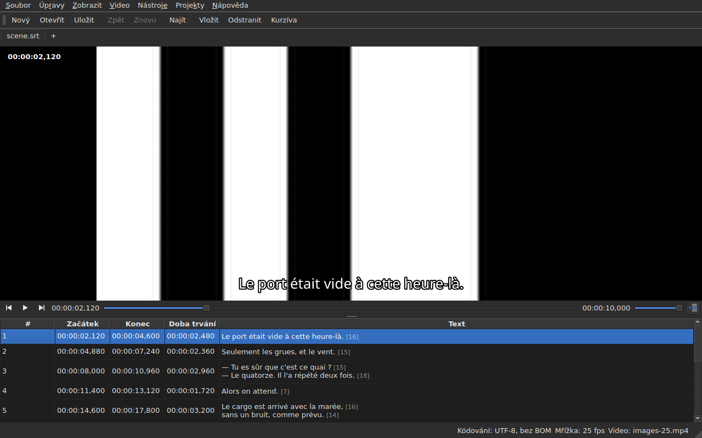

# Přehrávač

<!-- machine-translated -->
> Tato stránka je strojovým překladem a dosud ji nezkontroloval žádný čtenář tohoto jazyka.

Přidružené video se sleduje **v okně**, s aktuálním řádkem
vykresleným přes něj. Díky tomu lze na filmu ověřit výsledek
posunu, transformace nebo převodu snímkové frekvence.

Jak film přidružit, popisuje stránka [Přidružené video](video.md); tato
stránka popisuje, co se děje, jakmile přidružen je.

## Zobrazení videa

| Situace | Co okno ukazuje |
| :-------- | :-------------------- |
| video je přidruženo a otevře se | obraz zabírá horní část, tabulka je pod ním |
| žádné přidružené video | žádný obraz, tabulka zabírá celé okno |
| video se neotevře | žádný obraz, hlášení, a okno zůstává použitelné |

Dělítko mezi obrazem a tabulkou **se posouvá myší**. Obraz
neklesne pod 180 pixelů výšky. Zvětšení okna dá získané místo
tabulce, ne obrazu: při úpravách vám chybějí řádky.

Pod obrazem je **lišta přehrávání**: kde se film nachází, jak dlouho trvá,
přehrání a pozastavení a hlasitost. Viz [Lišta přehrávání](#lišta-přehrávání).

## Přehrávání a zastavení

| Příkaz | Zkratka | Co dělá |
| :------ | :------- | :----------- |
| Video ▸ Přehrát / pozastavit | `Ctrl+P` | přehrává, je-li přehrávání zastaveno, jinak ho zastaví |

Příkaz je **nedostupný, dokud není otevřeno žádné video**. Video, které
bylo právě přidruženo, se otevře **zastavené**: otevřít film neznamená
ho sledovat.

`Ctrl+P` tam, kde má Gaupol prosté `P`: jednopísmennou zkratku s
působností v celém okně zachytí okno dřív, než ji uvidí prvek, který má fokus,
takže `P` by se ztratilo na cestě do editoru buňky. Nic se
zde netiskne, kombinace je volná.

## Lišta přehrávání

Pod obrazem, zleva doprava — tři tlačítka jsou **ikony**, ikony motivu pracovního prostředí, má-li je, jinak ikony stylu Qt:

| Prvek | Co dělá |
| :------ | :----------- |
| dvě tlačítka kroku | posunou film zpět, vpřed **o jeden krok ve snímcích** — viz [Snímek po snímku](timing.md#snímek-po-snímku) |
| přehrát / pozastavit | přehrává nebo zastaví, jako `Ctrl+P` — tlačítko ukazuje, **co udělá**: trojúhelník při zastavení, dva pruhy při přehrávání; bublinová nápověda to říká slovy |
| pozice | `HH:MM:SS,mmm`, zapsaná tak, jak tabulka zapisuje pozici — **jako číslo snímku**, je-li zaškrtnuto [`Zobrazit ▸ Pozice ve snímcích`](table.md#pozice-ve-snímcích) |
| posuvník | **čte i posouvá**: táhnete jezdcem, kliknete do drážky, použijete šipky |
| doba trvání | ta, kterou video deklaruje, zapsaná jako pozice |
| hlasitost | od 0 do 100, viz [Hlasitost](#hlasitost) |
| sledování tabulkou | stisknuté, dokud tabulka sleduje přehrávání, a po stisknutí ji vrátí na přehrávaný řádek — viz [Tabulka sleduje přehrávání](#tabulka-sleduje-přehrávání) |

**Posuvník nepředává pozici při každém pixelu.** Tažení jezdcem požaduje desítky
pozic za sekundu a každá stojí dekódovaný snímek: první pozice odejde
okamžitě, další čekají dvacetinu sekundy a **poslední požadovaná pozice
je vždy ta, které se dosáhne** — nejpozději ve chvíli, kdy jezdec pustíte. Obraz proto
nezaostává za rukou a nezačne vykreslovat cestu, na kterou se nikdo nedívá.

**Posuvník se během přehrávání posouvá sám**, a to se nepočítá jako gesto:
film posouvá jen to, co uděláte vy. Dokud držíte jezdec, přehrávání ho nepřebírá.

## Časový kód

**Pozice je zapsána na obrazu**, vlevo nahoře, na průsvitném pozadí, které ji činí
čitelnou v jakékoli scéně. Vykresluje ji okno, svým písmem, a od
přehrávače nežádá nic než pozici, kterou už poskytuje; aktualizuje se s každým gestem,
bez čekání na další kolo sledování.

## Pohyb filmem

V nabídce **Video** jsou **gesta Gaupolu**, pod jeho názvy. Všechna jsou **nedostupná bez videa**, jako
přehrávání; tři, která působí na výběr, jsou navíc nedostupná, dokud není nic vybráno.

| Příkaz | Zkratka | Co dělá |
| :------ | :------- | :----------- |
| Video ▸ Přehrát výběr | `Ctrl+Shift+P` | přehrává od **chvilky před začátkem** výběru **do konce jeho posledního titulku** a zastaví na obrazu |
| Video ▸ Přetočit na předchozí | `Ctrl+Left` | nastaví přehrávání na začátek posledního titulku, který **skončil** před pozicí |
| Video ▸ Přetočit na další | `Ctrl+Right` | nastaví přehrávání na začátek prvního titulku, který **začíná** po pozici |
| Video ▸ Přetočit zpět | `Ctrl+Shift+Left` | vrátí se o jeden skok — ve výchozím stavu třicet sekund |
| Video ▸ Přetočit vpřed | `Ctrl+Shift+Right` | posune se o jeden skok vpřed |
| Video ▸ Přetočit na začátek výběru | `Ctrl+Up` | nastaví přehrávání na začátek výběru, **s předstihem před ním** |
| Video ▸ Přetočit na konec výběru | `Ctrl+Down` | nastaví přehrávání na konec výběru, **s předstihem před ním** |

**Zkratky jsou zkratkami Gaupolu**, až na jednu: `Play Selection` je tam `O` a
samotné písmeno zachytí okno dřív, než ho uvidí upravovaná buňka — napsání
`o` do textu by spustilo film. `Ctrl+P` je odpovědí přehrávání, `Ctrl+Shift+P` odpovědí
výběru. Šipky klávesnice zůstávají editoru buňky, když je
otevřen: `Ctrl+Left` v něm posune kurzor o jedno slovo, ne přehrávání.

- **Skok** je 30 sekund a lze ho nastavit od 1 sekundy do jedné hodiny — viz
  [Předvolby](preferences.md#přehrávač). Nepřesáhne začátek filmu ani jeho konec.
- **Předstih** je jedna sekunda: díváte se chvilku **před** titulkem, abyste ho viděli přicházet.
  Lze ho nastavit od 0 do 60 sekund a přehrávání neklesne pod nulu.
- **Soused, který neexistuje** — nic před prvním titulkem, nic za posledním — neudělá
  nic a nic neřekne: přehrávání zůstane, kde je.
- **Každé gesto se projeví hned**: lišta, časový kód a vykreslený řádek jsou
  aktuální, jakmile skončí, bez čekání na další kolo.

## Hlasitost

Hlasitost je hlasitostí **přehrávače**, od 0 do 100, a ne hlasitostí systému. Nastavuje se posuvníkem
lišty nebo dvěma gesty v podnabídce `Video ▸ Zvuk`, po krocích pěti:

| Příkaz | Zkratka | Co dělá |
| :------ | :------- | :----------- |
| Video ▸ Zvuk ▸ Hlasitost dolů | `Ctrl+-` | sníží hlasitost o pět |
| Video ▸ Zvuk ▸ Hlasitost nahoru | `Ctrl++` nebo `Ctrl+=` | zvýší ji o pět — druhá pro klávesnice, na kterých plus vyžaduje klávesu Shift |

**Pamatuje se od jedné relace k další** a předává se každému videu, které otevřete. Hodnota mimo
rozsah 0 až 100 v souboru nastavení otevření nenaruší: přehlédne se a okno to ohlásí.
**Zvuková stopa se naopak nepamatuje** — číslo stopy patří jejímu souboru; viz
[Zvuková stopa](video.md#zvuková-stopa).

## Výběr a přehrávání

Obojí funguje oběma směry.

| Co uděláte | Co se stane |
| :---------- | :----------- |
| vyberete řádek | přehrávání se přesune **na začátek tohoto titulku** |
| rozšíříte výběr směrem dolů | nic dalšího: počítá se první řádek výběru |
| přehrávání postupuje | **aktuální řádek** sleduje titulek na obrazovce, **zabarvený**, a tabulka ho **vystředí** — viz [Tabulka sleduje přehrávání](#tabulka-sleduje-přehrávání) |

Aktuální řádek a výběr jsou dvě odlišné věci. Přehrávání
posouvá první a **nikdy se nedotkne druhého**: výběr je to, na co se
operace vztahuje, a film přehrávaný v rohu nemá co
přepisovat uživatelův cílový řádek za řádkem.

Zabarvení se řídí tímtéž pravidlem: je to značka, ne výběr. **Anomálie
má přednost** — řádek, který nese obojí, si ponechá barvu
své chyby, protože chyba je tu proto, aby se opravila, kdežto zobrazený řádek je zobrazen jen
po dobu jedné repliky. Viz [Tabulka](table.md).

### Tabulka sleduje přehrávání

**Tabulka vystředí přehrávaný řádek** — doprostřed toho, co ukazuje, ne k okraji, kde by stačilo,
aby byl vidět. Dělá to **při změně řádku**, ne při každém tiku sledování: replika trvá
sekundy a nové vystředění každou desetinu sekundy by bylo posouváním bez účelu.

**Ruční posunutí sledování pozastaví.** Kolečko, posuvník a kliknutí do tabulky
ho pozastaví: tabulka zůstane tam, kam jste ji dali, zatímco aktuální řádek, vykreslený řádek a lišta
dál sledují film. Tlačítko sledování — **ikona řádků tabulky, z nichž jeden je označen šipkou**, vpravo na liště
přehrávání; jeho bublinová nápověda říká „Sledovat přehrávání“ — **je stisknuté, dokud tabulka sleduje**, a pak vyskočí.

**Sledování se obnoví gestem přehrávače**: spuštěné přehrávání, skok, krok, nastavená značka,
vložení na pozici nebo posun lišty — tabulka se pak hned vystředí na
přehrávaný řádek, i když to už byl tentýž. **Nebo na požádání**: stisknutí tlačítka ho obnoví a
jeho uvolnění ho pozastaví. Neexistuje žádný časovač: sledování obnovuje vždy gesto.

Přepnutí na jinou kartu obnoví sledování na filmu této karty.

**Probíhající úprava se nepřeruší.** Dokud je otevřen editor
buňky, aktuální řádek zůstane, kde je; řádek vykreslený na
obrazu naopak dál sleduje, protože nikomu nevadí.

## Vykreslený řádek

To, co se zobrazuje na obrazu, pochází z **otevřeného dokumentu**, nikdy ze souboru:
**co vidíte na obrazu, je to, co jste právě napsali**, bez průchodu
diskem. Text se objeví vystředěný, dole na obrazu, a mezi dvěma
titulky zmizí.

**S překladem je řádek řádkem cílového textu**: překlad, když
je aktuální buňka ve sloupci `Translation`, hlavní text
všude jinde. Je to pravidlo všech textových operací — viz [Text,
na který operace míří](table.md#text-na-který-operace-míří) —
a **neexistuje žádné nastavení**: přechod z jednoho sloupce do druhého změní, co
obraz ukazuje, nejvýše o desetinu sekundy později. Bez překladu nebo
s odebraným sloupcem se nic nemění: jde o hlavní text.

Titulek, který překlad ještě nedohnal, neukazuje **nic**, dokud
je aktuálním sloupcem překlad: jeho místo nezaujme
hlavní text.

**Značky formátu se chápou, nikdy se nevykreslují tak, jak jsou.** Model nese
text tak, jak ho zapisuje soubor, a je to pivot značek — ten z převodu
formátů —, který ho přečte, než ho předá obrazu:

| V souboru | Na obrazu |
| :---------- | :------------- |
| tučné, kurzíva, podtržení | použito: `<i>no</i>` se zobrazí jako *no*, bez svých značek |
| barva | použita |
| písmo, velikost | odstraněno, text zůstane |
| pozice, zarovnání, mluvčí, cokoli bez ekvivalentu na obrazovce | odstraněno, text zůstane |
| `{` a `}` v textu | vykresleny: „{laughs}“ se zobrazí jako „{laughs}“ |

Soubor Advanced SSA se čte stejně: jeho `{\i1}` se použijí a jeho
`{\an8}` se odstraní — řádek zůstane dole na obrazu. Každý text se čte **ve formátu
svého vlastního souboru**, překlad stejně jako hlavní text.

**Sousední soubor titulků přehrávač nenačítá**, i když nese název
filmu. Byl by to ten, který se právě upravuje, a obraz by pak ukazoval stav disku,
zatímco tabulka ukazuje něco jiného.

## Náhled změny

Není **třeba dělat nic zvláštního**: použijete operaci, podíváte se
na film a zvolíte `Undo: shifting` — nebo dotčenou operaci —, pokud
výsledek nevyhovuje. Viz [Zpět a znovu](undo.md).

Žádný samostatný režim náhledu neexistuje, a to záměrně: to, na co se
díváte, je dokument tak, jak je, ne neviditelný provizorní stav.

## Když se obraz neobjeví

Dvě možná hlášení, obě s předponou cesty k souboru:

| Hlášení | Co se stalo |
| :------ | :------------ |
| `<file>: <reason>` | přehrávač soubor odmítl — neznámý formát, chybějící soubor, adresář |
| `<file>: no video player is available` | nepodařilo se sestavit žádný přehrávač |

V obou případech **video zůstane přidružené** — musíte přece vidět, o který
soubor jde, abyste mohli zvolit jiný — a **okno zůstane použitelné**:
dokument je otevřen, operace fungují, stejně jako ukládání.

**Obraz se vykresluje přímo v okně**: `libmpv` plní vyrovnávací paměť ve
velikosti zobrazení, ve skutečných pixelech, a okno ji namaluje. Nic z toho nezávisí na
grafické platformě — tentýž obraz pod X11, pod Waylandem i bez displeje — a
sleduje změnu velikosti: poměr stran filmu se zachová, zbytek
zobrazení je černý.

Druhé hlášení se tedy objeví, jen pokud knihovna `libmpv` odmítne nastartovat,
přestože je při sestavení vyžadována.

Vykreslování probíhá na procesoru, ale **dekódování může probíhat na grafické kartě**: ta
dekóduje, obraz se zkopíruje zpět do paměti a pak se vykreslí jako předtím. Počítač bez
použitelné karty dekóduje na procesoru, bez hlášení. U filmu 1080p v H.264 přehrávání stíhá
reálný čas s rezervou. **Film 4K v náročném HEVC nemusí stíhat**: změřeno na dvou
jádrech dekóduje rychlostí 0,6násobku reálného času bez karty a krok o jeden snímek tam trvá několik
sekund, je-li klíčový snímek daleko. Karta tento čas zkracuje — o třetinu až dvě třetiny podle filmu
— aniž by ho odstranila. **Nemění zobrazený obraz**: krok nebo přetočení dopadnou na
tentýž snímek s ní i bez ní. Chcete-li ji vypnout, zrušte zaškrtnutí `Decode on the graphics card` v
[`Preferences…`](preferences.md#přehrávač).

## Co tu není

**Nastavení značky, krokování snímek po snímku a posun okraje o jeden snímek** jsou na
stránce [Časování podle videa](timing.md), ne zde. Co neexistuje a nemá smysl hledat:

- průběh zvukové vlny;
- automatické přehrávání při otevření filmu;
- styl vykresleného řádku (písmo, barva, pozice, pozadí): ponechává si styl okna;
- hardwarové dekódování bez kopírování: viz „Když se obraz neobjeví“ výše.

Tato příručka popisuje, co existuje: co přijde a v jakém pořadí, je v
[plánu vývoje](../../../../feuille-de-route.md).
