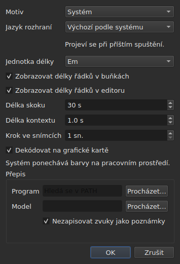

# Předvolby

<!-- machine-translated -->
> Tato stránka je strojovým překladem a dosud ji nezkontroloval žádný čtenář tohoto jazyka.

Okno si pamatuje, co nastavíte myší — **kde bylo**, **zda
bylo maximalizované**, **šířku svých sloupců**, **polohu
táhla** mezi filmem a tabulkou — a **kde pracujete**, aby
se `Open…` otevřelo na správném místě. Nic z toho se nenastavuje v dialogu:
přesunete, přetáhnete, a zapamatuje se to.

**Šest předvoleb má vlastní dialog**, `Úpravy ▸ Předvolby…`, a to je
kritérium: předvolba, která už má své gesto, nepotřebuje pole.
Motiv žádné nemá, stejně jako jednotka délek řádků, dvě zaškrtávací políčka, která
je zobrazují, a skok a předstih přehrávače. Viz [Motiv](#motiv),
[Délky řádků](#délky-řádků) a [Přehrávač](#přehrávač).

**Jazyk rozhraní je ve stejném dialogu, a je to ten, který čeká**: použije se při
příštím spuštění, ne hned. Viz [Jazyk rozhraní](#jazyk-rozhraní).

**Hlasitost žádné nemá**: nastavuje ji lišta pod obrazem a dvě gesta, a zapamatuje se.

**Jedna další se nastavuje tam, kde se používá**: strana, na kterou `Insert Subtitles…` vkládá své
řádky, je pole tohoto dialogu a zapamatuje se poslední volba. Viz
[Vkládání, odstraňování, slučování a rozdělování řádků](lines.md#strana-se-pamatuje).

**Stejně tak obě volby hledání**: `Regular expression` a
`Ignore case` zůstávají zaškrtnuté nebo nezaškrtnuté od jednoho otevření dialogu
k dalšímu a od jedné relace k další. Viz
[Najít a nahradit](find-and-replace.md#dvě-volby).

**Stejně tak nastavení `Adjust Durations…`**: rychlost čtení, její dva
směry a tři doby trvání s jejich zaškrtávacími políčky — každá si ponechá svou hodnotu, zaškrtnutá
nebo ne. Viz [`Adjust Durations…`](operations.md#adjust-durations).

**A poslední kódování zvolené v `Save As…`**, se značkou pořadí
bajtů. Viz [soubor](#soubor).

**A co nastaví průvodce `Correct Texts…` a `Spell-Check Settings…`**:
zaškrtnuté úlohy a jejich kód, zaškrtávací políčka vzorů, nastavení zalamování řádků, jazyk,
cíl kontroly a podtrhávání při psaní. Viz [Opravit texty…](correct-texts.md) a
[Zkontrolovat pravopis…](check-spelling.md#nastavení-kontroly-pravopisu). **Cíl a
dokument `Correct Texts…` se nepamatují.**

**Co se nepamatuje:** naposledy otevřený soubor — viz
[Zapamatovaný adresář](#zapamatovaný-adresář).

## Přehrávač

Čtyři pole. **Délka skoku** a **Délka kontextu** pocházejí z Gaupolu a mají jeho hodnoty; **Krok ve snímcích** a **Dekódovat na grafické kartě** jsou vlastní subedit:

| Pole | Co nastavuje | Výchozí | Meze |
| :---- | :----------- | ------: | :----- |
| `Seek length` | skok příkazů `Seek Backward` a `Seek Forward` | 30 s | od 1 s do jedné hodiny |
| `Context length` | předstih před výběrem pro `Seek Selection Start`, `Seek Selection End` a `Play Selection` | 1 s | od 0 do 60 s, na desetiny |
| `Frame step` | krok, **ve snímcích**, příkazů `Step Backward` a `Step Forward` a posunu okraje | 1 snímek | od 1 do 1000 snímků |
| `Decode on the graphics card` | nechá film dekódovat grafickou kartu, má-li ji počítač; bez karty se nic nemění | zaškrtnuto | zaškrtnuto nebo ne |

Použijí se **hned**, bez čekání na restart, a pamatují se od jedné relace k další
pod klíči `video.seek-length` (v sekundách), `video.context-length-ms` (v milisekundách), `video.step-frames` (ve snímcích) a `video.hardware-decoding` (`true` nebo `false`).
**Hodnota mimo meze nebo hodnota, která není číslem**, nebrání otevření okna:
přehlédne se, zůstane výchozí hodnota a okno to při otevření ohlásí. **Krok ve snímcích nikdy není v milisekundách**: krok N snímků je vždy N snímků, ať je snímková frekvence filmu jakákoli — viz [Časování podle videa](timing.md#snímek-po-snímku). Hlasitost se pamatuje v `video.volume`,
od 0 do 100, se stejnou tolerancí.

## Soubor

```
~/.config/subedit/settings.conf
```

Přesněji `$XDG_CONFIG_HOME/subedit/settings.conf`, je-li tato proměnná
nastavena. Zapisuje se **při zavření okna** a čte se při jeho otevření.
Přerušený program — zabitý nebo zastavený pádem — nezapíše nic a
další relace najde to, co zanechala předchozí.

Soubor je textový a lze jej upravovat ručně. To je vlastnost, a ne
vedlejší účinek: díky tomu lze nastavení opravit, i když rozhraní,
které ho nastavuje, je právě to, co je rozbité.

### Dva bloky, jeden sdílený s příkazovým řádkem

Soubor se zapisuje ve **dvou blocích**, každý pod komentářem v záhlaví:

| Blok | Klíče | Čte ho |
| :---- | :--- | :------ |
| `# Operation settings: shared by the window and the command line` | klíče `duration-adjust.*` a `correction.*` | okno **i** `subedit-cli` |
| `# Display preferences: the window's own` | všechny ostatní klíče — geometrie, sloupce, motiv, jazyk rozhraní, hledání, kontrola pravopisu, editor, video, poslední adresář, kódování zápisu | jen okno |

**`subedit-cli` ve výchozím stavu čte blok operací**: to, co si zde pamatují `Adjust Durations…` a
`Correct Texts…`, je zároveň výchozím bodem pro [`subedit-cli adjust`](../subedit-cli/adjust.md)
a část [`subedit-cli correct`](../subedit-cli/correct.md), pokud volba
příkazového řádku neurčí jinak. **Předvolby zobrazení nečte nikdy.** Jeho
příkaz [`config`](../subedit-cli/config.md) vypíše klíče operací, ukáže jejich hodnoty a
mění je — `subedit-cli config set duration-adjust.speed 12` — a okno změnu uvidí
při příštím otevření. **Změna provedená při otevřeném okně jeho zavření nepřežije**:
okno přepíše celý soubor tím, co drží. `--no-config` přiměje příkazový řádek
soubor přehlížet. Viz
[Soubor nastavení](../subedit-cli/invocation.md#soubor-nastavení).

Čtečka přijímá klíče v libovolném pořadí, se záhlavími i bez nich: soubor zapsaný dříve, než
existovaly dva bloky, se přečte beze změny a při příštím zavření se přepíše ve dvou blocích.

| Volba | Co obsahuje | Výchozí |
| :----- | :------------ | :------ |
| `window.geometry` | `x,y,width,height` v pixelech; šířka a výška nenulové | okno si velikost určí samo |
| `window.maximised` | `true` nebo `false` | `false` |
| `table.columns` | čtyři šířky v pixelech oddělené čárkami — `#`, `Start`, `End`, `Duration`, i skryté | tabulka si velikost určí sama |
| `table.order` | šest sloupců, **každý jednou**, v pořadí, v jakém je tabulka zobrazuje: `number`, `start`, `end`, `duration`, `text`, `translation` | `number,start,end,duration,text,translation` |
| `table.hidden` | odebrané sloupce, z `number`, `start`, `end` a `duration`; prázdné, žádný | žádný |
| `window.table-share` | podíl výšky přidělený tabulce, v procentech, od 1 do 99 | okno dělí výšku jako vždy |
| `file.directory` | **absolutní** cesta k adresáři | žádná: `Open…` se otevře tam, kde byl program spuštěn |
| `general.theme` | `system`, `light` nebo `dark` | `system` |
| `interface.language` | `system` nebo název jazyka tak, jak je pojmenován jeho katalog: dvě nebo tři malá písmena, pak volitelně `_` a dvě velká písmena — `fr`, `pt_BR`; `en` pro angličtinu | `system` |
| `edit.insert-placement` | `above` nebo `below` | `below` |
| `file.write-encoding` | název kódování, které ICU umí zapsat a jehož převodník nezapisuje vlastní značku | žádné |
| `file.write-bom` | `true` nebo `false` | `false` |
| `search.regex` | `true` nebo `false` — vzor je regulární výraz | `false` |
| `search.ignore-case` | `true` nebo `false` — velikost písmen se přehlíží | `true` |
| `duration-adjust.speed` | rychlost čtení ve znacích za sekundu, ostře kladná; desetinné číslo se zapíše co nejkratší (`15`, `12.5`) | `15` |
| `duration-adjust.lengthen` | `true` nebo `false` — prodloužit, co je příliš krátké na přečtení | `true` |
| `duration-adjust.shorten` | `true` nebo `false` — zkrátit, co zůstává zobrazeno déle, než je třeba | `false` |
| `duration-adjust.minimum-enabled` | `true` nebo `false` — minimální doba trvání se požaduje | `true` |
| `duration-adjust.minimum-ms` | minimální doba trvání v milisekundách, celá a nezáporná | `1500` |
| `duration-adjust.maximum-enabled` | `true` nebo `false` — maximální doba trvání se požaduje | `false` |
| `duration-adjust.maximum-ms` | maximální doba trvání v milisekundách, celá a nezáporná | `6000` |
| `duration-adjust.gap-enabled` | `true` nebo `false` — mezera k následujícímu titulku se požaduje | `true` |
| `duration-adjust.gap-ms` | mezera v milisekundách, celá a nezáporná | `0` |
| `correction.mentions.enabled`, `correction.common-errors.enabled`, `correction.capitalization.enabled`, `correction.line-break.enabled` | `true` nebo `false` — úloha je zaškrtnuta na první stránce `Correct Texts…` | `false`, `true`, `true`, `false` |
| `correction.mentions.code`, `correction.common-errors.code`, `correction.capitalization.code`, `correction.line-break.code` | kód vzorů úlohy: `Zyyy` nebo `Script[-language[-COUNTRY]]` — `Latn-en-US`; neprázdný | `Zyyy` |
| `correction.human`, `correction.ocr` | `true` nebo `false` — třídy běžných chyb | `true`, `true` |
| `correction.sound-in-brackets`, `correction.sound-in-parentheses` | `true` nebo `false` — dvě zaškrtávací políčka stránky `Mentions` | `false`, `false` |
| `correction.line-break.max-length` | největší délka řádku, desetinná; dialog ji omezuje od 1 do 1000 | `24` |
| `correction.line-break.max-lines` | největší počet řádků, celý; dialog ho omezuje od 1 do 100 | `3` |
| `correction.line-break.in-ems` | `true`: délka se měří v *em*; `false`: ve znacích | `true` |
| `correction.line-break.skip-on-length`, `correction.line-break.skip-on-lines` | `true` nebo `false` — obě podmínky přeskočení se požadují | `true`, `true` |
| `correction.line-break.skip-max-length`, `correction.line-break.skip-max-lines` | oba prahy přeskočení, ve zvolené jednotce | `24`, `3` |
| `correction.join-split.enabled` | `true` nebo `false` — úloha `Join or Split Words` je zaškrtnuta | `false` |
| `correction.join-split.join`, `correction.join-split.split` | `true` nebo `false` — spojovat, rozdělovat | `true`, `false` |
| `correction.join-split.language` | kód národního prostředí — `fr`, `en_US`, `sr@Latn` —; prázdný: jazyk systému | prázdný |
| `correction.remove-blank` | `true` nebo `false` — `Remove all blank subtitles` | `true` |
| `transcription.engine` | název nástroje: malá písmena, číslice, `.`, `-` a `_` | `whisper.cpp` |
| `transcription.executable`, `transcription.model` | absolutní cesta; prázdná: nástroj se hledá v `PATH` a žádný model není nastaven | prázdná |
| `transcription.language` | dvě malá písmena, kód ISO 639-1; prázdný: jazyk se zjistí | prázdný |
| `transcription.merge-gap-ms` | části jedné věty bližší než tato doba se spojí, v milisekundách, celé nezáporné číslo | `400` |
| `transcription.max-duration-ms` | nejdelší doba, po kterou přepsaný titulek zůstává na obrazovce, v milisekundách, od 1 do 3600000 | `7000` |
| `transcription.max-characters` | největší počet znaků přepsaného titulku, od 1 do 1000 | `84` |
| `correction.activations` | zaškrtávací políčka vzorů, která uživatel změnil, `<type>:<code>:<name>:<0\|1>`, oddělená čárkami; **čárka nebo zpětné lomítko v názvu se zapíše s předřazeným zpětným lomítkem** (`\,` a `\\`) a nečitelná položka ztratí jen své vlastní nastavení — ohlásí se, ostatní se zachovají | prázdné |
| `spell-check.language` | kód národního prostředí, například `fr_FR`; prázdný: jazyk systému | prázdný |
| `spell-check.target` | `selection`, `current-project` nebo `all-projects` | `current-project` |
| `spell-check.document` | `main` nebo `translation` | `main` |
| `spell-check.inline` | `true` nebo `false` — podtrhávat neznámá slova při psaní v editoru buňky | `false` |
| `editor.length-unit` | `em` nebo `characters` — jednotka délek řádků, které ukazuje tabulka a editor | `em` |
| `editor.show-lengths-cell` | `true` nebo `false` — za každým řádkem textové buňky následuje jeho délka | `true` |
| `editor.show-lengths-edit` | `true` nebo `false` — editor buňky ukazuje délku každého řádku na okraji | `true` |

**Soubor přijímá víc než dialog.** Čtečka přijme jakoukoli ostře
kladnou rychlost a jakoukoli nezápornou dobu trvání; dialog `Adjust
Durations…` naopak omezuje rychlost od 1 do 99 znaků za sekundu a každou
dobu trvání od 0 do 99 s. Hodnota ze souboru mimo tyto meze se při otevření dialogu
vrátí na mez a soubor ji tak zachová, jakmile se
dialog potvrdí a okno zavře. Zrušený dialog nemění nic na tom, co
se pamatuje.

**`file.write-encoding` si pamatuje poslední kódování zvolené v `Save As…` a
nikdy se nevnucuje souboru.** Otevřený dokument nese své vlastní kódování
a to dialogové okno nabízí: přepsat ho v jiném jen proto, že to říká
tři týdny staré nastavení, by ztratilo, co čtení zachovalo.
To, co si toto nastavení pamatuje, slouží dokumentu, který nemá soubor — tomu
právě vytvořenému.

**Je to záměrné „ne“, a ne opomenutí.** Kdo vždy dodává ve
stejném kódování a otevírá zděděné soubory v jiném, zvolí ho znovu pro
každý soubor; dialogové okno mu ho nabídne a záruka zpáteční cesty platí
pro všechny.

**`file.write-bom` nese značku téhož kódování** a dva
řádky jsou skutečně potřeba: název kódování neříká, zda mu předchází jeho značka, stejně jako
`--encoding` neříká to, co říká `--bom`. Oba se čtou společně, v
libovolném pořadí, a `file.write-bom` bez zapamatovaného kódování nenastaví nic.

**Pro táhlo podíl, a ne výšky**, a právě díky tomu je
užitečné: tři výšky v pixelech přestanou cokoli znamenat, jakmile se okno
otevře v jiné velikosti, a okno se v jiné velikosti otevírá často.
Podíl se dá přehrát kdekoli. **Vrátí se na to, co okno přijme**, je-li
příliš malý — pruh filmu má minimální výšku.

**Čtyři šířky pro šest sloupců**, a to není opomenutí: jsou to šířky
sloupců `#`, `Start`, `End` a `Duration`, v tomto pořadí bez ohledu na pořadí
tabulky, a **skrytý sloupec si ponechá svou** — znovu ji najde, až bude
opět zobrazen. Poslední zobrazený sloupec dostane to, co ostatní nechají, a přidělit mu
šířku by nic nezměnilo; šířky textu a překladu se proto
nepamatují.

## Co se stane, když soubor neříká, co se očekává

Konfigurace je pohodlí. **Její selhání stojí pohodlí a nic
jiného**: okno se otevře v každém případě.

| Případ | Co se stane |
| :--- | :----------- |
| soubor neexistuje | všechny výchozí hodnoty a nic se neohlásí — jde o první spuštění |
| soubor existuje a nelze ho přečíst | všechny výchozí hodnoty a důvod se zapíše na chybový výstup |
| volba chybí | její výchozí hodnota |
| klíč je neznámý | přehlédne se bez jediného slova a v přepsaném souboru chybí |
| hodnotu nelze přečíst | ponechá se její výchozí hodnota a volba se uvede na chybovém výstupu |

```console
$ subedit-gui film.srt
subedit-gui: /home/vous/.config/subedit/settings.conf: window.geometry: "plus tard" cannot be read, keeping the default
```

**Hlášení jde na chybový výstup a nikam jinam.** Modální
okno při spuštění kvůli nečitelné předvolbě by uživatele zastavilo kvůli
chybě, která mu v ničem nebrání, a dříve, než o cokoli požádal.

## Volby jako komentář

Přepsaný soubor obsahuje **všechny** známé volby a ty, které zůstaly na
výchozí hodnotě, jsou zapsány jako komentář:

```
#window.geometry = 0,0,1280,800
#window.maximised = false
#table.columns = 60,110,110,110
#table.order = number,start,end,duration,text,translation
#table.hidden = start,end
```

Není to strojenost. Bez toho by volba, které se nikdo nedotkl, zůstala
zamrzlá na hodnotě ze dne, kdy byla zapsána, a **vylepšená výchozí hodnota
by se nikdy k nikomu nedostala**. S tím změna výchozí hodnoty změní
chování všech, kdo ji nepřepsali — což je přesně to,
co má výchozí hodnota dělat.

Chcete-li volbu přepsat: odstraňte `#` a změňte hodnotu. Chcete-li se vrátit
k výchozí hodnotě: smažte řádek, nebo ho znovu zakomentujte.

Geometrie, šířky a odebrané sloupce ukazují **tvar**, a
ne platnou hodnotu: výchozí hodnota geometrie a šířek je
„to, co zvolí okno“, což se čísly nezapíše, a výchozí hodnota
`table.hidden` je „žádný“, což nelze přečíst. Říká to i
záhlaví souboru. `table.order` naopak výchozí pořadí ukazuje.

## Zapamatovaný adresář

`Open…` se otevře v adresáři **naposledy otevřeného nebo uloženého souboru**,
a ne v adresáři dialogového okna, které jste zrušili: počítá se, kde
pracujete, ne kam jste se dívali.

**Poslední soubor se naopak nepamatuje.** Pamatovat si ho by znamenalo
otevírat při spuštění dokument, o který nikdo nežádal. Zapamatovaný adresář
dialogové okno *nasměruje*; zapamatovaný soubor by nějaký otevřel.

## Motiv

`Úpravy ▸ Předvolby…` se otevře s motivem, předvolbou bez gesta, nad
[délkami řádků](#délky-řádků).

| Hodnota | Co dělá |
| :---- | :----------- |
| `System` | **nic** — barvy zůstanou barvami pracovního prostředí |
| `Light` | nastaví světlou paletu |
| `Dark` | nastaví tmavou paletu |

Zvolený motiv se použije **okamžitě**, bez restartu.

**„System“ nedělá nic, a není to nedostatek.** Verze Qt, na
které je subedit sestaven, nemá jak se pracovního prostředí zeptat, zda chce být
světlé nebo tmavé, ani jak dostat zprávu, když si to rozmyslí. Místo
vymýšlení čtení, které neumíme provést, nástroj dodává dva motivy,
o které lze požádat, a u třetího nechá rozhodnout sadu nástrojů —
což dělá Gaupol za stejných podmínek.

V pracovním prostředí, jehož motiv je už tmavý, tedy `System` dá tmavé
okno; ve světlém prostředí světlé okno. `Light` a `Dark` ho
přepíší, ať je pracovní prostředí jakékoli.

**Zabarvení anomálií zůstávají čitelná v obou paletách** — viz
[Tabulka](table.md#anomálie). Není to předpoklad: kontrast
textu na každém ze zabarvení ověřuje test, na obou pozadích.

## Jazyk rozhraní

`Úpravy ▸ Předvolby…` volí jazyk okna, pod motivem.

| Pole | Hodnoty | Výchozí |
| :---- | :----- | :------ |
| `Interface language` | `System default`; `English`; pak každý jazyk nainstalovaný s programem, pod svým vlastním názvem — `Français` | `System default` |

**Projeví se při příštím spuštění** a dialog to říká pod polem: okno se
překládá při svém sestavování a běžící okno si ponechá jazyk, ve kterém se spustilo. Volba se
uchová v souboru nastavení pod `interface.language` a přečte se při příštím otevření okna.

| Volba | Okno se spustí v |
| :----- | :------------------- |
| `System default` | jazyce prostředí, jako před jakoukoli volbou — `LANGUAGE`, `LC_ALL`, `LC_MESSAGES`, `LANG`; viz [Jazyk](invocation.md#jazyk) |
| `English` | angličtině, ať říká prostředí cokoli |
| nainstalovaný jazyk | tomto jazyce, **ať říká prostředí cokoli**, včetně `LC_ALL=C`: volba učiněná zde je výslovná |

Seznam obsahuje jazyky, jejichž katalog je nainstalován v `<prefix>/share/subedit/locale`;
angličtina je tam vždy, protože je to jazyk, ve kterém je program napsán. Jazyk se zobrazuje
pod svým vlastním názvem, který žádný katalog nepřekládá, aby čtenář našel ten, který čte.

**Hodnota, které program nemůže vyhovět, stojí jen volbu:**

| Co říká soubor | Co se stane |
| :----------------- | :----------- |
| název jazyka, jehož katalog není nainstalován — soubor přinesený z jiného počítače | okno se bez jediného slova řídí prostředím; `Preferences…` ukazuje tento jazyk, pod jeho názvem nebo kódem, a ponechá ho, dokud se nezvolí jiný |
| něco, co není názvem jazyka — `French`, `fr_FR.UTF-8` | `system`, výchozí hodnota, a volba se uvede na chybovém výstupu jako každá nečitelná hodnota |

```console
$ subedit-gui film.srt
subedit-gui: /home/vous/.config/subedit/settings.conf: interface.language: "French" cannot be read, keeping the default
```

**Příkazový řádek ji nikdy nečte**: `subedit-cli` volí svůj jazyk jen podle
prostředí a `subedit-cli config set interface.language fr` se odmítne jako předvolba zobrazení.

## Délky řádků




`Úpravy ▸ Předvolby…` nastavuje také **to, co tabulka a editor ukazují z
délky řádků** — pravítko a okraj Gaupolu.

| Pole | Co dělá | Výchozí |
| :---- | :----------- | :------ |
| `Length unit` | jednotka délek: `Ems` nebo `Characters` | `Ems` |
| `Show line lengths in cells` | za každým řádkem textové buňky následuje jeho délka | zaškrtnuto |
| `Show line lengths in the editor` | editor buňky ukazuje délku každého řádku na okraji vpravo | zaškrtnuto |

**`Length unit` je zašedlé, když není zaškrtnuto ani jedno políčko**: bez
délky k zobrazení jednotka nic nenastavuje. Volba se **hned** použije na
tabulku a editory, které se otevřou potom, se jí řídí. Tyto tři hodnoty se
pamatují od jedné relace k další: `editor.length-unit`, `editor.show-lengths-cell`
a `editor.show-lengths-edit`, v tabulce [souboru](#soubor). Viz
[Délka řádků](table.md#délka-řádků) a
[v editoru](editing.md#délka-řádků).

**Není to mez průvodce.** Jednotka `Correct Texts…` — délka,
při které zalamuje řádky — je samostatné nastavení, ve svém
průvodci: v tabulce můžete číst v em a zalamovat ve znacích.

## Co nelze nastavit

**Devět zapamatovaných nastavení se volí v dialogu** — nepočítaje nastavení
průvodce opravami a kontroly pravopisu, které mají každý
svůj vlastní —, a každé v tom, kde se používá: motiv a tři nastavení délek řádků zde; strana vkládání v dialogu vkládání;
obě volby hledání v dialogu hledání; kódování a
značka pořadí bajtů v `Save As…`; rychlost čtení, doby trvání
a mezera úpravy dob trvání v jejím vlastním dialogu. Jiné
není: nic nelze nastavit pro hlášení, hlasitost přehrávače
ani výchozí formát ukládání — ten pochází z otevřeného souboru.

A **žádné číslo, které patří dokumentu, se od jedné relace
k další neuchovává**: hodnota posunu nebo dva referenční body transformace platí pro jeden
soubor a neplatí pro další. Dialogy se na ně ptají znovu při každém spuštění,
záměrně. Nastavení `Adjust Durations…` jsou výjimkou stejně jako
obě volby hledání: rychlost čtení, minimální doba trvání nebo
mezera jsou volbou metody spíše než měřením souboru, a
proto přetrvávají od jedné relace k další.

Tato příručka popisuje, co existuje: co přijde, je v
[plánu vývoje](../../../../feuille-de-route.md).
