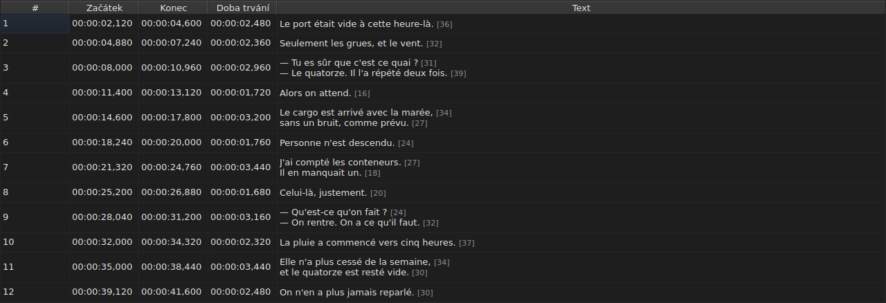
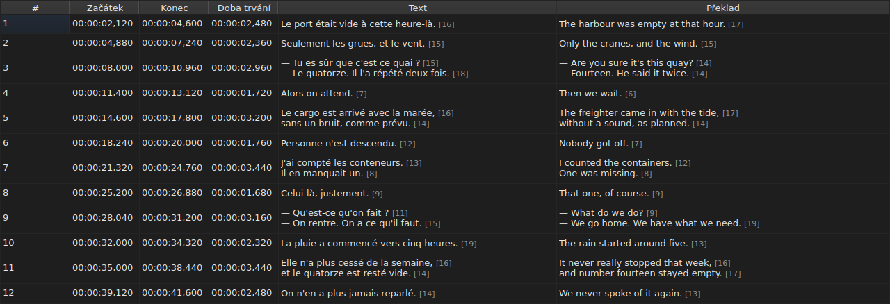
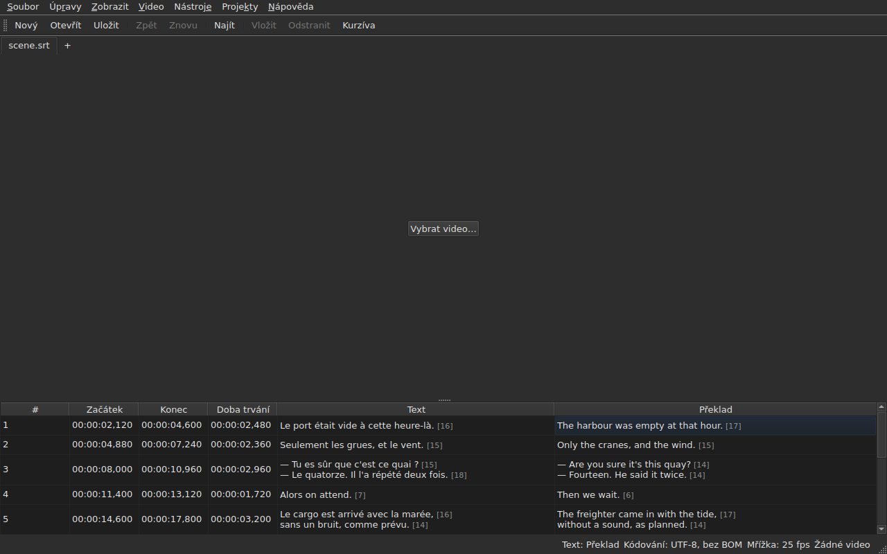

# Tabulka

<!-- machine-translated -->
> Tato stránka je strojovým překladem a dosud ji nezkontroloval žádný čtenář tohoto jazyka.

Okno ukazuje titulky otevřeného souboru, jeden na řádek, v pěti
sloupcích — v šesti, když projekt nese překlad.

**Tato příručka cituje záhlaví okna tak, jak je zobrazuje anglické
okno**, stejně jako u příkazového řádku; přeložené okno je ukazuje ve
svém vlastním jazyce.

| Sloupec | Co ukazuje |
| :----- | :------------ |
| `#` | pořadí titulku, od 1 |
| `Start` | pozice, ve které se objeví, `HH:MM:SS,mmm` |
| `End` | pozice, ve které zmizí |
| `Duration` | `End − Start` |
| `Text` | text titulku |
| `Translation` | překlad titulku — **chybí, dokud projekt žádný nemá** |


## Délka řádků




**Za každým řádkem textové buňky následuje jeho délka**, `[N]`, menší
a bledší — ve sloupci `Text` stejně jako ve sloupci `Translation`.
Tak to dělá Gaupol.

| Co se počítá | Co tabulka dělá |
| :---------- | :------------------ |
| **značky** | nepočítají se: `<i>Bonjour</i>` dá `[7]`, jako `Bonjour` |
| **zaokrouhlení** | dolů: řádek o 12,9 em se zobrazí jako `[12]` |
| **prázdný řádek** | nemá délku; stejně tak prázdný text |
| **jednotka** | ve výchozím stavu *em*, nebo znaky — `Úpravy ▸ Předvolby…` |
| **řádek příliš dlouhý pro sloupec** | se zkrátí pomocí `…` **před** číslem, které zůstane viditelné |

**Jednotka *em* je jednotkou Gaupolu, ne typografie**: malá abeceda
má hodnotu 0,55 em na písmeno, písmem tabulky. Délka v *em* tedy
závisí na písmu; délka ve znacích počítá kódové body, s
diakritickým znaménkem za jeden.

**Tabulka neoznačuje řádek, který je příliš dlouhý.** Ukazuje číslo a je na
oku, aby ho porovnalo s mezí, kterou jste si sami stanovili — jako v Gaupolu. Není to
mez průvodce `Correct Texts…`, který má vlastní nastavení.

**Pokud je nechcete vidět:** zrušte zaškrtnutí `Show line lengths in cells` v
`Úpravy ▸ Předvolby…`. Viz [Délky řádků](preferences.md#délky-řádků).

## Skrytí a přesun sloupců

**`Zobrazit ▸ Sloupce`** nese jednu zaškrtávací položku pro každý sloupec, **kromě `Text`**:
bez hlavního textu by nezbylo nic k úpravě.

| Položka | Sloupec |
| :---- | :----- |
| `Zobrazit ▸ Sloupce ▸ Číslo` | `#` |
| `Zobrazit ▸ Sloupce ▸ Začátek` | `Start` |
| `Zobrazit ▸ Sloupce ▸ Konec` | `End` |
| `Zobrazit ▸ Sloupce ▸ Doba trvání` | `Duration` |
| `Zobrazit ▸ Sloupce ▸ Překlad` | `Translation` — viz [Sloupec překladu](#sloupec-překladu) |

Zrušení zaškrtnutí položky odebere její sloupec, nové zaškrtnutí ho vrátí, v šířce,
kterou měl. **Nastavení platí pro celé okno**, včetně všech
karet: tabulka je jediná a její projekt se mění s kartou.

**Aktuální buňka opustí odebíraný sloupec**: přesune se do `Text`,
na tomtéž řádku, a výběr se nepohne. Aktuální buňka ve
sloupci, který nikdo nevidí, by byla buňkou, kterou by stisk klávesy upravil
naslepo.

**Sloupce se přesouvají tažením za jejich záhlaví**, kterýkoli z nich, včetně
`Text`. Poslední zobrazený sloupec zabere místo, které ostatní nechají.

**Pořadí a odebrané sloupce se pamatují od jedné relace k další**, spolu
se šířkami, v [souboru předvoleb](preferences.md) — `table.order`
a `table.hidden`. Sloupec překladu tam není: řídí se vlastním
pravidlem a vrací se s každým otevřeným překladem.

**Číslo není údajem souboru**, ale pořadím řádku. Vložení
nebo odstranění proto přečísluje vše, co následuje, aniž by se cokoli
přepisovalo.

**Desetinný oddělovač se řídí formátem souboru**: čárka pro SubRip,
tečka pro ostatních osm. SubRip je jediný z devíti, který zapisuje čárku.

**Řídí se oddělovač, ne celý zápis.** Tabulka vždy zapisuje
hodiny a vždy tři desetinná místa; soubor WebVTT vynechává
hodiny pod jednu hodinu, SubViewer 2 a oba Sub Station Alpha počítají v
setinách, MPL2 v desetinách, TMPlayer v sekundách, MicroDVD ve snímcích.
Sloupec, jehož šířka by se řídila formátem, by se četl únavněji než
sloupec, který prostě není přesným zápisem souboru.

Tabulka tedy zaručuje **hodnotu a oddělovač**, ne počet
desetinných míst. Co by cílový formát zaokrouhlil, se řekne ve chvíli
ukládání — viz
[Co formát nepřenese](files.md#co-formát-nepřenese-řečeno-před-zápisem).

**Doba trvání (`Duration`) se počítá**, nikdy se neukládá: její zadání posune
konec. Titulek, jehož konec předchází jeho
začátku, zobrazí zápornou dobu trvání místo nuly: je to anomálie
souboru a její skrytí by znemožnilo ji najít.

**Začátek, konec, doba trvání, text a překlad se upravují na místě**;
číslo ne. Viz [Úprava buňky](editing.md).

**Výběr označuje, na co operace působí** — viz
[Operace](operations.md).

**Výška řádku se řídí titulkem, který nese**: titulek o
dvou řádcích zabere dva, o třech zabere tři. Text se ukazuje
celý, tak jak bude zapsán.

**Zkrácen zůstane jen řádek příliš dlouhý pro svůj sloupec**, a ten pak
končí třemi tečkami. Rozšíření sloupce `Text` nebo okna ho ukáže
celý; stejně tak otevření buňky. Řádky textu se nikdy
nezalamují: řádek tvoří jen skutečné zalomení řádku, aby se výška
řádku tabulky neměnila, když táhnete okrajem sloupce.

## Pozice ve snímcích

**`Zobrazit ▸ Pozice ve snímcích`** — zaškrtávací položka, jediné nastavení pro celé okno — ukazuje
sloupce `Start` a `End` **jako čísla snímků** místo časových údajů a **přijímá číslo snímku jako vstup**.
Záhlaví to říkají: `Start (frames)` a `End (frames)`.

| Co se mění | Co se nemění |
| :----------- | :------------------- |
| co `Start` a `End` zapisují a co přijímají | sloupec `Duration`, který zůstává časem |
| záhlaví těchto dvou sloupců | dokument: nic se nezmění, historie nemá novou položku a **soubor zapíše to, co zapsal** |

**Snímková frekvence, podle které se snímky počítají**, je v tomto pořadí:

1. **frekvence souboru**, je-li počítán ve snímcích — MicroDVD, který nese čísla a žádnou
   snímkovou frekvenci: **okno pak ukazuje čísla svého souboru**, ať je video jakékoli;
2. **frekvence, kterou deklaruje přidružené video**;
3. **mřížka, kterou vykreslují pozice**, když nějakou vykreslují.

Bublinová nápověda položky říká, která byla zvolena: *Pozice jsou čísla snímků, počítaná při 25 fps, zdroj: frekvence
uvedená videem*. **Bez žádné ze tří je položka nedostupná a její bublinová nápověda říká proč**: soubor
není počítán ve snímcích, video nedeklaruje žádnou snímkovou frekvenci a pozice nepadají na žádnou mřížku.

- **Číslo je číslem snímku, do kterého pozice padá**, zaokrouhleno na nejbližší snímek. **Zadané
  dává okamžik, kdy tento snímek začíná**, zaokrouhlený **jen jednou** z přesného poměru
  ([ADR 0013](../../../../adr/0013-mise-a-l-echelle-exacte-des-positions.md)): snímek 37 při 23,976 snímku za sekundu
  začíná v 1 543,04 ms, tedy `00:00:01,543`.
- **Přijímají se jen celá čísla** — se znaménkem minus, protože začátek může předcházet filmu.
  Časový údaj zadaný v režimu snímků nebo číslo, které číslem není, ponechá buňku tak, jak byla.
- **Lišta přehrávání se řídí stejným nastavením**: pozice a doba trvání po obou stranách posuvníku
  se zapisují jako čísla snímků, stejně jako `Start` a `End`, ve stejném okamžiku — viz
  [Lišta přehrávání](player.md#lišta-přehrávání). Hodiny vykreslené nahoře na obrazu zůstávají
  časovým údajem.
- **Toto nastavení se nepamatuje** od jedné relace k další: je to nastavení okna, ne
  dokumentu, a zapne se znovu jedním gestem.

## Anomálie

Titulek, jehož pozice k sobě nesedí, je **zabarvený ve svých
časových sloupcích** a najetí myší na něj řekne, co je špatně.

| Zabarvení | Co hlásí | Co dělat |
| :--- | :-------------- | :--------- |
| červené | `ends before it starts` | opravit jeho konec nebo začátek |
| modré | `starts before the previous one starts` | vrátit ho na jeho místo v pořadí |
| jantarové | `starts before the previous one ends` | upravit jeho časování |


Zabarveny jsou jen sloupce `Start`, `End` a `Duration`: anomálie
mluví jen o čase a zabarvení textu by naznačovalo, že s ním má něco
společného.

**Titulek jich může nést několik** a bublinová nápověda je jmenuje všechny.
Zabarvení je zabarvením první, kterou je třeba opravit: titulek rozbitý sám o sobě
je rozbitý, ať dělají jeho sousedé cokoli; titulek mimo pořadí se vrátí na místo
a jeho překryv zmizí s ním.

> Není náhoda, že nepořádek téměř vždy vítězí nad
> překryvem: začít před začátkem předchozího znamená začít
> před jeho koncem — pokud předchozí sám není rozbitý.

**Označení se přepočítá po každé změně pozice**, ať pochází
z upravené buňky, z operace nebo z vrácení zpět. Říká, jaký je
soubor teď, ne jaký byl při otevření.

Nespoléhá na žádnou mřížku snímků: jakmile se pozice ručně
opraví, mřížku opustí, a označení založené na ní by hlásilo
práci uživatele.

## Sloupec překladu

Titulek nese **dva texty a jedinou dvojici pozic**:
překlad nemá vlastní časování, je připojen k časování titulku.
Tabulka ho ukazuje v šestém sloupci, `Translation`, vpravo od `Text`.




**Sloupec je tam, jen pokud má projekt překlad.** Bez něj si tabulka
ponechá svých pět sloupců a okno se chová, jako by překlad
neexistoval — nic není zašedlé ani přidané. `Soubor ▸ Otevřít překlad…` nějaký
otevře: viz [Otevření překladu](files.md#otevření-překladu).

**Položka nabídky `View` ho ukazuje nebo odebírá**:

| Položka | Co dělá |
| :---- | :----------- |
| `Zobrazit ▸ Sloupce ▸ Překlad` | zaškrtnuto: sloupec je zobrazen; nezaškrtnuto: je odebrán |

Položka je **nedostupná, když projekt nemá překlad** — není co
ukazovat — a při spuštění je zaškrtnutá. **Volba ho odebrat je na
uživateli**: platí od jednoho souboru k dalšímu, dokud se znovu
nezaškrtne. Odebrání sloupce neodstraní překlad: ten zůstane v
projektu a vrátí se s položkou. Otevření souboru, který žádný nenese, sloupec
odebere.

**Do buněk překladu se píše stejně jako do buněk textu** — viz
[Úprava buňky](editing.md).

### Text, na který operace míří

Se dvěma texty na řádku musí textové operace vědět, který
z nich přepisují. **Je to text sloupce aktuální buňky**:
překlad, je-li aktuální buňka ve sloupci `Translation`, hlavní
text všude jinde — v časovém sloupci stejně jako v `Text`.

| Operace | Na co míří |
| :-------- | :-------------- |
| `Italic`, `Case`, `Dialogue`, `Remove Hearing-Impaired Mentions…` | text aktuálního sloupce |
| `Cut Texts`, `Copy Texts`, `Paste Texts` | text aktuálního sloupce |
| `Find and Replace…` | text aktuálního sloupce — viz [Najít a nahradit](find-and-replace.md#v-jakém-textu) |
| operace s pozicemi, vkládání, odstraňování, slučování, rozdělování | **oba texty**: titulek je celek |

**Stavový řádek to říká, když jsou texty dva**, vlevo od ostatních
údajů:

```text
Text: Translation
```

nebo `Text: Main` pro hlavní text. Mlčí, když sloupec není
zobrazen: text je pak jen jeden a nemá smysl to říkat.




**Řádek vykreslený na obrazu se řídí stejným pravidlem**: je to text
aktuálního sloupce. Viz [Přehrávač](player.md#vykreslený-řádek).

**Nic není zašedlé.** Textové operace zůstávají dostupné, ať je
aktuální sloupec jakýkoli, a bez sloupce překladu míří na hlavní
text, jako dříve.

## Přidávání a odebírání řádků

`Úpravy ▸ Vložit titulky…` a `Úpravy ▸ Odstranit titulky` přidávají a odebírají
řádky, `Úpravy ▸ Sloučit titulky` a `Úpravy ▸ Rozdělit titulek` je slučují a
rozdělují; tabulka se sama přečísluje. Viz
[Vkládání, odstraňování, slučování a rozdělování řádků](lines.md).

## Co tabulka nedělá

**Řazení podle sloupce neexistuje.** Zobrazené pořadí je pořadím souboru a
je jediným, které má u titulků smysl: pořadí řádku *je*
jeho místem v čase.
