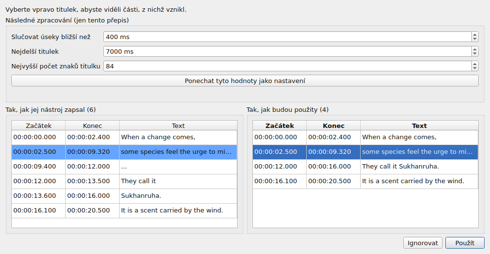
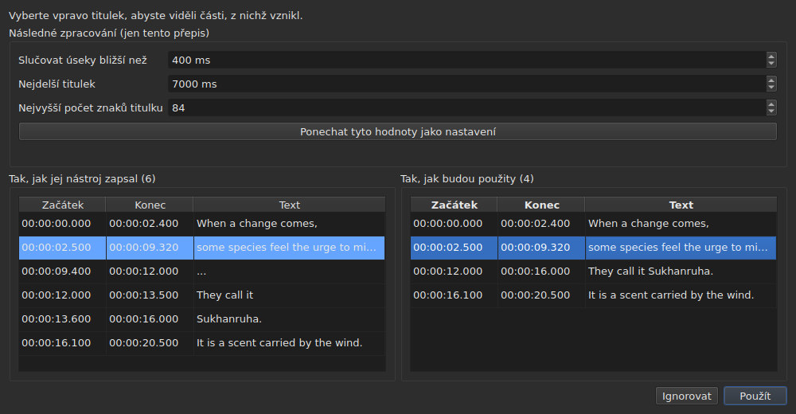

# Přidružené video

<!-- machine-translated -->
> Tato stránka je strojovým překladem a dosud ji nezkontroloval žádný čtenář tohoto jazyka.

Nabídka **Video** nese nejprve tři příkazy a pak úkony, které ovládají film
— viz [Přehrávač](player.md#pohyb-filmem).

| Příkaz | Zkratka | Co dělá |
| :------ | :------- | :----------- |
| Vybrat video… | žádná | zvolí soubor videa, ke kterému dokument patří |
| Přepsat zvuk… | žádná | přepíše zvuk filmu na titulky, které nahradí titulky projektu — viz [Přepis zvuku](#přepis-zvuku) |
| Přehrát / pozastavit | `Ctrl+P` | přehraje nebo zastaví video — viz [Přehrávač](player.md#přehrávání-a-zastavení) |

Přidružené video je **vlastností otevřeného dokumentu**, nikoli nastavením
aplikace: otevření jiného souboru titulků začíná od nuly. Nezapisuje
se do žádného souboru a zmizí spolu s oknem.

## Zvuková stopa

Film může nést několik zvukových stop — původní znění, dabing, komentář.
Podnabídka **`Video ▸ Zvuk ▸ Jazyk`** je vypíše, **jednu položku na stopu**, a **označí tu, která hraje**:

| Co soubor uvádí | Co říká položka |
| :------------------ | :------------------ |
| jazyk a název | `1: fra — Original` |
| jen jazyk | `2: eng` |
| jen název | `3: Commentary` |
| ani jedno | `1` |

Číslo je **pořadí stopy ve filmu**, jedna po druhé, v pořadí souboru: dvě stopy
mohou říkat `eng` a soubor, který o svých označeních mlčí, má přesto první a druhou.

**Volba položky přehraje tuto stopu.** Označení je odpovědí přehrávače, nikoli kliknutí: říká, která
stopa hraje.

- **Podnabídka je nedostupná** bez videa nebo bez zvukové stopy. S jedinou stopou zůstane dostupná a
  ukáže ji zaškrtnutou: říká jazyk filmu. Oba úkony hlasitosti, které jsou vedle ní, zůstávají
  dostupné v každém případě: viz [Hlasitost](player.md#hlasitost).
- **Stopa se nepamatuje** od jednoho videa k dalšímu ani od jedné relace k další: číslo stopy patří
  jejímu souboru a jeho přenesení na další film by vybralo cokoli, co tam nese toto číslo.
  Návrat na kartu znovu otevře její film na stopě, kterou si přehrávač zvolí sám.
- Žádná klávesová zkratka: jazyk se mění zřídka a nabídka stačí.

## Volba videa

Dialog se otevře v adresáři souboru titulků a filtruje podle
rozpoznaných přípon videa:

    .avi .flv .m2ts .mkv .mov .mp4 .ogg .ogv .vob .webm

Nabízí také zobrazení všech souborů. Zrušení dialogu nic
nezmění.

Zvolený soubor se **ihned otevře**: obraz se objeví v okně,
pozastavený na svém prvním okamžiku. Viz [Přehrávač](player.md).

**Přetažení souboru videa do okna udělá totéž** — viz
[Přetažení souborů do okna](files.md#přetažení-souborů-do-okna).

**Video patří projektu aktuální karty.** Každá karta si drží
své vlastní; změna karty změní film. **Návrat na kartu obnoví její
film tam, kde jste ho opustili**, pozastavený, jako každé otevření. Jiný film
zvolený pro tento projekt mezitím naopak začne od začátku.

## Automatický návrh

Když se otevře soubor titulků a **dosud nebylo zvoleno žádné video**,
okno ho hledá ve stejném adresáři: soubor videa, jehož název
bez přípony je předponou našeho, a to až po tečku.

| Soubor titulků | Nalezené video | Proč |
| :------------ | :---------- | :-- |
| `film.fr.srt` | `film.mkv` | `film` je předponou `film.fr` |
| `film.en.forced.srt` | `film.mkv` | stejně, bez ohledu na počet segmentů |
| `film.fr.srt` | `film.fr.mkv`, nikoli `film.mkv` | vyhrává nejdelší název |
| `film.fr.srt` | žádné, jsou-li tam `film.mkv` **i** `film.mp4` | dva kandidáty nelze rozlišit |
| `film.fr.srt` | žádné, je-li tam jen `fil.mkv` | `fil` nekončí na tečce |

**Návrh není volba.** Nechá se nahradit jiným
návrhem — otevřením jiného souboru, uložením pod jiným názvem. Výslovná
volba se naopak nikdy nepřepíše: jakmile bylo použito `Select Video…`,
automatický návrh se už za ní nevrátí.

Právě to činí odhad přijatelným: lze ho opravit a jeho
oprava platí.

## Co ukazuje stavový řádek

Vpravo ve stavovém řádku říká jeden řádek, k čemu dokument patří.
Je posledním ze tří: [kódování](files.md#kódování-ve-stavovém-řádku)
přečteného souboru je první, [mřížka snímků](frame-grid.md) odvozená z
pozic následuje.

| Situace | Co se zapíše |
| :-------- | :-------------- |
| video je přidruženo | `Video: film.mkv` |
| … a `ffprobe` uvádí jeho snímkovou frekvenci | `Video: film.mkv, 24000/1001 fps` |
| žádné | `No video` |

**Snímková frekvence jde s filmem, nikoli vedle něj.** Jde o jediný údaj — k čemu
tento dokument patří — a třetí zmínka by ji postavila na stejnou úroveň jako
[mřížku odvozenou z pozic](frame-grid.md), která je údajem jiným.

## Přepis zvuku

**`Transcribe Audio…`** zapíše řeč filmu jako titulky. Je vypnutý, dokud není otevřen film: jde o
zvuk **filmu projektu**, nikdy o soubor, který byste vybírali — k přepisu zvukového
souboru použijte v příkazovém řádku [`transcribe`](../subedit-cli/transcribe.md).

Dialog se ptá na čtyři věci a říká, zda může začít:

- **zvukovou stopu**, uvedenou tak, jak ji uvádí nabídka [`Audio`](#zvuková-stopa), s jazykem
  a názvem, které soubor uvádí;
- **jazyk**, vybraný v **seznamu**: nejprve položka, která jej zjistí, „Zjistit z prvních 30 sekund zvuku“, pak jazyky, které nástroj
  nabízí pro model, jmenovitě v jazyce okna a s jejich kódem — „francouzština (fr)“. Seznam je seznamem samotného nástroje: asi sto
  u vícejazyčného modelu; u modelu pouze pro angličtinu má jedinou položku, angličtinu, a nelze jej změnit, a řádek říká, že film vyjde anglicky,
  ať se v něm mluví jakýmkoli jazykem. Seznam začíná jazykem zvolené stopy, když jej soubor uvádí a nástroj jej nabízí, sleduje stopu, dokud jste
  žádný nevybrali, a **řádek pod ním říká, odkud se vzal**. Když soubor pro stopu žádný jazyk neuvádí, řádek to říká a varuje:
  model jej pak zjistí z prvních třiceti sekund zvuku a **film, který začíná hudbou nebo tichem, může být považován za jiný jazyk a jeho řeč pak
  přeložena do něj**. Vyberte jazyk, pokud jej znáte;
- **zvuky zapsané jako poznámky**: políčko „Nezapisovat zvuky jako poznámky“, ve výchozím stavu zaškrtnuté. Nástroji se pak řekne, aby nezapisoval zvuky jako
  poznámky, například `(phone ringing)` nebo `[MUSIC PLAYING]`; tam, kde nemá řeč k zapsání, zapíše `...`, a kousky, které nemají žádné písmeno ani číslici,
  následné zpracování zahodí. Odškrtněte políčko, chcete-li poznámky ponechat, pro titulky pro neslyšící a nedoslýchavé. Políčko je šedé, s důvodem,
  u nástroje, kterému to nelze říci. Je to nastavení `transcription.suppress-notes`, které obsahují také [předvolby](preferences.md#přepis);
- **část filmu**, od jednoho času k druhému — viz [Nejprve zkusit část](#nejprve-zkusit-část). Obě pole
  prázdná znamenají celý film.

**Říká také, co chybí.** Tři řádky říkají, zda nástroj, `ffmpeg` a model jsou k dispozici, a
kde; když něco chybí, `OK` zůstane nedostupné a dialog to oznámí s odkazem na
[Instalace nástrojů pro přepis](../subedit-cli/install-transcription.md). Tlačítko `Preferences…` otevře
[předvolby](preferences.md#přepis), kde se nastavují program a model — jsou to skutečnosti
o počítači, ne volby, které by se měly opakovat při každém přepisu — a dialog se po jejich zavření podívá znovu.

Jazyk se uchová pro příště. Samotný nástroj a meze titulků jsou
[nastavení](preferences.md) (`transcription.*`).

**Když projekt už obsahuje titulky, okno se před jejich nahrazením zeptá** a řekne,
kolik jich zmizí. Ptá se před prací, aby odmítnutí nestálo nic. Když je projekt prázdný,
není se na co ptát.

Práce probíhá **na pozadí**, s oknem a tlačítkem `Cancel`; okno zůstává kolem použitelné. **Okno
říká, v jakém stavu práce je**, abyste věděli, že žije a jak dlouho potrvá:

- **krok**: nejprve “Extrahuje se zvuk…” — okno je pak zaneprázdněné, bez čísla, protože extrakce neříká nic o tom, jak daleko
  došla —, pak “Přepis zvuku…”, s ukazatelem;
- **zbývající čas**, “zbývá asi 38 min”: zpočátku chybí, zobrazí se, jakmile nástroj ohlásil dost postupu pro extrapolaci, a počítá se z jeho rychlosti od začátku až do poslední minuty; je to přesnost na několik minut, ne příslib;
- **uplynulý čas**, “uplynulo: 0:05:12”, který běží, i když se nic jiného nehýbe;
- **pozice**, “0:12:30 z 0:50:00”: kam ve filmu nástroj došel, jakmile vytvoří první text, zobrazená **těsně nad posledním textem**, ke kterému patří;
- **poslední získaný text**, abyste viděli, že práce dává smysl.

U dlouhého filmu s velkým modelem na procesoru mohou první minuty trvat dlouho: nástroj načítá model a pracuje na prvních
oknech po třiceti sekundách. Pozice a poslední text se hýbou dřív než vlastní procento nástroje, které přichází jen v krocích
po 5 % filmu.

### Náhled

**Nic nenahradí titulky projektu, dokud je neuvidíte.** Když práce skončí — i když ji zrušíte nebo selže poté, co něco vytvořila —, okno ukáže výsledek
ve dvou tabulkách vedle sebe, každé s **vlastním začátkem a koncem**:

- **vlevo „Tak, jak jej nástroj zapsal“**: vše, co nástroj vrátil, tak, jak to rozdělil, bez jakéhokoli následného zpracování — to, co by zapsal
  [`--raw`](../subedit-cli/transcribe.md) —, včetně zástupných znaků (`...`);
- **vpravo „Tak, jak budou použity“**: titulky po následném zpracování, přesně to, co půjde do projektu. Probíhá ve třech krocích, každý nad celým přepisem, než začne další: kousky bez písmene a bez číslice (`...`) se zahodí; blízké kousky jedné věty se sloučí; příliš dlouhé se rozdělí — **nejprve na konci věty (`. ? ! …`), pak u čárky, středníku nebo dvojtečky a uprostřed věty jen tehdy, když není interpunkce, u které by se dalo dělit**. Řezu, který by zanechal titulek příliš malý na čtení (pár znaků, zlomek vteřiny), se vyhne, pokud existuje jiný. Titulek, který kousek začíná, si ponechá jeho začátek, a ten, který ho končí, jeho konec: časy slov slouží jen pro řezy uvnitř kousku.

Nad tabulkami **„Následné zpracování (jen tento přepis)“** obsahuje tři meze následného zpracování: „Slučovat úseky bližší než“, „Nejdelší titulek“ a „Nejvyšší počet znaků titulku“ — nastavení `transcription.merge-gap-ms`, `transcription.max-duration-ms` a `transcription.max-characters`. **Změna jedné z nich hned znovu vytvoří pravou tabulku**, bez zapojení nástroje, a titulek, který jste měli vybraný, zůstane vybraný. Hodnoty, které zadáte, platí jen pro **tento přepis**: ať jej použijete, nebo zahodíte, nastavení aplikace zůstane, jaké bylo. **„Ponechat tyto hodnoty jako nastavení“** předá tři hodnoty nastavení aplikace — těm v [předvolby](preferences.md#přepis), uloženým spolu s nimi —, a okno to říká; zavření okna to samo neprovede.

Obě se neřadí řádek po řádku, proto má každá vlastní časy. **Výběr titulku vpravo zvýrazní vlevo kousky, z nichž vznikl**, a posune levou stranu na ně;
vždy jeden titulek, jen v tomto směru. Žádnou z tabulek nelze upravovat: co žádné nastavení nevyřeší správně, se upraví potom v tabulce projektu jako každý titulek.

Zavírají ji dvě tlačítka. **„Použít“** nahradí titulky projektu **jako jedna operace**: jedno `Undo` vrátí, co tam bylo, včetně textů
překladu. **„Ignorovat“** výsledek zahodí a ten je ztracen. „Použít“ je nedostupné, když
není co použít.

**Když byl běh zastaven**, okno to říká — „Částečný výsledek: práce se zastavila na …“ — a nabídne, co se do té doby získalo, k použití
nebo ignorování, aby dlouhý běh zastavený pozdě nepřišel o svou práci bez dotazu. Tyto kousky nemají časovaná slova (nástroj je zapíše na konci) a
následné zpracování řeže na vlastních hranicích kousků. Selhání se nejprve oznámí v okně, jako každé selhání; zrušení nic takového neříká.

### Nejprve zkusit část

Rozsah umožňuje **posoudit model nebo jazyk na dvou minutách, než se zavážete na dvě hodiny**. Pole “Část filmu” berou začátek a konec, každý zapsaný jako `HH:MM:SS`, jak říkají pole (`2:00` a počet sekund, `90`,
jsou rovněž čteny); jedno samotné je povoleno (odtud do konce, nebo od začátku potud). `OK` zůstane nedostupné, dokud některé pole
není čas nebo konec nenásleduje po začátku, a řádek pod poli řekne, které.

- **Titulky zachovají čas filmu**: co se říká v 2:10, je ve výsledku na `0:02:10`.
- **Prochází náhledem jako každý přepis** a po použití nahradí titulky projektu; jedno `Undo` je vrátí. Chcete-li
  rozsah zkusit, aniž byste sáhli na svou práci, náhled ignorujte, nebo nejprve uložte.

**Co je potřeba, se nedodává**: nástroj (whisper.cpp), model a `ffmpeg` k extrakci zvuku.
Viz [Instalace nástrojů pro přepis](../subedit-cli/install-transcription.md).

## Když není film

Okno ukáže tlačítko **`Select Video…`** tam, kde by byl obraz, místo
prázdného místa. Je to tentýž příkaz jako v nabídce `Video`, na dosah
myši: nepřítomnost, se kterou nelze nic udělat, se těžko odlišuje od
poruchy.

Tlačítko zmizí, jakmile se otevře film, a obraz zabere **celé** jeho
místo: výšku, kterou mu tabulka nad sebou nechává — tu, kterou si
[`window.table-share`](preferences.md) pamatuje od jedné relace k další —, a
nikdy méně než minimální výšku obrazu, kterou tabulka v případě potřeby uvolní.
Když film zmizí, tlačítko zaujme totéž místo.

**Název souboru, nikdy jeho cesta.** Cesta o dvou stech znacích
by z lišty vytlačila všechno ostatní; celou cestu ukázal
dialog.

## `ffmpeg` není nutný

`subedit-gui` se ptá programu `ffprobe` — dodávaného s `ffmpeg` — na jedinou
věc: **snímkovou frekvenci, kterou uvádí kontejner**. Čte se jednou
za film, když se přidruží.

| S `ffprobe` | Bez něj |
| :------------- | :------ |
| stavový řádek zapíše snímkovou frekvenci vedle názvu filmu | zapíše jen název |
| dialog převodu navrhne ve spodním poli snímkovou frekvenci filmu | nenavrhne nic a otevře se jako dříve |
| dialog zarovnání se na ní otevře | otevře se na snímkové frekvenci projektu |

**Nic jiného na něm nezávisí a žádná operace neodmítne.** Přehrávač
naopak `ffprobe` vůbec nepotřebuje: opírá se o `libmpv`, který je
závislostí sestavení. Doba trvání filmu, ta, podle které se hlásí, co
přesahuje konec, pochází z přehrávače, a ne z `ffprobe`.

**Přepis je jediná věc, která `ffmpeg` potřebuje**: vyextrahuje z něj zvuk filmu. Viz
[Instalace nástrojů pro přepis](../subedit-cli/install-transcription.md).
Nejde tedy o omezený režim, ale o **běžný provoz** počítače,
na kterém nikdy nebyl nainstalován `ffmpeg`: údaj pochází od uživatele a `ffprobe`
ho navrhne, když je k dispozici.

Přečtená snímková frekvence je **přesné racionální číslo** — `24000/1001`, nikoli `23.976`.
Proto se `ffprobe` pro tuto odpověď zachovává:
přehrávač ví totéž jako číslo s plovoucí desetinnou čárkou a přibližná snímková frekvence
by celý soubor přečasovala mírně vedle.
