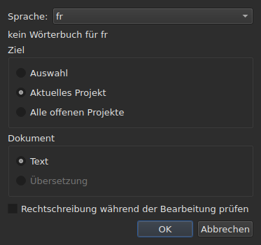
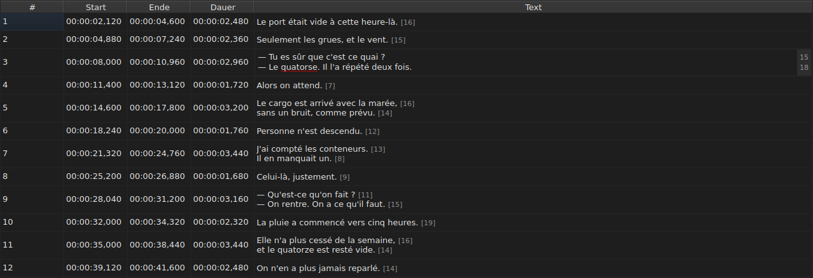
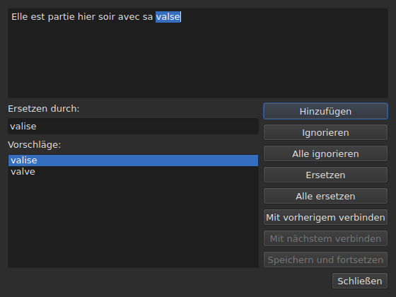

# Rechtschreibung prüfen…

<!-- machine-translated -->
> Diese Seite ist eine maschinelle Übersetzung und wurde noch von keiner Leserin und keinem Leser dieser Sprache geprüft.

`Werkzeuge ▸ Rechtschreibung prüfen …` geht die Wörter durch, die das Wörterbuch nicht kennt,
eines nach dem anderen, nach dem Vorbild der Rechtschreibprüfung von Gaupol. Es hat einen Begleiter,
`Werkzeuge ▸ Rechtschreibeinstellungen …`, der die Sprache, das Ziel und das Dokument festlegt sowie das Unterstreichen beim Tippen.
Beide stützen sich auf die Wörterbücher des Systems, über Enchant.

Die Beschriftung des ersten wird `Chec&k Spelling…` geschrieben: `C` ist bereits
die Zugriffstaste von `Correct Texts…`, und `k` ist im Menü `Tools` frei.
Keiner der beiden hat ein Tastenkürzel.

**Beide sind bei einem Dokument ohne Untertitel deaktiviert**, wie
[`Correct Texts…`](correct-texts.md): Es gibt nichts zu prüfen. `Check Spelling…`
ist außerdem deaktiviert, wenn es für die eingestellte Sprache kein Wörterbuch gibt, siehe
[Ohne Wörterbuch](#ohne-wörterbuch).

## Rechtschreibeinstellungen…




| Gruppe | Auswahl | Standard |
| :---- | :------ | :------ |
| `Language` | die Sprachcodes, die das System anbietet, und der bereits gewählte | die Sprache des Systems, wenn sie darunter ist |
| `Target` | `Selection`, `Current Project`, `All Open Projects` | `Current Project` |
| `Document` | `Text`, `Translation` | `Text` |
| `Check spelling while editing` | ein Kontrollkästchen, siehe [Unterstreichen beim Tippen](#unterstreichen-beim-tippen) | nicht angekreuzt |

`Selection` ist deaktiviert, wenn im angezeigten Tab keine Zeile gewählt ist; `Translation`
ist deaktiviert, solange kein offenes Projekt eine Übersetzung trägt. Eine gemerkte
Einstellung, die nicht mehr verfügbar ist — eine leere Auswahl, eine fehlende Übersetzung —,
öffnet sich auf `Current Project` oder `Text`. `OK` behält die Einstellungen, `Cancel` ändert
nichts.

**Dieses Fenster hängt nicht vom Wörterbuch ab**: Es bleibt aktiviert, solange das
Dokument Untertitel hat, selbst ohne Wörterbuch für die eingestellte Sprache, und es ist
dasjenige, mit dem Sie eine Sprache verlassen können, die keines hat. Die Sprache, für die kein
Wörterbuch existiert, bleibt bearbeitbar und erscheint in der Liste, mit dem Satz
`no dictionary for` darunter, gefolgt von ihrem Code.

**Die vier Einstellungen werden gemerkt**, von einer Sitzung zur nächsten, in der
Einstellungsdatei von `subedit` — siehe [Die Einstellungen](preferences.md) für ihren
Ort:

| Schlüssel | Werte | Standard |
| :-- | :----- | :------ |
| `spell-check.language` | ein Sprachcode, etwa `fr_FR`; leer: die Sprache des Systems | leer |
| `spell-check.target` | `selection`, `current-project`, `all-projects` | `current-project` |
| `spell-check.document` | `main`, `translation` | `main` |
| `spell-check.inline` | `true` oder `false` — unbekannte Wörter im Editor einer Zelle unterstreichen | `false` |

Ein Wert, den der Schlüssel nicht annimmt, wird ignoriert, der Standard gilt, und die Option
wird beim Öffnen des Fensters in der Fehlerausgabe genannt — siehe
[Die Einstellungen](preferences.md#was-geschieht-wenn-die-datei-nicht-sagt-was-erwartet-wird).

## Unterstreichen beim Tippen




Das Kontrollkästchen `Check spelling while editing` von `Spell-Check Settings…` unterstreicht
**mit einer roten Wellenlinie und während Sie tippen** jedes unbekannte Wort im Editor einer
Textzelle — dem der Spalte `Text` ebenso wie dem der
Spalte `Translation`. Die Unterstreichung folgt dem Tippen: Sie erscheint, wandert und
verschwindet mit dem Wort. **Sie ist standardmäßig nicht angekreuzt**, wie in Gaupol: Ohne
sie ändert sich nichts im Editor.

**Die Sprache ist die von `Language:`**, im selben Fenster, und die unbekannten Wörter
sind die, die `Check Spelling…` finden würde: dieselben Fälle umgangssprachlichen Englischs
(`goin'`, `we'd`, `1st`), dieselbe Zerlegung in Wörter. Ein unterstrichenes Wort wird nicht
über ein Menü korrigiert: Das Kontrollkästchen zeigt es nur an.

**Ohne Wörterbuch für die eingestellte Sprache bleibt der Editor stumm**: Nichts wird
unterstrichen und nichts schlägt fehl, und der Satz `no dictionary for` des Fensters sagt,
warum. Das Kontrollkästchen gilt für die danach geöffneten Editoren; ein bereits
offener Editor behält, was er hatte.

## Der Durchlauf




Das Fenster zeigt den Text des Untertitels, bei dem es angehalten hat, das unbekannte Wort
darin ausgewählt. **Bei jedem unbekannten Wort kommt der Tab des Projekts zurück, und die
Zeile des Untertitels wird in der Tabelle ausgewählt.** Der Durchlauf geht Untertitel
für Untertitel vor, dann Projekt für Projekt, wenn das Ziel mehrere bezeichnet.

Unter dem Text: das Feld `Replace with:`, mit dem ersten Vorschlag gefüllt, und die
Liste `Suggestions:`. Einen Vorschlag zu wählen, kopiert ihn in das Feld; im
Feld zu tippen, erneuert die Liste.

| Schaltfläche | Was sie tut |
| :----- | :----------- |
| `Add` | fügt das Wort dem persönlichen Wörterbuch des Benutzers hinzu und geht zum nächsten weiter |
| `Ignore` | lässt dieses Wort stehen und geht zum nächsten weiter |
| `Ignore All` | lässt dieses Wort stehen, und alle seine anderen Vorkommen während dieses Durchlaufs |
| `Replace` | ersetzt das Wort durch den Inhalt von `Replace with:`; deaktiviert, solange das Feld leer ist |
| `Replace All` | tut dasselbe für seine anderen Vorkommen; deaktiviert, solange das Feld leer ist |
| `Join with Previous` | verbindet das Wort mit dem Wort davor; deaktiviert, wenn es keines gibt oder sie nicht durch ein Leerzeichen getrennt sind |
| `Join with Next` | verbindet das Wort mit dem Wort danach, unter denselben Bedingungen |
| `Save and Resume` | behält den Text so, wie der Textbereich ihn trägt, und setzt das Lesen **dieses Textes von seinem Anfang an** fort |
| `Close` | schließt das Fenster |

**Der Textbereich ist bearbeitbar.** Sobald Sie darin tippen, bleibt nur `Save and Resume`
aktiviert: Die anderen Handgriffe wirken auf das gewählte Wort, das nicht mehr
das des Textes ist.

**Der Durchlauf endet von selbst**, wenn kein unbekanntes Wort mehr übrig ist: Die
Schaltflächen werden deaktiviert, der Text leert sich. Ein Ziel ganz ohne unbekanntes Wort
zeigt kein Fenster.

### Schließen mittendrin

`Close`, oder das Kreuz des Fensters, **wendet an, was getan wurde**, wie das Ende
des Durchlaufs: die bereits verlassenen Texte **und** die Handgriffe — ersetzen,
alle ersetzen, verbinden —, die am aktuellen Text bereits vorgenommen wurden. Das ist eine Abweichung von
Gaupol, das den aktuellen Text verliert. Was nicht zählt, ist der Rest des Durchlaufs, ebenso wenig
die im Textbereich getippten Nachbesserungen, die `Save and Resume` nicht
übernommen hat.

**Ein einziger Eintrag im Verlauf je berührtem Projekt**, unabhängig von der Anzahl der
Ersetzungen: `Undo` macht alle Korrekturen dieses Projekts auf einmal rückgängig.
Das Menü nennt ihn `Undo: correcting texts`. Die Statusleiste gibt dann die
Zählung:

```text
Edited 2 and removed 0 subtitles
```

**Die Liste der Ersetzungen** — was der Benutzer ersetzt hat, und womit —
wird beim Schließen nach `spell-check/<language>.repl` geschrieben, unter dem Konfigurationsverzeichnis
von `subedit`, und nicht in das von Gaupol, das nie gelesen wird.
Sie zählt dann zu den Vorschlägen der Rechtschreibprüfung, hier wie in
[`Correct Texts…`](correct-texts.md#wörter-zusammenfügen-oder-trennen--zusammenfügen-und-trennen-durch-die-rechtschreibprüfung).
Kann sie nicht geschrieben werden, sagt es ein Fehlerfenster, `Could not save the
replacements for`, gefolgt von der Sprache und dem Grund, ohne die
Korrekturen zu verwerfen.

## Ohne Wörterbuch

Wenn die eingestellte Sprache — die des Systems, wenn keine gewählt wurde — kein
Wörterbuch hat, **ist `Check Spelling…` deaktiviert**, und sein Tooltip ebenso wie die Statusleiste,
wenn der Mauszeiger über dem Eintrag steht, sagen, warum:

```text
no dictionary for fr
```

`Spell-Check Settings…` bleibt, um eine Sprache zu wählen, die eines hat. Ein Fenster,
das ohne jeden Wörterbuchanbieter gebaut wurde, sagt dasselbe und prüft
nichts.

## Die Meldungen

| Meldung | Wo | Was sie auslöst |
| :------ | :---- | :--------------- |
| `no dictionary for fr` | Tooltip und Statusleiste | kein Wörterbuch für die eingestellte Sprache |
| `Nothing to check.` | Statusleiste | das Ziel bezeichnet keinen Text — zum Beispiel eine leere Auswahl |
| `Edited N and removed M subtitles` | Statusleiste | am Ende oder beim Schließen; `M` bleibt bei `0` |
| `Could not save the replacements for fr: …` | Fehlerfenster | die Liste der Ersetzungen wurde nicht geschrieben |

## Ein Beispiel

Eine geöffnete Datei trägt `Elle est partie hier soir avec sa valse`. Das französische
Wörterbuch ist vorhanden: `Werkzeuge ▸ Rechtschreibung prüfen …` hält bei `valse` an, wählt die
Zeile in der Tabelle aus und schlägt `valise` vor, bereits in `Replace with:`. `Replace`,
dann `Close`: Die Zeile wird zu `Elle est partie hier soir avec sa valise`, und die
Statusleiste sagt:

```text
Edited 1 and removed 0 subtitles
```
