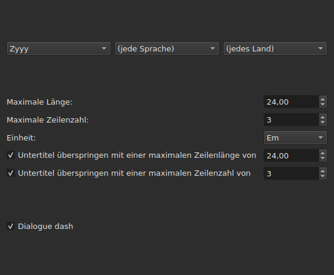
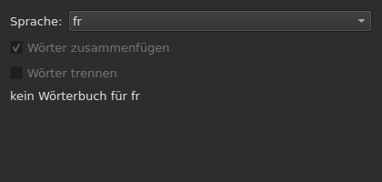
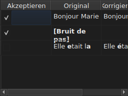

# Texte korrigieren…

<!-- machine-translated -->
> Diese Seite ist eine maschinelle Übersetzung und wurde noch von keiner Leserin und keinem Leser dieser Sprache geprüft.

`Werkzeuge ▸ Texte korrigieren …` öffnet einen mehrseitigen Assistenten nach dem Vorbild
von Gaupols: eine Seite für Ziel und Aufgaben, eine Seite pro angekreuzter Aufgabe,
eine Fortschrittsseite und eine Bestätigungsseite, die die
Änderungen vorschlägt, ohne sie je aufzuzwingen.

**Bei einem leeren Dokument deaktiviert**: Es gibt nichts zu korrigieren.

**Die Befehlszeile tut dasselbe** für alle Aufgaben: [`subedit-cli correct`](../subedit-cli/correct.md), mit
denselben Mustern und denselben Zählungen — und in Zeichen, wo das Fenster in Em misst.
**Sie liest standardmäßig vier der gemerkten Einstellungen dieses Assistenten** — die zwei Klassen
häufiger Fehler (`Human`, `OCR`), `Remove all blank subtitles` und die Höchstzahl der Zeilen von
`Line Break` — und nimmt alles andere (die Aufgaben, ihren Code, die Zeilenlänge, die Sprache,
die Kontrollkästchen der Muster) aus ihrer eigenen Zeile. Siehe
[Zwei Blöcke, einer davon mit der Befehlszeile geteilt](preferences.md#zwei-blöcke-einer-davon-mit-der-befehlszeile-geteilt)
und [`subedit-cli config`](../subedit-cli/config.md).

## Aufgaben und Ziel — die erste Seite

| Gruppe | Wahlmöglichkeiten | Standard |
| :---- | :------ | :------ |
| `Target` | `Selection`, `Current Project`, `All Open Projects` | `Current Project` |
| `Document` | `Text`, `Translation` | `Text` |
| `Tasks` | `Mentions`, `Join or Split Words`, `Common Errors`, `Capitalization`, `Line Break` — anzukreuzen, eine oder mehrere | `Common Errors` und `Capitalization` angekreuzt, die drei anderen nicht |

`Selection` ist deaktiviert, wenn im angezeigten Tab keine Zeile gewählt ist; `Translation`
ist deaktiviert, solange kein offenes Projekt eine Übersetzung trägt.

**Das Ziel und das Dokument werden nicht gemerkt**: Der Assistent öffnet sich immer wieder
auf `Current Project` und `Text`. Die angekreuzten Aufgaben hingegen werden gemerkt.

**Was jedes Ziel bezeichnet**:

| Ziel | Wirkt auf |
| :----- | :------ |
| `Selection` | die im angezeigten Tab gewählten Zeilen |
| `Current Project` | die ganze Datei des angezeigten Tabs |
| `All Open Projects` | die ganze Datei jedes offenen Tabs |

**`All Open Projects` auf `Translation` überspringt die Projekte ohne Übersetzung**:
Ein Projekt, das keine trägt, hat in einer leeren Spalte nichts vorzuschlagen, und
der Assistent zählt es nicht.

**Die Seiten der Aufgaben folgen in Gaupols Reihenfolge — `Mentions`,
`Join or Split Words`, `Common Errors`, `Capitalization`, `Line Break` — nie in der, in der die Kästchen
angekreuzt wurden.** Eine nicht angekreuzte Aufgabe hat keine Seite; ihre gemerkten
Einstellungen ändern sich deshalb nicht. **Keine Aufgabenseite trägt ein eigenes
Kästchen „aktiv“**: Es ist das dieser ersten Seite, und es allein, das
entscheidet, ob die Aufgabe ausgeführt wird.

## Die Seiten der Aufgaben

Jede der vier Musterseiten — alle außer `Join or Split Words`, das keine hat — trägt dieselbe Grundlage: drei kaskadierende
Auswahllisten — Schrift, Sprache, Land —, um den Code der anzuwendenden Muster zu
wählen, dann die Liste der Muster dieses Codes, eines je Name zum Ankreuzen. **Die
drei Listen bieten nur an, was der Musterkatalog tatsächlich
enthält** — die mit dem Programm ausgelieferten und die, die ein Benutzer dort
abgelegt hat (siehe [Abgelegte Muster](#abgelegte-muster)) —, nie eine anderswo gelesene Liste
von Sprachen oder Ländern. `Zyyy` („beliebige Schrift“) ist der Ausgangscode
von `Common Errors`, der die überall gültigen Muster liefert. **Die drei
anderen Typen haben Muster nur unter einer Schrift**: Ihre Seite öffnet sich auf der
ersten, die der Katalog anbietet, `Latn` bei den ausgelieferten Mustern, und nicht auf `Zyyy`.

**Die Beschreibung jedes Musters ist der Tooltip seines Kästchens.** Namen und Beschreibungen folgen der
Sprache des Fensters bei den mit dem Programm ausgelieferten Mustern; ein eigenes Muster wird so gezeigt,
wie seine Datei es schreibt ([Sprache](invocation.md#sprache)).

**Ein abgewähltes Muster bleibt abgewählt, bis es wieder angekreuzt wird**, auch wenn
man den Code wechselt und dann zu ihm zurückkehrt, und diese Wahl wird von einem Öffnen
des Assistenten zum nächsten gemerkt. Wieder angekreuzt, findet es einfach seine ursprüngliche
Einstellung wieder, und die gemerkte Wahl verschwindet.

| Seite | Was sie zur Grundlage hinzufügt |
| :--- | :----------------------- |
| `Mentions` | zwei Kontrollkästchen, `Sound in brackets` und `Sound in parentheses`, standardmäßig nicht angekreuzt |
| `Common Errors` | zwei Kontrollkästchen, `Human` und `OCR`, standardmäßig angekreuzt |
| `Capitalization` | nichts weiter |
| `Line Break` | eine Höchstlänge (`24`, standardmäßig), eine Höchstzahl der Zeilen (`3`), eine Einheit — `Characters` oder `Ems`, standardmäßig `Ems` — und zwei Bedingungen zum Überspringen, unten beschrieben |

**Die zwei Kästchen von `Mentions` benennen kein kompiliertes Muster**: Sie
steuern eine Durchsicht des Textes im Kern, dieselbe, die
[`Remove Hearing-Impaired Mentions…`](operations.md#remove-hearing-impaired-mentions)
bereits als direkter Handgriff vornimmt. Das eine **oder** das andere angekreuzt genügt, um sie zu starten. **Die Musterliste der Seite wiederholt sie nicht**: Diese zwei Namen erscheinen dort nur einmal, als Kontrollkästchen.

**`Common Errors` filtert nach Klasse**: Ein Muster, das beide Klassen trägt,
gilt, sobald eines der beiden Kästchen angekreuzt ist; die drei anderen Seiten kennen
diese Unterscheidung nicht.

### Zeilenumbruch — die Einheit und das Überspringen




| Einstellung | Was sie tut | Standard |
| :------ | :----------- | :------ |
| `Maximum length` | die Länge einer Zeile, in der gewählten Einheit; von `1` bis `1000` | `24` |
| `Maximum lines` | die angestrebte Anzahl der Zeilen; von `1` bis `100` | `3` |
| `Unit` | `Characters` zählt Zeichen; `Ems` misst die Breite mit der Schrift des Fensters, in der ein durchschnittlicher Kleinbuchstabe `0.55` wert ist — Gaupols Einheit | `Ems` |
| `Skip subtitles with maximum line length of` | lässt einen Untertitel, dessen längste Zeile in diese Länge passt, in der gewählten Einheit, so, wie er ist | angekreuzt, `24` |
| `Skip subtitles with maximum line amount of` | lässt einen Untertitel, dessen Zeilenzahl in diese Zahl passt, so, wie er ist | angekreuzt, `3` |

**Das Überspringen hat eigene Schwellen**, verschieden von den angestrebten Grenzen: Das ist
Gaupols Regel. Ein Untertitel bleibt, wie er ist, wenn er in **alle
Schwellen passt, deren Kästchen angekreuzt ist**; sonst wird er umbrochen, und der Umbruch wird
nur behalten, wenn er den Untertitel einer Schwelle näherbringt, die er überschritt — weniger
Länge oder weniger Zeilen. Kein Kästchen angekreuzt: Jeder Untertitel wird umbrochen,
ob er schon passt oder nicht.

**Die Einheit zu wechseln, ändert, was vorgeschlagen wird**: Die Länge jeder Zeile wird
bei jeder Berechnung gemessen, in der Einheit, die die Seite in diesem Moment hat, und nichts
bleibt von einer früheren Messung. Ein Text von neunundzwanzig Zeichen, die Hälfte
davon schmale Buchstaben, überschreitet `24` in `Characters` und passt mühelos hinein
in `Ems`.

**Die sieben Einstellungen werden gemerkt**, von einer Sitzung zur nächsten, die Einheit eingeschlossen.

### Wörter zusammenfügen oder trennen — wieder zusammenfügen und trennen durch die Rechtschreibprüfung




Eine eigene Seite, zwischen `Mentions` und `Common Errors`, um zu reparieren, was
Texterkennungssoftware mit den Leerzeichen anstellt. Sie hat keine Liste von
Mustern: Sie stützt sich über Enchant auf die Wörterbücher des Systems.

| Einstellung | Was sie tut | Standard |
| :------ | :----------- | :------ |
| `Language` | die Sprache des Wörterbuchs; die Codes, die das System anbietet, und der bereits gewählte | die Sprache des Systems, wenn sie darunter ist |
| `Join words` | fügt ein falsch geschriebenes Wort an das benachbarte Wort an | angekreuzt |
| `Split words` | schneidet ein falsch geschriebenes Wort in zwei | nicht angekreuzt |

**Zusammenfügen**: Ein falsch geschriebenes Wort wird mit dem Wort davor oder dem
danach verbunden, **wenn, und nur wenn, nur eine der beiden Richtungen ein richtig
geschriebenes Wort ergibt**. Wenn beide eines ergeben, oder keine, geschieht nichts.
`bon jour` wird zu `bonjour`; zwei Leerzeichen hintereinander werden zuerst auf
eines reduziert, aber ein Text, in dem nichts zusammengefügt wird, wird so zurückgegeben, wie er war, Leerzeichen
eingeschlossen.

**Trennen**: Ein falsch geschriebenes Wort wird geschnitten, wenn unter den Vorschlägen
der Rechtschreibprüfung **nur einer** dieses Wort mit einem Leerzeichen darin ist — dieselben
Buchstaben, in derselben Reihenfolge. Zwei Vorschläge dieser Art, oder keiner: Es geschieht
nichts. Ein Wort, dessen Anfangsbuchstabe allein groß ist (`Bonjourtous`), wird
nie getrennt: Es ist oft ein Name, und Wörterbücher haben keine.

**Die Ersetzungsliste des Benutzers** (`spell-check/<language>.repl`,
im Konfigurationsverzeichnis des Programms) zählt zu den Vorschlägen der
Rechtschreibprüfung; der Assistent liest sie und schreibt sie nicht.

**Ohne Wörterbuch für die gewählte Sprache bleibt die Seite bestehen und ist ausgegraut**: Die
zwei Kästchen sind deaktiviert, und die Seite sagt `no dictionary for`, gefolgt vom Code
der Sprache. Die Sprache bleibt bearbeitbar — ein Wörterbuch für eine andere kann
vorhanden sein —, und die Aufgabe, ob auf der ersten Seite angekreuzt oder nicht, tut dann nichts und
meldet keinen Fehler.

**Die Sprache, die zwei Kästchen und das Kästchen der ersten Seite werden gemerkt**, von einem
Öffnen des Assistenten zum nächsten.

### Abgelegte Muster

Ein Muster, das ein Benutzer in sein eigenes Musterverzeichnis abgelegt hat,
kommt zu den mit dem Programm ausgelieferten hinzu, im selben Katalog und unter denselben
Listen — einmal geladen, unterscheidet sie nichts mehr.

| Muster | Wo |
| :------- | :---- |
| ausgeliefert | `<prefix>/share/subedit/patterns`, neben `<prefix>/bin` |
| die des Benutzers | `$XDG_DATA_HOME/subedit/patterns`, oder `~/.local/share/subedit/patterns`, wenn die Variable nicht gesetzt oder kein absoluter Pfad ist |

**Das Format ist das von Gaupol, so gelesen, wie es ist**: eine Datei `<Code>.<type>` pro Schrift,
Sprache und Land — `Latn-en.common-error` —, ihre Aktivierung `.conf` daneben. Die Typen
sind `common-error`, `capitalization`, `hearing-impaired` und `line-break`. Die ausgelieferten
Dateien dienen als Vorlage. **Muster werden einmal gelesen, beim Start**: Eine Datei,
die bei offenem Fenster abgelegt wird, wird erst beim nächsten Start gesehen.

## Fortschritt

Sobald `Next` auf der letzten angekreuzten Aufgabenseite gedrückt ist (oder auf der
ersten Seite, wenn keine Aufgabe angekreuzt ist), berechnet der Assistent die vorgeschlagenen
Korrekturen in einem Hintergrund-Thread, ein unbestimmter Fortschrittsbalken auf dem
Bildschirm. Sobald die Berechnung beendet ist, öffnet sich die Bestätigungsseite von selbst.

**`Cancel` bei diesem Schritt verwirft die Berechnung, ohne sie zu unterbrechen**: Nichts
wird angewendet, aber der Assistent wartet vor dem Schließen, bis die laufende
Berechnung beendet ist — eine Wartezeit, begrenzt durch das Zeitlimit, das die Muster-Engine
jeder Suche auferlegt.

**`Back` bei diesem Schritt kehrt ohne Warten zur vorigen Seite zurück**: Die Berechnung
endet im Hintergrund, und ihr Ergebnis wird verworfen — der Assistent springt nicht
von selbst zur Bestätigung. `Next` startet eine neue Berechnung.

## Bestätigung — die letzte Seite




Eine Zeile pro Text, den der Assistent ändern würde — nie eine Zeile für einen
Text, den eine Aufgabe so gelassen hat, wie er ist.

| Spalte | Was sie zeigt |
| :----- | :------------ |
| `Accept` | ein Kontrollkästchen, standardmäßig angekreuzt: Die Korrektur wird angewendet oder nicht |
| `Original` | der Text, wie er ist, der Teil, der sich ändern würde, **fett** |
| `Corrected Text` | der vorgeschlagene Text, der geänderte Teil fett, **bearbeitbar** — ihn nachzubessern, ändert, was geschrieben wird, ohne das Kästchen `Accept` zu ändern |

**Die Änderung wird fett markiert, nie farbig**: Derselbe Diff liest sich
unter beiden Paletten, ohne von einer Tönung abzuhängen.

**Eine Zeile, deren Vorschlag ein Entfernen ist** — dem Untertitel bliebe kein
Text —, zeigt die Spalte `Corrected Text` leer und ihr ganzes `Original`
fett.

| Schaltfläche | Was sie tut |
| :----- | :----------- |
| `Mark All` | kreuzt `Accept` in allen Zeilen an |
| `Unmark All` | wählt `Accept` in allen Zeilen ab |
| `Preview` | setzt den eingebauten Player auf den Untertitel der gewählten Zeile, wenn das Projekt einen Film hat — nichts, wenn es keinen hat |
| `Finish` | wendet die angekreuzten Zeilen an und schließt den Assistenten |

`Remove all blank subtitles`, standardmäßig angekreuzt, entfernt die Untertitel,
die eine Korrektur ganz ohne Text ließe, statt sie leer zu behalten.

**Ein Muster, das die Berechnung nicht anwenden konnte, wird unter der Tabelle genannt**, mit
dem Grund:

```text
Not applied: some pattern (will not compile)
```

Ein so genanntes Muster wird **einmal pro Grund** genannt, wie viele
Texte oder Projekte es auch betrifft, bei denen es gescheitert ist: Der Bildschirm sagt nicht, welche.

| Grund | Was ihn auslöst |
| :----- | :--------------- |
| `cannot be translated` | der Ausdruck verwendet, was die Übersetzung der Python-Syntax ablehnt |
| `will not compile` | die Engine lehnt den Ausdruck ab |
| `has an invalid replacement` | die Ersetzung liest sich nicht so, wie Python sie liest |
| `timed out` | eine Suche überschritt die Zeit, die die Engine ihr für einen Text gewährt |
| `never settled` | `Repeat` änderte den Text nach hundert Durchgängen noch immer |
| `grew the text too long` | der Text überschritt 16.384 Bytes, während das Muster an ihm arbeitete |

**Ein Muster, das an einem Text scheitert, lässt ihn so, wie er vorher war**: Eine halb
ausgeführte Ersetzung ist weniger wert als keine Ersetzung. Die anderen Muster werden angewendet.

**Eine Zeile einer Musterdatei, die nicht gelesen werden kann, wird an derselben
Stelle genannt**, mit ihrer Datei, ihrer Zeile und dem Grund — bei jedem Öffnen des
Assistenten, da die Muster nur einmal gelesen werden, beim Start:

```text
Could not be read: Zyyy.common-error, line 8 (malformed line)
```

| Grund | Was ihn auslöst |
| :----- | :--------------- |
| `directory cannot be read` | das Verzeichnis der ausgelieferten Muster konnte nicht durchlaufen werden |
| `file cannot be read` | eine Musterdatei konnte nicht gelesen werden |
| `malformed line` | eine Zeile, die weder ein Kopf noch ein Kommentar noch `Key=Value` ist |
| `field outside any pattern` | ein `Key=Value` vor dem ersten Musterkopf |
| `unknown field` | ein Schlüssel, mit dem dieser Mustertyp nichts anfangen kann — das Muster wird behalten |
| `missing field` | ein Schlüssel, ohne den dieser Mustertyp nichts tun kann — das Muster wird verworfen |
| `invalid value` | ein Wert, den der Schlüssel nicht annimmt — das Muster wird verworfen |
| `malformed activation` | ein Element `<pattern>` einer `.conf`, das nichts benennt |

Die anderen Muster, die korrekt gelesen und angewendet wurden, sind nicht
betroffen.

## Was das Rückgängigmachen sagt, und was `Cancel` nie tut

**`Finish` legt einen Eintrag im Verlauf pro berührtem Projekt an**, nie einen pro
Korrektur: `Undo` macht alle auf diesem Projekt angenommenen Korrekturen auf einmal
rückgängig, jede mit dem Text, den sie hatte. Das Menü nennt ihn
`Undo: correcting texts`.

Die Statusleiste gibt die Zählung an, zuerst die geänderten Texte, dann die entfernten
Untertitel:

```text
Edited 3 and removed 1 subtitles
```

**`Cancel`, auf jeder Seite, wendet nichts an und merkt sich nichts** — weder
die während dieses Öffnens gewählten Einstellungen noch die geringste Korrektur. Das
nächste Öffnen des Assistenten beginnt wieder mit den Einstellungen von vorher.

## Ein Beispiel

Eine geöffnete Datei trägt zwei Leerzeichen zwischen zwei Wörtern einer Zeile und einen
Hinweis in eckigen Klammern ohne weiteren Text. `Werkzeuge ▸ Texte korrigieren …`,
`Common Errors` bereits angekreuzt, `Next` bis zur Bestätigung: Die Zeile mit den zwei Leerzeichen
zeigt links `Bonjour  Marie`, rechts `Bonjour Marie`, die Korrektur
fett und bereits angenommen. `Finish` wendet sie an, und die Statusleiste sagt:

```text
Edited 1 and removed 0 subtitles
```
