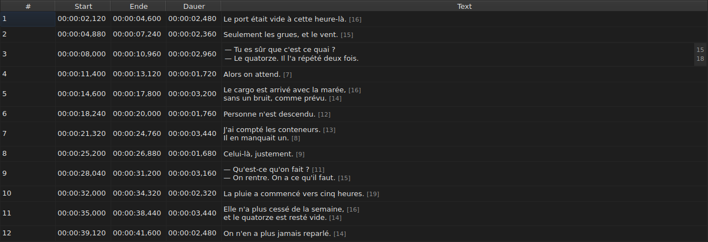

# Eine Zelle bearbeiten

<!-- machine-translated -->
> Diese Seite ist eine maschinelle Übersetzung und wurde noch von keiner Leserin und keinem Leser dieser Sprache geprüft.

Vier Spalten werden direkt an Ort und Stelle bearbeitet: `Start`, `End`, `Duration` und `Text` — fünf
mit der Spalte `Translation`, wenn das Projekt eine Übersetzung hat. `#` lässt sich nicht
bearbeiten — die Nummer ist der Rang der Zeile, keine Angabe der Datei.

**Den Editor einer Zelle öffnen:** Doppelklicken Sie darauf, oder wählen Sie sie aus
und drücken Sie `F2`.

## Der Text

**Die Übersetzung wird wie der Text bearbeitet**, mit demselben mehrzeiligen Feld und
denselben Regeln; nur die Zelle ändert sich, und der Haupttext bleibt, wie er
war. Ein Übernehmen, das nichts ändert, tut nichts, beim einen wie beim
anderen — siehe [unten](#ein-übernehmen-das-nichts-ändert-tut-nichts).

Der Editor ist ein **mehrzeiliges** Feld, und er öffnet sich in der Höhe des Untertitels:
Ein zweizeiliger Untertitel wird darin so eingetippt, wie er geschrieben wird, seine zwei Zeilen
lesbar und ohne Bildlaufleiste. Ein `Shift+Enter`, das eine Zeile hinzufügt, vergrößert
den Editor; die Zeile der Tabelle passt sich beim Übernehmen an.

| Taste | Wirkung |
| :-- | :----- |
| `Enter` | übernimmt und schließt den Editor |
| `Shift+Enter` | fügt einen Zeilenumbruch in den Text ein |
| `Esc` | schließt den Editor; die Zelle behält, was sie hatte |
| `Tab` | übernimmt und geht zur nächsten Zelle |

Ein Klick woandershin übernimmt ebenfalls: Der Verlust des Fokus ist so viel wert wie ein `Enter`.

**Elf Handgriffe ohne Dialog übernehmen ebenso**, bevor sie ihr Ziel berechnen:
`Italic`, `Groß-/Kleinschreibung ▸ …`, `Dialogue`, `Merge Subtitles`, `Split Subtitle`,
`Cut Texts`, `Paste Texts`, `Copy Texts`, `Remove Subtitles`, `Undo` und `Redo`.
Aus dem Menü, der Werkzeugleiste oder über ein Tastenkürzel des Fensters gestartet,
nehmen sie den Text so, wie der Editor ihn gerade übernommen hat, wie nach einem Klick
woandershin. `Ctrl+X`, `Ctrl+C` und `Ctrl+V` bleiben dennoch beim Editor, solange
er geöffnet ist — siehe [Texte ausschneiden, kopieren und einfügen](clipboard.md): Es ist dann das
Menü, das `Cut Texts`, `Copy Texts` und `Paste Texts` startet.

`Undo` und `Redo` lesen den Verlauf und nicht das Dokument: siehe
[Rückgängig und Wiederholen](undo.md). Ein Handgriff, der einen Dialog öffnet, braucht
diese Regel nicht, da der Dialog beim Öffnen den Fokus nimmt, was
die Eingabe bereits übernimmt.

### Die Tags sind die der Datei

Der angezeigte und eingetippte Text ist **der der Datei, Tags eingeschlossen**: Ein
`<i>…</i>` eines SubRip wird so geschrieben, und ein `{\i1}…{\i0}` eines Advanced SSA
ebenso. Nichts wird für die Anzeige übersetzt — die Tabelle von
[`Italic`](operations.md#italic) sagt, was jedes Format schreibt.

Für die Kursivschrift gibt es daher nichts zu wissen: `Ctrl+I` setzt das richtige Tag
für das geöffnete Dokument, und ein Format, das keines kennt — TMPlayer, LRC —,
deaktiviert den Eintrag, statt Sie suchen zu lassen. Fett und Unterstrichen werden
eingetippt, wie in Gaupol.

**Und die Tags folgen den Textoperationen nicht**: Einen Untertitel
in Kleinbuchstaben zu setzen, macht aus seinem `<I>` kein `<i>`, und ein Dialogstrich wird
vor den Text gesetzt und nicht vor ein öffnendes Tag. Siehe
[`Case` und `Dialogue`](operations.md#case-und-dialogue).

## Die Länge der Zeilen

**Der Texteditor zeigt in einem Rand rechts die Länge jeder
Zeile**, auf der Höhe der ersten Reihe dieser Zeile. Der Rand ist so breit
wie die größte Zahl, aktualisiert sich **beim Tippen** und folgt dem Bildlauf.
Ein leerer Text zeigt nichts. Die Längen sind die der Tabelle — ohne die
Tags, abgerundet, in der eingestellten Einheit — und werden mit dem
Kontrollkästchen `Show line lengths in the editor` von `Bearbeiten ▸ Einstellungen …` entfernt. Siehe
[Zeilenlängen](preferences.md#zeilenlängen).

## Der Beginn und das Ende

Der Editor ist ein einzeiliges Feld, **an die Form eines Zeitstempels gebunden**:
Er lehnt schon beim Tippen ab, was nie einer sein könnte.

Die angenommenen Formen sind die, die das Lesen einer Datei bereits annimmt:

| Element | Was durchgeht |
| :------ | :---------- |
| Felder | `MM:SS` oder `HH:MM:SS`, je eine oder zwei Ziffern |
| Dezimalstellen | eine bis drei, nach einem Komma oder einem Punkt, oder keine |
| Vorzeichen | ein führendes `-`, für eine Position vor dem Beginn des Videos |
| Grenzen | Minuten und Sekunden unter 60 |

`00:01:02,500`, `1:02.5` und `-0:01,000` sind daher drei gültige Eingaben.

**Eine Eingabe, die das Lesen ablehnt, lässt die Zelle unverändert.** Das ist der Fall
bei `00:70:00,000`, dessen Form stimmt, dessen Minuten aber außerhalb der
Grenzen liegen: Der Editor schließt sich, und nichts hat sich bewegt. Keine Position wird erfunden
— sich bei einer Position zu irren, geschieht lautlos, nichts auf dem Bildschirm unterscheidet einen
schlecht getimten Untertitel von einem gut getimten.

Das Ändern eines Beginns oder eines Endes aktualisiert die `Duration` sofort.

## Die Dauer

**Das Eintippen einer Dauer verschiebt das Ende, und nie den Beginn**: Das Ende wird zu
`Start + Duration`. Den Beginn zu verschieben, würde den ganzen Untertitel verschieben, was
die Aufgabe von [`Shift Positions…`](operations.md) ist, und in die Spalte `Start` lässt sich
bereits tippen.

Die Dauer wird **in der Form eines Zeitstempels** eingetippt, der, die die Spalte
anzeigt, und die Formen der Tabelle oben gelten — mit einem Unterschied:

| Element | Beginn, Ende | Dauer |
| :------ | :--------- | :------- |
| Form | die eines Zeitstempels | dieselbe |
| führendes Vorzeichen `-` | angenommen | **beim Tippen abgelehnt** |

`0:02.5` und `00:00:02,500` sind daher zwei gültige Eingaben einer Dauer von zweieinhalb
Sekunden; `-0:01,000` lässt sich nicht eintippen. Eine Dauer von null wird angenommen:
Der Untertitel verschwindet dann im selben Augenblick, in dem er erscheint.

**Ein Ende, das über den nächsten Untertitel hinausgeht, ist erlaubt.** Die
Überschneidung wird in der Tabelle eingefärbt, mit ihrem Tooltip — siehe
[Die Tabelle](table.md#die-auffälligkeiten) — ein Hinweis, keine Ablehnung: Es kann sein, dass Sie
genau das wollten. Die [Liste der Diagnosen](files.md#die-diagnosen-beim-lesen)
führt sie ebenfalls, und entfernt sie, wenn Sie sie korrigiert haben.

**Ein Ende, das über das Ende des Films hinaus eingetippt wird, wird nicht gemeldet**, anders als
bei einer Operation des Menüs `Tools`, die es dorthin schieben würde — siehe
[Die Operationen](operations.md#über-das-ende-des-films-hinaus). Eine Zelle zeigt bereits
den Wert, den Sie gerade eingetippt haben.

Eine unlesbare Eingabe lässt die Zelle unverändert, wie bei einer Position, und
eine Dauer, die der angezeigten gleicht, kommt nicht in den Verlauf.

## Ein Übernehmen, das nichts ändert, tut nichts

Öffnen Sie eine Zelle, tippen Sie nichts, drücken Sie `Enter`: Nichts geschieht.
Keine Änderung wird aufgezeichnet, und die Datei gilt weiterhin als identisch mit
der auf der Festplatte.

Verglichen wird die **Position**, nicht die Zeichenkette: `0:01.0`
in eine Zelle einzutippen, die `00:00:01,000` anzeigt, bezeichnet denselben Augenblick und
ändert daher ebenfalls nichts.

## Was aus einer bearbeiteten Zelle wird

Sie **lässt sich rückgängig machen** — eine Zelle, ein Eintrag. Siehe
[Rückgängig und Wiederholen](undo.md).

Sie **wird gespeichert**, und das Fenster zu schließen, ohne das getan zu haben, verlangt eine
Bestätigung. Siehe [Öffnen und Speichern](files.md).
