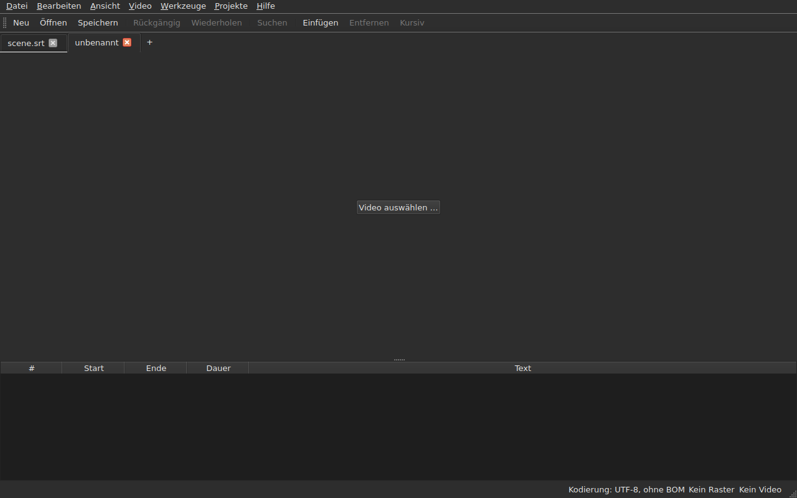
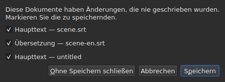
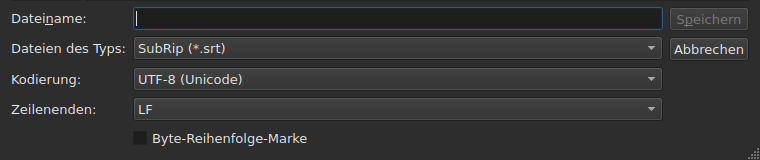
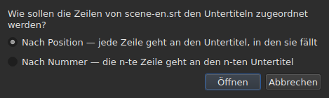
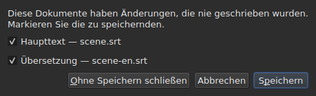

# Öffnen und Speichern

<!-- machine-translated -->
> Diese Seite ist eine maschinelle Übersetzung und wurde noch von keiner Leserin und keinem Leser dieser Sprache geprüft.

Das Menü **Datei** enthält die drei Befehle, zwei für die Tabs und drei
weitere für die Übersetzung; das Menü **Projekte** wirkt auf alle Tabs zugleich.

| Befehl | Tastenkürzel | Was er tut |
| :------ | :------- | :----------- |
| Neues Projekt | `Ctrl+N` | ein leeres Projekt, in einem neuen Tab — auch die Schaltfläche `+` nach dem letzten Tab |
| Öffnen … | `Ctrl+O` | wählt eine Datei und öffnet sie in einem neuen Tab — oder anstelle eines unberührten Projekts |
| Übersetzung öffnen … | — | wählt eine Übersetzungsdatei und ordnet sie der Hauptdatei des aktuellen Tabs zu |
| Speichern | `Ctrl+S` | schreibt die geöffnete Datei neu |
| Speichern unter … | `Ctrl+Shift+S` | wählt einen Pfad und ein Format, dann schreibt er |
| Übersetzung speichern | — | schreibt die Datei der Übersetzung neu |
| Übersetzung speichern unter … | — | wählt einen Pfad und ein Format für die Übersetzung, dann schreibt er |
| Schließen | `Ctrl+W` | schließt den aktuellen Tab — deaktiviert, wenn es nur einen gibt |

`New Project`, `Open…` und `Save` stehen auch in der
[Werkzeugleiste](index.md#die-werkzeugleiste), unter den Wörtern `New`, `Open` und
`Save`. **Die drei Einträge der
Übersetzung stehen nicht in der Leiste**: Sie dienen nur denen, die eine
Übersetzung haben, und die Leiste gehört allen.

## Mehrere Projekte, in Tabs

**Jedes geöffnete Projekt hat seinen Tab**, über dem Bild und der Tabelle:
Seine Beschriftung ist der Name der Datei, oder `untitled` für ein Projekt, das noch
keinen hat. Ein Klick auf einen Tab wechselt zu ihm; `Ctrl+PageDown` und `Ctrl+PageUp` tun
dasselbe, ohne Maus, und kehren nach dem letzten Tab zum ersten zurück.
**Die Schaltfläche `+`, direkt nach dem letzten Tab**, öffnet ein leeres Projekt in einem
neuen Tab, wie `New Project`.




**`Open…` rührt sie nie an.** Eine Datei zu öffnen, ersetzt nicht mehr, was das
Fenster zeigte: Sie kommt in einem neuen Tab daneben an, und der Tab, den Sie
vorher betrachteten, behält alles, was er hatte — seinen Verlauf, seine Auswahl, sein
verknüpftes Video. Deshalb fragt das Öffnen auch nichts mehr: Es gibt
nichts zu verlieren, da es nichts zu ersetzen gibt.

**Eine Ausnahme: Das unberührte Projekt gibt seinen Platz ab.** Ohne Datei gestartet, oder
nach `New Project`, zeigt das Fenster ein Projekt `untitled`, in dem nichts ist.
Eine geöffnete Datei — über `Open…` wie durch Ablegen — **übernimmt dann seinen Tab,
an derselben Stelle der Leiste**, statt einen weiteren neben einem
nutzlosen Projekt zu öffnen. Ein Projekt ist unberührt, wenn es **keine Datei, keinen Untertitel,
nichts rückgängig zu machen oder zu wiederholen, keinen Film hat und nie geändert wurde**: Eine
einzige dieser Sachen genügt, damit es seinen Tab behält. Ein unberührtes Projekt, das nicht
der aktuelle Tab ist, wird nicht angerührt.

**Eine bereits geöffnete Datei wird nicht ein zweites Mal geöffnet.** `Open…` auf einer
Datei, die ein anderer Tab bereits enthält, gibt diesem Tab den Fokus zurück und sagt es
in der Statusleiste:

```text
premier.srt: already open
```

**Jeder Tab ist ein ganzes Projekt, unabhängig von den anderen**: Sein
Verlauf, seine Auswahl, sein verknüpftes Video und was sein letztes Lesen
angetroffen hat, werden nur gezeigt, wenn dieser Tab der aktuelle ist, und ändern sich
nicht, solange ein anderer es ist. **Eine Ausnahme, und sie steht in ADR
0033**: Der Videoplayer ist für das ganze Fenster einzig — ein einziger mpv-Prozess
— und sein Film wechselt mit dem Tab; **jeder Tab merkt sich, wo sein Film
stand**, und setzt ihn dort fort, angehalten, wenn Sie zu ihm zurückkehren. Die Zwischenablage hingegen gehört dem Fenster: In
einem Tab zu kopieren und in einem anderen einzufügen, ist das, wofür man zwei öffnet.

**`Close` schließt den aktuellen Tab** und stellt bei Bedarf
[die Frage der ungespeicherten Änderungen](#ungespeicherte-änderungen) —
die dieses Tabs allein, die anderen sind nicht betroffen. **Deaktiviert, wenn es
nur einen Tab gibt**: Das Fenster behält immer mindestens einen, und ihn zu schließen,
hieße das Fenster zu schließen — was die Schaltfläche des Systems bereits tut.

**Jeder Tab trägt außerdem ein Kreuz**, das **sein** Projekt schließt, mit derselben
Frage. Das Kreuz eines Tabs, der nicht der aktuelle ist, schließt diesen, und
der Tab, den Sie betrachten, bleibt angezeigt; hat dieses Projekt Änderungen, kommt sein
Tab für die Dauer der Frage nach vorn. **Kein Kreuz, wenn nur noch
ein Tab übrig ist**, aus demselben Grund, aus dem `Close` deaktiviert ist.

**Ein Tab sagt, dass er geändert ist**: Ein Stern folgt seinem Namen, `premier.srt*`,
solange eines seiner Dokumente von seiner Datei abweicht — wie es der Fenstertitel
über das Projekt sagt, das Sie betrachten. Er verschwindet beim Speichern.

## Das Menü Projekte

Zwei Befehle wirken auf alle Projekte zugleich.

| Befehl | Tastenkürzel | Was er tut |
| :------ | :------- | :----------- |
| Alle speichern | `Ctrl+Shift+L` | schreibt jedes geänderte Dokument, Tab für Tab |
| Alle schließen | `Ctrl+Shift+W` | schließt alle Projekte — das heißt das Fenster |

**`Save All` geht in der Reihenfolge der Tabs vor**, das Hauptdokument vor der Übersetzung.
Ein Dokument, das eine Datei hat, wird dort neu geschrieben, **ohne dass sein Tab nach vorn kommt**;
**ein Dokument, das keine hat, öffnet `Save As…`, eines nach dem anderen**, auf seinem Tab —
der einzige Fall, in dem `Save All` den Tab wechselt, damit das Fenster zeigt, um welches
Projekt es geht. **Das Abbrechen eines `Save As…` oder ein
Speichern, das scheitert, hält den Rest an**: Die folgenden Projekte werden nicht
angerührt, und ein Fenster sagt, was geschrieben wurde.

```text
Save All stopped: 1 of 3 documents saved
```

Wenn alles geschrieben ist, sagt es die Statusleiste — `2 documents saved`, oder
`Nothing to save`, wenn nichts geändert wurde. Hat ein `Save As…` einen
Tab nach vorn geholt, kehrt das Fenster danach zu dem zurück, in dem der Befehl
gestartet wurde.

**`Close All` und das Kreuz des Fensters sind ein und dasselbe**: Das Fenster
behält immer ein Projekt, und alle zu schließen, heißt es zu schließen. Sie stellen daher
**eine einzige Frage für alle Projekte**, dieselbe wie bei
[zwei geänderten Dokumenten](#schließen-mit-zwei-geänderten-dokumenten), mit einem Kontrollkästchen
je geändertem Dokument jedes Tabs:




**`Cancel` schließt nichts** und lässt nichts geschrieben zurück. `Save` schreibt die
angekreuzten Dokumente wie `Save All`: hinter ihrem Tab, außer einem Dokument ohne
Namen, dessen Tab für sein `Save As…` nach vorn kommt. Mit einem einzigen
geänderten Dokument über alle Projekte hinweg ist es die einfache Frage, die es schon immer
gab, auf seinem Tab gestellt. `Save All As…` gibt es nicht: Es wäre eine Folge von
`Save As…`, die `Save All` für die Dokumente ohne Namen bereits stellt, eines nach dem anderen.

## Öffnen

Der Dialog filtert **die neun gelesenen Formate**, mit je einem Eintrag, dazu einen ersten
Eintrag, der sie alle zeigt. Das Format wird dann **am Inhalt erkannt, nicht an
der Endung**: Eine `.txt`, die SubRip enthält, öffnet sich, und der Filter entscheidet
nichts — er blendet nur Dateien aus.

| Eintrag des Filters | Endung |
| :----------- | :-------- |
| `SubRip` | `.srt` |
| `WebVTT` | `.vtt` |
| `SubViewer 2` | `.sub` |
| `Sub Station Alpha` | `.ssa` |
| `Advanced SSA` | `.ass` |
| `MicroDVD` | `.sub` |
| `MPL2` | `.txt` |
| `TMPlayer` | `.txt` |
| `LRC` | `.lrc` |

**Zwei Endungen bezeichnen je zwei Formate** — `.sub` ist SubViewer 2 und
MicroDVD, `.txt` ist MPL2 und TMPlayer. Beim Öffnen hat das keine Folge,
da der Inhalt entscheidet; beim Speichern ist es der **Name**
des gewählten Eintrags, der das Format bestimmt, niemals sein Muster.

**Eine unlesbare Datei öffnet nichts.** Fehlend, vom System verweigert, in
einer Kodierung geschrieben, in der sich ihre Bytes nicht dekodieren lassen, oder in keinem bekannten
Format: Ein modales Fenster **nennt die Ursache**, kein Tab wird geöffnet, und die, die
offen waren, bewegen sich nicht.

| Meldung | Was geschehen ist |
| :------ | :------------ |
| `does not exist` | der Pfad bezeichnet keine Datei |
| `cannot be opened: permission denied` | das System verweigert das Öffnen |
| `cannot be read` | das System hat aus einem anderen Grund verweigert |
| `cannot be decoded in the chosen encoding` | die Bytes lassen sich in der gewählten Kodierung nicht lesen |
| `is in no format this tool knows` | kein Format erkennt den Inhalt |
| `holds nothing recognisable as a subtitle` | das Format wird erkannt, aber nichts darin ist ein Untertitel |

Der Meldung geht der Pfad voran: `notes.txt: is in no format this tool knows`.
Es sind die Worte der Befehlszeile, und das ist kein Zufall — beide
Oberflächen lesen eine Datei nach demselben Rezept.

### Dateien auf dem Fenster ablegen

**Dateien, die irgendwo auf dem Fenster abgelegt werden, werden geöffnet**, aus dem
Dateimanager: die Tabelle, die Tab-Leiste, die
Schaltfläche `Select Video…` und **das Bild des Films selbst**, beim Abspielen wie im Stillstand.
Das Bild ist ein eigenes, vom Player gezeichnetes Fenster, bei dem nichts garantierte,
dass es ein Ablegen weiterreicht; das wurde von Hand auf einer echten Arbeitsumgebung geprüft,
in einer Wayland-Sitzung. `subedit-gui` wird dort unter X11 gestartet, um den
Film zeigen zu können, sodass das Ablegen über das X11-Protokoll läuft — das einer
X11-Sitzung, in der es nicht gesondert ausprobiert wurde.

- **Jede Untertiteldatei öffnet ihren Tab**, in der Reihenfolge, in der sie
  abgelegt wurden — genau wie `Open…`. Eine **bereits geöffnete** Datei wird nicht
  erneut gelesen: Ihr Tab kommt nach vorn, und die Statusleiste sagt es
  (`premier.srt: already open`).
- **Ein abgelegtes Video wird mit dem aktuellen Tab verknüpft**, wie durch
  `Select Video…`. Zusammen mit Untertiteln abgelegt, geht es an den letzten Tab,
  den sie geöffnet haben, unabhängig von der Reihenfolge des Ablegens. Ein Video wird an
  seiner Endung erkannt — dieselbe Liste wie die, die einen Film neben der
  Datei vorschlägt.
- **Zwei oder mehr Videos auf einmal werden nicht geöffnet**: Ein Projekt sieht sich
  einen einzigen Film an. Die Untertitel desselben Ablegens hingegen öffnen sich.
- **Eine Datei, die sich nicht öffnet, hält die anderen nicht auf.** Ein einziges Fenster sagt dann,
  was nicht getan werden konnte, eine Zeile je Datei, mit den Worten
  von `Open…`:

  ```text
  /films/notes.txt: is in no format this tool knows
  /films/absent.srt: does not exist
  ```

Nur lokale Dateien werden angenommen: Ein aus einem Browser gezogener Link
bezeichnet nichts, was das Fenster lesen kann.

Das Öffnen von der Befehlszeile aus funktioniert weiterhin: `subedit-gui film.srt`.
Dort wird derselbe Grund auf den Fehlerkanal geschrieben, und das Fenster öffnet sich
leer — siehe [Aufruf](invocation.md#wenn-das-öffnen-scheitert).

## Die Diagnosen beim Lesen

Eine echte Datei ist selten perfekt, und das Lesen stellt wieder her, statt
aufzugeben: eine fehlende Nummer, eine Zeile, die nirgendwohin gehört, gemischte
Zeilenenden. **Was es angetroffen hat, passt in eine Schaltfläche der Statusleiste**
— `2 diagnostics`, links von dem, was die Leiste bereits über das Dokument sagt —, und **die Liste öffnet sich per Klick
in einem schwebenden Fenster** über der Schaltfläche. Dafür wird keine Zeile des Fensters belegt:
Die Tabelle behält ihre volle Höhe, ob das Lesen etwas zu sagen hatte oder nicht. Die Liste
schließt sich mit einem Klick woanders hin oder mit `Esc`.

```
a SubRip block without its number, settled by the reader: 5
```

**Jede Zeile zählt**: was angetroffen wurde, was damit geschah, und
wie oft. Eine schlecht gemachte Datei trifft auf Hunderte, und zu wissen,
wie viele von jeder Sorte, ist das, was Handeln ermöglicht; die Zeilennummer jedes Vorkommens in der
Datei hingegen liest man auf der Befehlszeile, in der Ausführlichkeitsstufe `-vvv`. Die
Schaltfläche zählt diese Zeilen — eine je Sorte —, nicht die Vorkommen.

**Die erratene Kodierung erscheint dort auch**, einmal: Sie wurde durch Abwägen der
Bytes vorgeschlagen, bevor auch nur eine Zeile der Datei existierte.

```
an encoding nothing declared, settled by the reader: 1
```

Sie wird nur angezeigt, wenn die Kodierung **erraten wurde und nicht
UTF-8 ist** — eine als solche gelesene UTF-8-Datei ist kein Ereignis, und es bei
jedem Öffnen zu sagen, würde eine Schaltfläche in die Statusleiste jedes gewöhnlichen
Dokuments setzen. Eine Datei, die eine Byte-Reihenfolge-Marke trägt, löst sie
ebenfalls nicht aus: Sie hat ihre Kodierung angegeben, nichts wurde erraten.

**Dieselbe Liste zählt auch, was an den Untertiteln selbst falsch ist**: ein
Untertitel, der beginnt, bevor der vorherige geendet hat, ein Ende vor seinem
Beginn, ein Beginn vor dem des Untertitels darüber. Die Tabelle färbt sie ein, aber
eine Einfärbung findet man durch Scrollen, und in einer Datei von zweitausend Zeilen
übersieht man leicht eine; hier stehen die Sorten alle beisammen, **eine je
Zeile und mit ihrer Anzahl**, in den Worten des Berichts von `inspect`:

```
subtitle starts before the previous one ends: 12
subtitle starts before the previous one starts: 3
```

**Ein Klick auf eine führt zum ersten betroffenen Untertitel**, ausgewählt in der
Tabelle. Diese Zeilen **folgen den Korrekturen** — das Ordnen oder das Korrigieren einer Dauer
entfernt einige oder senkt ihre Anzahl —, ohne die Liste zu schließen, die Sie
lesen. Ein Untertitel kann zweimal gezählt werden: vor dem Ende des
vorherigen und vor dessen Beginn anzufangen, sind zwei Befunde, die auf zwei
Arten korrigiert werden. Um sie einzeln zu nennen: `subedit-cli inspect --detail`.

Die Schaltfläche **erscheint nicht**, wenn es nichts zu melden gibt, weder beim Lesen noch
in den Untertiteln, und **sie folgt dem Tab**: Jedes Projekt behält die
Diagnosen seines eigenen Lesens, und die Schaltfläche zeigt die des angezeigten Projekts.

## Die Kodierung in der Statusleiste

**Die Statusleiste nennt immer die Kodierung des geöffneten Dokuments**, links von dem, was
sie über das [Bildraster](frame-grid.md) und das
[verknüpfte Video](video.md) sagt:

| Situation | Was geschrieben wird |
| :-------- | :-------------- |
| die Datei wurde als UTF-8 gelesen, ohne Marke | `Encoding: UTF-8, no BOM` |
| … mit einer Marke | `Encoding: UTF-8, BOM` |
| eine Datei in Latin-1 | `Encoding: ISO-8859-1, no BOM` |

**Die Diagnose und diese Zeile beantworten nicht dieselbe Frage**, und deshalb
gibt es beide. Die Diagnose sagt, was das Lesen **getan hat** — es
hat geraten, und Sie wollen es vielleicht prüfen; sie wird daher nur angezeigt, wenn
geraten wurde. Die Statusleiste sagt, was das Dokument **ist**,
dauerhaft, auch für eine Datei, die ihre Kodierung selbst angibt und über
die das Lesen nichts zu berichten hat.

**Woher die Antwort kommt, erscheint dort nicht.** `inspect` nennt es — `detected`,
`from its byte order mark`, `as asked for` —, weil ein Bericht Platz hat, es
zu sagen; eine Zeile der Statusleiste hat ihn nicht, und die Liste der Diagnosen enthält es bereits, wenn es
darauf ankommt.

## Speichern

`Save` schreibt die geöffnete Datei **in ihrer ursprünglichen Form** neu: ihr Format, ihre
Kodierung, ihre Zeilenenden, ihre Byte-Reihenfolge-Marke und ihr Kopf. Eine
geöffnete und ohne Änderung gespeicherte Datei bewegt sich um kein Byte — siehe
die genaue Garantie weiter unten.

Das Schreiben ist **atomar**: Es geht über eine temporäre Datei, die über die
alte umbenannt wird. Ein in jedem beliebigen Moment unterbrochenes Speichern lässt die vorherige Version
unversehrt.

Ein Dokument zu speichern, das nie auf dem Datenträger war, läuft auf `Save As…` hinaus.

**Ein Schreiben, das scheitert, sagt es und verliert nichts**: ein voller Datenträger, eine
schreibgeschützte Datei, ein fehlendes Verzeichnis — oder **ein Zeichen, das die Kodierung der Datei
nicht schreiben kann**, ein `ł` in einer Latin-1-Datei. Die Meldung lautet
dann `holds a character the chosen encoding cannot write`, und nichts wird
geschrieben: Das Zeichen durch ein `?` zu ersetzen, würde Text vor den Augen dessen verlieren, der
ihn gerade getippt hat. Die Meldung nennt die Datei und den Grund, das Fenster behält
seine Änderungen, und die Markierung im Titel bleibt.

## Speichern unter

`Save As…` fragt nach einem Pfad, einem Format **und der Form der geschriebenen Bytes**:
der Kodierung, den Zeilenenden, der Byte-Reihenfolge-Marke. Das Dokument **lebt dann
dort**: Der Titel ändert sich, `Save` zielt auf die neue Datei und schreibt in der
gewählten Form, und die ursprüngliche Datei bleibt, wie sie war.

**Die neun Formate werden angeboten**, und der beim Öffnen des Fensters
ausgewählte Eintrag ist **der des Dokuments**. Unter einem anderen Namen zu speichern, ohne den
Filter anzurühren, ändert das Format daher nicht.




**Die Bilder zeigen nur den unteren Teil des Fensters**, nicht die Liste der Dateien
darüber: Die hängt vom Rechner ab — seinen Verzeichnissen, seinen Daten, seinen
seitlichen Verknüpfungen —, sodass ihr Foto nie zweimal dasselbe wäre.
Dieser Streifen ist es, und dort geschieht alles.

| Feld | Was es anbietet | Standard |
| :---- | :------------- | :------ |
| `Encoding` | vierzehn Kodierungen, die eine Untertiteldatei in der Praxis trägt, dazu `Other…` | **die der gelesenen Datei** |
| `Other…` | ein Feld, um jede Kodierung einzugeben, die ICU schreiben kann, **mit Vervollständigung** — `cp1257`, `EUC-KR` | — |
| `Line endings` | `LF`, `CRLF` oder `CR` | die der gelesenen Datei |
| `Byte order mark` | die Marke, **deaktiviert für eine Kodierung, die keine trägt** | die der gelesenen Datei |

**Die Standardwerte sind die der gelesenen Datei, und das ist eher eine Garantie als eine
Bequemlichkeit**: Eine geöffnete und wieder gespeicherte Datei, bei der diese drei
Felder nicht angerührt wurden, ergibt dieselben Bytes.

**Die Liste ist kurz, und sie ist keine Obergrenze.** ICU kennt
zweihunderteinundzwanzig; was das Menü anbietet, ist das, was eine Untertiteldatei in der Praxis
trägt, denn ein Menü mit zweihundert Einträgen hilft niemandem. `Other…`
öffnet den Rest.

**Das Feld vervollständigt über alle zweihunderteinundzwanzig**, sodass man den
genauen Namen nicht kennen muss: `1252` einzugeben, schlägt `windows-1252` vor, `koi` einzugeben,
schlägt `KOI8-R` und `KOI8-U` vor. Vervollständigt wird nach dem, was der Name **enthält**,
und nicht nach dem, womit er beginnt — der kanonische Name von Windows Westeuropäisch ist
`windows-1252`, und `cp1252` ist der, den man im Kopf hat. Beide lassen sich
auch ohne Vervollständigung vollständig schreiben: ICU nimmt seine eigenen Aliase an.

**Ein Name, den niemand kennt, schreibt nichts.** `klingon-1` einzugeben, fällt nicht
auf UTF-8 zurück: Nichts wird geschrieben, und die Meldung sagt es.

**Ebenso wenig ein Name, der seine Byte-Reihenfolge nicht angibt.** `UTF-16` und `UTF-32` sind
Namen, die ICU kennt, deren Konverter **seine eigene Marke** schreibt: Das
Kontrollkästchen `Byte order mark` würde dann nichts mehr entscheiden. Beide
werden abgelehnt, und die Meldung verweist auf `UTF-16LE` oder `UTF-16BE`, die
dieselben Bytes unter der Kontrolle des Kontrollkästchens schreiben. Es ist dieselbe Ablehnung, mit
denselben Worten, wie die der Befehlszeile.

**Ein Zeichen, das die gewählte Kodierung nicht schreiben kann, hält das Speichern an**
— ein `ł` in Latin-1. Die Meldung lautet
`holds a character the chosen encoding cannot write`, das Fenster behält seine
Änderungen, und die Zieldatei wird nicht angerührt.

**Auch das Dokument bewegt sich nicht**: Es bleibt auf seiner Datei, in seinem
Format und seiner Kodierung, und das nächste `Save` schreibt die neu, die geöffnet wurde.
Ein Speichern, das nicht stattgefunden hat, ändert überhaupt nichts — weder auf dem Datenträger
noch im Fenster.

Das Format zu wechseln, ändert, was die Tabelle zeigt — das Dezimaltrennzeichen folgt dem
Format, ein Komma für SubRip, ein Punkt für WebVTT, und **die Tags werden im
Vokabular des Zielformats neu geschrieben**: Ein `<i>` wird zu `{\i1}` in Sub
Station Alpha, zu `{Y:i}` in MicroDVD, zu `/` am Zeilenanfang in MPL2. Das Dokument
**ist zu dieser Datei geworden**, also zeigt die Tabelle, was die Datei trägt.

**Es ist kein Befehl, und `Ctrl+Z` macht es nicht rückgängig.** Ein Dokument, dessen
Format LRC sagte und dessen Texte noch `<i>` sagten, wäre ein
widersprüchliches Dokument; es gibt keine Hälfte rückgängig zu machen.

## Was ein Format nicht übernimmt, vor dem Schreiben gesagt

**Ein modales Fenster warnt, und Sie können noch Nein sagen.** Es zählt auf, was das
Zielformat nicht aufnehmen wird, Punkt für Punkt, mit den Worten, die die
Befehlszeile danach schreibt:

```
ends are not carried by LRC, line breaks were joined in 2 subtitles, 1 tag dropped
```

| Schaltfläche | Wirkung |
| :----- | :----- |
| `Save` | schreibt trotzdem, der Verlust ist hingenommen |
| `Cancel` | schreibt nichts; das Dokument bewegt sich nicht, weder Datei noch Format |

`Cancel` ist die Standardschaltfläche: Eine ohne Lesen gedrückte Eingabetaste behält die
Datei, wie sie ist.

**Nichts wird gefragt, wenn nichts verloren geht.** Ein Fenster, das „nichts
geht verloren“ ankündigte, würde Sie lehren, das wegzuklicken, auf das es ankommt.

Was angekündigt werden kann:

| Punkt | Wann |
| :--- | :--- |
| die Enden | das Zielformat trägt keine — TMPlayer, LRC |
| die Zeilenumbrüche | das Zielformat trägt keine — LRC |
| die Tags | ein Tag der Quelle hat keine Entsprechung im Ziel, oder der Pivot kennt es nicht |
| der Kopf | die gelesene Datei trug einen, und er kommt nicht hinüber |
| die angegebenen Felder | die Reihenfolge der SSA-Spalten, die Form der TMPlayer-Zeit |
| die Genauigkeit | das Zielformat zählt gröber — die Zehntelsekunde von MPL2, die Sekunde von TMPlayer |

**Was zum anderen Format gehört, wird übergangen.** Eine WebVTT-Datei
trägt Cue-Kennungen und Platzierungseinstellungen; SubRip trägt
Anzeigekoordinaten. Im anderen Format zu schreiben, ignoriert sie, statt
sie aufs Geratewohl zu übersetzen — sie gehen deshalb nicht verloren, sie werden einfach
nicht geschrieben.

## Die Garantie des Hin- und Rückwegs

Sie hat zwei Hälften, und beide sind nötig:

- **Byte für Byte treu** bei einer Datei, die bereits das Layout hat, das
  `subedit` schreibt — das von Gaupol, abschließende Leerzeile inbegriffen —, und **unabhängig
  von ihrer Kodierung**: Eine Datei in CP1252 oder in UTF-16 wird in
  ihrer eigenen neu geschrieben, Marke inbegriffen;
- **idempotent** andernfalls: Das erste Speichern normalisiert das Layout,
  danach rührt keines mehr etwas an.

Konkret erhält eine Datei, deren letzter Block nicht von einer Leerzeile gefolgt wird,
eine, einmal. Das ist die einzige Änderung, die ein Speichern ohne
Änderung hervorbringen kann.

## Öffnen einer Übersetzung

`Datei ▸ Übersetzung öffnen …` stellt eine **zweite Datei** neben die Hauptdatei.
Der Eintrag ist deaktiviert, solange es keinen Untertitel gibt, dem die Zeilen
der Übersetzung gegeben werden können.

**Zwei Fragen, eine nach der anderen.** Die Dateiauswahl, die von
`Open…` — derselbe Filter, derselbe Startordner, die Kodierung erkannt wie bei der
Hauptdatei — dann **die Zuordnungsmethode**:




| Methode | Was sie tut |
| :----- | :----------- |
| `By position` (Standard) | jede Zeile geht an den Untertitel, in den ihre Mitte fällt |
| `By number` | die n-te Zeile geht an den n-ten Untertitel, ohne auf die Positionen zu achten |

**Die Position ist der Standard**, denn eine einzige fehlende Zeile in der Mitte lässt
*alle* folgenden nach Nummer verrutschen, während nach Position ein einziger
Untertitel ohne Übersetzung bleibt.

**Was getan wird, was geschrieben wird:**

- die Texte der zugeordneten Zeilen kommen in die Spalte `Translation`, die
  erscheint;
- **eine Zeile, die keinen Untertitel findet, bringt einen hervor**, mit **den
  Positionen dieser Zeile** — bei beiden Methoden;
- **nichts wird geordnet**, weder die Datei noch das Dokument: Die Zeilen werden
  in zeitlicher Reihenfolge durchlaufen, und die Anzahl derer, die nicht darin standen, wird genannt;
- **eine bereits geöffnete Übersetzung wird ersetzt**, alle ihre Texte zuerst gelöscht.

**Was geschehen ist, wird gesagt.** Wenn jede Zeile ihren Untertitel gefunden hat und
keiner allein geblieben ist, schreibt es die Statusleiste; andernfalls **ein zu schließendes Fenster**,
wie bei jedem Handgriff, der etwas zu sagen hat:

```text
translation: 3 lines attached
translation: 2 lines attached; 1 subtitle left without a translation
translation: 3 lines attached; 1 subtitle born of a line; 2 lines out of order
```

Die Punkte werden nur geschrieben, wenn sie nicht null sind: die zugeordneten Zeilen, die
aus einer Zeile hervorgegangenen Untertitel, die, die keine Zeile erreicht hat, die Zeilen außerhalb
der Reihenfolge. Eine Datei ganz ohne Zeile sagt es
(`translation: the file holds no line`), statt es den
Untertiteln anzulasten.

**Eine verschobene Übersetzung wird erkannt und verschoben neu geöffnet.** Eine Übersetzung, die zwei
Sekunden zu spät liegt, wird den falschen Untertiteln zugeordnet, ohne dass etwas sie von einer
korrekten Zuordnung unterscheidet. Wenn das Öffnen **nach Position** nicht sauber ist, sucht das Fenster
**eine konstante Verschiebung**: Die Abstände zwischen dem Beginn jeder Zeile und dem der Untertitel
um sie herum liefern Kandidaten, auf zehn Millisekunden gruppiert, und **jeder
wird durch genau die Zuordnung des Öffnens beurteilt**. Macht eine einzige Verschiebung das Öffnen
sauber, sagt es das Fenster nach seiner Zählung und **bietet an, verschoben neu zu öffnen**:

```text
translation: 4 subtitles born of a line; 4 subtitles left without a translation
the lines sit 2.000 s later than the subtitles; moved back, 4 lines would attach instead of 0
```

`Yes` macht das Öffnen rückgängig und wiederholt es mit den um diese Verschiebung zurückversetzten Zeilen; `No`, die
Standardantwort, lässt das Öffnen, wie es ist. **Das Ergebnis ist ein einziger Eintrag im
Verlauf**: Ihn rückgängig zu machen, gibt alles zurück, wie bei jedem Öffnen.

**Nichts wird vorgeschlagen, wenn die Verschiebung nicht konstant ist** — ein Abdriften, eine Verschiebung, die
nur einen Teil der Datei betrifft —, wenn zwei Verschiebungen das Öffnen gleich
sauber machen würden, oder wenn keine es sauber macht: Der Satz sagt dann nicht, dass es eine gibt. Ebenso wenig
nach Nummer, wo die Positionen nicht beachtet werden. Es gibt **keine Befehlszeile**
dafür.

**Das Öffnen einer Übersetzung ist ein einziger Eintrag im Verlauf**, `Undo: opening a translation`,
und es rückgängig zu machen, gibt alles zurück: die Texte, die hervorgegangenen Untertitel entfernt,
die Datei der Übersetzung gelöst — die Spalte verschwindet mit ihr. Um sie mit
der anderen Methode zu öffnen, machen Sie zuerst rückgängig.

**Die gerade geöffnete Übersetzung ist nicht geändert**: Nichts wurde getippt, und
sie zu schließen, bietet nicht an, sie zu speichern. Wenn Untertitel hervorgegangen sind, ist es das
Hauptdokument, das geändert ist.

**Eine geänderte Übersetzung wird zum Speichern angeboten, bevor sie
ersetzt wird**, mit den drei Möglichkeiten des Abschnitts über
[ungespeicherte Änderungen](#ungespeicherte-änderungen).

| Meldung | Was geschehen ist |
| :------ | :------------ |
| `the file is already open as the main document` | die gewählte Datei ist das Hauptdokument selbst, wie auch immer sein Pfad geschrieben ist |
| `does not exist`, `cannot be decoded in the chosen encoding`, … | dieselben Ursachen wie bei `Open…` |

Der Meldung geht der Pfad voran, und **nichts ändert sich**: Das Fenster behält seinen
Verlauf und seine Änderungen.

**Die Probleme, auf die das Lesen gestoßen ist**, falls es welche gibt — eine reparierte Zeile,
ein ignoriertes Feld —, kommen in die Liste der Diagnosen, die
[des letzten Lesens](#die-diagnosen-beim-lesen).

**Was die Übersetzung nicht behält**: die Einstellungen **je Untertitel** ihrer
Datei — einen SSA-Stil, die Position eines WebVTT-Untertitels. Ein Untertitel
trägt nur einen Satz davon, den des Hauptdokuments; sie werden weder zurückgelesen noch neu geschrieben.

## Speichern der Übersetzung

**Jedes Dokument wird getrennt gespeichert**, in seiner Datei, seinem Format, seiner
Kodierung und seinen Zeilenenden: Eine Übersetzung in `.ass` unter einer Hauptdatei in
`.srt`, in Windows-1252 unter einer Hauptdatei in UTF-8, kommt zurück, wie sie ist.

| Eintrag | Was er tut |
| :---- | :----------- |
| `Save Translation` | schreibt die Datei der Übersetzung neu — die, aus der sie stammt |
| `Save Translation As…` | die Auswahl von `Save As…`, geöffnet auf der Datei **der Übersetzung**, mit ihrem Format und ihrer Kodierung |

Beide sind **deaktiviert, solange das Projekt keine Übersetzung hat**.
`Save Translation As…` ist `Save As…` auf dem anderen Dokument: dieselben Felder, dieselbe
[Verlustwarnung](#was-ein-format-nicht-übernimmt-vor-dem-schreiben-gesagt), die
zählt, **was die geschriebene Datei verlieren würde** — die Tags des Haupttextes
sind nicht die der Übersetzung, und ein Format, das keine Kursivschrift schreibt,
beschwert sich darüber nur, wenn die Übersetzung welche hat.

**Jedes Dokument hat seinen eigenen Änderungsstand.** Das Hauptdokument zu speichern, lässt die
Übersetzung geändert, und umgekehrt; **der Fenstertitel ist geändert, wenn eines der
beiden es ist**, und er hat nur ein Sternchen.

**Nichts vom einen berührt das andere**: Die Übersetzung zu speichern, schreibt nicht das
Hauptdokument und ändert weder seine Datei noch sein Format noch seine Texte.

## Schließen mit zwei geänderten Dokumenten

Den aktuellen Tab oder das Fenster zu schließen, während **zwei Dokumente** oder mehr
von ihren Dateien abweichen, stellt **eine einzige Frage**, mit einem Kontrollkästchen je
Dokument:




| Schaltfläche | Was geschieht |
| :----- | :----------- |
| `Save` | schreibt die Dokumente, deren Kontrollkästchen angekreuzt ist, und fährt dann fort — deaktiviert, wenn keines es ist |
| `Close Without Saving` | verliert beide, unabhängig von den Kontrollkästchen |
| `Cancel` | nichts geschieht; das Fenster bleibt, wie es war |

**Ein Dokument abzuwählen, heißt es zu verlieren**: `Save` schreibt die anderen und fährt
fort. **Scheitert ein Speichern, geht die Aktion nicht weiter.** Das
Fenster zu schließen, ohne zu antworten, gilt als `Cancel`.

**Mit einem einzigen geänderten Dokument ist die Frage die, die es schon immer gab**,
unten beschrieben, und der Satz sagt, welches: `The translation has changes that were never written.`
oder `The document has …`.

**Eine vom Datenträger verschwundene Datei zählt als geändert**, und die Liste sagt es —
`(file is gone from the disk)`: Was das Fenster enthält, ist dann **die einzige
Kopie**, und ohne zu schreiben zu schließen, würde sie zerstören. Mit einem einzigen Dokument in diesem Fall
lautet der Satz `The document is no longer where it was read from.`

## Ungespeicherte Änderungen

Das Fenster oder den aktuellen Tab zu schließen, oder eine Übersetzung zu öffnen, die
die bereits vorhandene ersetzen würde, während das Dokument von dem auf dem Datenträger abweicht, **verlangt eine
Bestätigung**, mit drei Möglichkeiten:

| Antwort | Was geschieht |
| :----- | :----------- |
| `Save` | das Dokument wird geschrieben, dann geht die Aktion weiter |
| `Discard` | die Änderungen gehen verloren, und die Aktion geht weiter |
| `Cancel` | nichts geschieht; das Fenster bleibt, wie es war |

Das Fenster zu schließen, ohne zu antworten, gilt als `Cancel`.

**Scheitert das Speichern**, geht die Aktion nicht weiter: Die Arbeit ist weder
geschrieben noch verloren.
