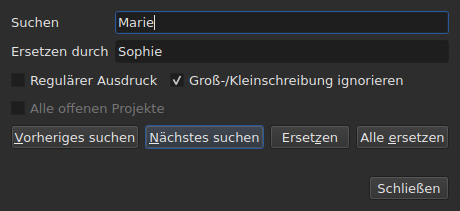
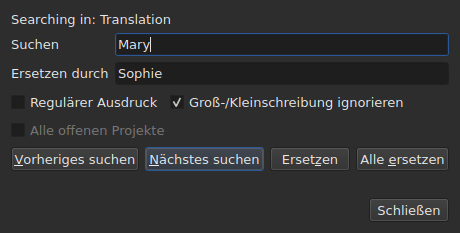

# Suchen und Ersetzen

<!-- machine-translated -->
> Diese Seite ist eine maschinelle Übersetzung und wurde noch von keiner Leserin und keinem Leser dieser Sprache geprüft.

`Bearbeiten ▸ Suchen und Ersetzen …`, oder `Ctrl+F`, öffnet den Suchdialog.




**Der Dialog ist nicht modal**: Er bleibt offen, während Sie die Tabelle ansehen,
eine Zelle bearbeiten, erneut suchen. `Close` schließt ihn; ihn erneut zu öffnen,
gibt ihn so zurück, wie Sie ihn verlassen haben, Muster und Ersetzung inbegriffen.

| Feld | Was es enthält |
| :---- | :-------------- |
| `Find` | das gesuchte Muster |
| `Replace with` | was es ersetzt |
| `Regular expression` | das Muster ist ein regulärer Ausdruck statt einfachen Textes |
| `Ignore case` | „marie“ findet „Marie“ |
| `All open projects` | die Suche geht durch alle Tabs — [siehe unten](#in-allen-offenen-projekten) |

Der Eintrag ist bei einem leeren Dokument deaktiviert: Es gibt nichts zu suchen.

## Die vier Handgriffe

| Schaltfläche | Was sie tut |
| :----- | :----------- |
| `Find Previous` | findet den vorherigen Treffer, und die Tabelle springt zu ihm |
| `Find Next` | findet den nächsten — es ist die Schaltfläche, die `Enter` drückt |
| `Replace` | ersetzt den gefundenen Treffer und findet dann den nächsten |
| `Replace All` | ersetzt alle Treffer des Ziels |

Alle vier sind deaktiviert, solange `Find` leer ist.

**Die Tabelle springt zum Treffer**, indem sie seine Zeile auswählt. Beim
letzten angekommen, beginnt `Find Next` wieder beim ersten; `Find Previous` tut dasselbe in
der anderen Richtung.

**`Replace` ohne gefundenen Treffer sucht zuerst**: Das erste Drücken
zeigt, was ersetzt werden wird, das nächste ersetzt es. So macht es
Gaupol.

## Was die Suche umfasst

**Die Auswahl, oder das ganze Dokument, wenn nichts ausgewählt ist** — die Regel des
Menüs `Tools`. Siehe [Die Operationen](operations.md#worauf-sie-wirken).

**Das Ziel wird beim ersten Handgriff festgelegt und beibehalten**, solange die Suche
weitergeht: `Find Next` wählt die Zeile eines Treffers aus, und diese
Auswahl verkleinert das Ziel nicht. **Wählen Sie selbst andere Zeilen aus,
ändert sich das Ziel** für den nächsten Handgriff.

Die Suche umfasst den Text der Untertitel; weder die Positionen noch die Nummer
werden durchsucht.

### In allen offenen Projekten

Das Kontrollkästchen **`All open projects`** erweitert den Bereich auf jeden Tab. **Deaktiviert, solange
nur ein Projekt offen ist** — es gibt nichts zu erweitern —, wird es aktiviert, sobald ein
zweiter Tab sich öffnet, und hebt seine Markierung selbst auf, wenn nur noch einer übrig ist.

**Angekreuzt zählt die Auswahl nicht mehr**: Jedes Projekt wird vollständig durchsucht,
in **dem Zieldokument** — dem der aktuellen Spalte, Haupttext oder
Übersetzung, wie bei einem einzelnen Projekt.

- **`Find Next` und `Find Previous` gehen von Tab zu Tab, in der Reihenfolge der
  Tabs.** Zuerst das angezeigte Projekt; wenn es keine Treffer mehr hat, das
  nächste, dessen Tab das Fenster anzeigt und dessen Zeile es auswählt.
- **Die Runde endet, wo sie begonnen hat**: Wenn die Suche über den letzten
  Tab hinausgeht, um zum ersten zurückzukehren — oder umgekehrt beim Aufwärtsgehen —, sagt es die
  Zeile des Dialogs, statt kommentarlos von vorn zu beginnen:

  ```text
  Search wrapped around
  ```

  Der Schritt danach ist ein gewöhnlicher Schritt, und die Zeile leert sich.
- **`Replace` ersetzt dort, wo die Suche steht**, und geht dann zum nächsten
  Treffer weiter, der in einem anderen Tab liegen kann.
- **`Replace All` geht durch alle Projekte** und **legt einen Eintrag im Verlauf
  je berührtem Projekt an**: Das Rückgängigmachen in einem Tab macht nur rückgängig, was dieser Tab
  erhalten hat. Die Zählung sagt, wie viele Projekte sich geändert haben, nicht nur, wie viele
  Ersetzungen es gab:

  ```text
  replaced 4 matches in 3 projects
  ```

  Ein Projekt, in dem das Muster fehlt, wird nicht angerührt und hat nichts rückgängig zu machen.
  **Kein Tab kommt in den Vordergrund**: Jedes Projekt erhält seine Ersetzungen
  hinter seinem Tab, der sein Sternchen bekommt, und der Tab, von dem der Handgriff
  ausging, bleibt angezeigt, mit seinem Film.

### In welchem Text

**Mit einer Übersetzung umfasst die Suche nur einen der beiden Texte: den
der Spalte der aktuellen Zelle** — die Übersetzung, wenn die aktuelle Zelle
in der Spalte `Translation` liegt, den Haupttext überall sonst. Es ist die
Regel aller Textoperationen, und es gibt keine zusätzliche Einstellung:
siehe [Der Text, auf den die Operationen zielen](table.md#der-text-auf-den-die-operationen-zielen).

**Der Dialog sagt, in welchem Text er sucht**, auf einer Zeile über
`Find`, und ändert sie, wenn die aktuelle Spalte wechselt — auch während er offen ist:




| Die aktuelle Zelle liegt in | Die Zeile sagt |
| :--------------------- | :------------ |
| der Spalte `Translation` | `Searching in: Translation` |
| jeder anderen Spalte | `Searching in: Main` |
| — das Projekt hat keine Übersetzung, oder die Spalte ist ausgeblendet | nichts: Die Zeile ist nicht da |

**Ersetzen schreibt in diesen Text, und nur in ihn.** `Replace` und `Replace
All` auf der Übersetzung lassen den Haupttext, wie er war, und
umgekehrt; `Undo` gibt zurück, was sie geschrieben haben. **Die Tags sind die des Formats
der Datei dieses Textes**: Eine Übersetzung in Advanced SSA wird mit ihrem
`{\i1}` gelesen, auch wenn der Haupttext ein SubRip ist. `Replace with` wird dort
in denselben Tags geschrieben.

**Die Tabelle bleibt in der Spalte, in der sie war.** `Find Next` wählt die Zeile
eines Treffers aus, ohne die aktuelle Zelle von einer Spalte in die andere zu verschieben:
Eine in der Übersetzung begonnene Suche geht in der Übersetzung weiter.

**Beide Texte zugleich zu durchsuchen, gibt es nicht**: Jeder Treffer
wäre ein Paar (Untertitel, Text), und die Tabelle hätte, um zu ihm zu springen,
keinen klaren Ort, an den sie gehen könnte. Sie suchen in einem und wechseln dann die Spalte.

**Was wieder von vorn beginnt**:

| Handgriff | Was vergessen wird |
| :------ | :---------------- |
| `Find`, `Replace with` oder eine Option ändern | der aktuelle Treffer und die Statuszeile |
| selbst andere Zeilen auswählen | das Ziel und der Treffer |
| die aktuelle Zelle von einem Text in den anderen verschieben — von `Text` nach `Translation`, oder umgekehrt | der Treffer: Er ist ein Ort in einem Text |
| eine andere Datei öffnen | das Ziel und der Treffer; der Dialog bleibt offen, Muster inbegriffen |

## Der durchsuchte Text ist der sichtbare Text

**Tags sind kein Text.** Die Suche nach `<i>` findet nichts, und die Suche nach
`Bonjour` findet ein durch ein Tag geschnittenes `<i>Bon</i>jour`.

**Die Ersetzung erfolgt im Text der Datei, ohne die Tags zu zerbrechen**:

| Text | Gesucht → an seine Stelle gesetzt | Was geschrieben wird |
| :--- | :-------------------------- | :-------------- |
| `<i>Bonjour</i>` | `Bonjour` → `Salut` | `<i>Salut</i>` |
| `<i>Bon</i>jour` | `Bonjour` → `Salut` | `<i>Salut</i>` |
| `<i>Bonjour</i> Marie` | `Bonjour Marie` → `Salut Sophie` | `<i>Salut Sophie</i>` |

Ein Tag, das ein Wort schneidet, umfasst das ganze Wort, und jeder Stil, der den
Treffer berührt, deckt die Ersetzung ab. **Die Tags, die der Treffer nicht
berührt, bleiben, wo sie sind**, selbst eines, das ein anderes Wort desselben
Untertitels schneidet: `Marie` in `<i>Bon</i>jour Marie` zu ersetzen, ergibt
`<i>Bon</i>jour Sophie`. Ein Wort besteht aus Buchstaben und Ziffern — ein geschütztes
Leerzeichen oder ein Anführungszeichen gehört nicht dazu. **`Replace with` wird in den Tags des
Zieltextes gelesen**: `<b>Salut</b>` dort in einem SubRip einzugeben, setzt das Wort fett.

## Die zwei Optionen

| Option | Standard | Was sie ändert |
| :----- | :------ | :-------------- |
| `Regular expression` | nicht angekreuzt | `.` sucht nicht mehr nach einem Punkt, sondern nach einem beliebigen Zeichen |
| `Ignore case` | angekreuzt | die Groß-/Kleinschreibung zählt nicht, Buchstaben mit Akzent inbegriffen: `élise` findet `Élise` |

Das sind die Standardwerte von Gaupol. **Beide werden gemerkt**, von einem Öffnen zum
nächsten und von einer Sitzung zur nächsten, in den Optionen `search.regex` und
`search.ignore-case` der [Einstellungsdatei](preferences.md#die-datei).

### Ein regulärer Ausdruck

Das Muster wird von ICU gelesen. Wie in Gaupol überquert `.` einen Zeilenumbruch, und `^`
und `$` gelten am Anfang und am Ende **jeder Zeile** eines Untertitels:
`^` durch `- ` zu ersetzen, setzt einen Strich vor jede Zeile.

In `Replace with`, und nur bei einem regulären Ausdruck:

| Geschrieben | Was es einsetzt |
| :------ | :----------- |
| `$1` bis `$9` | die Gruppe dieser Nummer; eine fehlende Gruppe setzt nichts ein |
| `$0` | den ganzen Treffer |
| `\n` | einen Zeilenumbruch |
| `\$`, `\\` | ein `$`, einen umgekehrten Schrägstrich |
| `\` gefolgt von einem beliebigen anderen Zeichen | dieses Zeichen: `\t` setzt ein `t` ein |

**`\1` ist keine Gruppe** und setzt eine `1` ein. Das ist die Syntax von Gaupol, das
seine Ausdrücke in Python liest; die hier ist die von ICU, das das Muster liest.

## Was der Dialog sagt

Unter den Schaltflächen sagt eine Zeile, was die Suche nicht tun konnte, oder was ein
`Replace All` getan hat:

| Situation | Was angezeigt wird |
| :-------- | :------------ |
| kein Treffer im Ziel | `"Sophie" not found` |
| ein regulärer Ausdruck, der sich nicht lesen lässt | `not a regular expression (U_REGEX_MISMATCHED_PAREN)` |
| `Replace All` hat ersetzt | `replaced 3 matches` |
| `Replace All` hat das Muster gefunden, aber die Ersetzung ändert keinen Text | `nothing to change` |

**Eine Suche, die nichts findet, rührt nichts an**: Die Auswahl bleibt, wo
sie war, und nichts kommt in den Verlauf.

**`not found` und `nothing to change` sagen nicht dasselbe.** `not found`
sagt, dass das Muster nirgends im Ziel ist. `nothing to change` sagt, dass es
da ist, aber die Ersetzung jeden Text lässt, wie er war — zum Beispiel
`Marie` durch `Marie` zu ersetzen. In beiden Fällen kommt nichts in
den Verlauf. Die Zahl von `replaced N matches` zählt die Treffer der
Untertitel, deren Text sich geändert hat.

## Was die Rückgängig-Aktion darüber sagt

| Handgriff | Was `Undo` anzeigt |
| :------ | :---------------- |
| `Replace` | `Undo: replacing` — einer je Ersetzung |
| `Replace All` | `Undo: replacing all` — **ein einziger Eintrag**, unabhängig von der Anzahl der Treffer |

Siehe [Rückgängig und Wiederholen](undo.md).
