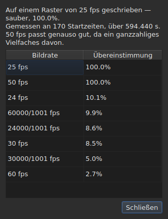

# Das Bildraster

<!-- machine-translated -->
> Diese Seite ist eine maschinelle Übersetzung und wurde noch von keiner Leserin und keinem Leser dieser Sprache geprüft.

Eine Untertiteldatei **gibt nicht an**, auf welche Bildrate hin
ihre Positionen berechnet wurden: SubRip hat keinen Kopf, der von
WebVTT ist freier Text. Das Fenster **leitet** sie aus den Positionen selbst **ab**,
beim Öffnen, und zeigt sie an zwei Stellen, die nicht dieselbe
Frage beantworten.

| Stelle | Was sie liefert |
| :------ | :------------ |
| die Statusleiste | **die Antwort**, dauerhaft und ohne gefragt zu werden |
| `Werkzeuge ▸ Bildratenanalyse …` | **die Begründung**, wenn Sie sie sehen wollen |

## Was die Statusleiste zeigt

Rechts, zwischen dem, was sie über die
[Kodierung](files.md#die-kodierung-in-der-statusleiste) der gelesenen Datei sagt, und dem, was
sie über das [verknüpfte Video](video.md#was-die-statusleiste-zeigt) sagt:

| Situation | Was geschrieben wird |
| :-------- | :-------------- |
| die Positionen liegen auf einem Raster | `Grid: 24 fps` |
| nur ein Teil von ihnen | `Grid: 29.97 fps (partial)` |
| kein bekanntes Raster passt | `No grid` |

**`No grid` nennt keine Bildrate, und das ist gewollt.** Die Menge der
Kandidaten ist geschlossen — die acht, die der Umrechnungsdialog anbietet —, und
die am wenigsten falsche von ihnen zu melden, hieße, eine falsche Antwort zu geben, wo
„ich weiß es nicht“ die richtige ist.

**`No grid` hat zwei Ursachen, und sie sind nicht dieselbe Antwort.** Entweder passt kein
Raster, oder die Datei hat zu wenige Untertitel, als dass sich etwas
über sie sagen ließe — zwei Anfänge sehen immer vollkommen ausgerichtet aus, und das beweist
nichts. Die Statusleiste sagt über beide dasselbe;
**die Analyse unterscheidet sie** und gibt im ersten Fall an, um wie viel der
beste Kandidat scheitert.

Die Zeile **wird nach jeder Operation aktualisiert**. Eine Datei auf eine andere
Bildrate einzurasten, ändert das Raster, und die Statusleiste darf nicht weiterhin
das alte ankündigen.

### Ein in Bildern gezähltes Dokument hat kein Raster, es hat eine Bildrate

**MicroDVD ist das einzige der neun Formate, das in Bildern zählt.** Jede seiner Zeilen
trägt zwei Bildnummern und sonst nichts, und die Datei **sagt nicht**, mit
welcher Bildrate sie zu lesen sind. Dieselbe Stelle der Statusleiste schreibt dann:

| Situation | Was geschrieben wird |
| :-------- | :-------------- |
| das Dokument wird in Bildern gezählt | `Frames: 24000/1001 fps` |

**Das ist nicht das Raster, und das Raster wäre hier ein Zirkelschluss.** Die Positionen
eines MicroDVD-Dokuments wurden *aus* seinen Bildern mit genau dieser
Bildrate berechnet; ein aus ihnen abgeleitetes Raster würde diese Zahl zurückgeben, also eine Angabe,
die als Messung verkleidet ist.

**Woher sie kommt, wird einmal gesagt**, vom Lesen, in der
[Liste der Diagnosen](files.md#die-diagnosen-beim-lesen):
`counts in frames and states no rate; it was read at ("24000/1001")`. Die Zeile der
Statusleiste ihrerseits sagt dauerhaft, was ist.

**Sich bei der Bildrate zu irren, verschiebt die ganze Datei**, und der Dialog
[`Convert Frame Rate…`](operations.md#convert-frame-rate) ist der Ort, an dem Sie es korrigieren:
Er öffnet sich auf der Bildrate des Lesens und sagt, dass sie es ist.

## Was die Analyse zeigt

`Werkzeuge ▸ Bildratenanalyse …` **verändert nichts.** Sie öffnet sich mit einer Zusammenfassung und
der Rangfolge der acht Kandidaten mit ihrer Bewertung.




Die Zusammenfassung gibt die Antwort und dann, was sie einschränkt — jeder Satz erscheint
nur, wenn er etwas zu sagen hat:

| Was sich dort lesen lässt | Wann |
| :--------------------- | :--- |
| über wie viele Anfänge, und über welche Spanne | immer |
| um wie viel die Datei gegenüber ihrem Raster verschoben ist | ihre Positionen liegen bis auf eine Konstante darauf |
| dass eine andere Bildrate genauso gut passt | sie ist ein ganzzahliges Vielfaches der gewählten |
| dass die Spanne nicht erlaubt, zwei Bildraten zu unterscheiden | die Datei ist zu kurz, um sie zu trennen |
| wie viele Anfänge vom Raster abweichen, **und in wie vielen Folgen** | die Datei ist teilweise |

**Die Anzahl der Folgen unterscheidet zwei Geschichten**, die der
Prozentsatz allein verwechselt. Viele Folgen aus einem einzigen Anfang sind von Hand
korrigierte Positionen, eine nach der anderen. Wenige lange Folgen sind ein neu getimter
Abschnitt oder eine aus zwei anderen zusammengesetzte Datei.

**Die vollständige Rangfolge wird gezeigt statt einer einzigen Antwort.** Eine Datei, die
zu hundert Prozent auf 25 und zu hundert Prozent auf 50 passt, sagt etwas, das ein
Urteil allein verbergen würde.

## Wenn die Umrechnung falsch war

Eine Datei, die auf kein Raster fällt, ist manchmal eine Datei, die **mit der falschen
Bildrate umgerechnet** wurde: Sie liegt dann auf einem durchaus echten Raster, aber verschoben um ein Verhältnis, das
keinem der acht entspricht. Wenn die Ableitung `none` oder `partial` ergibt, sucht die Analyse **unter den
sechsundfünfzig geordneten Paaren der acht Standardbildraten** — das ist die Menge, geschlossen — dasjenige,
dessen Umrechnung die Positionen wieder auf ein Raster bringt. Jedes Verhältnis wird auf die Positionen angewendet, und
**es ist die Ableitung selbst, die das Ergebnis beurteilt**: Die Konfidenz ist das, was sie sagen würde, niemals eine
erfundene Zahl. Zwei Paare, die dasselbe Verhältnis ergeben, wie 30 auf 25 und 60 auf 50, sind eine einzige
Umrechnung.

Der Satz wird der Zusammenfassung hinzugefügt:

```text
converting from 24 to 25 fps puts the positions on a 24 fps grid: 99.9%, against 11.8% as they are and 14.9% for the next best conversion
```

Er gibt die Umrechnung an, das Raster, auf das die Positionen fallen würden, und wie gut sie darauf fallen,
**dann den Abstand zu den Positionen, wie sie sind, und zur besten der anderen
Umrechnungen.** Eine Schaltfläche `Convert Frame Rate…` schließt die Analyse und öffnet [den
Umrechnungsdialog](operations.md#convert-frame-rate), **mit dem gefundenen Paar ausgefüllt** — nichts wird angewendet,
solange der Dialog nicht bestätigt ist, und Abbrechen genügt, um zurückzugehen. Das daneben geöffnete Video
lässt Sie am Bild beurteilen, ob die Antwort die richtige ist.

**Wenn zwei Paare gleich gut sind, wird keines vorgeschlagen, und der Satz sagt es:**

```text
converting from 30 to 25 fps and converting from 25 to 24 fps fit equally well (99.7% and 99.6%), so none is proposed
```

Das ist eher der gewöhnliche Fall als die Ausnahme: Ein Raster mit 28,8 Bildern pro Sekunde geht
ebenso gut auf 24 wie auf 30 zurück, und eine Datei, deren Zeiten alle verdoppelt sind, bleibt auf dem Raster von 25.
Der Handgriff, der eine einzige Reparatur hat, ist das Umrechnen einer Datei, die **bereits** auf der Zielbildrate liegt. Bei
einem Gleichstand entscheidet das Video: Sie öffnen `Convert Frame Rate…` selbst mit einem der beiden Paare.

**Nichts wird gesagt** über eine Datei, die bereits auf einem Raster liegt, eine Datei, die zu kurz ist, als dass ein Urteil
etwas wert wäre, noch über eine Datei, die keine Umrechnung der Menge wieder auf ein Raster bringt — eine Drift, ein
Verhältnis außerhalb der acht Bildraten, Positionen ohne Struktur.

## Was die Tabelle nicht zeigt

**Keine Zeile der Tabelle wird wegen des Rasters markiert**, niemals.

Sobald Sie eine Position von Hand korrigieren, ist sie nicht mehr ausgerichtet. Eine
automatische Markierung würde daher die Arbeit des Benutzers als eine
Auffälligkeit melden, an einer Datei, die er gerade korrigiert. Die Ableitung
spricht vom **Dokument**, und die Analyse ist die einzige Ausnahme — weil Sie
sie dafür geöffnet haben.

Die Markierungen der Tabelle ihrerseits betreffen, was nicht zusammenpasst: ein Ende
vor seinem Beginn, eine Überlappung, eine gestörte Reihenfolge. Siehe [Die Tabelle](table.md).
