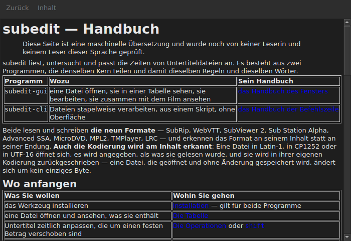

# Das Handbuch im Fenster

<!-- machine-translated -->
> Diese Seite ist eine maschinelle Übersetzung und wurde noch von keiner Leserin und keinem Leser dieser Sprache geprüft.

`Hilfe ▸ Handbuch`, oder `F1`, öffnet **genau dieses Handbuch** in einem eigenen Fenster.




## Was es öffnet, und warum keine Adresse

**Das neben dem Programm installierte Handbuch**, keine Seite im Internet.

Eine Adresse würde die Version in Entwicklung beschreiben, nicht die vorliegende.
Wer das Handbuch einer Version liest, die er nicht hat, ist schlechter bedient als
jemand ganz ohne Handbuch — deshalb liest das Fenster die Dateien, die
die Installation unter `<prefix>/share/subedit/manual` abgelegt hat. Siehe
[Installation](../subedit-cli/installation.md).

Es öffnet sich auf der [Startseite](../index.md), der, die sagt, wo man anfängt.

## In welcher Sprache

**In der Sprache des Fensters.** Das Handbuch öffnet sich in der Sprache, die die
Oberfläche spricht: der in `Bearbeiten ▸ Einstellungen …` gewählten, oder andernfalls der der
Umgebung — siehe
[Die Sprache der Oberfläche](preferences.md#die-sprache-der-oberfläche).

| Das Fenster spricht | Das Handbuch öffnet sich auf |
| :---------------- | :------------------ |
| Englisch | Englisch |
| eine Sprache, deren Handbuch installiert ist — Katalanisch, Tschechisch, Deutsch, Spanisch, Finnisch, Französisch, Galicisch, Hebräisch, Ungarisch, Interlingue | dieser Sprache |
| eine Sprache, deren Handbuch nicht installiert ist | Englisch |

**Seite für Seite, nicht alles oder nichts**: Eine Seite, die die Übersetzung nicht hat,
öffnet sich auf Englisch, und jede andere Seite bleibt in der Sprache des Fensters. Ein
Link führt auf dieselbe Weise von der einen zur anderen.

Die Übersetzungen werden neben dem englischen Handbuch installiert, jede in einem Verzeichnis,
das nach ihrer Sprache benannt ist: `<prefix>/share/subedit/manual/fr` für Französisch. Die
Sprache ist die, in der das Fenster gestartet wurde, sodass eine in den
Einstellungen gewählte Sprache ab dem nächsten Start auch für das Handbuch gilt.

## Navigieren

| Was Sie tun | Was geschieht |
| :---------- | :----------- |
| einen Link des Handbuchs anklicken | die Seite öffnet sich im selben Fenster |
| einen Link anklicken, der auf einen Abschnitt zielt | die Seite öffnet sich, und das Fenster scrollt zu ihm hinunter |
| einen Link anklicken, der nur auf einen Abschnitt zielt | das Fenster scrollt zu ihm hinunter, ohne die Seite zu wechseln |
| `Back` | kehrt zur vorherigen Seite zurück; auf der ersten deaktiviert |
| `Contents` | kehrt zur Startseite zurück; deaktiviert, wenn Sie dort sind |

Das Fenster **ist nicht modal**: Es bleibt offen, während Sie arbeiten, was der ganze
Sinn davon ist, das Handbuch zur Hand zu haben. Den Eintrag erneut zu wählen, erzeugt kein
zweites Fenster, sondern holt dieses in den Vordergrund.

## Was es nicht öffnen kann, und es sagt es

Das Handbuch verweist manchmal auf die **Roadmap** oder auf eine **Architekturentscheidung**.
Das sind Dokumente des Repositorys, nicht des Pakets: Sie werden
nicht installiert, und das Fenster sagt es mit klaren Worten, statt den
Klick ohne Wirkung zu lassen.

```
../../feuille-de-route.md is not part of the installed manual;
it lives in the project's repository.
```

Sie lassen sich im Repository lesen, dessen Adresse in `Hilfe ▸ Über subedit` steht.

## Wenn der Eintrag deaktiviert ist

**`Hilfe ▸ Handbuch` ist deaktiviert, wenn neben dem Programm kein Handbuch liegt.** Zwei
Fälle, und keiner ist ein Fehler:

| Fall | Warum |
| :--- | :-- |
| das Binary wird aus seinem Build-Verzeichnis gestartet | dort wurde nichts installiert, also gibt es nichts zu lesen |
| die Installation ist unvollständig | das Handbuch wurde entfernt oder nie kopiert |

Wenn man mit der Maus über den Eintrag fährt, wird gesagt, welcher der beiden es ist: „Neben diesem Programm ist kein
Handbuch installiert“.

Eine fehlende Seite, während das Handbuch vorhanden ist — eine von Hand gelöschte Datei —, schließt
das Fenster nicht: Es nennt die Datei, die es nicht lesen konnte, und behält auf dem Bildschirm, was
es gerade zeigte.

## Wo das Handbuch gesucht wird

**Neben der ausführbaren Datei**, in `../share/subedit/manual` — die Anordnung, die jede
Installation erzeugt, unabhängig vom Präfix. Das erlaubt es einer Installation
unter `~/.local`, ihr Handbuch ebenso zu finden wie ein unter `/usr` installiertes Paket.
