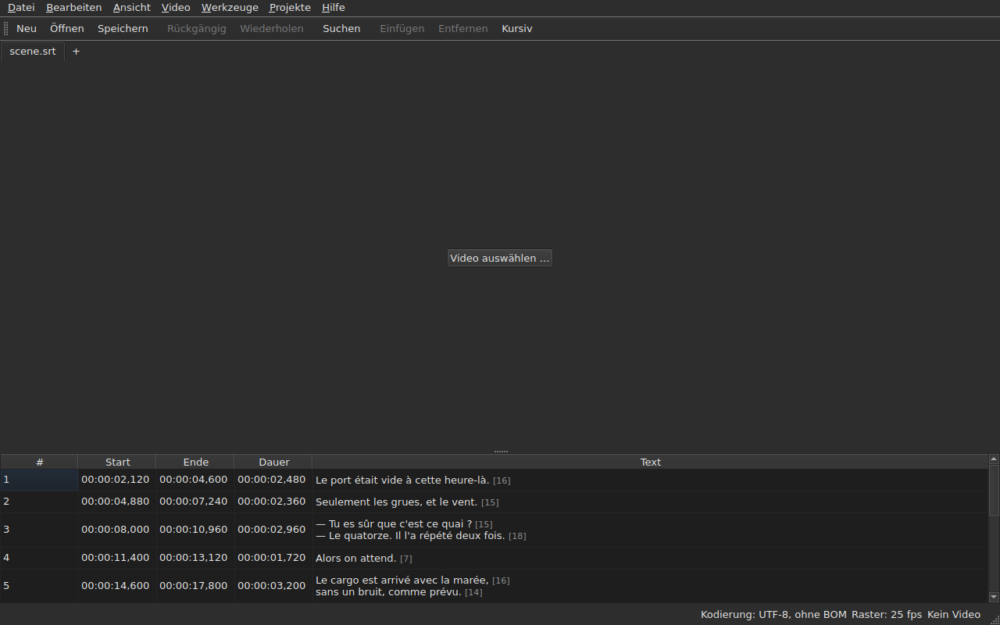

# subedit-gui — Handbuch

<!-- machine-translated -->
> Diese Seite ist eine maschinelle Übersetzung und wurde noch von keiner Leserin und keinem Leser dieser Sprache geprüft.

Das Fenster von subedit: Öffnen Sie eine Untertiteldatei und sehen Sie sie in einer Tabelle. Zum
anderen Programm und um zu wissen, wo Sie anfangen, siehe [das Handbuch](../index.md).

> **Aktueller Stand.** Das Fenster **öffnet mehrere Dateien, jede in einem eigenen Tab**, unabhängig
> von ihrer Kodierung — über `Open…` oder indem man sie darauf ablegt —, **zeigt sie an**,
> **bearbeitet seine Zellen**, **fügt Zeilen ein und entfernt sie**,
> **macht rückgängig**, **speichert — mit Wahl der Kodierung, der Zeilenenden und der
> Byte-Reihenfolge-Marke** — und **markiert die Untertitel, deren Positionen
> nicht zusammenpassen**. Es **führt Zeilen zusammen und teilt sie**, **schneidet Texte aus,
> kopiert und fügt sie ein** und **sucht und ersetzt** im sichtbaren Text,
> ohne die Tags zu zerstören, in einem Projekt oder in allen. Es **öffnet eine Übersetzung
> neben der Hauptdatei**, nach Position oder nach Nummer zugeordnet, in einer zusätzlichen Spalte,
> und speichert sie getrennt. Das Menü `Tools` enthält sechzehn Operationen und zwei Einträge zur Rechtschreibung —
> verschieben, transformieren, die Bildrate umrechnen, Dauern anpassen,
> **eine Datei anhängen, das Projekt in zwei teilen**, kursiv
> setzen, Dialogstriche hinzufügen, die Groß-/Kleinschreibung auf vier Arten ändern,
> Hinweise für Hörgeschädigte entfernen, **Texte mit einem
> mehrseitigen Assistenten korrigieren**, **die Rechtschreibung Wort für Wort prüfen**, an einer Bildrate einrasten, wieder
> auf das Raster bringen — und die Rasteranalyse, die nichts verändert. Das Menü `Projects`
> **speichert und schließt alles** mit einem einzigen Handgriff. Es **verknüpft ein Video
> mit dem Dokument**, gewählt oder erraten, und **spielt es im Fenster ab**, die aktuelle
> Zeile auf das Bild gezeichnet; es **setzt einen Beginn, ein Ende oder einen
> Untertitel von der Position des Films aus**, **geht Bild für Bild vor** und **verschiebt einen Rand um ein Bild**. Die Wiedergabeleiste **springt, stellt die
> Lautstärke und die Position ein**, die Tabelle **folgt der Wiedergabe**, ohne ein manuelles Scrollen rückgängig zu machen, Positionen
> lassen sich **in Bildern** anzeigen, und das Menü `Video` **wählt die Tonspur**. Zwei Erkennungen
> **schlagen vor, ohne je anzuwenden**: eine um einen festen Betrag verschobene Übersetzung, die sich **verschoben
> neu öffnen** lässt, und die Umrechnung der Bildrate, die eine Datei wieder auf ein Raster bringt. Es **merkt sich seine Geometrie, die Reihenfolge, Breite und Sichtbarkeit seiner
> Spalten sowie seine Einstellungen** von einer
> Sitzung zur nächsten und erscheint **hell oder dunkel**, wie Sie es wählen. `Hilfe ▸ Handbuch`
> öffnet **dieses Handbuch** in einem Fenster. Dieses Handbuch beschreibt, was existiert, niemals
> was geplant ist; was als Nächstes kommt, steht in der
> [Roadmap](../../../../feuille-de-route.md).

> **Die Bilder dieses Handbuchs werden erzeugt, der Text nicht.** Die Beispiele von
> `subedit-cli` werden durch Ausführen des Befehls erzeugt; die Bildschirmfotos
> werden erzeugt, indem das echte Fenster gebaut und fotografiert wird — `make
> manual` erledigt beides. Ein Bild kann daher keine Oberfläche beschreiben, die
> es nicht mehr gibt, und eine Oberfläche, die sich ändert, zeigt sich im Diff
> des Repositorys. Ohne Sicherheitsnetz bleibt der Text um sie herum, dessen
> Richtigkeit auf der Durchsicht beruht.

**Jeder Bildschirm wird zweimal gezeigt, unter den beiden Paletten, die die Anwendung
setzt** — `Light` und `Dark`, die, die
[die Einstellungen](preferences.md#das-design) anbieten. Unter einer Arbeitsumgebung, deren
Design maßgeblich ist, ergibt `System` die eine oder die andere, je nachdem, was die Arbeitsumgebung gewählt hat.

## Die Menüs

`File`, `Edit`, `View`, `Video`, `Tools`, `Projects`, `Help` — in der Reihenfolge, in
der Sie sie benutzen: das Dokument, was Sie damit tun, wie Sie es betrachten, was
dazugehört, was es untersucht, was für alle offenen Projekte gilt, was
es erklärt.

`View` enthält ein Untermenü, `Columns`, mit einem ankreuzbaren Eintrag je Spalte außer `Text`
— siehe [Die Tabelle](table.md#spalten-ausblenden-und-verschieben) — und eine Einstellung, `Positions in Frames`, die
`Start` und `End` als Bildnummern zeigt — siehe [Positionen in Bildern](table.md#positionen-in-bildern).

`Projects` enthält zwei Einträge, `Save All` und `Close All` — siehe
[Das Menü Projekte](files.md#das-menü-projekte).

`Edit` enthält fünf Blöcke, jeder unter einem Trennstrich: das Rückgängigmachen; die
Zwischenablage — Texte ausschneiden, kopieren, einfügen; `Find and Replace…`;
das Einfügen, Entfernen, Zusammenführen und Teilen von Zeilen; schließlich
`Preferences…`. Das Rückgängigmachen ist etwas, das man *mit* einer Bearbeitung tut, das Verschieben eines Textes
fügt weder eine Zeile hinzu noch entfernt es eine, die vier Einträge des nächsten Blocks ändern die Anzahl der
Zeilen, und das Einstellen des Designs ist überhaupt keine Bearbeitung.

**Tasten werden so benannt, wie das Menü sie anzeigt**, auf Englisch wie der Rest
der Oberfläche: `Ins`, `Del`, `Ctrl+Shift+Z`. Eine Taste, die Sie drücken und
die kein Menü nennt, behält ihren englischen Namen: `Enter`, `Esc`, `Shift`.

`Help` enthält zwei Einträge, in der Reihenfolge, in der das Menü sie zeigt. `Manual`, oder
`F1`, öffnet dieses Handbuch in einem Fenster — siehe
[Das Handbuch im Fenster](help.md). `About subedit` nennt die Version, die
Lizenz und die Bibliotheken, mit denen das Fenster läuft, samt ihren Versionen — siehe
[`--version`](invocation.md#--version).

## Die Werkzeugleiste

Unter den Menüs enthält eine Leiste **die häufigsten Handgriffe**, in Gruppen.
Jede Schaltfläche trägt ein kurzes Wort; das Menü behält den vollständigen Eintrag, und das
Tastenkürzel ist dasselbe.

| Schaltfläche | Menüeintrag | Tastenkürzel |
| :----- | :--------- | :------- |
| Neu | Datei ▸ Neues Projekt | `Ctrl+N` |
| Öffnen | Datei ▸ Öffnen … | `Ctrl+O` |
| Speichern | Datei ▸ Speichern | `Ctrl+S` |
| Rückgängig | Bearbeiten ▸ Rückgängig | `Ctrl+Z` |
| Wiederholen | Bearbeiten ▸ Wiederholen | `Ctrl+Shift+Z` |
| Suchen | Bearbeiten ▸ Suchen und Ersetzen … | `Ctrl+F` |
| Einfügen | Bearbeiten ▸ Untertitel einfügen … | `Ins` |
| Entfernen | Bearbeiten ▸ Untertitel entfernen | `Del` |
| Kursiv | Werkzeuge ▸ Kursiv | `Ctrl+I` |

**Eine deaktivierte Schaltfläche ist aus demselben Grund deaktiviert wie ihr Eintrag**: `Undo`, wenn
nichts rückgängig zu machen ist, `Remove`, wenn keine Zeile gewählt ist. Die Einträge der Übersetzung
und die Operationen des Menüs `Tools`, außer `Italic`, bleiben in ihren
Menüs: Sie werden seltener benutzt, oder nicht von allen.

## Abschnitte

| Abschnitt | Inhalt |
| :------ | :------- |
| [Installation](../subedit-cli/installation.md) | bauen und installieren — die Seite gilt für beide Programme |
| [Aufruf](invocation.md) | das Fenster starten, Argumente, Exit-Codes |
| [Öffnen und Speichern](files.md) | die Befehle, die Tabs, das Menü `Projects`, das Ablegen von Dateien, die Übersetzung und ihr verschobenes Neuöffnen, die Diagnosen, die Kodierung in der Statusleiste, der Hin- und Rückweg, das Schließen |
| [Die Tabelle](table.md) | was jede Spalte zeigt, sie ausblenden und verschieben, Positionen in Bildern, die Spalte der Übersetzung und der Text, auf den die Operationen zielen |
| [Eine Zelle bearbeiten](editing.md) | welche Zellen sich bearbeiten lassen, und wie |
| [Texte ausschneiden, kopieren und einfügen](clipboard.md) | die drei Einträge, was übertragen wird, die hinzugefügten Zeilen, die übersetzten Tags |
| [Suchen und Ersetzen](find-and-replace.md) | der Dialog, die vier Handgriffe, die zwei Optionen, was die Suche umfasst, in allen offenen Projekten |
| [Zeilen einfügen, entfernen, zusammenführen und teilen](lines.md) | die vier Einträge, ihre Tastenkürzel, wohin die neuen Zeilen kommen |
| [Rückgängig und Wiederholen](undo.md) | der Verlauf, die zwei Aktionen, die Änderungsmarkierung |
| [Das Bildraster](frame-grid.md) | die aus den Positionen abgeleitete Bildrate, die Analyse und die Umrechnung, die eine Datei wieder auf ein Raster bringt |
| [Die Operationen](operations.md) | verschieben, transformieren, umrechnen, Dauern anpassen, eine Datei anhängen, das Projekt teilen, kursiv setzen, die Groß-/Kleinschreibung, die Striche, Hinweise entfernen, einrasten, wieder auf das Raster bringen, und was über das Ende des Films hinausgeht |
| [Texte korrigieren…](correct-texts.md) | der Korrekturassistent: das Ziel und die Aufgaben, die Seite jeder Aufgabe, der Fortschritt, die Bestätigung |
| [Rechtschreibung prüfen…](check-spelling.md) | die Rechtschreibprüfung: ihre Einstellungen, der Durchlauf, das Schließen mittendrin, das Fehlen eines Wörterbuchs |
| [Das verknüpfte Video](video.md) | ein Video wählen, der automatische Vorschlag, die Tonspur, die Statusleiste, `ffmpeg` |
| [Der Player](player.md) | die Videoansicht, die Wiedergabeleiste, abspielen, sich bewegen, die Lautstärke, die Tabelle, die folgt, die gezeichnete Zeile |
| [Timing anhand des Videos](timing.md) | den Beginn oder das Ende eines Untertitels setzen, einfügen, von der Position des Films aus auswählen, Bild für Bild vorgehen, einen Rand verschieben |
| [Die Einstellungen](preferences.md) | das Design, die Einstellungsdatei, ihre Optionen, und was aus einem unlesbaren Wert wird |
| [Das Handbuch im Fenster](help.md) | `Hilfe ▸ Handbuch`, was es öffnet und wie man sich darin bewegt |
