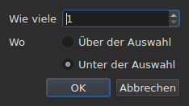

# Zeilen einfügen, entfernen, zusammenführen, teilen, sortieren und überschneidungsfrei machen

<!-- machine-translated -->
> Diese Seite ist eine maschinelle Übersetzung und wurde noch von keiner Leserin und keinem Leser dieser Sprache geprüft.

Acht Einträge des Menüs `Edit`, unter einem Trennstrich, der sie von
`Find and Replace…` absetzt. Vier haben gemeinsam, dass sie die Anzahl der Zeilen ändern, während
Ausschneiden, Kopieren und Einfügen, weiter oben, Texte verschieben; `Sort Subtitles` ändert
nur **die Reihenfolge** der Zeilen, `Join Repeated Subtitles` macht aus den aufeinanderfolgenden Stücken
eines und desselben Textes wieder einen einzigen Untertitel, und `Make Ranges Disjoint…`
schneidet sie dort neu, wo sie sich überlappen.

| Eintrag | Tastenkürzel | Was er tut |
| :---- | :------- | :----------- |
| Untertitel einfügen … | `Ins` | öffnet einen Dialog und fügt dann leere Zeilen hinzu |
| Untertitel entfernen | `Del` | entfernt die Auswahl, ohne etwas zu fragen |
| Untertitel zusammenführen | keines | macht aus einem Block benachbarter Zeilen eine einzige Zeile |
| Untertitel teilen | keines | schneidet eine Zeile in der Mitte ihrer Dauer in zwei |
| Wiederholte Untertitel zusammenfassen | keines | macht aus den aufeinanderfolgenden Stücken eines und desselben Textes einen einzigen Untertitel |
| Untertitel sortieren | keines | bringt die Zeilen wieder in die Reihenfolge ihres Beginns, über das ganze Projekt |
| Bereiche überschneidungsfrei machen … | keines | schneidet die überlappenden Zeilen so, dass sich kein Bereich mehr mit einem anderen überschneidet |
| Untertitel reparieren … | keines | verkettet die drei vorangehenden Einträge — Wiederholungen zusammenfassen, sortieren, die Bereiche schneiden — in einem Zug |

Alle acht gehen in den Verlauf ein: `Ctrl+Z` macht sie rückgängig wie den Rest.

## Einfügen

| Feld | Was es enthält | Standard |
| :---- | :------------ | :------ |
| `How many` | eine ganze Zahl von 1 bis 99.999 | `1` |
| `Where` | `Above the selection` oder `Below the selection` | die letzte Wahl, `Below` beim ersten Start |

`OK` fügt die Zeilen hinzu, `Cancel` fügt nichts hinzu.

### Wohin sie kommen

**An die zuletzt ausgewählte**, nicht an die erste. Die Zeilen 1 und 3 auszuwählen
und dann darunter einzufügen, setzt die neue Zeile an Position 4 — nicht an
Position 2. Das tut Gaupol seit zwanzig Jahren, und das erwartet die Hand,
nachdem sie von oben nach unten gestrichen hat.

`Above the selection` setzt sie direkt vor dieselbe Zeile.

### Wie lange sie dauern

Eine leere Zeile hat keinen Text, aber sie hat Positionen. Sie werden aus dem
verfügbaren Platz abgeleitet:

| Situation | Beginn | Dauer |
| :-------- | :---- | :------- |
| zwischen zwei Untertiteln | das Ende des vorigen | der Platz bis zum nächsten, zu gleichen Teilen aufgeteilt |
| nach dem letzten | das Ende des letzten | je drei Sekunden |
| am Anfang einer Datei | der Nullpunkt | der Platz bis zum ersten, aufgeteilt |
| in einer leeren Datei | der Nullpunkt | je drei Sekunden |

Wenn sich die Datei an der gewählten Stelle überlappt, gibt es **keinen Platz zum
Aufteilen**: Die Zeilen erhalten eine Dauer von null, die die Tabelle zeigt, statt
einer erfundenen Dauer, die über den Nachbarn hinausginge.

### Das leere Dokument

**Keine Auswahl ist erforderlich**, und es ist der einzige Weg, eine
neue Datei zu beginnen: Die Zeilen kommen an den Index null. Die Wahl der Seite ist dann
im Dialog deaktiviert — es gibt keine Auswahl, an der man sie ausrichten könnte.

Sobald das Dokument eine Zeile trägt, **ist der Eintrag `Insert Subtitles…` deaktiviert, solange
nichts ausgewählt ist**: Ohne Auswahl würde der Index erraten.

### Danach

Die hinzugefügten Zeilen sind **ausgewählt**, und die Tabelle springt zu ihnen. Ein
zweites Drücken von `Ins` fügt daher nach ihnen ein, ohne zwischen die
beiden klicken zu müssen.

### Die Seite wird gemerkt

`Above` oder `Below` wird **von einer Einfügung zur nächsten und von einer Sitzung zur
nächsten** gemerkt: Es ist die Option `edit.insert-placement` der
[Einstellungsdatei](preferences.md#die-datei). Man fügt nicht einmal ein,
man fügt zehn Zeilen hintereinander ein, immer auf derselben Seite.

## Entfernen

`Remove Subtitles`, oder `Del`, entfernt die ausgewählten Zeilen — auch eine
nicht zusammenhängende Auswahl, wobei jede Zeile an ihren Platz zurückkehrt, wenn Sie rückgängig machen.

**Es wird keine Bestätigung verlangt**, und das ist kein Versäumnis:
Die Operation wird mit `Ctrl+Z` rückgängig gemacht. Ein modales Fenster vor einem rückgängig machbaren Handgriff
würde jedes Mal einen Klick kosten, um hin und wieder ein `Ctrl+Z` zu sparen.

**Der Eintrag ist deaktiviert, wenn nichts ausgewählt ist.** Anderswo im Fenster
bedeutet „nichts ausgewählt“ „die ganze Datei“ — das macht eine
Verschiebung benutzbar, ohne viertausend Zeilen auszuwählen. Hier würde diese Lesart
ein Dokument mit einem unglücklichen `Del` leeren, daher wird sie nicht angeboten.

Nach dem Entfernen **ist die Zeile ausgewählt, die den Platz der ersten entfernten
eingenommen hat** — oder die letzte verbleibende, wenn das Entfernen das Ende der
Datei weggenommen hat. Mehrmals hintereinander `Del` zu drücken, entfernt daher die Zeilen eine
nach der anderen.

Eine vollständig geleerte Datei lässt das Fenster benutzbar: `Insert Subtitles…`
wird wieder aktiviert, da man in ein leeres Dokument ohne Auswahl einfügt.

## Zusammenführen

`Merge Subtitles` macht aus den ausgewählten Zeilen **eine einzige Zeile**:

| Was die zusammengeführte Zeile erhält | Woher es kommt |
| :---------------------------- | :------------------ |
| ihren Beginn | der Beginn der ersten |
| ihr Ende | das Ende der letzten |
| ihren Text | die Texte aller, in Reihenfolge, ein Zeilenumbruch zwischen zweien |
| ihre Übersetzung | die Übersetzungen, auf dieselbe Weise verbunden |
| was das Format außerdem trägt — einen Stil, eine Ebene, Koordinaten | die erste |

**Ein leerer Text hinterlässt keine leere Zeile**: `Un.`, eine Zeile ohne
Text und `Trois.` zusammenzuführen, ergibt zwei Textzeilen, nicht drei.

Die zusammengeführten Zeilen verschwinden, und die Zeile, die sie ersetzt, nimmt den Platz
der ersten ein.

**Der Eintrag ist deaktiviert**, solange die Auswahl kein **Block von mindestens
zwei benachbarten Zeilen** ist. Eine einzelne Zeile hat nichts, womit sie zusammengeführt werden könnte; die Zeilen
1 und 3 ohne 2 ebenso wenig, da das Ergebnis über 2 hinausginge und
sie verdecken würde.

Nach dem Zusammenführen **ist die zusammengeführte Zeile ausgewählt**: `Split Subtitle` ist
bereit, sie wieder zu schneiden.

## Teilen

`Split Subtitle` schneidet die ausgewählte Zeile **in der Mitte ihrer Dauer**, auf die
Millisekunde genau:

| Hälfte | Beginn | Ende | Text |
| :--- | :---- | :-- | :--- |
| die erste | der ursprüngliche Beginn | die Mitte | **der ganze** Text, und die Übersetzung |
| die zweite | die Mitte | das ursprüngliche Ende | leer |

**Der Text wird nicht an seinem Zeilenumbruch geschnitten.** Das wäre richtig für einen
zweizeiligen Untertitel und falsch für einen Untertitel mit einer Zeile oder mit drei;
der ganze Text bleibt in der ersten Hälfte, und Sie verschieben selbst, was in die zweite
gehört.

Die erste Hälfte behält, was das Format außer dem Text trug; die zweite
entsteht wie eine eingefügte Zeile, mit nichts.

**Der Eintrag ist deaktiviert**, solange die Auswahl nicht **genau eine
Zeile** umfasst. Nichts ausgewählt bedeutet hier nicht „die ganze Datei“.

Nach dem Teilen **sind beide Hälften ausgewählt** — das tut Gaupol
nach jeder Einfügung, und `Merge Subtitles` ist dann bereit, den
Handgriff rückgängig zu machen.

## Sortieren

`Sort Subtitles` bringt **das ganze Projekt** wieder in die Reihenfolge der Beginne. Nie die
Auswahl: Eine Reihenfolge ist eine Eigenschaft des Dokuments, und die Hälfte einer
Datei zu sortieren, bedeutet nichts. Die Sortierung ist **stabil**: Zwei Untertitel, die
zugleich beginnen, behalten die Reihenfolge, die die Datei ihnen gab.

**Während der Sortierung läuft ein Balken in der Statusleiste, und der Mauszeiger wird zur
Sanduhr**: Bei einer langen Datei reagiert das Fenster eine Weile nicht — die
Tabelle baut sich Zeile für Zeile neu auf —, und ohne das wüssten Sie nicht, ob etwas
im Gange ist. Der Balken zeigt keinen Anteil, die Sortierung meldet keinen,
und er verschwindet mit ihr.

Die Statusleiste sagt, wie viele Zeilen ihren Platz gewechselt haben — `3 subtitles moved`
— oder, wenn alles in Ordnung war, `already in order`. **Ein bereits geordnetes Projekt
geht nicht in den Verlauf ein**: Eine Operation, die nichts ändert, ist keine
Operation, die rückgängig zu machen wäre. Der Eintrag ist bei einem Projekt mit einem einzigen Untertitel deaktiviert.

Eine Datei, **bei der es beim Öffnen etwas zu korrigieren gibt**, bietet es von sich aus an,
[in einem einzigen Fenster](#beim-öffnen-ein-einziges-fenster): siehe unten. Falsch platzierte
Untertitel werden außerdem [mit den Diagnosen gezählt](files.md#die-diagnosen-beim-lesen),
damit Sie sie finden, ohne durch die Tabelle zu scrollen.

In der Befehlszeile tut [`sort`](../subedit-cli/sort.md) dasselbe mit
Dateien, und `--sort` tut es nebenbei bei
[`convert`](../subedit-cli/convert.md#ordnen-beim-schreiben),
[`append`](../subedit-cli/append.md#das-ergebnis-ordnen) und
[`split-file`](../subedit-cli/split-file.md#in-zeitlicher-reihenfolge-schneiden).

## Zusammenfassen wiederholter Untertitel

`Join Repeated Subtitles` macht **einen einzigen Untertitel** aus den Untertiteln, die
hintereinander dasselbe zeigen: ein in aufeinanderfolgende Stücke geschnittener Text, wie
manche Segmentierungswerkzeuge ihn hinterlassen. Es wirkt auf **das ganze Projekt**.

**Eine Wiederholung** hat denselben Text, dieselbe Übersetzung und dieselben Formateinstellungen
(einen Stil, eine Position, Cue-Einstellungen) wie ein anderer, **und beginnt spätestens,
wenn dieser endet**. Eine Folge von Wiederholungen wird zu dem, der zuerst
beginnt, mit dem größten Ende der Folge; die anderen verschwinden.
`Alpha [1, 2]`, `Alpha [2, 4]` und `Alpha [4, 6]` ergeben `Alpha [1, 6]`.

- **Die Reihenfolge der Datei ändert nichts daran, und es ändert sie nicht**: Der behaltene Untertitel
  ist der, der zuerst beginnt, wo auch immer die anderen sind.
- **Nichts wird versehentlich zusammengefasst**: ein anderer Text, andere Einstellungen, eine Lücke
  zwischen zwei Stücken, ein Untertitel ohne Text oder dessen Ende vor seinem Beginn liegt,
  bleiben getrennt.
- Die Statusleiste sagt, was getan wurde — `2 repeated subtitles joined`, oder
  `no repeated subtitles`.

**Vor dem Sortieren und Schneiden zu tun**, die eine saubere Folge besser lesen: Ein
Text in drei Stücken, dazu ein anderer Text über den ganzen Bereich, außer der Reihe
gegeben, wird beim Sortieren und Schneiden zu Zeilen, die von einem Stück zum anderen springen; zuerst
zusammengefasst, fällt er in die Reihenfolge und verschmilzt sauber. Das Fenster beim Öffnen, unten, tut
alle drei in dieser Reihenfolge.

## Bereiche überschneidungsfrei machen

`Make Ranges Disjoint…` schneidet die überlappenden Untertitel so, dass sich **kein
Bereich `[start, end]` mehr mit einem anderen überschneidet**. Es wirkt auf **das ganze
Projekt**, nie auf die Auswahl: Eine Gruppe überlappender Untertitel
wird dort geschnitten, wo sie sich überlappen, und eine halbe Gruppe bedeutet nichts.

**Nichts wird gekürzt oder verlängert.** In jedem Augenblick zeigt das Fenster dieselben
Texte wie vorher. Was sich ändert, ist, wie die Zeitachse geschnitten ist:
Sie wird bei jedem Beginn und jedem Ende einer Gruppe geschnitten; ein Intervall, das
von einem einzigen Untertitel abgedeckt wird, bleibt dieser Untertitel; ein Intervall, das von mehreren abgedeckt wird,
wird zu **einem** Untertitel, dessen Zeilen die ihren sind, **der früheste in Zeile 1**.
`A [0, 5]` und `B [3, 8]` ergeben `[0, 3] A`, `[3, 5] A / B`, `[5, 8] B`.

Der Dialog fragt nach drei Einstellungen, die von einem Mal zum nächsten gemerkt werden:

| Feld | Was es enthält | Standard |
| :---- | :------------ | :------ |
| `Shortest interval kept` | von 0 bis 10.000 ms: Ein kürzeres Intervall wird von einem Nachbarn übernommen | `80 ms` (etwa zwei Bilder) |
| `Most lines in a subtitle` | von 0 bis 10; `No limit` bei 0 | `2` |
| `Put a dash before each subtitle's text` | ein Strich vor dem, was jeder Untertitel zu einem zusammengeführten Untertitel beiträgt | nicht angekreuzt |

`OK` schneidet, `Cancel` tut nichts. **Die geschriebenen Zeilen sind danach
ausgewählt**, und die Statusleiste sagt, was getan wurde: `2 subtitles split, 1 merged`.
Ein zweiter Durchgang ändert nichts und sagt es: `already disjoint`.

- **Eine Zeile wird nie verdoppelt.** Zwei Untertitel mit demselben Text ergeben eine
  einzige Zeile, wo sie sich überlappen, und zwei benachbarte Stücke, die dasselbe
  zeigen, ergeben nur einen Untertitel. Der Text eines in mehrere Stücke geschnittenen
  Untertitels wird ansonsten in jedem wiederholt: Es ist das, was in diesem Augenblick auf dem Bildschirm steht.
- **Ein sehr kurzes Intervall wird von einem Nachbarn übernommen**: Derjenige, dessen Zeilen
  die seinen bereits enthalten, sonst der längste, dehnt seinen Bereich aus, um es abzudecken.
  Ein ganzer Untertitel, der kürzer als die Schwelle ist, wird nie übernommen.
- **Mehr Zeilen als die Grenze: Fenster.** Drei Zeilen über drei Sekunden
  werden zu zwei Hälften, erst die ersten zwei Zeilen, dann die letzten zwei;
  vier Zeilen zu drei Dritteln, und so weiter. Nichts wird abgeschnitten.
- Die Übersetzung folgt denselben Schnitten; der Stil und die Position des ersten
  abdeckenden Untertitels bleiben erhalten.

**Was nicht vollständig getan werden konnte, wird in einem zu schließenden Fenster gesagt**, nicht in
der Statusleiste: Fenster, übernommene Intervalle, zu kurze Untertitel,
die ganz gelassen wurden, Stile, die sich unterscheiden, Untertitel, deren Ende vor ihrem
Beginn liegt (an ihrem Platz gelassen).

**Der Eintrag wird mit Angabe des Grundes abgelehnt, wenn die Untertitel nicht in
der Reihenfolge ihres Beginns stehen**: Die Gruppen sind Folgen von Nachbarn, und der Kern sortiert
nie von sich aus. Zuerst `Sort Subtitles` — oder das Fenster beim Öffnen, das
beides in dieser Reihenfolge tut.

### Alles auf einmal: `Repair Subtitles…`

`Repair Subtitles…` führt die drei vorangehenden Einträge **nacheinander** aus, in der einzigen Reihenfolge, die funktioniert: Die
Wiederholungen werden zusammengefasst, die Untertitel in die Reihenfolge ihres Beginns gebracht, dann die Bereiche überschneidungsfrei gemacht. Es ist der Eintrag
für eine Datei, die schlecht segmentiert, schlecht geordnet und überlappend ist, wenn Sie wissen, dass Sie alle drei wollen. Der Dialog fragt nach den
Einstellungen des Schneidens (dieselben wie bei `Make Ranges Disjoint…`, von einem Mal zum nächsten gemerkt) und sagt, dass er zuerst zusammenfasst und
sortiert. Die Statusleiste — oder das zu schließende Fenster, wenn etwas nicht vollständig getan werden konnte — gibt **einen einzigen Bericht**
über alle drei: `2 repeated subtitles joined; already in order; 2 subtitles split, 1 merged`. Jede Korrektur ist ein eigener
Eintrag im Verlauf: `Ctrl+Z` macht sie eine nach der anderen rückgängig. In der Befehlszeile: [`repair`](../subedit-cli/repair.md).

### Beim Öffnen ein einziges Fenster

Eine Datei, die sich mit etwas öffnet, das wir zu korrigieren wissen, **bietet es in
einem einzigen Fenster an**, `Problems found in this file`, statt eines pro
Problem zu öffnen. Jedes gefundene Problem ist eine Zeile mit ihrem Kontrollkästchen, angekreuzt:

- `Join the repeated subtitles` — Untertitel wiederholen einen anderen, den sie
  berühren, mit ihrer Anzahl;
- `Sort the subtitles` — die Untertitel stehen nicht in der Reihenfolge ihres Beginns,
  mit ihrer Anzahl;
- `Make the ranges disjoint` — Untertitel beginnen vor dem Ende des vorigen,
  gezählt, **sobald die Datei geordnet ist**, da sie dort korrigiert werden.

**Jedes Problem wird dort gezählt, wo es korrigiert wird**, an einer Kopie, an der die
vorangehenden Korrekturen bereits vorgenommen wurden: Ein in Stücke geschnittener Text ist die
Ursache mancher Unordnung, und ihn zuerst zusammenzufassen, kann keine übrig lassen — das Fenster
bietet dann das Sortieren nicht an.

Ein Problem, das nicht gefunden wurde, hat keine Zeile. Das Abwählen des Sortierens **graut das
andere Kontrollkästchen aus und wählt es ab**: Bereiche werden nur in geordneter Reihenfolge überschneidungsfrei gemacht.
`Fix` wendet an, was angekreuzt ist — das Zusammenfassen, dann das Sortieren, dann das Schneiden, mit den
Einstellungen des letzten `Make Ranges Disjoint…` — und gibt **einen einzigen Bericht** darüber;
`Keep as is` rührt nichts an. **Nichts geschieht ohne ein Ja**, jede Korrektur
ist ein Eintrag im Verlauf, und eine Datei ohne etwas zu korrigieren ist Gegenstand
keiner Frage.

In der Befehlszeile tut [`disjoint`](../subedit-cli/disjoint.md) dasselbe mit Dateien, und `--disjoint`
tut es nebenbei bei [`convert`](../subedit-cli/convert.md#bereiche-überschneidungsfrei-machen),
[`append`](../subedit-cli/append.md#bereiche-überschneidungsfrei-machen) und
[`split-file`](../subedit-cli/split-file.md#bereiche-überschneidungsfrei-machen).

### Warum nicht Gaupols Tastenkürzel

Gaupol führt mit `M` zusammen und teilt mit `S`. Ein bloßer Buchstabe würde von der
Tabelle abgefangen, bevor er eine Zelle in Bearbeitung erreicht, und `Ctrl+S`
speichert bereits: Die zwei Einträge werden über das Menü erreicht.

## Was die Rückgängig-Aktion darüber sagt

**Ein Eintrag im Verlauf pro Handgriff.** Das Zusammenführen von fünf Zeilen wird mit einem einzigen
`Ctrl+Z` rückgängig gemacht und gibt die fünf Zeilen zurück, wie sie waren — Positionen, Texte und
alles, was das Format trug.

| Operation | Was `Undo` anzeigt |
| :-------- | :---------------- |
| eine Einfügung | `Undo: inserting` |
| ein Entfernen | `Undo: removing` |
| ein Zusammenführen | `Undo: merging` |
| ein Teilen | `Undo: splitting` |
| ein Zusammenfassen von Wiederholungen | `Undo: joining repeated subtitles` |
| ein Schneiden der Bereiche | `Undo: making the ranges disjoint` |

Eine beim Öffnen angebotene Korrektur ist ein Eintrag im Verlauf pro Korrektur: Das Zusammenfassen, das Sortieren, dann das Schneiden werden nacheinander rückgängig gemacht.

Siehe [Rückgängig und Wiederholen](undo.md).

## Tastenkürzel bei geöffneter Zelle

`Ins` und `Del` gehören dem Eingabefeld, solange ein Zelleneditor
geöffnet ist: Die Entf-Taste löscht dort ein Zeichen, keinen
Untertitel. Das Schließen des Editors — `Enter` oder `Esc` — gibt ihnen ihre Bedeutung zurück. Aus dem
Menü gestartet, übernimmt `Remove Subtitles` zuerst die Eingabe, wie die anderen
Handgriffe von [Eine Zelle bearbeiten](editing.md).

Dieses Handbuch benennt die Tasten so, wie das Menü sie anzeigt — siehe
[Die Menüs](index.md#die-menüs).
