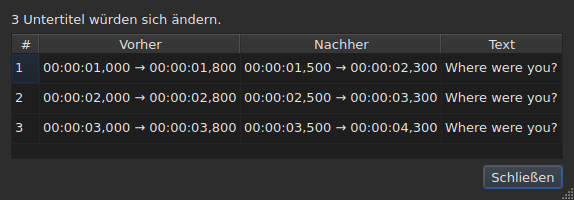
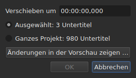
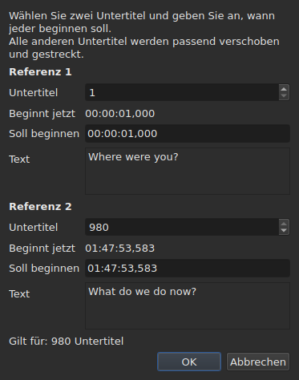
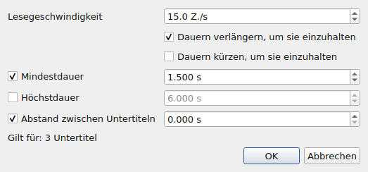
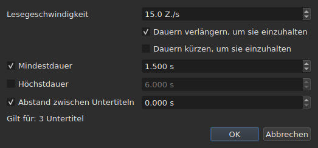
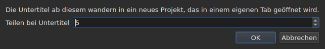

# Die Operationen

<!-- machine-translated -->
> Diese Seite ist eine maschinelle Übersetzung und wurde noch von keiner Leserin und keinem Leser dieser Sprache geprüft.

Das Menü **Werkzeuge** enthält sechzehn Operationen, eine Analyse und zwei Einträge zur Rechtschreibung. Jede der
sechzehn wird mit einem `Ctrl+Z` rückgängig gemacht; die Analyse verändert nichts. `Check Spelling…` wird ebenfalls rückgängig gemacht, und `Spell-Check Settings…` rührt keinen Text an.

| Eintrag | Dialog | Was er tut |
| :---- | :----- | :----------- |
| `Shift Positions…` | ja | verschiebt das Ziel um eine Dauer |
| `Transform Positions…` | ja | korrigiert das Ziel anhand zweier Bezugspunkte |
| `Convert Frame Rate…` | ja | rechnet das Ziel von einer Bildrate auf eine andere um |
| `Adjust Durations…` | ja | verschiebt die Enden, um eine Lesegeschwindigkeit, Dauern und einen Abstand einzuhalten |
| `Append File…` | eine Dateiauswahl | hängt eine Datei an das Ende des Projekts an |
| `Split Project…` | ja | schneidet das Projekt in zwei, der Rest kommt in einen neuen Tab |
| `Italic` | **nein** | setzt das Ziel kursiv, oder nimmt die Kursivschrift heraus |
| `Dialogue` | **nein** | setzt einen Dialogstrich an den Anfang jeder Zeile, oder entfernt ihn |
| `Case ▸ Title Case` | **nein** | jedes Wort erhält einen Großbuchstaben |
| `Case ▸ Sentence case` | **nein** | der erste Buchstabe des Textes, und er allein |
| `Case ▸ UPPER CASE` | **nein** | alles in Großbuchstaben |
| `Case ▸ lower case` | **nein** | alles in Kleinbuchstaben |
| `Remove Hearing-Impaired Mentions…` | ja, ohne Einstellungen | entfernt die Hinweise für Hörgeschädigte |
| `Correct Texts…` | ja, ein mehrseitiger Assistent | schlägt Korrekturen vor — Hinweise, Wörter zusammenfügen und trennen, häufige Fehler, Großschreibung, Zeilenumbruch — und wendet sie an, sobald sie angenommen sind, siehe [Texte korrigieren…](correct-texts.md) |
| `Check Spelling…` | ja, ein Durchlauf Wort für Wort | geht die dem Wörterbuch unbekannten Wörter durch und wendet an, was korrigiert wurde, siehe [Rechtschreibung prüfen…](check-spelling.md) |
| `Spell-Check Settings…` | ja | wählt die Sprache, das Ziel und das Dokument der Prüfung sowie das Unterstreichen beim Tippen, siehe [Rechtschreibung prüfen…](check-spelling.md#rechtschreibeinstellungen) |
| `Snap to Frame Rate…` | ja | setzt jeden Zeitstempel wieder auf das nächstgelegene Bild |
| `Shift Whole File onto Grid (…)` | **nein** | bringt die ganze Datei wieder auf ihr Raster |
| `Frame Rate Analysis…` | ja, ohne Einstellungen | **verändert nichts** — siehe [Das Bildraster](frame-grid.md) |

**Was eine Operation getan hat, wird in einem Informationsfenster gesagt, das
geschlossen werden muss, außer bei `Italic`, `Case` und `Dialogue`**: Diese drei öffnen keinen
Dialog, und ihr Bericht — „nichts zu ändern“ eingeschlossen — wird
in der Statusleiste angezeigt, ohne etwas zu schließen. `Split Project…` gibt seinen eigenen ebenfalls
in der Statusleiste aus: Sein Ergebnis liegt bereits vor Ihnen, im neuen Tab. Die Meldungen werden im
Abschnitt der jeweiligen Operation zitiert.

Das Einfügen, Entfernen, Zusammenführen und Teilen von Zeilen steht nicht hier, sondern im
Menü `Edit`, weil es die Anzahl der Zeilen ändert. Siehe
[Zeilen einfügen, entfernen, zusammenführen und teilen](lines.md).

## Worauf sie wirken

**Auf die ausgewählten Zeilen, oder auf die ganze Datei, wenn keine ausgewählt ist.** Es ist dieselbe
Regel für alle, und die Dialoge, wenn es einen gibt, erinnern mit klaren
Worten daran:

```
Applies to: 4 subtitles
```

Alle Zeilen auszuwählen, läuft auf dasselbe hinaus, wie keine auszuwählen.

**Wenn nur ein Teil der Zeilen ausgewählt ist, fragt der Dialog,
worauf gewirkt werden soll.** Zwei Möglichkeiten werden angezeigt, mit ihrer Anzahl, und **die Auswahl
ist die angekreuzte**:

```
(•) Selected: 2 subtitles
( ) Whole project: 4 subtitles
```

`Whole project` anzukreuzen, erweitert die Operation auf die ganze Datei, ohne dass man zuerst
die Auswahl ändern muss. Wenn es nichts zu wählen gibt — nichts
ausgewählt, oder alles —, bleibt die Zeile `Applies to:` oben allein.

Die Dialoge von `Shift Positions…`, `Transform Positions…`,
`Convert Frame Rate…`, `Adjust Durations…`, `Snap to Frame Rate…` und
`Remove Hearing-Impaired Mentions…` bieten diese Wahl an.

### Vor dem Anwenden sehen

`Shift Positions…`, `Transform Positions…`, `Convert Frame Rate…`,
`Adjust Durations…` und `Snap to Frame Rate…` tragen eine Schaltfläche **`Preview changes…`**.
Sie öffnet ein kleines Fenster, das sagt, wie viele Untertitel die Operation
**mit dem in diesem Moment Eingegebenen, auf dem angekreuzten Ziel** ändern würde, und
die ersten zwölf auflistet: ihre Nummer, ihre Position vorher, ihre Position
nachher und die erste Zeile ihres Textes. **Nichts wird angewendet**: Das Schließen des
Fensters führt zum Dialog zurück, wo Sie einen Wert ändern und erneut
nachsehen können.




Es öffnet sich groß genug, um alle Spalten zu zeigen, und lässt sich von Hand
in der Größe ändern.

Würde die Operation nichts ändern, sagt es das Fenster (`Nothing would change.`).
Solange das Eingegebene keine Operation definiert — eine unlesbare Dauer, zwei
Bezugspunkte auf demselben Untertitel —, ist die Vorschau aus demselben Grund leer, aus dem die
Schaltfläche `OK` ausgegraut ist. `Remove Hearing-Impaired Mentions…` hat keine Vorschau: Was
es ändert, ist Text, und der Bericht, den es danach gibt,
sagt es.

**Mit einer Übersetzung: welcher Text?** Die Operationen auf Positionen und Struktur
wirken auf den ganzen Untertitel — seine beiden Texte folgen. Die, die
einen Text neu schreiben — `Italic`, `Case`, `Dialogue`,
`Remove Hearing-Impaired Mentions…` —, zielen auf **den Text der Spalte der aktuellen Zelle**: die
Übersetzung in ihrer Spalte, den Haupttext anderswo. Der andere bleibt unversehrt, und
die Statusleiste sagt, auf welchen gezielt wird. Siehe [Die Tabelle](table.md#der-text-auf-den-die-operationen-zielen).

**Eine Ausnahme, und ihre Beschriftung trägt sie**: `Shift Whole File onto Grid`
ignoriert die Auswahl. Ein Raster ist eine Eigenschaft des Dokuments, und ein halbes
Dokument hat kein eigenes Raster; der Eintrag sagt es daher in seinem Namen, statt
nur in diesem Handbuch.

**`Append File…` ignoriert die Auswahl ebenfalls**, aus einem anderen Grund: Es ist
kein Ziel, das es neu schreibt, es ist ein Ende, das es hinausschiebt. Siehe seinen
[eigenen Abschnitt](#append-file). **Ebenso `Split Project…`**: Es schneidet dort, wo
es angewiesen wird. Siehe [seinen eigenen](#split-project).

**`Correct Texts…` wählt sein Ziel auf seiner eigenen Seite**, statt der
aktuellen Auswahl zu folgen: die Auswahl, das aktuelle Projekt oder alle offenen
Projekte. Siehe [Texte korrigieren…](correct-texts.md). **`Check Spelling…` wählt es in
`Spell-Check Settings…`** und merkt es sich: siehe [Rechtschreibung prüfen…](check-spelling.md).

**Die zwei Rasteroperationen sprechen nicht von demselben wie das Raster.**
Eine Operation wirkt auf die Auswahl; die Analyse und die Statusleiste sprechen vom
**ganzen Dokument**. Fünf Zeilen von hundertsechsundsiebzig einrasten zu lassen, ändert diese
fünf durchaus — die Tabelle zeigt es —, ohne dass sich eine der beiden bewegt, was
sich wie eine versäumte Aktualisierung liest. Es ist keine: Sie haben nichts zu
sagen. Siehe [`Snap to Frame Rate…`](#snap-to-frame-rate) und
[Das Bildraster](frame-grid.md).

### Was „nichts ausgewählt“ bedeutet, Eintrag für Eintrag

Die Regel gilt für das Menü `Tools` und für die Suche. Die Einträge des
Menüs `Edit`, die die Zeilen anrühren oder leeren, lesen sie anders — sonst würde ein
unglückliches `Del` oder `Ctrl+X` das Dokument leeren.

| Eintrag | Ohne Auswahl | Was er verlangt |
| :---- | :------------------ | :--------------- |
| die Operationen des Menüs `Tools` | die ganze Datei | ein nicht leeres Dokument |
| `Shift Whole File onto Grid` | die ganze Datei, **immer** | ein gefundenes Raster |
| `Find and Replace…` | die ganze Datei | ein nicht leeres Dokument |
| `Cut Texts`, `Copy Texts`, `Paste Texts` | **deaktiviert** | mindestens eine ausgewählte Zeile |
| `Remove Subtitles` | **deaktiviert** | mindestens eine ausgewählte Zeile |
| `Merge Subtitles` | **deaktiviert** | ein Block von mindestens zwei benachbarten Zeilen |
| `Split Subtitle` | **deaktiviert** | genau eine Zeile |
| `Insert Subtitles…` | deaktiviert, außer bei einem leeren Dokument | eine Zeile, an der sie platziert werden |

Jede Seite nennt den Grund: [die Zwischenablage](clipboard.md#worauf-sie-wirken),
[die Zeilen](lines.md), [die Suche](find-and-replace.md#was-die-suche-umfasst).

Die Einträge sind **bei einer leeren Datei deaktiviert**: Es gäbe nichts zu
verschieben. `Italic` hat eine zweite Bedingung, die sein Abschnitt beschreibt: Das geöffnete
Format muss einen Stil schreiben können. Groß-/Kleinschreibung und Striche haben keine — ein
Text ist ein Text in allen neun Formaten.

## `Shift Positions…`

Verschiebt das Ziel um eine Dauer, vorwärts oder rückwärts. Beide Grenzen
jedes Untertitels bewegen sich um denselben Betrag: Keiner bleibt länger oder kürzer auf dem Bildschirm
als vorher.

Die Dauer wird **wie ein Zeitstempel geschrieben, Vorzeichen inbegriffen** — `00:00:02,500` verschiebt vorwärts,
`-0:01,250` rückwärts. Die angenommenen Formen sind die einer Positionszelle.




| Ablehnung | Warum |
| :------ | :-- |
| eine unlesbare Dauer | die Schaltfläche bleibt deaktiviert; nichts wird aufs Geratewohl verschoben |
| eine Verschiebung um null | es gibt keine Operation aufzuzeichnen |
| ein Untertitel käme vor den Beginn des Videos | **keine Datei kann eine solche Position tragen** |

Der dritte Fall nennt den Schuldigen — „Untertitel 1 würde vor dem Nullpunkt beginnen“ —,
und er ist der, den man sich ansehen muss, um zu sehen, um wie viel man sich geirrt hat. Nichts
wird angewendet.

## `Transform Positions…`

Die Korrektur einer Datei, die auf einen anderen Schnitt getimt wurde. Sie sagen, wo **zwei**
Untertitel wirklich beginnen, und alles andere folgt, proportional.

Der Dialog fragt zweimal nach demselben: einer Untertitelnummer und der
Position, an die ihr Beginn gehört. Für jeden Bezugspunkt zeigt er, **was diese
Nummer bezeichnet** — ihren Text (`Text`) und die Zeit, zu der sie **jetzt** beginnt
(`Now starts`), als einfache Beschriftungen —, und sie folgen der Nummer,
während Sie sie ändern. Der Text behält **drei Zeilen Platz**, was auch immer der
Untertitel sagt: Ein längerer, oder eine lange Adresse, scrollt darin, und
der Dialog behält seine Größe, wenn der Bezugspunkt wechselt. **Ein einziges Feld ist je Bezugspunkt einzugeben:
`Should start`**, die Zeit, zu der dieser Untertitel beginnen muss. Man muss nicht in der Tabelle suchen, welche Zeile `980` ist.

`Should start` wird **mit dem aktuellen Wert vorgeschlagen**: Solange Sie es nicht
anrühren, sagt der Bezugspunkt „dieser Untertitel ist bereits dort, wo er sein muss“. Sie ändern nur,
was Sie ändern wollen. Der zweite Bezugspunkt wird mit dem letzten
Untertitel der Datei vorausgefüllt — zwei weit auseinanderliegende Bezugspunkte ergeben eine sicherere Korrektur
als zwei benachbarte.




**Beide Bezugspunkte landen genau dort, wo es verlangt wurde.** Es ist keine
Näherung: Die Berechnung ist so angelegt, dass es stimmt.

| Ablehnung | Warum |
| :------ | :-- |
| zwei Bezugspunkte auf demselben Untertitel | sie definieren keine Korrektur |
| eine unlesbare Position | derselbe Grund wie bei der Verschiebung |

Eine Nummer außerhalb der Datei lässt sich nicht eingeben: Das Feld ist durch die
Anzahl der Untertitel begrenzt.

## `Convert Frame Rate…`

Rechnet das Ziel um, wenn die Positionen auf eine Bildrate hin berechnet wurden und auf
eine andere hin sein müssen.

Beide Listen bieten die acht Standardbildraten an.

> **Sich bei der Eingangsbildrate zu irren, verschiebt die ganze Datei, ohne etwas
> zu melden.** Es ist die schlimmste Art, wie diese Operation scheitern kann, und deshalb
> sagt der Dialog, woher die Werte kommen, die er vorschlägt, statt
> sie stillschweigend zu setzen.

### Die zwei Quellen, und was sie beantworten

Der Dialog trägt bis zu zwei weitere Zeilen, die jeweils erscheinen, wenn sie
etwas zu sagen haben:

| Zeile | Was sie sagt | Was sie vorausfüllt |
| :--- | :----------- | :---------------- |
| `The positions say` | das aus den Positionen der Datei abgeleitete [Bildraster](frame-grid.md) | `Timed against` |
| `The video declares` | die Bildrate, die der Container ankündigt, zum Beispiel `24000/1001` | `Should play at` |
| `The file was read at` | die Bildrate, mit der eine **in Bildern gezählte** Datei gelesen wurde | `Timed against` |

**Jeder Vorschlag geht an das Feld, das er beantwortet.** Das Raster sagt, worauf hin die
Datei *geschrieben* wurde — das ist die obere Liste. Was der Container ankündigt, ist
die Bildrate, mit der der Film *läuft*, und damit die, mit der die Untertitel
ankommen müssen — das ist die untere Liste.

**Nur ein sauberes Raster füllt die Eingabe vor.** Ein teilweises Raster ist ein
Hinweis, den die Ableitung selbst als teilweise einstuft, und dieses Feld entscheidet eine
Operation auf der ganzen Datei. Die [Statusleiste](frame-grid.md) und die Analyse
tragen diesen Fall; dieses hier nicht.

**Eine in Bildern gezählte Datei ersetzt das Raster, statt es zu ergänzen.**
MicroDVD trägt Bildnummern, und die Positionen des Dokuments wurden
daraus mit der Bildrate des Lesens berechnet: Ein aus diesen Positionen abgeleitetes Raster
kann nur diese Zahl wiederfinden. `The positions say` verschwindet daher, und
`The file was read at` nimmt seinen Platz ein — es ist dieselbe Wahl, die
[die Statusleiste](frame-grid.md#ein-in-bildern-gezähltes-dokument-hat-kein-raster-es-hat-eine-bildrate) trifft.

**So ändert man die Bildrate einer MicroDVD-Datei.** Die gelesene Bildrate als
Eingabe und die wahre als Ausgabe zu setzen, berechnet jede Position aus den
Bildern der Datei neu — ohne irgendetwas erneut zu lesen, und die Operation wird wie die
anderen rückgängig gemacht.

### Eine Abweichung ist kein Widerspruch

Beide Zeilen können zusammen angezeigt werden und verschiedene Zahlen ankündigen.
**Es ist kein Fehler, der zu entscheiden wäre**: Der Film läuft mit einer Bildrate, die
Datei wurde auf einem anderen Raster geschrieben. Eine Datei mit 24 für einen Film mit 25 ist
genau der Fall, für den das Einrasten — `snap` auf der Befehlszeile — da ist.

Nichts wird daher an Stelle des Benutzers gewählt: Beide Listen bleiben
bearbeitbar, und das ist Absicht. Eine Quelle, die sich aufdrängt, verhindert den Abgleich.

Die Zeilen erscheinen nicht, wenn es nichts zu sagen gibt: kein Video
verknüpft, kein `ffprobe` oder kein sauberes Raster. Der Dialog ist dann der
oben beschriebene, und **keine Operation lehnt deshalb ab** — die
Bildrate kommt vom Benutzer. Siehe
[Das verknüpfte Video](video.md#ffmpeg-ist-nicht-erforderlich).

Eine Bildrate, die der Film ankündigt, die aber keine der acht Standardbildraten ist,
wird **angezeigt, ohne gewählt zu werden**: Zu wissen, dass der Film mit einer
ungewöhnlichen Bildrate läuft, ist die Information, und es gibt hier nichts, worauf sie umzurechnen wäre.

Eine Bildrate in sich selbst umzurechnen, ändert nichts: Die Schaltfläche bleibt deaktiviert.

## `Adjust Durations…`

Verlängert oder verkürzt die Dauer der Untertitel des Ziels, **indem ihr
Ende verschoben wird, niemals ihr Beginn**. Den Beginn zu verschieben, würde den Untertitel verschieben, was
die Aufgabe von [`Shift Positions…`](#shift-positions) ist.





### Die vier Einschränkungen

| Feld | Was es verlangt | Werte | Standard |
| :---- | :--------------- | :----- | :------ |
| `Reading speed` | die zum Lesen des Textes nötige Zeit | von 1 bis 99 Zeichen pro Sekunde, auf das Zehntel | 15 Zeichen/s |
| `Lengthen durations to match it` | verlängern, was zu kurz ist, um gelesen zu werden | angekreuzt oder nicht | angekreuzt |
| `Shorten durations to match it` | kürzen, was länger als nötig angezeigt bleibt | angekreuzt oder nicht | nicht angekreuzt |
| `Minimum duration` | eine Mindestdauer als Untergrenze | von 0 bis 99 s, auf die Millisekunde | angekreuzt, 1,5 s |
| `Maximum duration` | eine Höchstdauer als Obergrenze | von 0 bis 99 s, auf die Millisekunde | nicht angekreuzt, 6 s |
| `Gap between subtitles` | der vor dem nächsten Untertitel zu lassende Abstand | von 0 bis 99 s, auf die Millisekunde | angekreuzt, 0 s |

Das sind die Standardwerte von Gaupol.

**Eine nicht angekreuzte Einschränkung ist abwesend**: Ihr Feld ist ausgegraut und wird nicht gelesen.
Eine bei null angekreuzte Einschränkung gilt null — ein Abstand von 0 s verbietet einem
Untertitel, den nächsten zu überlappen. Die Lesegeschwindigkeit wird nur gelesen, wenn
`Lengthen` oder `Shorten` angekreuzt ist.

**Wenn alles abgewählt ist, ist `OK` deaktiviert**: Es gibt nichts zu verlangen.

Der Dialog öffnet sich wieder mit den Werten der letzten Anpassung **und behält sie von einer
Sitzung zur nächsten** — wie die zwei Optionen der Suche. **Ein nicht angekreuztes Kästchen
behält seinen Wert**: `Minimum duration` abzuwählen, nachdem 2 s gesetzt wurden, bringt nicht die
1,5 s zurück, und es erneut anzukreuzen, findet 2 s wieder. Die neun Einstellungen stehen in der
[Einstellungsdatei](preferences.md#die-datei), unter `duration-adjust.`.

**Die Befehlszeile teilt sie.** [`subedit-cli adjust`](../subedit-cli/adjust.md) liest
standardmäßig dieselben neun Einstellungen, sodass eine hier gesetzte Geschwindigkeit die ist, die es verwendet, sofern seine eigenen Optionen
nichts anderes sagen; [`subedit-cli config`](../subedit-cli/config.md) zeigt und ändert sie. Siehe
[Zwei Blöcke, einer davon mit der Befehlszeile geteilt](preferences.md#zwei-blöcke-einer-davon-mit-der-befehlszeile-geteilt).

### In welcher Reihenfolge, und welche gewinnt

Jeder Untertitel des Ziels durchläuft die vier Einschränkungen **in dieser Reihenfolge**, und
jede setzt der Reihe nach das Ende:

| Rang | Einschränkung | Was sie setzt |
| ---: | :--------- | :----------- |
| 1 | Lesegeschwindigkeit | `end = start + length ÷ speed`, wenn der Untertitel zu kurz (`Lengthen`) oder zu lang (`Shorten`) ist |
| 2 | Mindestdauer | `end = start + minimum`, wenn die Dauer kürzer ist |
| 3 | Höchstdauer | `end = start + maximum`, wenn die Dauer länger ist |
| 4 | Abstand | `end = next start − gap`, wenn das Ende ihm zu nahe ist — niemals vor dem Beginn |

**Die zuletzt angewendete gewinnt.** Der Abstand kommt zuletzt und kann eine
Dauer wieder unter das gerade gesetzte Minimum bringen: Zwei gleichzeitig auf dem Bildschirm
stehende Untertitel sind ein Fehler, den die Zuschauer sehen, ein etwas zu kurzer Untertitel ist
es nicht.

**Die Länge des Textes wird ohne Tags gezählt**, in Zeichen, Zeilenumbrüche
inbegriffen: `<i>été</i>` zählt drei Zeichen. Die Lesegeschwindigkeit spricht von
dem, was die Zuschauer lesen.

**Der nächste ist der nächste Untertitel der Datei**, ob er im Ziel liegt oder
nicht. **Der letzte Untertitel der Datei hat keinen nächsten**: Der Abstand
schränkt ihn nicht ein.

### Was kein Ende erfüllen kann, wird gesagt

Sobald die Anpassung erledigt ist, sagt das Fenster, wie viele Enden sich bewegt haben, und **was
nicht eingehalten werden konnte** — eine Einschränkung erscheint nur, wenn sie
für mindestens einen Untertitel geopfert wurde:

```text
adjusted the durations of 12 subtitles; could not satisfy the reading speed in 9 subtitles, the minimum duration in 4 subtitles
```

Die drei möglichen Nennungen sind `the reading speed`, `the minimum duration` und
`the gap`. **Die Höchstdauer wird immer eingehalten**: Sie kommt nach der Geschwindigkeit
und dem Minimum, und nur der Abstand folgt ihr, der nur kürzen kann. Ein Minimum,
das größer als das Maximum ist, weicht diesem, und es ist das Minimum, das gezählt wird. Der Abstand
wird nur geopfert, wenn der nächste vor dem Beginn des Untertitels
selbst beginnt.

Die Zählung umfasst das ganze Ziel, **einschließlich der Untertitel, deren Ende sich nicht
bewegt hat**: Ein Untertitel, der bereits an seinen nächsten anstößt und für das
Minimum zu kurz ist, wird gezählt. Wenn sich kein Ende bewegt, sagt es das Fenster —
`no duration to adjust` —, und nichts kommt in den Verlauf.

## `Append File…`

Hängt eine Datei an das Ende des geöffneten Projekts an. **Nichts wird zwischen die
beiden eingefügt**: Die gewählte Datei wird um das Ende des letzten Untertitels des
Projekts verschoben, genau wie Gaupol es tut.

**Bei einem leeren Dokument deaktiviert**: Es gäbe kein Ende, von dem aus verschoben werden könnte. Eine
Dateiauswahl öffnet sich, ohne eine Kodierung zu wählen — wie `Open…`.

**Die angehängte Datei durchläuft die Konvertierung**, mit den Worten von `Save As…` und des
[Einfügens aus einem anderen Format](clipboard.md#tags-eines-anderen-formats-werden-übersetzt):
Ihre Tags werden in das Format des Projekts übersetzt, und was dieses Format nicht
schreiben kann, wird gesagt:

```text
appended 12 subtitles; Advanced SSA into SubRip: 1 tag dropped
```

**Was die angehängte Datei trug, übersteht es nicht vollständig.** Ihre Positionen
folgen, Tags inbegriffen; ihr Kopf, ihre formatspezifischen Felder — Name des
Stils, Ränder — und was ein Tag im Format des Projekts nicht werden kann,
folgen nicht und sagen es. **Sie hat keine Übersetzung**: Eine Übersetzung bleibt
dem Dokument eigen, das sie erhalten hat, und die angehängte Datei kommt allein an.

**Danach ausgewählt**, wie die Zeilen, die ein Einfügen über das Ende hinaus
geschrieben hat. Wenn nichts verloren geht, wird die Zählung in der Statusleiste angezeigt, statt
in einem zu schließenden Fenster — dieselbe Regel wie beim
[Öffnen einer Übersetzung](files.md#öffnen-einer-übersetzung).

**Ein einziger Eintrag im Verlauf**, unabhängig von der Anzahl der angehängten
Untertitel: `Ctrl+Z` entfernt sie alle auf einmal.

**Eine bereits geöffnete Datei kann an sich selbst angehängt werden**: Nichts verbietet es, wie
in Gaupol.

**Auf der Befehlszeile** tut [`append`](../subedit-cli/append.md) dasselbe für mehrere Dateien
zugleich, in einem einzigen Ergebnis.

## `Split Project…`

Schneidet das Projekt in zwei: **die genaue Umkehrung von `Append File…`**. Ein Fenster
fragt, ab welchem Untertitel geschnitten werden soll — vom zweiten bis zum letzten, nummeriert
wie in der Tabelle — und öffnet sich auf der aktuellen Zeile.

**Die Tabelle zeigt, wo Sie schneiden, bevor Sie schneiden**: Jede Nummer, die das
Fenster annimmt, wählt ihre Zeile aus. `Cancel` gibt die vorherige Auswahl zurück.




**Unter zwei Untertiteln deaktiviert**: Ein Schnitt verlangt einen Untertitel auf jeder
Seite.

**Der Rest wird in ein neues Projekt kopiert, in einem neuen Tab geöffnet, und
aus dem ursprünglichen Projekt entfernt.** Das neue Projekt wird **um minus das Ende des
letzten verbliebenen Untertitels verschoben**: Teilen und dann Anhängen ergibt das Ausgangsprojekt wieder.
Seine beiden Texte, Haupttext und Übersetzung, folgen ihren Untertiteln, und es
behält das Format und die Kodierung des ursprünglichen — **ohne Pfad**: Noch enthält keine Datei
es. Sein Tab wird daher von Geburt an `untitled*` geschrieben, und
es ohne Speichern zu schließen, stellt die Frage, die für alles gestellt wird, was nicht
geschrieben ist.

**Die Statusleiste sagt, wie viele Untertitel gegangen sind**, ohne zu schließendes
Fenster — der neue Tab zeigt das Ergebnis bereits:

```text
split 12 subtitles into a new project
```

**Ein einziger Eintrag im Verlauf**, im ursprünglichen Projekt:
`Undo: splitting the project` gibt ihm seinen Rest zurück. Das neue Projekt hat einen eigenen
Verlauf, leer; das Rückgängigmachen rührt es nicht an, und es bleibt offen.

**Abgelehnt, wenn keine Datei das Ergebnis schreiben könnte.** Überlappen sich die zwei
Hälften am Schnitt, würde die Verschiebung einen Untertitel vor den
Beginn des Videos bringen — eine negative Position, die kein Format schreibt. Das Fenster,
das ablehnt, **nennt den Untertitel** und schlägt vor, woanders zu schneiden:

```text
Cannot split at subtitle 3: subtitle 3 would fall before the start of the video. Cut somewhere else.
```

Genau am Beginn anzukommen, ist erlaubt: Null ist eine Position.

**Auf der Befehlszeile** schneidet [`split-file`](../subedit-cli/split-file.md) eine Datei auf dieselbe Weise, in zwei
benannte Dateien.

## `Snap to Frame Rate…`

Setzt **jeden Zeitstempel** — Beginn und Ende — auf das nächstgelegene Bild der
gewählten Bildrate. Eine einzige Liste, und das ist der ganze Unterschied zur
Umrechnung: Eine Umrechnung braucht zwei Bildraten, weil sie die
Datei von der einen auf die andere skaliert; ein Einrasten braucht nur das
Raster, auf dem gelandet werden soll.

| | `Convert Frame Rate…` | `Snap to Frame Rate…` |
| :--- | :-------------------- | :-------------------- |
| Bewegung | proportional zur Zeit — **mehrere Sekunden** über einen Spielfilm | höchstens ein halbes Bild, **überall** |
| für welche Datei | eine Datei, deren **Timing falsch ist** | eine Datei, deren Timing **stimmt** und deren Raster falsch ist |

**Der Anwendungsfall**, ausbuchstabiert: ein Film mit 25 Bildern pro Sekunde,
Untertitel auf einem Raster von 24 geschrieben, Zeilen bereits ungefähr an ihrem
Platz, bis auf wenige Millisekunden. Es gibt nichts zeitlich anzupassen — nur
die Zeitstempel wieder auf die richtigen Bilder zu setzen.

Die Liste **öffnet sich auf dem, was das Video angibt**, und nicht auf dem, was die
Positionen sagen: Die Absicht ist, das Raster des Films zu erreichen, und die
Ableitung nennt das, das verlassen wird. Ohne Video oder ohne `ffprobe` öffnet sie sich
auf der Bildrate des Projekts.

Eine Datei auf dem Raster einrasten zu lassen, das sie bereits einnimmt, ändert sie nicht, und das ist kein
Fehler: Die Operation wird angewendet, bewegt nichts und wird wie
jede andere rückgängig gemacht.

**Einen Teil der Datei einrasten zu lassen, sagt es, sobald es erledigt ist.** Ein Hinweis wird angezeigt,
wenn die Auswahl nicht alles umfasst und das Dokument noch auf einem anderen
Raster gelesen wird:

```
5 of 176 subtitles aligned to 25 fps; the document is still read on a 24 fps grid
```

Er verbindet den Handgriff mit seiner Wirkung, und er erklärt, warum sich die Statusleiste und
die Analyse nicht bewegt haben: Sie sprechen vom Dokument, die Operation hat auf
fünf Zeilen gewirkt. Nichts wird verhindert — einen Teil einer Datei einrasten zu lassen, kann
beabsichtigt sein.

**Es ist fast immer unbeabsichtigt, und das ist gemessen.** Über die acht Rasterdateien
des Repositorys hinweg bringt das Einrasten der ganzen Datei die abgeleitete Bildrate auf das
Ziel und ihre Konzentration auf 100 %; fünf Zeilen einrasten zu lassen, bewegt die
abgeleitete Bildrate nie und **senkt** die Konzentration in sieben von acht Fällen — die
eingerasteten Zeilen haben das Raster verlassen, auf dem der Rest der Datei lebt. Der achte ist
50 auf 25, wo das Zielraster das der Datei teilt und wo die Positionen
bereits darauf lagen.

Der Hinweis wird nicht angezeigt, wenn die Auswahl die ganze Datei umfasst, wenn
kein Raster abgeleitet wird, oder wenn das Dokument jetzt auf der
verlangten Bildrate gelesen wird — dann hat das Einrasten getan, was verlangt wurde.

## `Shift Whole File onto Grid`

Verschiebt **die ganze Datei** um den Betrag, der ihre Positionen wieder auf das Raster bringt,
das sie verlassen haben. Eine Datei, deren Positionen bis auf eine
Konstante auf einem Raster liegen, wurde verschoben, und diese Konstante lässt sich messen.

**Der Menüeintrag trägt den Betrag und den Geltungsbereich** —
`Shift Whole File onto Grid (+0.001 s)`. Es gibt keinen Dialog:
Die Operation nimmt keine Option, und ein Eintrag, der eine ganze
Datei bewegen wird, muss sagen, um wie viel, und dass er es vollständig tun wird, bevor er gewählt wird.
Es ist die einzige Operation des Menüs, die die Auswahl ignoriert.

**Sie ist deaktiviert, wenn kein Raster gefunden wurde.** Es gibt dann nichts zu
erreichen, und eine auf Rauschen gemessene Phase würde die Datei aufs Geratewohl bewegen.
„Nichts zu erreichen“ und „um null erreichen“ sagen nicht dasselbe: Das
zweite bleibt angeboten, denn eine Datei, die bereits auf ihrem Raster liegt, ist ein
normaler Fall davon.

**Das ist nicht `Snap to Frame Rate…`.** Dieser Eintrag verschiebt alles um denselben Betrag
und bewahrt das relative Timing **genau**; das Einrasten bewegt jede
Position unabhängig und schluckt dabei die, die von Hand
korrigiert worden waren. Bei einer sauberen Datei ergeben beide dasselbe Ergebnis; bei einer
teilweisen Datei nicht — und das [Detail der Analyse](frame-grid.md) sagt, welche der
beiden Sie vor sich haben.

## `Italic`

Setzt das Ziel kursiv, indem die Tags des **geöffneten Formats** geschrieben werden, oder
entfernt sie, wenn es bereits kursiv ist. Kein Dialog: Die Operation hat keine Einstellung, und
sie wird mit einem `Ctrl+Z` rückgängig gemacht wie die anderen.

| Aktion | Tastenkürzel | Wo |
| :----- | :------- | :---- |
| Kursiv | `Ctrl+I` | Menü **Werkzeuge**, Werkzeugleiste |

Es ist die einzige Operation des Menüs `Tools`, die eine Schaltfläche in der
[Werkzeugleiste](index.md#die-werkzeugleiste) hat.

### Was er schreibt, Format für Format

Der Text eines Untertitels ist der seiner Datei, Tags inbegriffen — siehe
[Eine Zelle bearbeiten](editing.md). Jedes Format hat seine eigenen, und genau das
erspart Ihnen dieser Eintrag zu wissen:

| Format | Was geschrieben wird |
| :----- | :-------------- |
| SubRip, WebVTT, SubViewer 2 | `<i>text</i>` |
| Sub Station Alpha, Advanced SSA | `{\i1}text{\i0}` |
| MicroDVD | `{Y:i}text` — das Tag reicht bis zum Ende des Untertitels, es gibt nichts zu schließen |
| MPL2 | `/` am Anfang **jeder** Zeile, wobei das Zeichen nur für seine eigene gilt |
| TMPlayer, LRC | nichts: Diese beiden Formate schreiben keinen Stil |

**Der Eintrag ist bei TMPlayer und LRC deaktiviert, nicht ausgeblendet.** Ein fehlender
Eintrag lehrt nichts; ein ausgegrauter Eintrag beantwortet „warum kann
ich nicht?“.

**Das gelesene Format ist das des Zieltextes.** Mit einer Übersetzung kann der Haupttext
in SubRip und die Übersetzung in Advanced SSA sein: `Italic` schreibt `<i>` in
den ersten und `{\i1}` in die zweite. Der Eintrag ist ebenso deaktiviert, wenn der
Zieltext in einem Format ist, das keinen Stil schreibt, selbst wenn der andere es tut.

### In welche Richtung er geht

Ein einziger Eintrag für beide Richtungen, und das Ziel entscheidet:

- **ein einziger nicht kursiver Untertitel genügt**, damit das ganze Ziel kursiv wird;
- das Ziel verlässt die Kursivschrift nur, wenn es **ganz** kursiv ist.

Das ist die Regel von Gaupol, und sie ist die einzige, die eine einzige Schaltfläche
benutzbar macht: Eine gemischte Auswahl geht als ein Block, statt
Zeile für Zeile umgekehrt zu werden, und zweimal Drücken gibt sie zurück, wie sie war.

Der Bericht sagt, was getan wurde, in der Richtung, in der es getan wurde:

```
2 subtitles put in italics
2 subtitles taken out of italics
```

**Eine leere Zeile erhält nie Tags** — ein `<i></i>` um nichts würde
in der Tabelle sichtbar. Ein Ziel, das nur solche Zeilen enthält, ändert daher nichts und
sagt es: „nichts zu ändern“. Kein Eintrag kommt dann in den Verlauf.

### Was er nicht anrührt

**Die anderen Tags bleiben genau dort, wo sie sind**: eine Farbe, eine
Schriftart, ein `{\pos(x,y)}` von Advanced SSA durchlaufen die Operation, ohne sich zu bewegen.
Nur Kursiv-Tags werden gesetzt und entfernt.

Ein Tag, das mehrere Dinge zugleich sagt, wird nicht als Ganzes entfernt:
`{\b1\i1}` wird zu `{\b1}`, und `{Y:bi}` wird zu `{Y:b}`. Das Fett bleibt, und der
Text verlässt die Kursivschrift wirklich.

## `Case` und `Dialogue`

Zwei Umformungen des **sichtbaren Textes**, und die Tags werden nicht angerührt: Ein
in Kleinbuchstaben gesetzter Untertitel behält sein `<I>`, wie es ist, und ein Strich wird
vor den Text gesetzt, nicht vor ein öffnendes Tag. **Kein Tag wechselt
seinen Platz**: `<i>bon</i>jour` in Großbuchstaben ergibt `<i>BON</i>JOUR`, wo
[eine Ersetzung](find-and-replace.md#der-durchsuchte-text-ist-der-sichtbare-text) die
Kursivschrift auf das ganze Wort ausgedehnt hätte.

| Eintrag | Tastenkürzel | Was er tut |
| :---- | :------- | :----------- |
| Groß-/Kleinschreibung ▸ Titelschreibweise | — | `bonjour marie` wird zu `Bonjour Marie` |
| Groß-/Kleinschreibung ▸ Satzschreibweise | — | `BONJOUR MARIE` wird zu `Bonjour marie` |
| Groß-/Kleinschreibung ▸ GROSSBUCHSTABEN | — | alles in Großbuchstaben |
| Groß-/Kleinschreibung ▸ kleinbuchstaben | — | alles in Kleinbuchstaben |
| Dialog | — | fügt die Striche hinzu oder entfernt sie |

### Was die Schreibweise nicht anrührt

**Was vor dem ersten Buchstaben oder der ersten Ziffer steht, bleibt, wie es ist.**
Ein Dialogstrich, ein öffnendes Anführungszeichen, eine Klammer überstehen es:
`- bonjour` in Satzschreibweise ergibt `- Bonjour`, und nicht `- bonjour` mit einem
großgeschriebenen Strich, was keinen Sinn ergäbe.

**Die Satzschreibweise setzt den Rest wieder in Kleinbuchstaben.** `BONJOUR MARIE` wird zu
`Bonjour marie`: Das tut Gaupol, und es erlaubt, einen in Großbuchstaben getippten
Untertitel abzumildern.

**Akzente und nichtlateinische Alphabete werden richtig behandelt.** `éléonore`
ergibt `ÉLÉONORE`, und ein Apostroph schneidet kein Wort: `l'été` in
Titelschreibweise ergibt `L'été` und nicht `L'Été`. Ein Buchstabe, der seine Länge ändert, behält seine
Tags um sich herum: `fi <i>x</i>` in Großbuchstaben ergibt `FI <i>X</i>`.

**Die Groß-/Kleinschreibung hängt nicht von der Sprache des Systems ab.** Sie folgt den Regeln, die
allen Sprachen gemeinsam sind: `istanbul` in Großbuchstaben ergibt `ISTANBUL`, ob der Rechner
auf Französisch oder auf Türkisch eingestellt ist.

### In welche Richtung `Dialogue` geht

Ein einziger Eintrag für beide Richtungen, und das Ziel entscheidet:

- **eine einzige Zeile ohne Strich genügt**, damit das ganze Ziel einen erhält;
- das Ziel verliert sie nur, wenn **alle** seine Zeilen einen haben.

Zweimal Drücken gibt das Ziel zurück, wie es war. Es ist die Regel von
[`Italic`](#italic), und die einzige, die eine einzige Schaltfläche benutzbar macht.

**Drei Striche werden erkannt** — der Bindestrich der Tastatur und die zwei
Striche des Schriftsetzers, `–` und `—` —, und geschrieben wird der Bindestrich.
Überzählige Leerzeichen nach dem Strich verschwinden. Eine leere Zeile erhält
keinen.

### Was sie sagen

```
2 subtitles recased
2 subtitles dashed
2 subtitles undashed
```

Und wenn sich nichts ändert — ein Ziel, das bereits in der verlangten Schreibweise ist —, „nichts zu
ändern“, ohne etwas in den Verlauf zu setzen.

## `Remove Hearing-Impaired Mentions…`

Entfernt die Hinweise, die für gehörlose oder schwerhörige Zuschauer gedacht sind — die
Beschreibungen von Geräuschen in eckigen Klammern. **Runde Klammern bleiben**: Sie dienen auch für
geflüsterte Zeilen, und es ist `Correct Texts…`, das sie entfernt, über sein Kontrollkästchen `Sound in parentheses`.
**Sonst nichts**: Liedtexte
zwischen Rautenzeichen und der Name der sprechenden Person vor einem Doppelpunkt werden nur über
[`Correct Texts…`](correct-texts.md), Seite `Mentions`, entfernt.

Der Dialog fragt nichts: Die Operation hat keine Einstellung, und der Dialog dient nur dazu,
zu bestätigen und daran zu erinnern, worauf sie wirkt.

**Sie ist die einzige des Menüs `Tools`, die Zeilen verschwinden lässt**, und die einzige
im ganzen Programm, die sie verschwinden lässt, ohne darum gebeten zu werden. Ein
Untertitel, der *nur* ein Hinweis war, hat nach der Bereinigung keinen Text mehr, und ein
Untertitel ohne Text hat keinen Grund zu sein: Er wird aus der Datei entfernt. Die anderen
werden ohne ihren Hinweis neu geschrieben.

**Die Tags des Formats zählen nicht als Text**: `<i>[SOUPIR]</i>` eines
SubRip und `{\i1}[SOUPIR]{\i0}` eines Advanced SSA werden gleichermaßen entfernt.
Ein `<i>` in einem TMPlayer oder einem LRC, die kein Tag schreiben, ist Text.

**Auf die Übersetzung gerichtet, entfernt sie keine Zeile.** Eine Übersetzung, die die
Regel leert — ein Text, der nur ein Hinweis war —, wird **geleert**, und der Untertitel
bleibt: Er hat einen Haupttext, auf den die Operation nicht gezielt hat, und ihn zu entfernen, würde
diesen zerstören. Der Bericht zählt ihn als bereinigt:

```text
1 subtitle cleaned, 0 removed
```

Die gelesenen Tags sind die des Formats der Übersetzung, das nicht das
der Hauptdatei sein muss.

Der Bericht sagt beides:

```
1 subtitle cleaned, 1 removed
```

**Wenn nichts greift, geschieht nichts** — und der Dialog sagt es: „kein Hinweis
zu entfernen“. Kein Eintrag kommt in den Verlauf, denn eine Operation, die
nichts ändert, ist keine Operation, die rückgängig zu machen wäre.

**Das Rückgängigmachen stellt alles wieder her**, die entfernten Untertitel wie die neu geschriebenen
Texte, jeder mit dem Text, den er hatte. Ein Untertitel, den die Regel geleert hat,
wird nie neu geschrieben, bevor er entfernt wird, gerade damit er
vollständig zurückkommt.

> **Die Auswahl geht bei dieser Gelegenheit verloren**: Zeilen zu entfernen, ändert die
> Struktur der Tabelle, die neu aufgebaut wird. Alle anderen Operationen des
> Menüs `Tools` behalten sie, `Italic`, `Case` und `Dialogue` eingeschlossen. Die vier
> Struktureinträge des Menüs `Edit` — einfügen, entfernen, zusammenführen, teilen —
> ändern die Struktur ebenfalls und geben eine Auswahl anstelle derer zurück, die
> sie weggenommen haben — siehe
> [Zeilen einfügen, entfernen, zusammenführen und teilen](lines.md).

Ein rein numerischer Verweis — „Siehe [1] die Anmerkung“ — ist kein Hinweis
und bleibt, wie er ist.

## Über das Ende des Films hinaus

Wenn ein Video geöffnet ist, meldet eine Operation, die **Untertitel über das
Ende des Films hinausschiebt**, dies, sobald sie erledigt ist:

```
shifting leaves 3 subtitles past the end of the video, by 4.200 s at most
```

Der Satz nennt die Operation — `shifting`, `transforming`,
`converting the frame rate`, `adjusting durations`,
`aligning on the frame rate` —, wie viele Untertitel hinausgehen, und um wie viel
der am weitesten reichende hinausgeht. `Shift Whole File onto Grid` ist eine Verschiebung und wird
`shifting` genannt.

| Was gezählt wird | Was nicht |
| :-------------- | :---------- |
| was die Operation gerade angerührt hat, das heißt das Ziel | ein Untertitel, den niemand bewegt hat |
| ein Untertitel, der **nach** dem Ende endet | ein Untertitel, der genau mit ihm endet |

**Es ist eine Warnung, und nichts sonst.** Nichts wird abgelehnt, nichts wird
korrigiert: Ein Untertitel, der nach dem Abspann liegt, kann
genau das sein, was Sie wollten, und eine Ablehnung, die falsch ist, kostet mehr als eine
Warnung, die man ignoriert. Die Operation steht im Verlauf, und `Undo`
macht sie rückgängig wie jede andere.

**Ein einziges Fenster je Operation.** `Adjust Durations…` und `Align` haben bereits
etwas zu sagen — was eine Anpassung nicht einhalten konnte, was ein teilweises
Einrasten übergangen hat. Wenn sie zudem einen Untertitel über das Ende hinausschieben,
trägt das Fenster beide Sätze, einen unter dem anderen, den der Operation
zuerst:

```
adjusted the durations of 2 subtitles
adjusting durations leaves 1 subtitle past the end of the video, by 1.000 s at most
```

Die Meldung erscheint nicht, wenn kein Video geöffnet ist: Die Dauer kommt vom
Player, und ohne Film gibt es kein Ende, über das man hinausgehen könnte. Nur die fünf oben genannten
Operationen sind betroffen — `Adjust Durations…` eingeschlossen, das ein
Ende über den Film hinaus verlängern kann. Alle anderen sind es nicht: die des
Menüs `Tools`, die einen Text neu schreiben, und im Menü `Edit` das Einfügen,
das Zusammenführen, das Teilen, das Einfügen aus der Zwischenablage, das Ersetzen und bearbeitete Zellen — ein
von Hand über den Film hinaus getipptes Ende wird nicht gemeldet.
