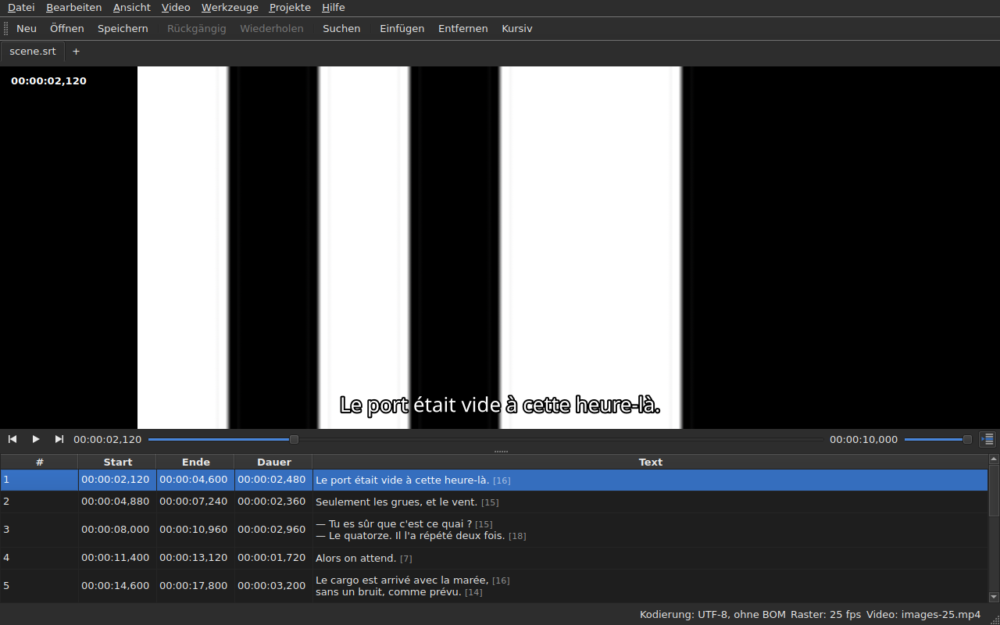

# Der Player

<!-- machine-translated -->
> Diese Seite ist eine maschinelle Übersetzung und wurde noch von keiner Leserin und keinem Leser dieser Sprache geprüft.

Das verknüpfte Video wird **im Fenster** angesehen, die aktuelle Zeile
darüber gezeichnet. So lässt sich am Film das Ergebnis
einer Verschiebung, einer Transformation oder einer Umrechnung der Bildrate prüfen.

Siehe [Das verknüpfte Video](video.md), um einen Film zu verknüpfen; diese
Seite beschreibt, was geschieht, sobald er verknüpft ist.

## Die Videoansicht

| Situation | Was das Fenster zeigt |
| :-------- | :-------------------- |
| ein Video ist verknüpft und öffnet sich | das Bild nimmt den oberen Teil ein, die Tabelle darunter |
| kein Video verknüpft | kein Bild, die Tabelle nimmt das ganze Fenster ein |
| das Video öffnet sich nicht | kein Bild, eine Meldung, und das Fenster bleibt benutzbar |

Die Aufteilung zwischen dem Bild und der Tabelle **lässt sich mit der Maus verschieben**. Das Bild wird
nicht niedriger als 180 Pixel. Ein Vergrößern des Fensters gibt den gewonnenen Platz
der Tabelle, nicht dem Bild: Was Ihnen beim Bearbeiten fehlt, sind Zeilen.

Unter dem Bild **eine Wiedergabeleiste**: wo der Film steht, wie lange er dauert,
Wiedergabe und Pause, und die Lautstärke. Siehe [Die Wiedergabeleiste](#die-wiedergabeleiste).

## Abspielen und anhalten

| Befehl | Tastenkürzel | Was er tut |
| :------ | :------- | :----------- |
| Video ▸ Wiedergabe / Pause | `Ctrl+P` | spielt ab, wenn die Wiedergabe angehalten ist, hält sie sonst an |

Der Befehl ist **deaktiviert, solange kein Video geöffnet ist**. Ein Video, das
gerade verknüpft wurde, wird **angehalten** geöffnet: Einen Film zu öffnen, heißt nicht,
ihn anzusehen.

`Ctrl+P`, wo Gaupol ein einfaches `P` hat: Ein Tastenkürzel aus einem einzigen Buchstaben im
Geltungsbereich des Fensters wird abgefangen, bevor das Element mit dem Fokus es sieht,
und so würde ein `P` auf dem Weg zu einem Zelleneditor verschluckt. Hier wird nichts
gedruckt, die Kombination ist frei.

## Die Wiedergabeleiste

Unter dem Bild, von links nach rechts — die drei Schaltflächen sind **Symbole**, die des Designs der Arbeitsumgebung, wenn es sie hat, sonst die des Qt-Stils:

| Element | Was es tut |
| :------ | :----------- |
| die zwei Schrittschaltflächen | setzen den Film zurück, voran, **um einen Bildschritt** — siehe [Bild für Bild](timing.md#bild-für-bild) |
| Wiedergabe / Pause | spielt ab oder hält an, wie `Ctrl+P` — die Schaltfläche zeigt, **was sie tun wird**: ein Dreieck im Stillstand, zwei Balken bei der Wiedergabe; der Tooltip sagt es in klaren Worten |
| die Position | `HH:MM:SS,mmm`, so geschrieben, wie die Tabelle eine Position schreibt — **als Bildnummer**, wenn [`Ansicht ▸ Positionen in Bildern`](table.md#positionen-in-bildern) angekreuzt ist |
| der Schieberegler | **liest und bewegt**: Sie ziehen den Griff, klicken in die Rille, benutzen die Pfeiltasten |
| die Dauer | die, die das Video angibt, geschrieben wie die Position |
| die Lautstärke | von 0 bis 100, siehe [Die Lautstärke](#die-lautstärke) |
| das Folgen der Tabelle | gedrückt, solange die Tabelle der Wiedergabe folgt, und bringt sie auf die gerade spielende Zeile zurück, wenn Sie sie drücken — siehe [Die Tabelle folgt der Wiedergabe](#die-tabelle-folgt-der-wiedergabe) |

**Der Schieberegler gibt nicht bei jedem Pixel weiter.** Das Ziehen des Griffs verlangt Dutzende von
Positionen pro Sekunde, und jede kostet ein dekodiertes Bild: Die erste Position geht
sofort hinaus, die folgenden warten eine Zwanzigstelsekunde, und **die zuletzt verlangte Position ist
immer die erreichte** — spätestens, wenn Sie den Griff loslassen. Das Bild hinkt daher nicht
hinter der Hand her und beginnt nicht, einen Weg zu zeichnen, den niemand ansieht.

**Der Schieberegler bewegt sich während der Wiedergabe von selbst**, und das zählt nicht als Handgriff:
Nur was Sie tun, bewegt den Film. Solange Sie den Griff halten, nimmt die Wiedergabe ihn nicht zurück.

## Der Timecode

**Die Position wird auf das Bild geschrieben**, oben links, auf einem durchscheinenden Hintergrund, der sie
auf jeder Szene lesbar macht. Sie wird vom Fenster gezeichnet, in seiner Schrift, und verlangt
vom Player nichts als die Position, die er ohnehin liefert; sie wird mit jedem Handgriff aktualisiert,
ohne auf die nächste Runde der Nachverfolgung zu warten.

## Sich im Film bewegen

Im Menü **Video** **Gaupols Handgriffe**, unter seinen Namen. Alle sind **ohne Video deaktiviert**, wie
die Wiedergabe; die drei, die auf die Auswahl wirken, sind außerdem deaktiviert, solange nichts ausgewählt ist.

| Befehl | Tastenkürzel | Was er tut |
| :------ | :------- | :----------- |
| Video ▸ Auswahl abspielen | `Ctrl+Shift+P` | spielt von **kurz vor dem Beginn** der Auswahl **bis zum Ende ihres letzten Untertitels** und hält auf dem Bild an |
| Video ▸ Zum vorherigen springen | `Ctrl+Left` | setzt die Wiedergabe an den Beginn des letzten Untertitels, der vor der Position **geendet** hat |
| Video ▸ Zum nächsten springen | `Ctrl+Right` | setzt die Wiedergabe an den Beginn des ersten Untertitels, der nach der Position **beginnt** |
| Video ▸ Rückwärts springen | `Ctrl+Shift+Left` | geht um einen Sprung zurück — standardmäßig dreißig Sekunden |
| Video ▸ Vorwärts springen | `Ctrl+Shift+Right` | geht um einen Sprung voran |
| Video ▸ Zum Auswahlanfang springen | `Ctrl+Up` | setzt die Wiedergabe an den Beginn der Auswahl, **mit dem Vorlauf davor** |
| Video ▸ Zum Auswahlende springen | `Ctrl+Down` | setzt die Wiedergabe an das Ende der Auswahl, **mit dem Vorlauf davor** |

**Die Tastenkürzel sind die von Gaupol**, bis auf eines: `Play Selection` ist dort `O`, und ein
bloßer Buchstabe wird vom Fenster abgefangen, bevor die Zelle in Bearbeitung ihn sieht — ein
`o` in einem Text zu tippen, würde den Film starten. `Ctrl+P` ist die Antwort der Wiedergabe, `Ctrl+Shift+P` die
der Auswahl. Die Pfeiltasten bleiben beim Zelleneditor, wenn er
geöffnet ist: `Ctrl+Left` bewegt dort den Cursor um ein Wort, nicht die Wiedergabe.

- **Der Sprung** beträgt 30 Sekunden und lässt sich von 1 Sekunde bis zu einer Stunde einstellen — siehe
  [Die Einstellungen](preferences.md#der-player). Er geht weder über den Beginn des Films noch über sein Ende hinaus.
- **Der Vorlauf** beträgt eine Sekunde: Sie sehen ein wenig **vor** dem Untertitel hin, um ihn kommen zu sehen.
  Er lässt sich von 0 bis 60 Sekunden einstellen, und die Wiedergabe geht nicht unter null.
- **Ein Nachbar, den es nicht gibt** — nichts vor dem ersten Untertitel, nichts nach dem letzten —, tut
  nichts und sagt nichts: Die Wiedergabe bleibt, wo sie ist.
- **Jeder Handgriff zeigt sich sofort**: Die Leiste, der Timecode und die gezeichnete Zeile sind
  aktuell, wenn er endet, ohne auf die nächste Runde zu warten.

## Die Lautstärke

Die Lautstärke ist die des **Players**, von 0 bis 100, und nicht die des Systems. Sie wird mit dem Schieberegler
der Leiste eingestellt, oder mit zwei Handgriffen im Untermenü `Video ▸ Audio`, in Fünferschritten:

| Befehl | Tastenkürzel | Was er tut |
| :------ | :------- | :----------- |
| Video ▸ Audio ▸ Lautstärke verringern | `Ctrl+-` | senkt die Lautstärke um fünf |
| Video ▸ Audio ▸ Lautstärke erhöhen | `Ctrl++` oder `Ctrl+=` | hebt sie um fünf — das zweite für Tastaturen, auf denen das Plus die Umschalttaste braucht |

**Sie wird von einer Sitzung zur nächsten gemerkt** und jedem Video gegeben, das Sie öffnen. Ein Wert außerhalb
von 0 bis 100 in der Einstellungsdatei verhindert das Öffnen nicht: Er wird ignoriert, und das Fenster sagt es.
**Die Tonspur hingegen wird nicht gemerkt** — eine Spurnummer gehört zu ihrer Datei; siehe
[Die Tonspur](video.md#die-tonspur).

## Auswahl und Wiedergabe

Beide wirken in beide Richtungen.

| Was Sie tun | Was geschieht |
| :---------- | :----------- |
| eine Zeile auswählen | die Wiedergabe springt **an den Beginn dieses Untertitels** |
| die Auswahl nach unten erweitern | nichts weiter: Es zählt die erste Zeile der Auswahl |
| die Wiedergabe läuft weiter | die **aktuelle Zeile** folgt dem Untertitel auf dem Bildschirm, **getönt**, und die Tabelle **zentriert** sie — siehe [Die Tabelle folgt der Wiedergabe](#die-tabelle-folgt-der-wiedergabe) |

Die aktuelle Zeile und die Auswahl sind zwei verschiedene Dinge. Die Wiedergabe
bewegt die erste und **rührt die zweite nie an**: Die Auswahl ist das, worauf
eine Operation wirkt, und ein Film, der in einer Ecke läuft, hat nichts damit zu tun,
die Zielzeile des Benutzers Zeile für Zeile neu zu schreiben.

Die Tönung folgt derselben Regel: Sie ist eine Markierung, keine Auswahl. **Eine
Auffälligkeit hat Vorrang vor ihr** — eine Zeile, die beides trägt, behält die Farbe
ihres Fehlers, denn ein Fehler ist da, um behoben zu werden, während eine angezeigte Zeile es nur
für die Dauer einer Dialogzeile ist. Siehe [Die Tabelle](table.md).

### Die Tabelle folgt der Wiedergabe

**Die Tabelle zentriert die gerade spielende Zeile** — in der Mitte dessen, was sie zeigt, nicht am Rand, wo es genügen würde, um
sie sichtbar zu machen. Sie tut es, **wenn die Zeile wechselt**, nicht bei jedem Takt der Nachverfolgung: Eine Dialogzeile dauert
Sekunden, und jede Zehntelsekunde neu zu zentrieren, wäre zielloses Scrollen.

**Ein manuelles Scrollen setzt die Nachverfolgung aus.** Das Mausrad, die Bildlaufleiste und ein Klick in die Tabelle
setzen sie aus: Die Tabelle bleibt, wo Sie sie hingestellt haben, während die aktuelle Zeile, die gezeichnete Zeile und die Leiste
weiter dem Film folgen. Die Schaltfläche der Nachverfolgung — **das Symbol der Zeilen einer Tabelle, eine davon mit einem Pfeil markiert**, rechts auf der Wiedergabeleiste;
ihr Tooltip sagt „Der Wiedergabe folgen“ — **ist gedrückt, solange die Tabelle folgt**, und springt dann heraus.

**Die Nachverfolgung wird bei einem Handgriff des Players wieder aufgenommen**: Wiedergabe gestartet, ein Sprung, ein Schritt, eine gesetzte Marke, eine
Einfügung an der Position oder eine Bewegung der Leiste — die Tabelle zentriert dann sofort auf der
gerade spielenden Zeile, selbst wenn es bereits dieselbe war. **Oder auf Wunsch**: Das Drücken der Schaltfläche stellt sie wieder her, und
das Loslassen setzt sie aus. Es gibt keinen Zeitgeber: Was die Nachverfolgung wieder aufnimmt, ist immer ein Handgriff.

Der Wechsel zu einem anderen Tab nimmt die Nachverfolgung auf dem Film dieses Tabs wieder auf.

**Eine laufende Bearbeitung wird nicht unterbrochen.** Solange ein Zelleneditor
geöffnet ist, bleibt die aktuelle Zeile, wo sie ist; die auf das Bild gezeichnete
Zeile hingegen folgt weiter, da sie niemanden stört.

## Die gezeichnete Zeile

Was auf dem Bild angezeigt wird, kommt aus dem **geöffneten Dokument**, nie aus einer Datei:
**Was Sie auf dem Bild sehen, ist das, was Sie gerade getippt haben**, ohne Umweg über die
Festplatte. Der Text erscheint zentriert, unten im Bild, und verschwindet zwischen zwei
Untertiteln.

**Mit einer Übersetzung ist die Zeile die des Zieltextes**: die Übersetzung, wenn
die aktuelle Zelle in der Spalte `Translation` steht, der Haupttext
überall sonst. Es ist die Regel aller Textoperationen — siehe [Der
Text, auf den die Operationen zielen](table.md#der-text-auf-den-die-operationen-zielen) —,
und **es gibt keine Einstellung**: Der Wechsel von einer Spalte zur anderen ändert, was
das Bild zeigt, höchstens eine Zehntelsekunde später. Ohne Übersetzung, oder
mit entfernter Spalte, ändert sich nichts: Es ist der Haupttext.

Ein Untertitel, den die Übersetzung noch nicht eingeholt hat, zeigt **nichts**, solange
die aktuelle Spalte die Übersetzung ist: Es ist nicht der Haupttext, der
seinen Platz einnimmt.

**Die Tags des Formats werden verstanden, nie so gezeichnet, wie sie sind.** Das Modell trägt den
Text so, wie die Datei ihn schreibt, und es ist der Tag-Pivot — der der Formatkonvertierung —,
der ihn liest, bevor er ihn dem Bild gibt:

| In der Datei | Auf dem Bild |
| :---------- | :------------- |
| fett, kursiv, unterstrichen | angewendet: `<i>no</i>` wird als *no* angezeigt, ohne seine Tags |
| Farbe | angewendet |
| Schriftart, Größe | entfernt, der Text bleibt |
| Position, Ausrichtung, Sprecher, alles ohne Entsprechung auf dem Bildschirm | entfernt, der Text bleibt |
| `{` und `}` im Text | gezeichnet: „{laughs}“ wird als „{laughs}“ angezeigt |

Eine Advanced-SSA-Datei wird auf dieselbe Weise gelesen: Ihre `{\i1}` werden angewendet, und ihr
`{\an8}` wird entfernt — die Zeile bleibt unten im Bild. Jeder Text wird **im Format
seiner eigenen Datei** gelesen, die Übersetzung ebenso wie der Haupttext.

**Die benachbarte Untertiteldatei wird vom Player nicht geladen**, selbst wenn sie den Namen des
Films trägt. Es wäre die, die gerade bearbeitet wird, und das Bild zeigte dann den Stand der Festplatte,
während die Tabelle etwas anderes zeigt.

## Eine Änderung vorab ansehen

Es ist **nichts Besonderes zu tun**: Sie wenden die Operation an, sehen sich
den Film an und wählen `Undo: shifting` — oder die betreffende Operation —, wenn das
Ergebnis nicht passt. Siehe [Rückgängig und Wiederholen](undo.md).

Es gibt keinen eigenen Vorschaumodus, und das ist Absicht: Was Sie
ansehen, ist das Dokument, wie es ist, kein unsichtbarer vorläufiger Zustand.

## Wenn das Bild nicht erscheint

Zwei mögliche Meldungen, beide mit dem Pfad der Datei vorangestellt:

| Meldung | Was geschehen ist |
| :------ | :------------ |
| `<file>: <reason>` | der Player hat die Datei abgelehnt — unbekanntes Format, fehlende Datei, Verzeichnis |
| `<file>: no video player is available` | es konnte kein Player gebaut werden |

In beiden Fällen **bleibt das Video verknüpft** — Sie müssen ja sehen, um welche
Datei es sich handelt, um eine andere zu wählen —, und **das Fenster bleibt benutzbar**:
Das Dokument ist geöffnet, die Operationen funktionieren, und das Speichern ebenso.

**Das Bild wird im Fenster selbst gezeichnet**: `libmpv` füllt einen Puffer in der
Größe der Ansicht, in echten Pixeln, und das Fenster malt ihn. Nichts davon hängt von der
Grafikplattform ab — dasselbe Bild unter X11, unter Wayland und ohne Bildschirm —, und es
folgt Größenänderungen: Das Seitenverhältnis des Films bleibt erhalten, der Rest der
Ansicht ist schwarz.

Die zweite Meldung erscheint daher nur, wenn die Bibliothek `libmpv` den Start verweigert,
obwohl sie beim Bauen erforderlich ist.

Das Rendern läuft über den Prozessor, aber **das Dekodieren kann auf der Grafikkarte erfolgen**: Sie
dekodiert, das Bild wird in den Speicher zurückkopiert und dann wie zuvor gezeichnet. Eine Maschine ohne
nutzbare Karte dekodiert auf dem Prozessor, ohne Meldung. Bei einem 1080p-Film in H.264 hält die Wiedergabe mit
der Echtzeit mühelos Schritt. **Ein 4K-Film in schwerem HEVC hält möglicherweise nicht Schritt**: Gemessen auf zwei
Kernen dekodiert er ohne die Karte mit dem 0,6-Fachen der Echtzeit, und ein Bildschritt dauert dort mehrere
Sekunden, wenn das Schlüsselbild weit entfernt ist. Die Karte verkürzt diese Zeit — um ein Drittel bis zwei Drittel, je nach Film
—, ohne sie zu beseitigen. **Sie ändert das angezeigte Bild nicht**: Ein Schritt oder ein Sprung landen mit und ohne sie auf
demselben Bild. Um sie abzuschalten, wählen Sie `Decode on the graphics card` ab, in
[`Preferences…`](preferences.md#der-player).

## Was es nicht gibt

**Eine Marke setzen, Bild für Bild vorgehen und einen Rand um ein Bild verschieben** stehen in
[Timing anhand des Videos](timing.md), nicht hier. Was es nicht gibt und wonach zu suchen sinnlos ist:

- eine Wellenform;
- eine automatische Wiedergabe beim Öffnen eines Films;
- der Stil der gezeichneten Zeile (Schriftart, Farbe, Position, Hintergrund): Sie behält den des Fensters;
- Hardware-Dekodierung ohne Kopieren: siehe „Wenn das Bild nicht erscheint“ oben.

Dieses Handbuch beschreibt, was existiert: Was kommen wird, und in welcher Reihenfolge, steht in der
[Roadmap](../../../../feuille-de-route.md).
