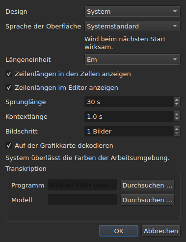

# Die Einstellungen

<!-- machine-translated -->
> Diese Seite ist eine maschinelle Übersetzung und wurde noch von keiner Leserin und keinem Leser dieser Sprache geprüft.

Das Fenster merkt sich, was Sie mit der Maus einstellen — **wo es war**, **ob es
maximiert war**, **die Breite seiner Spalten**, **die Position des
Trenngriffs** zwischen dem Film und der Tabelle — und **wo Sie arbeiten**, damit
`Open…` am richtigen Ort öffnet. Nichts davon wird über einen Dialog eingestellt:
Sie verschieben, Sie ziehen, und es wird gemerkt.

**Sechs Einstellungen haben einen eigenen Dialog**, `Bearbeiten ▸ Einstellungen …`, und das ist das
Kriterium: Eine Einstellung, die bereits einen Handgriff hat, braucht kein Feld. Das
Design hat keinen, ebenso wenig die Einheit der Zeilenlängen, die zwei Kontrollkästchen, die
sie anzeigen, oder der Sprung und der Vorlauf des Players. Siehe [Das Design](#das-design),
[Zeilenlängen](#zeilenlängen) und [Der Player](#der-player).

**Die Sprache der Oberfläche steht im selben Dialog, und sie ist diejenige, die wartet**: Sie gilt beim
nächsten Start, nicht sofort. Siehe [Die Sprache der Oberfläche](#die-sprache-der-oberfläche).

**Die Lautstärke hat keinen**: Die Leiste unter dem Bild und zwei Handgriffe stellen sie ein, und sie wird gemerkt.

**Eine weitere wird dort eingestellt, wo sie benutzt wird**: Die Seite, auf die `Insert Subtitles…` seine
Zeilen setzt, ist ein Feld dieses Dialogs, und die letzte Wahl wird gemerkt. Siehe
[Zeilen einfügen, entfernen, zusammenführen und teilen](lines.md#die-seite-wird-gemerkt).

**Ebenso die zwei Optionen der Suche**: `Regular expression` und
`Ignore case` bleiben angekreuzt oder nicht angekreuzt, von einem Öffnen des Dialogs zum
nächsten und von einer Sitzung zur nächsten. Siehe
[Suchen und Ersetzen](find-and-replace.md#die-zwei-optionen).

**Ebenso die Einstellungen von `Adjust Durations…`**: die Lesegeschwindigkeit, ihre zwei
Richtungen und die drei Dauern mit ihren Kontrollkästchen — jede behält ihren Wert, angekreuzt
oder nicht. Siehe [`Adjust Durations…`](operations.md#adjust-durations).

**Und die zuletzt in `Save As…` gewählte Kodierung**, mit ihrer Byte-Reihenfolge-Marke.
Siehe [die Datei](#die-datei).

**Und was der Assistent `Correct Texts…` und `Spell-Check Settings…` einstellen**: die
angekreuzten Aufgaben und ihr Code, die Kontrollkästchen der Muster, die Einstellungen des Zeilenumbruchs, die Sprache,
das Ziel der Prüfung und das Unterstreichen beim Tippen. Siehe [Texte korrigieren…](correct-texts.md) und
[Rechtschreibung prüfen…](check-spelling.md#rechtschreibeinstellungen). **Das Ziel und das
Dokument von `Correct Texts…` werden nicht gemerkt.**

**Was nicht gemerkt wird:** die zuletzt geöffnete Datei — siehe
[Das gemerkte Verzeichnis](#das-gemerkte-verzeichnis).

## Der Player

Vier Felder. **Sprunglänge** und **Kontextlänge** stammen von Gaupol und haben dessen Werte; **Bildschritt** und **Auf der Grafikkarte dekodieren** sind subedits eigene:

| Feld | Was es einstellt | Standard | Grenzen |
| :---- | :----------- | ------: | :----- |
| `Seek length` | den Sprung von `Seek Backward` und `Seek Forward` | 30 s | von 1 s bis zu einer Stunde |
| `Context length` | den Vorlauf vor der Auswahl, für `Seek Selection Start`, `Seek Selection End` und `Play Selection` | 1 s | von 0 bis 60 s, auf die Zehntelsekunde |
| `Frame step` | den Schritt, **in Bildern**, von `Step Backward` und `Step Forward` sowie beim Verschieben eines Randes | 1 Bild | von 1 bis 1000 Bildern |
| `Decode on the graphics card` | lässt die Grafikkarte den Film dekodieren, wenn die Maschine eine hat; ohne Karte ändert sich nichts | angekreuzt | angekreuzt oder nicht |

Sie gelten **sofort**, ohne auf einen Neustart zu warten, und werden von einer Sitzung zur nächsten gemerkt,
unter `video.seek-length` (in Sekunden), `video.context-length-ms` (in Millisekunden), `video.step-frames` (in Bildern) und `video.hardware-decoding` (`true` oder `false`).
**Ein Wert außerhalb der Grenzen, oder einer, der keine Zahl ist**, hindert das Fenster nicht am Öffnen: Er
wird ignoriert, der Standard bleibt, und das Fenster sagt es beim Öffnen. **Der Bildschritt ist niemals in Millisekunden**: Ein Schritt von N Bildern ist immer N Bilder, wie auch immer die Bildrate des Films ist — siehe [Timing anhand des Videos](timing.md#bild-für-bild). Die Lautstärke wird in `video.volume` gemerkt,
von 0 bis 100, mit derselben Nachsicht.

## Die Datei

```
~/.config/subedit/settings.conf
```

Genauer `$XDG_CONFIG_HOME/subedit/settings.conf`, wenn diese Variable
gesetzt ist. Sie wird **beim Schließen des Fensters** geschrieben und beim Öffnen gelesen.
Ein unterbrochenes Programm — beendet, oder durch einen Absturz angehalten — schreibt nichts, und die
nächste Sitzung findet vor, was die vorige hinterlassen hatte.

Die Datei ist Text, und sie lässt sich von Hand bearbeiten. Das ist eine Eigenschaft und keine
Nebenwirkung: Sie macht eine Einstellung korrigierbar, wenn die Oberfläche,
die sie einstellt, gerade diejenige ist, die defekt ist.

### Zwei Blöcke, einer davon mit der Befehlszeile geteilt

Die Datei wird in **zwei Blöcken** geschrieben, jeder unter einem Banner-Kommentar:

| Block | Schlüssel | Gelesen von |
| :---- | :--- | :------ |
| `# Operation settings: shared by the window and the command line` | die Schlüssel `duration-adjust.*` und `correction.*` | dem Fenster **und** `subedit-cli` |
| `# Display preferences: the window's own` | alle anderen Schlüssel — Geometrie, Spalten, Design, Sprache der Oberfläche, Suche, Rechtschreibprüfung, Editor, Video, letztes Verzeichnis, Schreibkodierung | nur dem Fenster |

**`subedit-cli` liest den Block der Operationen standardmäßig**: Was `Adjust Durations…` und
`Correct Texts…` hier speichern, ist auch das, wovon [`subedit-cli adjust`](../subedit-cli/adjust.md)
und ein Teil von [`subedit-cli correct`](../subedit-cli/correct.md) ausgehen, sofern keine Option
der Befehlszeile etwas anderes sagt. **Die Anzeigeeinstellungen liest es nie.** Sein
Befehl [`config`](../subedit-cli/config.md) listet die Schlüssel der Operationen auf, zeigt ihre Werte und
ändert sie — `subedit-cli config set duration-adjust.speed 12` —, und das Fenster sieht die Änderung
bei seinem nächsten Öffnen. **Eine Änderung, die bei offenem Fenster vorgenommen wird, überlebt dessen Schließen nicht**: Das
Fenster schreibt die ganze Datei mit dem neu, was es hält. `--no-config` lässt eine Befehlszeile die
Datei ignorieren. Siehe
[Die Einstellungsdatei](../subedit-cli/invocation.md#die-einstellungsdatei).

Der Leser nimmt die Schlüssel in beliebiger Reihenfolge, mit oder ohne die Banner: Eine Datei, die geschrieben wurde, bevor es
die zwei Blöcke gab, wird unverändert gelesen und beim nächsten Schließen in zwei Blöcken neu geschrieben.

| Option | Was sie enthält | Standard |
| :----- | :------------ | :------ |
| `window.geometry` | `x,y,width,height`, in Pixeln; Breite und Höhe nicht null | das Fenster wählt seine Größe selbst |
| `window.maximised` | `true` oder `false` | `false` |
| `table.columns` | vier Breiten in Pixeln, durch Kommas getrennt — `#`, `Start`, `End`, `Duration`, auch ausgeblendet | die Tabelle wählt ihre Größe selbst |
| `table.order` | die sechs Spalten, **jede genau einmal**, in der Reihenfolge, in der die Tabelle sie zeigt: `number`, `start`, `end`, `duration`, `text`, `translation` | `number,start,end,duration,text,translation` |
| `table.hidden` | die entfernten Spalten, unter `number`, `start`, `end` und `duration`; leer: keine | keine |
| `window.table-share` | der Anteil der Höhe, der der Tabelle gegeben wird, in Prozent, von 1 bis 99 | das Fenster teilt auf, wie es das immer getan hat |
| `file.directory` | ein **absoluter** Verzeichnispfad | keiner: `Open…` öffnet dort, wo das Programm gestartet wurde |
| `general.theme` | `system`, `light` oder `dark` | `system` |
| `interface.language` | `system`, oder der Name einer Sprache, so wie ihr Katalog heißt: zwei oder drei Kleinbuchstaben, dann wahlweise `_` und zwei Großbuchstaben — `fr`, `pt_BR`; `en` für Englisch | `system` |
| `edit.insert-placement` | `above` oder `below` | `below` |
| `file.write-encoding` | der Name einer Kodierung, die ICU schreiben kann und deren Konverter nicht seine eigene Marke schreibt | keine |
| `file.write-bom` | `true` oder `false` | `false` |
| `search.regex` | `true` oder `false` — das Muster ist ein regulärer Ausdruck | `false` |
| `search.ignore-case` | `true` oder `false` — die Groß-/Kleinschreibung wird ignoriert | `true` |
| `duration-adjust.speed` | die Lesegeschwindigkeit, in Zeichen pro Sekunde, strikt positiv; eine Dezimalzahl wird so kurz wie möglich geschrieben (`15`, `12.5`) | `15` |
| `duration-adjust.lengthen` | `true` oder `false` — verlängern, was zu kurz ist, um gelesen zu werden | `true` |
| `duration-adjust.shorten` | `true` oder `false` — kürzen, was länger als nötig angezeigt bleibt | `false` |
| `duration-adjust.minimum-enabled` | `true` oder `false` — die Mindestdauer wird verlangt | `true` |
| `duration-adjust.minimum-ms` | die Mindestdauer, in Millisekunden, ganzzahlig und nicht negativ | `1500` |
| `duration-adjust.maximum-enabled` | `true` oder `false` — die Höchstdauer wird verlangt | `false` |
| `duration-adjust.maximum-ms` | die Höchstdauer, in Millisekunden, ganzzahlig und nicht negativ | `6000` |
| `duration-adjust.gap-enabled` | `true` oder `false` — der Abstand zum nächsten Untertitel wird verlangt | `true` |
| `duration-adjust.gap-ms` | der Abstand, in Millisekunden, ganzzahlig und nicht negativ | `0` |
| `correction.mentions.enabled`, `correction.common-errors.enabled`, `correction.capitalization.enabled`, `correction.line-break.enabled` | `true` oder `false` — die Aufgabe ist auf der ersten Seite von `Correct Texts…` angekreuzt | `false`, `true`, `true`, `false` |
| `correction.mentions.code`, `correction.common-errors.code`, `correction.capitalization.code`, `correction.line-break.code` | der Code der Muster der Aufgabe: `Zyyy`, oder `Script[-language[-COUNTRY]]` — `Latn-en-US`; nicht leer | `Zyyy` |
| `correction.human`, `correction.ocr` | `true` oder `false` — die Klassen der häufigen Fehler | `true`, `true` |
| `correction.sound-in-brackets`, `correction.sound-in-parentheses` | `true` oder `false` — die zwei Kontrollkästchen der Seite `Mentions` | `false`, `false` |
| `correction.line-break.max-length` | die Höchstlänge einer Zeile, dezimal; der Dialog begrenzt sie auf 1 bis 1000 | `24` |
| `correction.line-break.max-lines` | die Höchstzahl der Zeilen, ganzzahlig; der Dialog begrenzt sie auf 1 bis 100 | `3` |
| `correction.line-break.in-ems` | `true`: die Länge wird in *Em* gemessen; `false`: in Zeichen | `true` |
| `correction.line-break.skip-on-length`, `correction.line-break.skip-on-lines` | `true` oder `false` — die zwei Bedingungen zum Überspringen werden verlangt | `true`, `true` |
| `correction.line-break.skip-max-length`, `correction.line-break.skip-max-lines` | die zwei Schwellen zum Überspringen, in der gewählten Einheit | `24`, `3` |
| `correction.join-split.enabled` | `true` oder `false` — die Aufgabe `Join or Split Words` ist angekreuzt | `false` |
| `correction.join-split.join`, `correction.join-split.split` | `true` oder `false` — zusammenfügen, trennen | `true`, `false` |
| `correction.join-split.language` | ein Locale-Code — `fr`, `en_US`, `sr@Latn` —; leer: die Sprache des Systems | leer |
| `correction.remove-blank` | `true` oder `false` — `Remove all blank subtitles` | `true` |
| `correction.activations` | die Kontrollkästchen der Muster, die der Benutzer geändert hat, `<type>:<code>:<name>:<0\|1>`, durch Kommas getrennt; **ein Komma oder ein Backslash in einem Namen wird mit vorangestelltem Backslash geschrieben** (`\,` und `\\`), und ein unlesbarer Eintrag verliert nur seine eigene Einstellung — er wird gemeldet, die anderen bleiben erhalten | leer |
| `spell-check.language` | ein Locale-Code, etwa `fr_FR`; leer: die Sprache des Systems | leer |
| `spell-check.target` | `selection`, `current-project` oder `all-projects` | `current-project` |
| `spell-check.document` | `main` oder `translation` | `main` |
| `spell-check.inline` | `true` oder `false` — unbekannte Wörter beim Tippen im Editor einer Zelle unterstreichen | `false` |
| `editor.length-unit` | `em` oder `characters` — die Einheit der Zeilenlängen, die die Tabelle und der Editor zeigen | `em` |
| `editor.show-lengths-cell` | `true` oder `false` — auf jede Zeile einer Textzelle folgt ihre Länge | `true` |
| `editor.show-lengths-edit` | `true` oder `false` — der Editor einer Zelle zeigt die Länge jeder Zeile in einem Rand | `true` |

**Die Datei nimmt mehr an als der Dialog.** Der Leser nimmt jede strikt
positive Geschwindigkeit und jede nicht negative Dauer; der Dialog `Adjust
Durations…` hingegen begrenzt die Geschwindigkeit auf 1 bis 99 Zeichen pro Sekunde und jede
Dauer auf 0 bis 99 s. Ein Wert der Datei außerhalb dieser Grenzen wird beim Öffnen des Dialogs auf die
Grenze zurückgeführt, und die Datei behält ihn so, sobald der
Dialog angenommen und das Fenster geschlossen ist. Ein abgebrochener Dialog ändert nichts an dem, was
gemerkt wird.

**`file.write-encoding` merkt sich die zuletzt in `Save As…` gewählte Kodierung und
drängt sich nie einer Datei auf.** Ein geöffnetes Dokument trägt seine eigene Kodierung,
und diese schlägt das Feld vor: Es in einer anderen neu zu schreiben, weil eine
drei Wochen alte Einstellung das sagt, würde verlieren, was das Lesen bewahrt hat.
Was diese Einstellung sich merkt, dient dem Dokument, das keine Datei hat — dem
gerade erstellten.

**Es ist ein bewusstes „Nein“ und kein Versäumnis.** Wer immer in derselben
Kodierung liefert und geerbte Dateien in einer anderen öffnet, wählt sie für
jede Datei erneut; das Feld schlägt sie vor, und die Garantie des Hin- und Rückwegs gilt
für alle.

**`file.write-bom` trägt die Marke derselben Kodierung**, und zwei
Zeilen sind tatsächlich nötig: Der Name einer Kodierung sagt nicht, ob ihr ihre Marke vorangeht, ebenso wenig
wie `--encoding` sagt, was `--bom` sagt. Beide werden zusammen gelesen, in
beliebiger Reihenfolge, und ein `file.write-bom` ohne gemerkte Kodierung stellt nichts ein.

**Ein Anteil und keine Höhen für den Trenngriff**, und das macht ihn
nützlich: Drei Höhen in Pixeln bedeuten nichts mehr, sobald das Fenster
in einer anderen Größe öffnet, und ein Fenster öffnet oft in einer anderen Größe.
Der Anteil lässt sich überall wieder anwenden. Er wird **auf das zurückgeführt, was das Fenster annimmt**, wenn
er zu klein ist — der Streifen des Films hat eine Mindesthöhe.

**Vier Breiten für sechs Spalten**, und das ist kein Versäumnis: Es sind die
von `#`, `Start`, `End` und `Duration`, in dieser Reihenfolge, wie auch immer die der
Tabelle ist, und **eine ausgeblendete Spalte behält ihre eigene** — sie findet sie wieder, wenn sie
wieder angezeigt wird. Die letzte angezeigte Spalte nimmt, was die anderen übrig lassen, und ihr
eine Breite zu geben, würde nichts bewirken; die des Textes und der Übersetzung werden daher
nicht gemerkt.

## Was geschieht, wenn die Datei nicht sagt, was erwartet wird

Eine Konfiguration ist eine Annehmlichkeit. **Ihr Versagen kostet die Annehmlichkeit und nichts
sonst**: Das Fenster öffnet sich in jedem Fall.

| Fall | Was geschieht |
| :--- | :----------- |
| die Datei existiert nicht | alle Standardwerte, und nichts wird gesagt — es ist der erste Start |
| die Datei existiert und kann nicht gelesen werden | alle Standardwerte, und der Grund wird in den Fehlerstrom geschrieben |
| eine Option fehlt | ihr Standardwert |
| ein Schlüssel ist unbekannt | ignoriert, ohne ein Wort, und in der neu geschriebenen Datei nicht enthalten |
| ein Wert kann nicht gelesen werden | sein Standardwert bleibt, und die Option wird im Fehlerstrom genannt |

```console
$ subedit-gui film.srt
subedit-gui: /home/vous/.config/subedit/settings.conf: window.geometry: "plus tard" cannot be read, keeping the default
```

**Die Meldung geht in den Fehlerstrom und nirgendwohin sonst.** Ein modales
Fenster beim Start wegen einer unlesbaren Einstellung würde den Benutzer anhalten,
wegen eines Fehlers, der ihn an nichts hindert, und bevor er überhaupt etwas verlangt hat.

## Die auskommentierten Optionen

Die neu geschriebene Datei enthält **alle** bekannten Optionen, und die, die auf
ihrem Standardwert belassen sind, werden als Kommentare geschrieben:

```
#window.geometry = 0,0,1280,800
#window.maximised = false
#table.columns = 60,110,110,110
#table.order = number,start,end,duration,text,translation
#table.hidden = start,end
```

Das ist keine Ziererei. Ohne das bliebe eine nie angerührte Option auf dem Wert
des Tages eingefroren, an dem sie geschrieben wurde, und **ein verbesserter Standardwert
würde nie jemanden erreichen**. Mit ihm ändert eine Änderung eines Standardwerts das
Verhalten aller, die ihn nicht überschrieben haben — und genau das
muss ein Standardwert tun.

Um eine Option zu überschreiben: das `#` entfernen und den Wert ändern. Um zum
Standardwert zurückzukehren: die Zeile löschen oder sie wieder auskommentieren.

Die Geometrie, die Breiten und die entfernten Spalten zeigen eine **Form** und
keinen geltenden Wert: Der Standardwert der Geometrie und der der Breiten ist
„was das Fenster wählt“, was sich nicht in Zahlen schreiben lässt, und der von
`table.hidden` ist „keine“, was sich nicht lesen lässt. Der Kopf der Datei sagt es
ebenfalls. `table.order` hingegen zeigt durchaus die Standardreihenfolge.

## Das gemerkte Verzeichnis

`Open…` öffnet im Verzeichnis der **zuletzt geöffneten oder gespeicherten Datei**,
und nicht in dem eines Dialogs, den Sie abgebrochen haben: Was zählt, ist, wo Sie
arbeiten, nicht, wo Sie nachgesehen haben.

**Die letzte Datei hingegen wird nicht gemerkt.** Sie sich zu merken, hieße,
beim Start ein Dokument wieder zu öffnen, nach dem niemand gefragt hat. Ein Verzeichnis zu merken,
*richtet* einen Dialog *aus*; eine Datei zu merken, würde eine öffnen.

## Das Design

`Bearbeiten ▸ Einstellungen …` öffnet sich mit dem Design, einer Einstellung ohne Handgriff, über den
[Zeilenlängen](#zeilenlängen).

| Wert | Was er tut |
| :---- | :----------- |
| `System` | **nichts** — die Farben bleiben die der Arbeitsumgebung |
| `Light` | setzt eine helle Palette |
| `Dark` | setzt eine dunkle Palette |

Das gewählte Design gilt **sofort**, ohne Neustart.

**„System“ tut nichts, und das ist kein Mangel.** Die Version von Qt, auf
der subedit gebaut ist, hat keine Möglichkeit, die Arbeitsumgebung zu fragen, ob sie
hell oder dunkel sein will, noch benachrichtigt zu werden, wenn sie es sich anders überlegt. Statt
eine Abfrage zu erfinden, die wir nicht durchzuführen wissen, liefert das Werkzeug die zwei Designs,
die sich verlangen lassen, und überlässt dem Toolkit die Entscheidung für das dritte —
was Gaupol unter denselben Bedingungen tut.

Unter einer Arbeitsumgebung, deren Design bereits dunkel ist, ergibt `System` daher ein dunkles
Fenster; unter einer hellen Arbeitsumgebung ein helles Fenster. `Light` und `Dark` setzen sich
darüber hinweg, wie auch immer die Arbeitsumgebung ist.

**Die Tönungen der Auffälligkeiten bleiben unter beiden Paletten lesbar** — siehe
[Die Tabelle](table.md#die-auffälligkeiten). Das ist keine Annahme: Der Kontrast
des Textes auf jeder der Tönungen wird von einem Test geprüft, auf beiden Hintergründen.

## Die Sprache der Oberfläche

`Bearbeiten ▸ Einstellungen …` wählt die Sprache des Fensters, unter dem Design.

| Feld | Werte | Standard |
| :---- | :----- | :------ |
| `Interface language` | `System default`; `English`; dann jede mit dem Programm installierte Sprache, unter ihrem eigenen Namen — `Français` | `System default` |

**Sie wird beim nächsten Start wirksam**, und der Dialog sagt es unter dem Feld: Das Fenster wird
übersetzt, während es gebaut wird, und ein laufendes Fenster behält die Sprache, in der es gestartet ist. Die Wahl wird
in der Einstellungsdatei unter `interface.language` aufbewahrt und gelesen, wenn das Fenster das nächste Mal öffnet.

| Wahl | Das Fenster startet in |
| :----- | :------------------- |
| `System default` | der Sprache der Umgebung, wie vor jeder Wahl — `LANGUAGE`, `LC_ALL`, `LC_MESSAGES`, `LANG`; siehe [Sprache](invocation.md#sprache) |
| `English` | Englisch, was auch immer die Umgebung sagt |
| eine installierte Sprache | dieser Sprache, **was auch immer die Umgebung sagt**, `LC_ALL=C` eingeschlossen: Eine hier getroffene Wahl ist eine ausdrückliche |

Die Liste enthält die Sprachen, deren Katalog unter `<prefix>/share/subedit/locale` installiert ist;
Englisch ist immer dabei, da es die Sprache ist, in der das Programm geschrieben ist. Eine Sprache wird
unter ihrem eigenen Namen gezeigt, den kein Katalog übersetzt, damit eine Leserin oder ein Leser die eigene findet.

**Ein Wert, den das Programm nicht einlösen kann, kostet nichts als die Wahl:**

| Was die Datei sagt | Was geschieht |
| :----------------- | :----------- |
| der Name einer Sprache ohne installierten Katalog — eine von einer anderen Maschine mitgebrachte Datei | das Fenster folgt der Umgebung, ohne ein Wort; `Preferences…` zeigt diese Sprache, unter ihrem Namen oder ihrem Code, und behält sie, sofern keine andere gewählt wird |
| etwas, das kein Name einer Sprache ist — `French`, `fr_FR.UTF-8` | `system`, der Standardwert, und die Option wird im Fehlerstrom genannt, wie jeder unlesbare Wert |

```console
$ subedit-gui film.srt
subedit-gui: /home/vous/.config/subedit/settings.conf: interface.language: "French" cannot be read, keeping the default
```

**Die Befehlszeile liest sie nie**: `subedit-cli` wählt seine Sprache allein aus der Umgebung,
und `subedit-cli config set interface.language fr` wird als Anzeigeeinstellung abgelehnt.

## Zeilenlängen




`Bearbeiten ▸ Einstellungen …` stellt auch ein, **was die Tabelle und der Editor von der
Länge der Zeilen zeigen** — Gaupols Lineal und Rand.

| Feld | Was es tut | Standard |
| :---- | :----------- | :------ |
| `Length unit` | die Einheit der Längen: `Ems` oder `Characters` | `Ems` |
| `Show line lengths in cells` | auf jede Zeile einer Textzelle folgt ihre Länge | angekreuzt |
| `Show line lengths in the editor` | der Editor einer Zelle zeigt die Länge jeder Zeile in einem Rand rechts | angekreuzt |

**`Length unit` ist ausgegraut, wenn keines der beiden Kontrollkästchen angekreuzt ist**: Ohne
anzuzeigende Länge stellt die Einheit nichts ein. Die Wahl gilt **sofort** für die
Tabelle, und die Editoren, die sich danach öffnen, folgen ihr. Die drei Werte werden
von einer Sitzung zur nächsten gemerkt: `editor.length-unit`, `editor.show-lengths-cell`
und `editor.show-lengths-edit`, in der Tabelle [der Datei](#die-datei). Siehe
[Die Länge der Zeilen](table.md#die-länge-der-zeilen) und
[im Editor](editing.md#die-länge-der-zeilen).

**Es ist nicht die Grenze des Assistenten.** Die Einheit von `Correct Texts…` — die
Länge, ab der er Zeilen umbricht — ist eine eigene Einstellung, in seinem
Assistenten: Sie können in der Tabelle Em lesen und in Zeichen umbrechen.

## Was sich nicht einstellen lässt

**Neun gemerkte Einstellungen werden in einem Dialog gewählt** — ohne die des
Korrekturassistenten und der Rechtschreibprüfung, die jeweils ihre
eigenen haben —, und jede in dem, in dem sie benutzt wird: das Design und die drei Einstellungen der Zeilenlängen hier; die Seite einer Einfügung im Einfügedialog;
die zwei Optionen der Suche im Suchdialog; die Kodierung und
die Byte-Reihenfolge-Marke in `Save As…`; die Lesegeschwindigkeit, die Dauern
und der Abstand der Dauernanpassung in ihrem eigenen Dialog. Es gibt keine
weitere: Nichts lässt sich für die Diagnosen, die Lautstärke des Players
oder das Standardformat beim Speichern einstellen — dieses kommt von der geöffneten Datei.

Und **keine Zahl, die zu einem Dokument gehört, wird von einer Sitzung zur
nächsten aufbewahrt**: Ein Verschiebungsbetrag, zwei Bezugspunkte einer Transformation sind für eine
Datei richtig und für die nächste falsch. Die Dialoge fragen bei jedem Start erneut danach,
mit Absicht. Die Einstellungen von `Adjust Durations…` sind eine Ausnahme, ebenso wie
die zwei Optionen der Suche: Eine Lesegeschwindigkeit, eine Mindestdauer oder
ein Abstand sind Entscheidungen der Methode und keine Messungen einer Datei, und
bleiben aus diesem Grund von einer Sitzung zur nächsten erhalten.

Dieses Handbuch beschreibt, was existiert: Was kommen wird, steht in der
[Roadmap](../../../../feuille-de-route.md).
