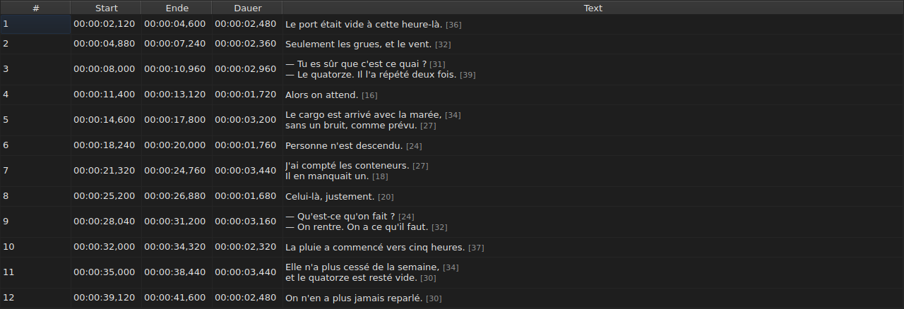
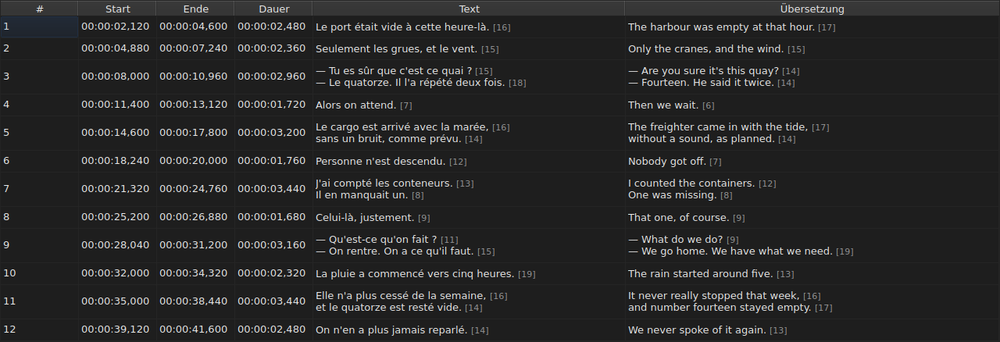
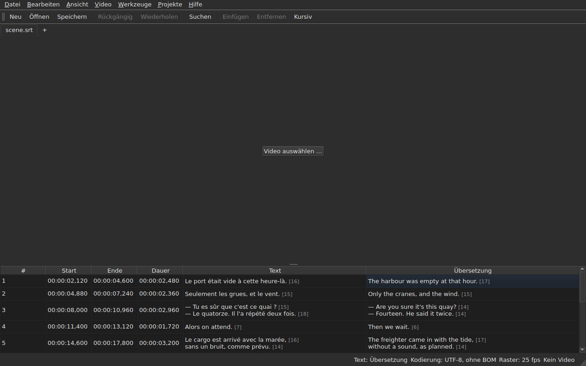

# Die Tabelle

<!-- machine-translated -->
> Diese Seite ist eine maschinelle Übersetzung und wurde noch von keiner Leserin und keinem Leser dieser Sprache geprüft.

Das Fenster zeigt die Untertitel der geöffneten Datei, einen pro Zeile, in fünf
Spalten — sechs, wenn das Projekt eine Übersetzung trägt.

**Dieses Handbuch zitiert die Spaltenköpfe des Fensters so, wie das englische Fenster sie
anzeigt**, wie es das auch für die Befehlszeile tut; das deutsche Fenster und seine Bildschirmfotos
zeigen sie auf Deutsch.

| Spalte | Was sie zeigt |
| :----- | :------------ |
| `#` | den Rang des Untertitels, ab 1 |
| `Start` | die Position, an der er erscheint, `HH:MM:SS,mmm` |
| `End` | die Position, an der er verschwindet |
| `Duration` | `End − Start` |
| `Text` | den Text des Untertitels |
| `Translation` | die Übersetzung des Untertitels — **nicht vorhanden, solange das Projekt keine hat** |


## Die Länge der Zeilen




**Auf jede Zeile einer Textzelle folgt ihre Länge**, `[N]`, kleiner
und blasser — in der Spalte `Text` wie in der Spalte `Translation`.
So macht es Gaupol.

| Was zählt | Was die Tabelle tut |
| :---------- | :------------------ |
| **Tags** | zählen nicht: `<i>Bonjour</i>` ergibt `[7]`, wie `Bonjour` |
| **Rundung** | nach unten: Eine Zeile von 12,9 Em wird als `[12]` angezeigt |
| **eine leere Zeile** | hat keine Länge; ein leerer Text ebenso wenig |
| **die Einheit** | standardmäßig *Em*, oder Zeichen — `Bearbeiten ▸ Einstellungen …` |
| **eine für die Spalte zu lange Zeile** | wird **vor** der Zahl, die sichtbar bleibt, durch `…` abgeschnitten |

**Das *Em* ist das von Gaupol, nicht das der Typografie**: Das Kleinbuchstabenalphabet
ist unter der Schrift der Tabelle 0,55 Em pro Buchstabe wert. Eine Länge in *Em* hängt daher
von der Schrift ab; eine Länge in Zeichen zählt Codepunkte, ein
Akzent für einen.

**Die Tabelle markiert keine zu lange Zeile.** Sie zeigt die Zahl, und es ist Sache
des Auges, sie mit der Grenze zu vergleichen, die Sie sich selbst gesetzt haben — wie bei Gaupol. Es ist nicht
die Grenze des Assistenten `Correct Texts…`, der seine eigene Einstellung hat.

**Um sie nicht zu sehen:** Wählen Sie `Show line lengths in cells` in
`Bearbeiten ▸ Einstellungen …` ab. Siehe [Zeilenlängen](preferences.md#zeilenlängen).

## Spalten ausblenden und verschieben

**`Ansicht ▸ Spalten`** enthält einen ankreuzbaren Eintrag je Spalte, **außer `Text`**:
Ohne den Haupttext bliebe nichts mehr zu bearbeiten.

| Eintrag | Spalte |
| :---- | :----- |
| `Ansicht ▸ Spalten ▸ Nr.` | `#` |
| `Ansicht ▸ Spalten ▸ Start` | `Start` |
| `Ansicht ▸ Spalten ▸ Ende` | `End` |
| `Ansicht ▸ Spalten ▸ Dauer` | `Duration` |
| `Ansicht ▸ Spalten ▸ Übersetzung` | `Translation` — siehe [Die Spalte der Übersetzung](#die-spalte-der-übersetzung) |

Das Abwählen eines Eintrags entfernt seine Spalte, erneutes Ankreuzen stellt sie wieder her, in der Breite,
die sie hatte. **Die Einstellung gilt für das ganze Fenster**, alle Tabs
eingeschlossen: Es gibt eine einzige Tabelle, deren Projekt mit dem Tab wechselt.

**Die aktuelle Zelle verlässt die Spalte, die entfernt wird**: Sie wandert nach `Text`,
in derselben Zeile, und die Auswahl bewegt sich nicht. Eine aktuelle Zelle in einer
Spalte, die niemand sieht, wäre eine Zelle, die ein Tastendruck blind
bearbeiten würde.

**Spalten werden durch Ziehen ihres Kopfes verschoben**, jede von ihnen, `Text`
eingeschlossen. Die letzte angezeigte Spalte nimmt den Platz, den die anderen übrig lassen.

**Die Reihenfolge und die entfernten Spalten werden von einer Sitzung zur nächsten gemerkt**, mit
den Breiten, in der [Einstellungsdatei](preferences.md) — `table.order`
und `table.hidden`. Die Spalte der Übersetzung ist nicht darunter: Sie folgt ihrer eigenen
Regel und kommt mit jeder geöffneten Übersetzung zurück.

**Die Nummer ist keine Angabe der Datei**, sondern der Rang der Zeile. Eine
Einfügung oder ein Entfernen nummeriert daher alles Folgende neu, ohne dass etwas
neu geschrieben wird.

**Das Dezimaltrennzeichen folgt dem Format der Datei**: ein Komma bei SubRip,
ein Punkt bei den acht anderen. SubRip ist das einzige der neun, das ein Komma schreibt.

**Es ist das Trennzeichen, das folgt, nicht die ganze Schreibweise.** Die Tabelle schreibt immer
die Stunden und immer drei Dezimalstellen; eine WebVTT-Datei lässt die
Stunden unter einer Stunde weg, SubViewer 2 und die zwei Sub Station Alpha zählen in
Hundertsteln, MPL2 in Zehnteln, TMPlayer in Sekunden, MicroDVD in Bildern. Eine
Spalte, deren Breite dem Format folgte, wäre mühsamer zu lesen als eine
Spalte, die einfach nicht die genaue Schreibweise der Datei ist.

Was die Tabelle garantiert, ist daher **der Wert und das Trennzeichen**, nicht die Anzahl
der Dezimalstellen. Was ein Zielformat runden würde, wird im Moment des
Speicherns gesagt — siehe
[Was ein Format nicht übernimmt](files.md#was-ein-format-nicht-übernimmt-vor-dem-schreiben-gesagt).

**Die Dauer (`Duration`) wird berechnet**, nie gespeichert: Sie einzutippen, verschiebt das
Ende. Ein Untertitel, dessen Ende vor seinem
Beginn liegt, zeigt eine negative Dauer statt null: Es ist eine Auffälligkeit der
Datei, und sie zu verbergen, würde es unmöglich machen, sie zu finden.

**Der Beginn, das Ende, die Dauer, der Text und die Übersetzung werden an Ort und Stelle bearbeitet**; die
Nummer nicht. Siehe [Eine Zelle bearbeiten](editing.md).

**Die Auswahl bezeichnet, worauf eine Operation wirkt** — siehe
[Die Operationen](operations.md).

**Die Höhe einer Zeile folgt dem Untertitel, den sie trägt**: Ein Untertitel mit
zwei Zeilen nimmt zwei ein, einer mit drei nimmt drei ein. Der Text wird
vollständig gezeigt, so, wie er geschrieben wird.

**Was abgeschnitten bleibt, ist eine für ihre Spalte zu lange Zeile**, und sie
endet dann mit einer Auslassung. Die Spalte `Text` oder das Fenster zu verbreitern, zeigt sie
vollständig; ebenso das Öffnen der Zelle. Die Zeilen des Textes werden nie
umbrochen: Nur ein echter Zeilenumbruch ergibt eine Zeile, damit sich die Höhe
einer Tabellenzeile nicht ändert, wenn Sie den Rand einer Spalte ziehen.

## Positionen in Bildern

**`Ansicht ▸ Positionen in Bildern`** — ein ankreuzbarer Eintrag, eine einzige Einstellung für das Fenster — zeigt die
Spalten `Start` und `End` **als Bildnummern** statt als Zeitstempel und **nimmt eine Bildnummer als Eingabe an**. Die
Köpfe sagen es: `Start (frames)` und `End (frames)`.

| Was sich ändert | Was sich nicht ändert |
| :----------- | :------------------- |
| was `Start` und `End` schreiben und was sie annehmen | die Spalte `Duration`, die eine Zeit bleibt |
| die Köpfe dieser zwei Spalten | das Dokument: Nichts wird geändert, der Verlauf hat keinen neuen Eintrag, und **was die Datei schreibt, ist das, was sie geschrieben hat** |

**Die Bildrate, die die Bilder zählt**, ist, in dieser Reihenfolge:

1. **die der Datei**, wenn sie in Bildern gezählt ist — MicroDVD, das Nummern und keine
   Bildrate trägt: **Das Fenster zeigt dann die Zahlen seiner Datei**, wie auch immer das Video ist;
2. **die, die das verknüpfte Video angibt**;
3. **das Raster, das die Positionen zeichnen**, wenn sie eines zeichnen.

Der Tooltip des Eintrags sagt, welche davon gewählt wurde: *Positions are frame numbers, counted at 25 fps, the rate the
video declares*. **Ist keine der drei vorhanden, ist der Eintrag deaktiviert, und sein Tooltip sagt, warum**: Die Datei ist
nicht in Bildern gezählt, das Video gibt keine Bildrate an, und die Positionen fallen auf kein Raster.

- **Eine Nummer ist die Nummer des Bildes, in das die Position fällt**, auf das nächste Bild gerundet. **Eingetippt
  ergibt sie den Augenblick, in dem dieses Bild beginnt**, **nur einmal** gerundet, aus dem exakten Verhältnis
  ([ADR 0013](../../../../adr/0013-mise-a-l-echelle-exacte-des-positions.md)): Bild 37 bei 23,976 Bildern pro Sekunde
  beginnt bei 1.543,04 ms, also `00:00:01,543`.
- **Nur ganze Zahlen werden angenommen** — mit dem Minuszeichen, da ein Beginn vor dem Film liegen kann. Ein
  im Bildmodus eingetippter Zeitstempel, oder eine Zahl, die keine ist, lässt die Zelle, wie sie war.
- **Die Wiedergabeleiste folgt derselben Einstellung**: Die Position und die Dauer zu beiden Seiten des Schiebereglers
  werden als Bildnummern geschrieben wie `Start` und `End`, im selben Augenblick — siehe
  [Die Wiedergabeleiste](player.md#die-wiedergabeleiste). Die oben auf das Bild gezeichnete Uhr bleibt ein
  Zeitstempel.
- **Diese Einstellung wird nicht gemerkt**, von einer Sitzung zur nächsten: Es ist eine Einstellung des Fensters, nicht eines
  Dokuments, und sie wird mit einem Handgriff wieder eingeschaltet.

## Die Auffälligkeiten

Ein Untertitel, dessen Positionen nicht zusammenpassen, ist **auf seinen
Zeitspalten getönt**, und das Darüberfahren sagt, was nicht stimmt.

| Tönung | Was sie meldet | Was zu tun ist |
| :--- | :-------------- | :--------- |
| rot | `ends before it starts` | sein Ende korrigieren, oder seinen Beginn |
| blau | `starts before the previous one starts` | ihn wieder an seinen Platz in der Reihenfolge setzen |
| bernsteinfarben | `starts before the previous one ends` | sein Timing anpassen |


Nur die Spalten `Start`, `End` und `Duration` werden getönt: Eine Auffälligkeit
spricht nur von der Zeit, und den Text zu tönen, würde nahelegen, er habe etwas
damit zu tun.

**Ein Untertitel kann mehrere tragen**, und der Tooltip nennt sie alle. Die
Tönung ist die der ersten, die zu beheben ist: Ein in sich defekter Untertitel
ist defekt, was auch immer seine Nachbarn tun; ein falsch platzierter Untertitel wird wieder an seinen Platz gesetzt,
und seine Überlappung verschwindet mit ihm.

> Es ist kein Zufall, dass die Unordnung fast immer Vorrang vor der
> Überlappung hat: vor dem Beginn des vorigen zu beginnen, heißt, vor
> seinem Ende zu beginnen — es sei denn, der vorige ist selbst defekt.

**Die Markierung wird nach jeder Änderung einer Position neu berechnet**, ob sie
von einer bearbeiteten Zelle, einer Operation oder einem Rückgängigmachen kommt. Sie sagt, was die
Datei jetzt ist, nicht, was sie beim Öffnen war.

Sie stützt sich auf kein Bildraster: Sobald eine Position von
Hand korrigiert wird, verlässt sie es, und eine darauf beruhende Markierung würde die
Arbeit des Benutzers melden.

## Die Spalte der Übersetzung

Ein Untertitel trägt **zwei Texte und ein einziges Paar von Positionen**: Die
Übersetzung hat kein eigenes Timing, sie hängt an dem des Untertitels.
Die Tabelle zeigt sie in einer sechsten Spalte, `Translation`, rechts von `Text`.




**Die Spalte ist nur da, wenn das Projekt eine Übersetzung hat.** Ohne eine behält die Tabelle
ihre fünf Spalten, und das Fenster verhält sich, als gäbe es die Übersetzung
nicht — nichts wird ausgegraut oder hinzugefügt. `Datei ▸ Übersetzung öffnen …` öffnet
eine: siehe [Öffnen einer Übersetzung](files.md#öffnen-einer-übersetzung).

**Ein Eintrag des Menüs `View` zeigt sie an oder entfernt sie**:

| Eintrag | Was er tut |
| :---- | :----------- |
| `Ansicht ▸ Spalten ▸ Übersetzung` | angekreuzt: Die Spalte wird angezeigt; abgewählt: Sie wird entfernt |

Der Eintrag ist **deaktiviert, wenn das Projekt keine Übersetzung hat** — es gibt nichts
anzuzeigen — und beim Start angekreuzt. **Die Entscheidung, sie zu entfernen, liegt beim
Benutzer**: Sie gilt von einer Datei zur nächsten, bis der Eintrag wieder
angekreuzt wird. Das Entfernen der Spalte entfernt nicht die Übersetzung: Sie bleibt im
Projekt und kommt mit dem Eintrag zurück. Das Öffnen einer Datei, die keine trägt, entfernt die
Spalte.

**In die Zellen der Übersetzung wird eingetippt wie in die des Textes** — siehe
[Eine Zelle bearbeiten](editing.md).

### Der Text, auf den die Operationen zielen

Mit zwei Texten in einer Zeile müssen die Textoperationen wissen, welchen
sie neu schreiben. **Es ist der der Spalte der aktuellen Zelle**: die
Übersetzung, wenn die aktuelle Zelle in der Spalte `Translation` steht, der Haupttext
überall sonst — in einer Zeitspalte wie in `Text`.

| Operation | Worauf sie zielt |
| :-------- | :-------------- |
| `Italic`, `Case`, `Dialogue`, `Remove Hearing-Impaired Mentions…` | den Text der aktuellen Spalte |
| `Cut Texts`, `Copy Texts`, `Paste Texts` | den Text der aktuellen Spalte |
| `Find and Replace…` | den Text der aktuellen Spalte — siehe [Suchen und Ersetzen](find-and-replace.md#in-welchem-text) |
| die Positionsoperationen, das Einfügen, das Entfernen, das Zusammenführen, das Teilen | **beide Texte**: Ein Untertitel ist ein Ganzes |

**Die Statusleiste sagt es, wenn es zwei Texte gibt**, links von den anderen
Angaben:

```text
Text: Translation
```

oder `Text: Main` für den Haupttext. Sie schweigt, wenn die Spalte nicht
angezeigt wird: Es gibt dann nur einen Text, und es hat keinen Sinn, das zu sagen.




**Die auf das Bild gezeichnete Zeile folgt derselben Regel**: Es ist der Text der
aktuellen Spalte. Siehe [Der Player](player.md#die-gezeichnete-zeile).

**Nichts wird ausgegraut.** Die Textoperationen bleiben verfügbar, was auch immer
die aktuelle Spalte ist, und ohne Spalte der Übersetzung zielen sie auf den Haupttext,
wie zuvor.

## Zeilen hinzufügen und entfernen

`Bearbeiten ▸ Untertitel einfügen …` und `Bearbeiten ▸ Untertitel entfernen` fügen
Zeilen hinzu und entfernen sie, `Bearbeiten ▸ Untertitel zusammenführen` und `Bearbeiten ▸ Untertitel teilen` führen sie zusammen und
teilen sie; die Tabelle nummeriert sich neu. Siehe
[Zeilen einfügen, entfernen, zusammenführen und teilen](lines.md).

## Was die Tabelle nicht tut

**Ein Sortieren nach Spalte gibt es nicht.** Die angezeigte Reihenfolge ist die der Datei, und
sie ist die einzige, die für Untertitel sinnvoll ist: Der Rang einer Zeile *ist*
ihr Platz in der Zeit.
