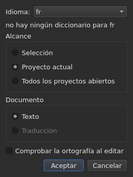
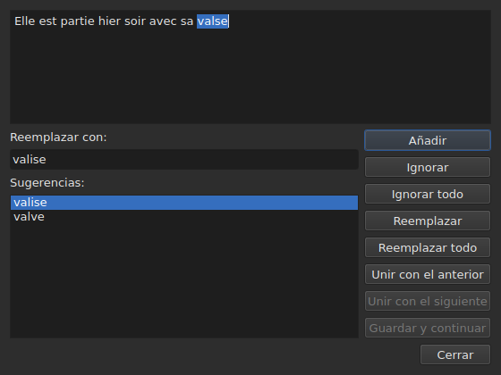

# Comprobar ortografía…

<!-- machine-translated -->
> Esta página es una traducción automática y todavía no la ha revisado ningún lector del idioma.

`Herramientas ▸ Comprobar ortografía…` recorre las palabras que el diccionario no conoce,
una por una, según el modelo del corrector ortográfico de Gaupol. Tiene un complemento,
`Herramientas ▸ Configuración ortográfica…`, que fija el idioma, el alcance y el documento, así como el subrayado al escribir.
Los dos se apoyan en los diccionarios del sistema, a través de Enchant.

En la ventana en inglés, la etiqueta de la primera se escribe `Chec&k Spelling…`: `C` ya es
el acelerador de `Correct Texts…`, y `k` está libre en el menú `Tools`.
Ninguna de las dos tiene atajo.

**Las dos están desactivadas en un documento sin subtítulos**, como
[`Correct Texts…`](correct-texts.md): no hay nada que comprobar. `Check Spelling…`
también está desactivada si no hay diccionario para el idioma elegido; véase
[Sin diccionario](#sin-diccionario).

## Configuración ortográfica…




| Grupo | Opciones | Por defecto |
| :---- | :------ | :------ |
| `Language` | los códigos de idioma que ofrece el sistema, y el ya elegido | el idioma del sistema, si está entre ellos |
| `Target` | `Selection`, `Current Project`, `All Open Projects` | `Current Project` |
| `Document` | `Text`, `Translation` | `Text` |
| `Check spelling while editing` | una casilla, véase [Subrayado al escribir](#subrayado-al-escribir) | sin marcar |

`Selection` está desactivado si no hay ninguna línea elegida en la pestaña mostrada; `Translation`
está desactivado mientras ningún proyecto abierto lleve una traducción. Un ajuste
recordado que ya no está disponible — una selección vacía, una traducción ausente —
se abre en `Current Project` o `Text`. `OK` conserva los ajustes, `Cancel` no cambia
nada.

**Esta ventana no depende del diccionario**: sigue activada mientras el
documento tenga subtítulos, incluso sin diccionario para el idioma elegido, y es
ella la que permite abandonar un idioma que no lo tiene. El idioma para el que no
existe diccionario sigue siendo editable y aparece en la lista, con, debajo,
la frase `no dictionary for` seguida de su código.

**Los cuatro ajustes se recuerdan** de una sesión a la siguiente, en el
archivo de configuración de `subedit` — véase [Las preferencias](preferences.md) para su
ubicación:

| Clave | Valores | Por defecto |
| :-- | :----- | :------ |
| `spell-check.language` | un código de idioma, como `fr_FR`; vacío: el idioma del sistema | vacío |
| `spell-check.target` | `selection`, `current-project`, `all-projects` | `current-project` |
| `spell-check.document` | `main`, `translation` | `main` |
| `spell-check.inline` | `true` o `false` — subrayar las palabras desconocidas en el editor de una celda | `false` |

Un valor que la clave no acepta se ignora, se aplica el valor por defecto, y la opción
se nombra en la salida de errores cuando se abre la ventana — véase
[Las preferencias](preferences.md#qué-ocurre-cuando-el-archivo-no-dice-lo-esperado).

## Subrayado al escribir


La casilla `Check spelling while editing` de `Spell-Check Settings…` subraya,
**con una línea ondulada roja y a medida que se teclea**, cada palabra desconocida en el editor de una
celda de texto — tanto el de la columna `Text` como el de la
columna `Translation`. El subrayado sigue a lo que se teclea: aparece, se mueve y
desaparece con la palabra. **Está sin marcar por defecto**, como en Gaupol: sin
ella, nada cambia en el editor.

**El idioma es el de `Language:`**, en la misma ventana, y las palabras desconocidas
son las que encontraría `Check Spelling…`: los mismos casos de inglés coloquial
(`goin'`, `we'd`, `1st`), la misma división en palabras. Una palabra subrayada no se corrige
desde un menú: la casilla solo la muestra.

**Sin diccionario para el idioma elegido, el editor se queda callado**: no se subraya
nada y nada falla, y la frase `no dictionary for` de la ventana dice
por qué. La casilla se aplica a los editores abiertos después de ella; un editor ya
abierto conserva lo que tenía.

## El recorrido




La ventana muestra el texto del subtítulo en el que se ha detenido, con la palabra desconocida
seleccionada en él. **En cada palabra desconocida, vuelve la pestaña del proyecto y la
línea del subtítulo queda seleccionada en la tabla.** El recorrido va de subtítulo
en subtítulo, y luego de proyecto en proyecto cuando el alcance designa varios.

Bajo el texto: el cuadro `Replace with:`, rellenado con la primera sugerencia, y la
lista `Suggestions:`. Elegir una sugerencia la copia en el cuadro; teclear en el
cuadro renueva la lista.

| Botón | Qué hace |
| :----- | :----------- |
| `Add` | añade la palabra al diccionario personal del usuario y pasa a la siguiente |
| `Ignore` | deja esta palabra y pasa a la siguiente |
| `Ignore All` | deja esta palabra, y todas sus demás apariciones durante este recorrido |
| `Replace` | reemplaza la palabra por el contenido de `Replace with:`; desactivado mientras el cuadro esté vacío |
| `Replace All` | hace lo mismo con sus demás apariciones; desactivado mientras el cuadro esté vacío |
| `Join with Previous` | une la palabra a la palabra anterior; desactivado si no la hay, o si no están separadas por un espacio |
| `Join with Next` | une la palabra a la palabra siguiente, en las mismas condiciones |
| `Save and Resume` | conserva el texto tal como lo lleva la zona de texto, y reanuda la lectura **de este texto desde su inicio** |
| `Close` | cierra la ventana |

**La zona de texto es editable.** En cuanto se teclea en ella, solo `Save and Resume`
sigue activado: los demás gestos actúan sobre la palabra elegida, que ya no es
la del texto.

**El recorrido termina por sí solo** cuando no queda ninguna palabra desconocida: los
botones se desactivan y el texto se vacía. Un alcance sin ninguna palabra desconocida
no muestra ninguna ventana.

### Cerrar a mitad de camino

`Close`, o la cruz de la ventana, **aplica lo que se ha hecho**, como el final
del recorrido: los textos ya dejados atrás, **y** los gestos — reemplazar,
reemplazar todo, unir — ya hechos en el texto actual. Es una diferencia respecto a
Gaupol, que pierde el texto actual. Lo que no cuenta es lo que queda del recorrido, ni
los retoques tecleados en la zona de texto que `Save and Resume` no ha
validado.

**Una sola entrada del historial por proyecto tocado**, sea cual sea el número de
reemplazos: `Undo` deshace de una vez todas las correcciones de ese proyecto.
El menú la nombra `Undo: correcting texts`. La barra de estado da entonces el
recuento:

```text
Edited 2 and removed 0 subtitles
```

**La lista de reemplazos** — lo que el usuario ha reemplazado, y con qué —
se escribe al cerrar en `spell-check/<language>.repl`, bajo el directorio de
configuración de `subedit`, y no en el de Gaupol, que nunca se lee.
Cuenta entonces entre las sugerencias del corrector ortográfico, aquí como en
[`Correct Texts…`](correct-texts.md#unir-o-dividir-palabras--unir-y-separar-según-el-corrector-ortográfico).
Si no puede escribirse, un cuadro de error lo dice, `Could not save the
replacements for` seguido del idioma y del motivo, sin anular las
correcciones.

## Sin diccionario

Cuando el idioma elegido — el del sistema, si no se ha elegido ninguno — no tiene
diccionario, **`Check Spelling…` está desactivada**, y su información sobre herramientas, así como la barra
de estado cuando se pasa por encima de la entrada, dicen por qué:

```text
no dictionary for fr
```

Queda `Spell-Check Settings…`, para elegir un idioma que lo tenga. Una ventana
compilada sin ningún proveedor de diccionarios dice lo mismo y no comprueba
nada.

## Los mensajes

| Mensaje | Dónde | Qué lo provoca |
| :------ | :---- | :--------------- |
| `no dictionary for fr` | información sobre herramientas y barra de estado | no hay diccionario para el idioma elegido |
| `Nothing to check.` | barra de estado | el alcance no designa ningún texto — una selección vacía, por ejemplo |
| `Edited N and removed M subtitles` | barra de estado | al final o al cerrar; `M` se queda en `0` |
| `Could not save the replacements for fr: …` | cuadro de error | la lista de reemplazos no se ha escrito |

## Un ejemplo

Un archivo abierto lleva `Elle est partie hier soir avec sa valse`. El diccionario
francés está instalado: `Herramientas ▸ Comprobar ortografía…` se detiene en `valse`, selecciona la
línea en la tabla y propone `valise`, ya en `Replace with:`. `Replace`
y luego `Close`: la línea pasa a ser `Elle est partie hier soir avec sa valise`, y la
barra de estado dice:

```text
Edited 1 and removed 0 subtitles
```
