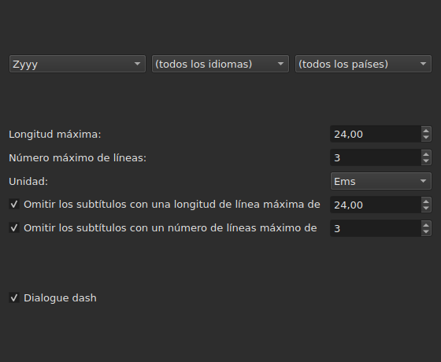
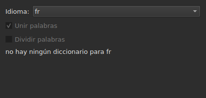
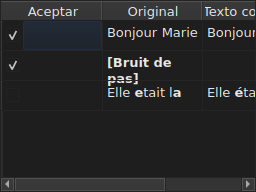

# Corregir textos…

<!-- machine-translated -->
> Esta página es una traducción automática y todavía no la ha revisado ningún lector del idioma.

`Herramientas ▸ Corregir textos…` abre un asistente de varias páginas, según el modelo
del de Gaupol: una página de alcance y tareas, una página por cada tarea marcada,
una página de progreso y una página de confirmación que propone los
cambios sin imponerlos nunca.

**Desactivado en un documento vacío**: no hay nada que corregir.

**La línea de comandos hace lo mismo** para todas las tareas: [`subedit-cli correct`](../subedit-cli/correct.md), con los
mismos patrones y los mismos recuentos — y en caracteres allí donde la ventana mide en ems.
**Lee por defecto cuatro de los ajustes recordados de este asistente** — las dos clases de
errores comunes (`Human`, `OCR`), `Remove all blank subtitles` y el número máximo de líneas de
`Line Break` — y toma todo lo demás (las tareas, su código, la longitud de línea, el idioma,
las casillas de los patrones) de su propia línea. Véanse
[Dos bloques, uno compartido con la línea de comandos](preferences.md#dos-bloques-uno-compartido-con-la-línea-de-comandos)
y [`subedit-cli config`](../subedit-cli/config.md).

## Tareas y alcance — la primera página

| Grupo | Opciones | Por defecto |
| :---- | :------- | :---------- |
| `Target` | `Selection`, `Current Project`, `All Open Projects` | `Current Project` |
| `Document` | `Text`, `Translation` | `Text` |
| `Tasks` | `Mentions`, `Join or Split Words`, `Common Errors`, `Capitalization`, `Line Break` — para marcar, una o varias | `Common Errors` y `Capitalization` marcadas, las otras tres no |

`Selection` está desactivado sin ninguna línea elegida en la pestaña mostrada; `Translation`
está desactivado mientras ningún proyecto abierto lleve una traducción.

**El alcance y el documento no se recuerdan**: el asistente vuelve a abrirse siempre
en `Current Project` y `Text`. Las tareas marcadas, por su parte, sí se recuerdan.

**Lo que designa cada alcance**:

| Alcance | Actúa sobre |
| :------ | :---------- |
| `Selection` | las líneas elegidas en la pestaña mostrada |
| `Current Project` | todo el archivo de la pestaña mostrada |
| `All Open Projects` | todo el archivo de cada pestaña abierta |

**`All Open Projects` sobre `Translation` omite los proyectos sin traducción**:
un proyecto que no lleva ninguna no tiene nada que proponer en una columna vacía, y
el asistente no lo cuenta.

**Las páginas de las tareas siguen, en el orden de Gaupol — `Mentions`,
`Join or Split Words`, `Common Errors`, `Capitalization`, `Line Break` —, nunca el orden en que se marcaron
las casillas.** Una tarea desmarcada no tiene página; sus ajustes recordados
no cambian por ello. **Ninguna página de tarea lleva su propia
casilla de «activa»**: es la de esta primera página, y solo ella, la que
decide si la tarea se ejecuta.

## Las páginas de las tareas

Cada una de las cuatro páginas de patrones — todas salvo `Join or Split Words`, que no tiene ninguno — lleva la misma base: tres
menús desplegables en cascada — escritura, idioma, país — para elegir el código de los patrones que se
aplicarán, y luego la lista de los patrones de ese código, uno para marcar por nombre. **Los
tres menús solo ofrecen lo que el catálogo de patrones contiene
realmente** — los que se distribuyen con el programa y los que un usuario ha
depositado en él (véase [Los patrones depositados](#los-patrones-depositados)) — nunca una lista
de idiomas o países leída en otra parte. `Zyyy` («cualquier escritura») es el código
de partida de `Common Errors`, que da los patrones válidos en todas partes. **Los otros
tres tipos solo tienen patrones bajo una escritura**: su página se abre en la
primera que ofrece el catálogo, `Latn` con los patrones distribuidos, y no en `Zyyy`.

**La descripción de cada patrón es la información sobre herramientas de su casilla.** Los nombres y las descripciones siguen el
idioma de la ventana para los patrones distribuidos con el programa; un patrón propio se muestra tal como
lo escribe su archivo ([Idioma](invocation.md#idioma)).

**Un patrón desmarcado sigue desmarcado hasta que se vuelve a marcar**, también al
cambiar de código y luego volver a él, y esa elección se recuerda de una apertura
del asistente a la siguiente. Al volver a marcarlo, simplemente recupera su ajuste
original, y la elección recordada desaparece.

| Página | Lo que añade a la base |
| :----- | :--------------------- |
| `Mentions` | dos casillas, `Sound in brackets` y `Sound in parentheses`, desmarcadas por defecto |
| `Common Errors` | dos casillas, `Human` y `OCR`, marcadas por defecto |
| `Capitalization` | nada más |
| `Line Break` | una longitud máxima (`24`, por defecto), un número máximo de líneas (`3`), una unidad — `Characters` o `Ems`, `Ems` por defecto — y dos condiciones de omisión, descritas más abajo |

**Las dos casillas de `Mentions` no nombran ningún patrón compilado**:
dirigen un examen del texto en el núcleo, el mismo que
[`Remove Hearing-Impaired Mentions…`](operations.md#remove-hearing-impaired-mentions)
ya hace en un gesto directo. Basta con que una **u** otra esté marcada para lanzarlo. **La lista de patrones de la página no las repite**: esos dos nombres solo aparecen una vez, como casillas.

**`Common Errors` filtra por clase**: un patrón que lleva ambas clases
se aplica en cuanto una de las dos casillas está marcada; las otras tres páginas no
conocen esta distinción.

### Salto de línea — la unidad y la omisión




| Ajuste | Qué hace | Por defecto |
| :----- | :------- | :---------- |
| `Maximum length` | la longitud de una línea, en la unidad elegida; de `1` a `1000` | `24` |
| `Maximum lines` | el número de líneas buscado; de `1` a `100` | `3` |
| `Unit` | `Characters` cuenta caracteres; `Ems` mide la anchura con la fuente de la ventana, en la que una letra minúscula media vale `0.55` — la unidad de Gaupol | `Ems` |
| `Skip subtitles with maximum line length of` | deja tal cual un subtítulo cuya línea más larga cabe en esta longitud, en la unidad elegida | marcada, `24` |
| `Skip subtitles with maximum line amount of` | deja tal cual un subtítulo cuyo número de líneas cabe en este número | marcada, `3` |

**La omisión tiene sus propios umbrales**, distintos de los límites buscados: es
la regla de Gaupol. Un subtítulo se deja tal cual si cabe en **todos los
umbrales cuya casilla está marcada**; si no, se divide, y la división solo se
conserva si acerca el subtítulo a un umbral que superaba — menos
longitud, o menos líneas. Ninguna casilla marcada: se dividen todos los subtítulos,
quepan ya o no.

**Cambiar la unidad cambia lo que se propone**: la longitud de cada línea se
mide en cada cálculo, en la unidad de la página en ese momento, y no queda
nada de una medida anterior. Un texto de veintinueve caracteres, la mitad
de ellos letras estrechas, supera `24` en `Characters` y cabe holgadamente
en `Ems`.

**Los siete ajustes se recuerdan** de una sesión a la siguiente, unidad incluida.

### Unir o dividir palabras — unir y separar según el corrector ortográfico




Una página aparte, entre `Mentions` y `Common Errors`, para reparar lo que
el software de reconocimiento de texto hace con los espacios. No tiene lista de
patrones: se apoya en los diccionarios del sistema, a través de Enchant.

| Ajuste | Qué hace | Por defecto |
| :----- | :------- | :---------- |
| `Language` | el idioma del diccionario; los códigos que ofrece el sistema, y el ya elegido | el idioma del sistema, si está entre ellos |
| `Join words` | une una palabra mal escrita a la palabra vecina | marcada |
| `Split words` | corta en dos una palabra mal escrita | desmarcada |

**Unir**: una palabra mal escrita se une a la palabra anterior o a la
siguiente **si, y solo si, solo uno de los dos sentidos da una palabra bien
escrita**. Cuando ambos la dan, o ninguno, no se hace nada.
`bon jour` se convierte en `bonjour`; dos espacios seguidos se reducen primero a
uno, pero un texto en el que no se une nada se devuelve tal como estaba, espacios
incluidos.

**Separar**: una palabra mal escrita se corta si, entre las sugerencias del corrector
ortográfico, **solo una** es esa palabra con un espacio dentro — las mismas
letras, en el mismo orden. Dos sugerencias de ese tipo, o ninguna: no se hace
nada. Una palabra cuya inicial es la única mayúscula (`Bonjourtous`) no se
separa nunca: a menudo es un nombre, y los diccionarios no los tienen.

**La lista de sustituciones del usuario** (`spell-check/<language>.repl`,
en el directorio de configuración del programa) cuenta entre las sugerencias del
corrector ortográfico; el asistente la lee y no la escribe.

**Sin diccionario para el idioma elegido, la página se queda y aparece en gris**: las
dos casillas están desactivadas y la página dice `no dictionary for` seguido del código del
idioma. El idioma sigue siendo editable — puede haber un diccionario para otro
— y la tarea, marcada o no en la primera página, no hace entonces nada y
no señala ningún error.

**El idioma, las dos casillas y la casilla de la primera página se recuerdan** de una
apertura del asistente a la siguiente.

### Los patrones depositados

Un patrón que un usuario ha depositado en su propio directorio de patrones
se añade a los distribuidos con el programa, en el mismo catálogo y bajo los
mismos menús — nada los distingue una vez cargados.

| Patrones | Dónde |
| :------- | :---- |
| distribuidos | `<prefix>/share/subedit/patterns`, junto a `<prefix>/bin` |
| los del usuario | `$XDG_DATA_HOME/subedit/patterns`, o `~/.local/share/subedit/patterns` si la variable no está definida o no es una ruta absoluta |

**El formato es el de Gaupol, leído tal cual**: un archivo `<Code>.<type>` por escritura,
idioma y país — `Latn-en.common-error` —, con su `.conf` de activación al lado. Los tipos
son `common-error`, `capitalization`, `hearing-impaired` y `line-break`. Los archivos
distribuidos sirven de modelo. **Los patrones se leen una sola vez, al inicio**: un archivo
depositado mientras la ventana está abierta solo se ve en el siguiente inicio.

## Progreso

Una vez pulsado `Next` desde la última página de tarea marcada (o desde la
primera página si no hay ninguna tarea marcada), el asistente calcula las correcciones
propuestas en un hilo en segundo plano, con una barra de progreso indeterminada en
pantalla. Una vez terminado el cálculo, la página de confirmación se abre sola.

**`Cancel` en este paso abandona el cálculo sin interrumpirlo**: no se aplica
nada, pero el asistente espera, antes de cerrarse, a que termine el cálculo en
curso — una espera acotada por el límite de tiempo que el motor de
patrones impone a cada búsqueda.

**`Back` en este paso vuelve a la página anterior sin esperar**: el cálculo
termina en segundo plano y su resultado se descarta — el asistente no salta
por sí solo a la confirmación. `Next` lanza un cálculo nuevo.

## Confirmación — la última página




Una línea por cada texto que el asistente cambiaría — nunca una línea para un
texto que una tarea ha dejado tal cual.

| Columna | Lo que muestra |
| :------ | :------------- |
| `Accept` | una casilla, marcada por defecto: la corrección se aplicará o no |
| `Original` | el texto tal como está, con la parte que cambiaría **en negrita** |
| `Corrected Text` | el texto propuesto, con la parte cambiada en negrita, **editable** — retocarlo cambia lo que se escribirá, sin cambiar la casilla `Accept` |

**El cambio se marca en negrita, nunca en color**: la misma diferencia se lee
en ambas paletas sin depender de ningún tinte.

**Una línea cuya propuesta es una eliminación** — al subtítulo no le quedaría
texto — muestra vacía la columna `Corrected Text`, y todo su `Original` en
negrita.

| Botón | Qué hace |
| :---- | :------- |
| `Mark All` | marca `Accept` en todas las líneas |
| `Unmark All` | desmarca `Accept` en todas las líneas |
| `Preview` | lleva el reproductor integrado al subtítulo de la línea elegida, si el proyecto tiene una película — nada si no tiene ninguna |
| `Finish` | aplica las líneas marcadas y cierra el asistente |

`Remove all blank subtitles`, marcada por defecto, elimina los subtítulos
que una corrección dejaría sin ningún texto en lugar de conservarlos vacíos.

**Un patrón que el cálculo no ha podido aplicar se nombra bajo la tabla**, con
el motivo:

```text
Not applied: some pattern (will not compile)
```

Un patrón nombrado así se nombra **una vez por motivo**, sea cual sea el número de
textos o proyectos en que ha fallado: la pantalla no dice en cuáles.

| Motivo | Qué lo provoca |
| :----- | :------------- |
| `cannot be translated` | la expresión usa lo que la traducción de la sintaxis de Python rechaza |
| `will not compile` | el motor rechaza la expresión |
| `has an invalid replacement` | el reemplazo no se lee como lo lee Python |
| `timed out` | una búsqueda ha superado el tiempo que el motor le concede en un texto |
| `never settled` | `Repeat` seguía cambiando el texto tras cien pasadas |
| `grew the text too long` | el texto ha superado 16 384 bytes mientras el patrón trabajaba en él |

**Un patrón que falla en un texto lo deja como estaba antes de él**: un reemplazo
hecho a medias vale menos que ningún reemplazo. Los demás patrones se aplican.

**Una línea de un archivo de patrones que no se puede leer se nombra en el mismo
lugar**, por su archivo, su línea y el motivo — en cada apertura del
asistente, ya que los patrones solo se leen una vez, al inicio:

```text
Could not be read: Zyyy.common-error, line 8 (malformed line)
```

| Motivo | Qué lo provoca |
| :----- | :------------- |
| `directory cannot be read` | no se ha podido recorrer el directorio de los patrones distribuidos |
| `file cannot be read` | no se ha podido leer un archivo de patrones |
| `malformed line` | una línea que no es ni una cabecera, ni un comentario, ni `Key=Value` |
| `field outside any pattern` | un `Key=Value` antes de la primera cabecera de patrón |
| `unknown field` | una clave que este tipo de patrón no usa — el patrón se conserva |
| `missing field` | una clave sin la cual este tipo de patrón no puede hacer nada — el patrón se descarta |
| `invalid value` | un valor que la clave no acepta — el patrón se descarta |
| `malformed activation` | un elemento `<pattern>` de un `.conf` que no nombra nada |

Los demás patrones, los que se han leído y aplicado correctamente, no se ven
afectados.

## Lo que dice la acción de deshacer, y lo que `Cancel` nunca hace

**`Finish` crea una entrada del historial por proyecto tocado**, nunca una por
corrección: `Undo` deshace de una vez todas las correcciones aceptadas en ese
proyecto, cada una con el texto que tenía. El menú la llama
`Undo: correcting texts`.

La barra de estado da el recuento, primero los textos cambiados y luego los subtítulos
eliminados:

```text
Edited 3 and removed 1 subtitles
```

**`Cancel`, en cualquier página, no aplica nada y no recuerda nada** — ni
los ajustes elegidos durante esta apertura, ni la menor corrección. La
siguiente apertura del asistente vuelve a partir de los ajustes de antes.

## Un ejemplo

Un archivo abierto lleva dos espacios entre dos palabras de una línea y una
anotación entre corchetes sin otro texto. `Herramientas ▸ Corregir textos…`,
`Common Errors` ya marcada, `Next` hasta la confirmación: la línea de los dos espacios
muestra `Bonjour  Marie` a la izquierda, `Bonjour Marie` a la derecha, con la corrección en
negrita y ya aceptada. `Finish` la aplica, y la barra de estado dice:

```text
Edited 1 and removed 0 subtitles
```
