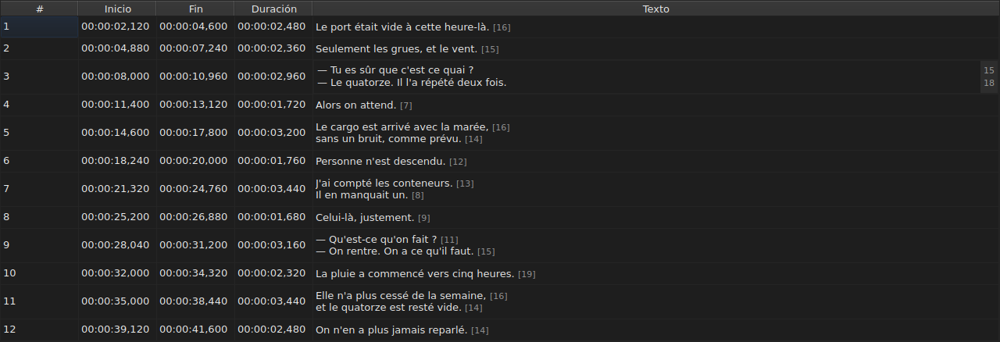
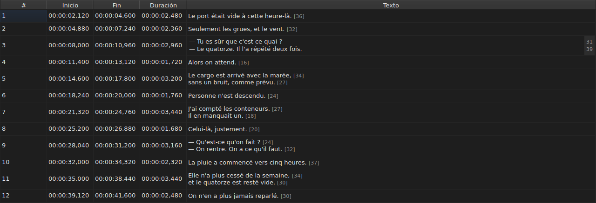

# Editar una celda

<!-- machine-translated -->
> Esta página es una traducción automática y todavía no la ha revisado ningún lector del idioma.

Cuatro columnas se editan en su sitio: `Start`, `End`, `Duration` y `Text` — cinco
con la columna `Translation`, cuando el proyecto tiene una traducción. `#` no
puede editarse — el número es el rango de la línea, no un dato del archivo.

**Abrir el editor de una celda:** hacer doble clic en ella, o seleccionarla
y pulsar `F2`.

## El texto

**La traducción se edita como el texto**, con el mismo campo multilínea y las
mismas reglas; solo cambia la celda, y el texto principal queda como
estaba. Una validación que no cambia nada no hace nada, para uno como para la
otra — véase [más abajo](#una-validación-que-no-cambia-nada-no-hace-nada).

El editor es un campo **multilínea**, y se abre a la altura del subtítulo:
un subtítulo de dos líneas se teclea en él tal como se escribirá, con sus dos líneas
legibles y sin barra de desplazamiento. Un `Shift+Enter` que añade una agranda
el editor; la fila de la tabla se ajusta al validar.

| Tecla | Efecto |
| :-- | :----- |
| `Enter` | valida y cierra el editor |
| `Shift+Enter` | inserta un salto de línea en el texto |
| `Esc` | cierra el editor; la celda conserva lo que tenía |
| `Tab` | valida y pasa a la celda siguiente |

Hacer clic en otro sitio también valida: perder el foco equivale a un `Enter`.

**Once gestos sin cuadro de diálogo validan del mismo modo** antes de calcular su objetivo:
`Italic`, `Capitalización ▸ …`, `Dialogue`, `Merge Subtitles`, `Split Subtitle`,
`Cut Texts`, `Paste Texts`, `Copy Texts`, `Remove Subtitles`, `Undo` y `Redo`.
Lanzados desde el menú, la barra de herramientas o un atajo de la ventana,
toman el texto tal como el editor acaba de validarlo, como tras un clic
en otro sitio. `Ctrl+X`, `Ctrl+C` y `Ctrl+V` siguen siendo, no obstante, del editor mientras
esté abierto — véase [Cortar, copiar y pegar](clipboard.md): es entonces el
menú el que lanza `Cut Texts`, `Copy Texts` y `Paste Texts`.

`Undo` y `Redo` leen el historial y no el documento: véase
[Deshacer y rehacer](undo.md). Un gesto que abre un cuadro de diálogo no
necesita esta regla, ya que el cuadro toma el foco al abrirse, lo que
ya valida la entrada.

### Las etiquetas son las del archivo

El texto mostrado y tecleado es **el del archivo, etiquetas incluidas**: un
`<i>…</i>` de un SubRip se escribe así, y un `{\i1}…{\i0}` de un Advanced SSA
también. Nada se traduce para mostrarlo — la tabla de
[`Italic`](operations.md#italic) dice lo que escribe cada formato.

Para la cursiva, por tanto, no hay nada que saber: `Ctrl+I` pone la etiqueta adecuada
para el documento abierto, y un formato que no lleva ninguna — TMPlayer, LRC —
desactiva la entrada en lugar de dejar que se busque. La negrita y el subrayado se
teclean, como en Gaupol.

**Y las etiquetas no siguen a las operaciones de texto**: pasar un subtítulo
a minúsculas no convierte su `<I>` en `<i>`, y una raya de diálogo se
pone delante del texto y no delante de una etiqueta de apertura. Véase
[`Case` y `Dialogue`](operations.md#case-y-dialogue).

## La longitud de las líneas

**El editor de texto muestra, en un margen a la derecha, la longitud de cada
línea**, alineada con la primera fila de esa línea. El margen es tan ancho
como el número más grande, se actualiza **a medida que se teclea** y sigue el desplazamiento.
Un texto vacío no muestra nada. Las longitudes son las de la tabla — sin las
etiquetas, redondeadas hacia abajo, en la unidad elegida — y se quitan con la
casilla `Show line lengths in the editor` de `Editar ▸ Preferencias…`. Véase
[Las longitudes de línea](preferences.md#las-longitudes-de-línea).

## El inicio y el fin

El editor es un campo de una sola línea, **restringido a la forma de una marca de tiempo**:
rechaza mientras se teclea lo que nunca podría serlo.

Las formas aceptadas son las que ya acepta la lectura de un archivo:

| Elemento | Lo que se acepta |
| :------ | :---------- |
| campos | `MM:SS` o `HH:MM:SS`, de una o dos cifras cada uno |
| decimales | de uno a tres, tras una coma o un punto, o ninguno |
| signo | un `-` inicial, para una posición anterior al inicio del vídeo |
| límites | minutos y segundos por debajo de 60 |

`00:01:02,500`, `1:02.5` y `-0:01,000` son, por tanto, tres entradas válidas.

**Una entrada que la lectura rechaza deja la celda sin cambios.** Es el caso
de `00:70:00,000`, cuya forma es correcta pero cuyos minutos están fuera de
los límites: el editor se cierra y nada se ha movido. No se inventa ninguna posición
— equivocarse de posición es silencioso, nada en la pantalla distingue un
subtítulo mal temporizado de uno bien temporizado.

Cambiar un inicio o un fin actualiza enseguida la `Duration`.

## La duración

**Teclear una duración mueve el fin, y nunca el inicio**: el fin pasa a ser
`Start + Duration`. Mover el inicio movería el subtítulo entero, lo que
es tarea de [`Shift Positions…`](operations.md), y en la columna `Start` ya
se puede teclear.

La duración se teclea **con la forma de una marca de tiempo**, la que muestra
la columna, y se aplican las formas de la tabla anterior — con una diferencia:

| Elemento | Inicio, fin | Duración |
| :------ | :--------- | :------- |
| forma | la de una marca de tiempo | la misma |
| signo `-` inicial | aceptado | **rechazado al teclear** |

`0:02.5` y `00:00:02,500` son, por tanto, dos entradas válidas de una duración de dos
segundos y medio; `-0:01,000` no puede teclearse. Se acepta una duración nula:
el subtítulo desaparece entonces en el instante en que aparece.

**Se permite un fin que pase por encima del subtítulo siguiente.** El
solapamiento se colorea en la tabla, con su información sobre herramientas — véase
[La tabla](table.md#las-anomalías) —, un aviso, no un rechazo: puede ser lo que
se quería. La [lista de diagnósticos](files.md#los-diagnósticos-de-una-lectura)
también lo recoge, y lo quita cuando se ha corregido.

**Un fin tecleado más allá del final de la película no se señala**, a diferencia de
una operación del menú `Tools` que lo llevara hasta ahí — véase
[Las operaciones](operations.md#más-allá-del-final-de-la-película). Una celda ya muestra
el valor que se acaba de teclear.

Una entrada ilegible deja la celda sin cambios, como para una posición, y
una duración idéntica a la mostrada no entra en el historial.

## Una validación que no cambia nada no hace nada

Se abre una celda, no se teclea nada, se pulsa `Enter`: no ocurre nada.
No se registra ninguna modificación, y el archivo se sigue considerando idéntico al
del disco.

La comparación se hace sobre la **posición**, no sobre la cadena: teclear `0:01.0`
en una celda que muestra `00:00:01,000` designa el mismo instante, y
por tanto tampoco cambia nada.

## Qué pasa con una celda editada

**Puede deshacerse** — una celda, una entrada. Véase
[Deshacer y rehacer](undo.md).

**Se guarda**, y cerrar la ventana sin haberlo hecho pide
confirmación. Véase [Abrir y guardar](files.md).
