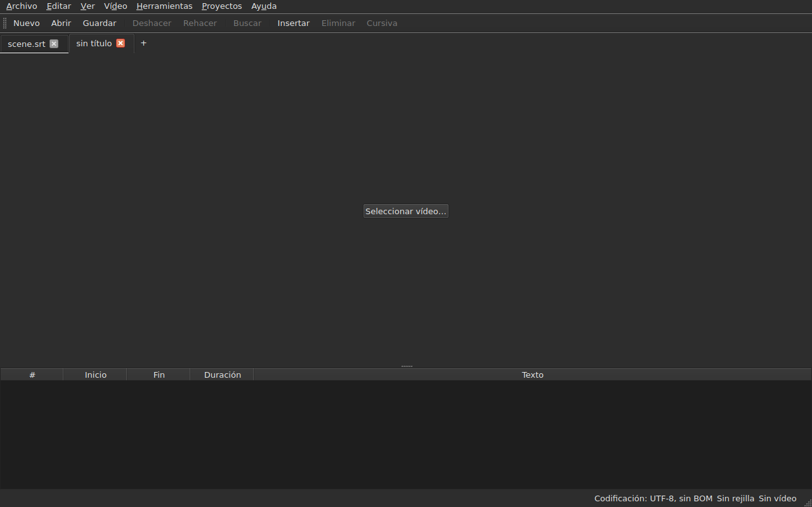
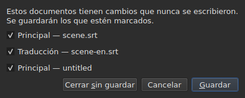
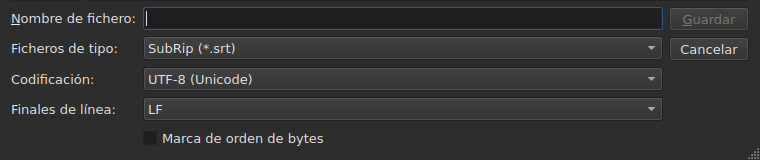
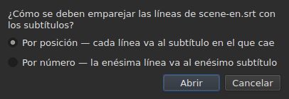
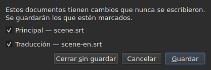

# Abrir y guardar

<!-- machine-translated -->
> Esta página es una traducción automática y todavía no la ha revisado ningún lector del idioma.

El menú **Archivo** contiene los tres comandos, dos para las pestañas y tres
más para la traducción; el menú **Proyectos** actúa sobre todas las pestañas a la vez.

| Comando | Atajo | Qué hace |
| :------ | :------- | :----------- |
| Nuevo proyecto | `Ctrl+N` | un proyecto vacío, en una pestaña nueva — también el botón `+` tras la última pestaña |
| Abrir… | `Ctrl+O` | elige un archivo y lo abre en una pestaña nueva — o en lugar de un proyecto en blanco |
| Abrir traducción… | — | elige un archivo de traducción y lo alinea con el archivo principal de la pestaña actual |
| Guardar | `Ctrl+S` | reescribe el archivo abierto |
| Guardar como… | `Ctrl+Shift+S` | elige una ruta y un formato, y después escribe |
| Guardar traducción | — | reescribe el archivo de la traducción |
| Guardar traducción como… | — | elige una ruta y un formato para la traducción, y después escribe |
| Cerrar | `Ctrl+W` | cierra la pestaña actual — desactivado si solo hay una |

`New Project`, `Open…` y `Save` están también en la
[barra de herramientas](index.md#la-barra-de-herramientas), con las palabras `New`, `Open` y
`Save`. **Las tres entradas de la
traducción no están en la barra**: solo sirven a quien tiene una
traducción, y la barra es de todos.

## Varios proyectos, en pestañas

**Cada proyecto abierto tiene su pestaña**, encima de la imagen y de la tabla:
su etiqueta es el nombre del archivo, o `untitled` para un proyecto que todavía
no lo tiene. Pulsar una pestaña cambia a ella; `Ctrl+PageDown` y `Ctrl+PageUp` hacen
lo mismo, sin el ratón, y vuelven a la primera pestaña después de la última.
**El botón `+`, justo después de la última pestaña**, abre un proyecto vacío en una
pestaña nueva, como `New Project`.




**`Open…` nunca las toca.** Abrir un archivo ya no sustituye lo que
mostraba la ventana: llega en una pestaña nueva, al lado, y la pestaña que se
estaba mirando conserva todo lo que tenía — su historial, su selección, su
vídeo asociado. Por eso, además, abrir ya no pregunta nada: no hay
nada que perder, puesto que no hay nada que sustituir.

**Una excepción: el proyecto en blanco cede su sitio.** Lanzada sin archivo, o
después de `New Project`, la ventana muestra un proyecto `untitled` sin nada dentro.
Un archivo abierto — mediante `Open…` como mediante un arrastre — **ocupa entonces su pestaña,
en el mismo lugar de la barra**, en lugar de abrir otra al lado de un
proyecto inútil. Un proyecto está en blanco cuando **no tiene archivo, ni subtítulos,
ni nada que deshacer o rehacer, ni película, y nunca se ha modificado**: basta con cualquiera
de estas cosas para que conserve su pestaña. Un proyecto en blanco que no es
la pestaña actual no se toca.

**Un archivo ya abierto no se abre una segunda vez.** `Open…` sobre un
archivo que ya contiene otra pestaña devuelve el foco a esa pestaña, y lo dice
en la barra de estado:

```text
premier.srt: already open
```

**Cada pestaña es un proyecto entero, independiente de los demás**: su
historial, su selección, su vídeo asociado y lo que encontró su última
lectura solo se muestran cuando esa pestaña es la actual, y no
cambian mientras lo es otra. **Una excepción, y está en el ADR
0033**: el reproductor de vídeo es único para toda la ventana — un solo proceso
mpv — y su película cambia con la pestaña; **cada pestaña recuerda dónde estaba su
película**, y la reanuda allí, en pausa, cuando se vuelve a ella. El portapapeles, por su parte, pertenece a la ventana: copiar
en una pestaña y pegar en otra es para lo que se abren dos.

**`Close` cierra la pestaña actual**, planteando si hace falta
[la pregunta de los cambios sin guardar](#cambios-sin-guardar) —
la de esa pestaña sola, ya que las demás no están afectadas. **Desactivado cuando
solo hay una pestaña**: la ventana conserva siempre al menos una, y cerrarla
sería cerrar la ventana — lo que ya hace el botón del sistema.

**Cada pestaña lleva también una cruz**, que cierra **su** proyecto, con la misma
pregunta. La cruz de una pestaña que no es la actual cierra esa, y
la pestaña que se está mirando sigue mostrándose; si ese proyecto tiene cambios, su
pestaña pasa al frente mientras dura la pregunta. **Sin cruz cuando solo
queda una pestaña**, por la misma razón por la que `Close` está desactivado.

**Una pestaña dice que está modificada**: un asterisco sigue a su nombre, `premier.srt*`,
mientras uno de sus documentos difiera de su archivo — como dice el título de la ventana
del proyecto que se está mirando. Desaparece al guardar.

## El menú Proyectos

Dos comandos actúan sobre todos los proyectos a la vez.

| Comando | Atajo | Qué hace |
| :------ | :------- | :----------- |
| Guardar todo | `Ctrl+Shift+L` | escribe cada documento modificado, pestaña a pestaña |
| Cerrar todo | `Ctrl+Shift+W` | cierra todos los proyectos — es decir, la ventana |

**`Save All` sigue el orden de las pestañas**, el documento principal antes que la traducción.
Un documento que tiene archivo se reescribe en él **sin que su pestaña pase al frente**;
**un documento que no lo tiene abre `Save As…`, de uno en uno**, en su pestaña —
el único caso en que `Save All` cambia de pestaña, para que el cuadro muestre de qué
proyecto se trata. **Cancelar un `Save As…`, o un
guardado que falla, detiene el resto**: los proyectos siguientes no se
tocan, y un cuadro dice lo que se ha escrito.

```text
Save All stopped: 1 of 3 documents saved
```

Cuando todo está escrito, la barra de estado lo dice — `2 documents saved`, o
`Nothing to save` cuando no se ha modificado nada. Si un `Save As…` ha traído
una pestaña al frente, la ventana vuelve después a aquella desde la que se lanzó
el comando.

**`Close All` y la cruz de la ventana son una sola y misma cosa**: la ventana
conserva siempre un proyecto, y cerrarlos todos es cerrarla. Por eso plantean
**una sola pregunta para todos los proyectos**, la misma que con
[dos documentos modificados](#cerrar-con-dos-documentos-modificados), con una casilla
por documento modificado de cada pestaña:




**`Cancel` no cierra nada**, y no deja nada escrito. `Save` escribe los
documentos marcados como `Save All`: detrás de su pestaña, salvo un documento sin
nombre, cuya pestaña pasa al frente para su `Save As…`. Con un solo documento
modificado en todos los proyectos, es la pregunta simple de
siempre, planteada en su pestaña. `Save All As…` no existe: sería una sucesión de
`Save As…`, que `Save All` ya pide, de uno en uno, para los documentos sin nombre.

## Abrir

El cuadro de diálogo filtra **los nueve formatos leídos**, una entrada cada uno, y una primera
entrada que los muestra todos. El formato se reconoce después **por el contenido, no por
la extensión**: un `.txt` que contiene SubRip se abre, y el filtro no decide
nada — solo oculta archivos.

| Entrada del filtro | Extensión |
| :----------- | :-------- |
| `SubRip` | `.srt` |
| `WebVTT` | `.vtt` |
| `SubViewer 2` | `.sub` |
| `Sub Station Alpha` | `.ssa` |
| `Advanced SSA` | `.ass` |
| `MicroDVD` | `.sub` |
| `MPL2` | `.txt` |
| `TMPlayer` | `.txt` |
| `LRC` | `.lrc` |

**Dos extensiones designan dos formatos cada una** — `.sub` es SubViewer 2 y
MicroDVD, `.txt` es MPL2 y TMPlayer. No tiene ninguna consecuencia al abrir,
ya que decide el contenido; al guardar, es el **nombre** de
la entrada elegida el que da el formato, nunca su patrón.

**Un archivo ilegible no abre nada.** Inexistente, rechazado por el sistema, escrito
en una codificación con la que sus bytes no se decodifican, o de ningún formato
conocido: un cuadro modal **nombra la causa**, no se abre ninguna pestaña, y las que
había no se mueven.

| Mensaje | Qué ha ocurrido |
| :------ | :------------ |
| `does not exist` | la ruta no designa ningún archivo |
| `cannot be opened: permission denied` | el sistema se niega a abrirlo |
| `cannot be read` | el sistema se ha negado por otro motivo |
| `cannot be decoded in the chosen encoding` | los bytes no se leen en la codificación elegida |
| `is in no format this tool knows` | ningún formato reconoce el contenido |
| `holds nothing recognisable as a subtitle` | el formato se reconoce, pero nada de lo que contiene es un subtítulo |

El mensaje va precedido de la ruta: `notes.txt: is in no format this tool knows`.
Son las palabras de la línea de comandos, y no por casualidad — las dos
superficies leen un archivo con la misma receta.

### Soltar archivos en la ventana

**Soltar archivos en cualquier parte de la ventana los abre**, desde el
gestor de archivos: la tabla, la barra de pestañas, el
botón `Select Video…`, y **la propia imagen de la película**, tanto en reproducción como detenida.
La imagen es una ventana aparte dibujada por el reproductor, y nada garantizaba
que dejara pasar un arrastre; se ha comprobado a mano en un escritorio real,
en una sesión Wayland. `subedit-gui` se lanza allí bajo X11 para poder mostrar
la película, de modo que el arrastre pasa por el protocolo X11 — el de una
sesión X11, donde no se ha probado por separado.

- **Cada archivo de subtítulos abre su pestaña**, en el orden en que se
  soltaron — exactamente como `Open…`. Un archivo **ya abierto** no se
  vuelve a leer: su pestaña pasa al frente, y la barra de estado lo dice
  (`premier.srt: already open`).
- **Un vídeo soltado se asocia a la pestaña actual**, como con
  `Select Video…`. Soltado junto con subtítulos, va a la última pestaña
  que estos abrieron, sea cual sea el orden del arrastre. Un vídeo se reconoce por
  su extensión — la misma lista que la que propone una película junto al
  archivo.
- **Dos vídeos o más a la vez no se abren**: un proyecto mira una
  sola película. Los subtítulos del mismo arrastre, en cambio, sí se abren.
- **Un archivo que no se abre no detiene a los demás.** Un único cuadro dice entonces
  lo que no se ha podido hacer, una línea por archivo, con las palabras
  de `Open…`:

  ```text
  /films/notes.txt: is in no format this tool knows
  /films/absent.srt: does not exist
  ```

Solo se aceptan archivos locales: un enlace arrastrado desde un navegador
no designa nada que la ventana pueda leer.

Abrir desde la línea de comandos sigue funcionando: `subedit-gui film.srt`.
Allí, el mismo motivo se escribe en el flujo de error, y la ventana se abre
vacía — véase [Invocación](invocation.md#cuando-la-apertura-falla).

## Los diagnósticos de una lectura

Un archivo real rara vez es perfecto, y la lectura recupera en lugar de
rendirse: un número que falta, una línea que no lleva a ninguna parte, finales
de línea mezclados. **Lo que ha encontrado cabe en un botón de la barra de estado**
— `2 diagnostics`, a la izquierda de lo que la barra ya dice del documento —, y **la lista se abre con un clic
en una ventana flotante** encima del botón. No se le dedica ninguna línea de la ventana:
la tabla conserva toda su altura, tenga la lectura algo que decir o no. La lista
se cierra con un clic en otra parte o con `Esc`.

```
a SubRip block without its number, settled by the reader: 5
```

**Cada línea cuenta**: lo que se encontró, lo que se hizo al respecto, y
cuántas veces. Un archivo mal hecho encuentra cientos, y saber
cuántos hay de cada tipo es lo que permite actuar; el número de línea de cada aparición en el
archivo, por su parte, se lee en la línea de comandos, con el nivel de detalle `-vvv`. El
botón cuenta estas líneas — una por tipo —, no las apariciones.

**La codificación adivinada aparece también ahí**, una vez: se propuso sopesando los
bytes, antes de que existiera una sola línea del archivo.

```
an encoding nothing declared, settled by the reader: 1
```

Solo se muestra cuando la codificación se **adivinó y no es
UTF-8** — un archivo UTF-8 leído como tal no es un acontecimiento, y decirlo en
cada apertura pondría un botón en la barra de estado de todo documento
corriente. Un archivo que lleva una marca de orden de bytes tampoco lo activa:
ha declarado su codificación, no se ha adivinado nada.

**La misma lista cuenta también lo que está mal en los propios subtítulos**: un
subtítulo que empieza antes de que haya terminado el anterior, un fin antes de su
inicio, un inicio antes que el del subtítulo de arriba. La tabla los colorea, pero
un color se encuentra desplazándose, y en un archivo de dos mil líneas
es fácil pasar uno por alto; aquí los tipos están todos juntos, **uno por
línea y con su número**, con las palabras del informe de `inspect`:

```
subtitle starts before the previous one ends: 12
subtitle starts before the previous one starts: 3
```

**Un clic en uno lleva al primer subtítulo afectado**, seleccionado en la
tabla. Estas líneas **siguen las correcciones** — ordenar o corregir una duración
elimina algunas, o reduce su número —, sin cerrar la lista que se está
leyendo. Un subtítulo puede contarse dos veces: empezar antes del fin del
anterior y antes de su inicio son dos constataciones, que se corrigen de dos
maneras. Para nombrarlos uno por uno, `subedit-cli inspect --detail`.

El botón **no aparece** cuando no hay nada que indicar, ni en la lectura ni
en los subtítulos, y **sigue a la pestaña**: cada proyecto conserva los
diagnósticos de su propia lectura, y el botón muestra los del proyecto mostrado.

## La codificación en la barra de estado

**La barra de estado da siempre la codificación del documento abierto**, a la izquierda de lo que
dice de la [rejilla de fotogramas](frame-grid.md) y del
[vídeo asociado](video.md):

| Situación | Lo que se escribe |
| :-------- | :-------------- |
| el archivo se leyó como UTF-8, sin marca | `Encoding: UTF-8, no BOM` |
| … con marca | `Encoding: UTF-8, BOM` |
| un archivo en Latin-1 | `Encoding: ISO-8859-1, no BOM` |

**El diagnóstico y esta línea no responden a la misma pregunta**, y por eso
existen los dos. El diagnóstico dice lo que la lectura **hizo** — ha
adivinado, y puede que se quiera comprobar; por eso solo se muestra cuando ha
habido una suposición. La barra de estado dice lo que el documento **es**,
de forma permanente, incluso para un archivo que declara él mismo su codificación y sobre
el que la lectura no tiene nada que contar.

**De dónde viene la respuesta no aparece ahí.** `inspect` lo da — `detected`,
`from its byte order mark`, `as asked for` — porque un informe tiene sitio para
decirlo; una línea de barra de estado no, y la lista de diagnósticos ya lo incluye cuando
importa.

## Guardar

`Save` reescribe el archivo abierto **en su forma original**: su formato, su
codificación, sus finales de línea, su marca de orden de bytes y su cabecera. Un
archivo abierto y luego guardado sin modificaciones no cambia ni un byte — véase
la garantía exacta más abajo.

La escritura es **atómica**: pasa por un archivo temporal que se renombra
encima del original. Un guardado interrumpido en cualquier momento deja intacta la versión
anterior.

Guardar un documento que nunca ha estado en el disco equivale a `Save As…`.

**Una escritura que falla lo dice y no pierde nada**: un disco lleno, un
archivo de solo lectura, un directorio que no existe — o **un carácter que la codificación del archivo
no puede escribir**, una `ł` en un archivo Latin-1. El mensaje es
entonces `holds a character the chosen encoding cannot write`, y no se escribe
nada: sustituir el carácter por un `?` perdería texto ante los ojos de quien
acaba de teclearlo. El mensaje nombra el archivo y el motivo, la ventana conserva
sus modificaciones, y la marca del título permanece.

## Guardar como

`Save As…` pide una ruta, un formato **y la forma de los bytes escritos**:
la codificación, los finales de línea, la marca de orden de bytes. El documento **vive entonces
allí**: el título cambia, `Save` apunta al archivo nuevo y escribe con la
forma elegida, y el archivo original se queda como estaba.

**Se ofrecen los nueve formatos**, y la entrada seleccionada cuando se abre el
cuadro es **la del documento**. Guardar con otro nombre sin tocar el
filtro no cambia, por tanto, el formato.




**Las imágenes muestran solo la parte inferior del cuadro**, no la lista de archivos
de encima: esta depende de la máquina — sus directorios, sus fechas, sus
accesos directos laterales —, así que su fotografía nunca sería la misma dos veces.
Esta franja sí lo es, y es donde ocurre todo.

| Campo | Lo que ofrece | Por defecto |
| :---- | :------------- | :------ |
| `Encoding` | catorce codificaciones que lleva en la práctica un archivo de subtítulos, más `Other…` | **la del archivo leído** |
| `Other…` | un campo para teclear cualquier codificación que ICU sepa escribir, **con autocompletado** — `cp1257`, `EUC-KR` | — |
| `Line endings` | `LF`, `CRLF` o `CR` | los del archivo leído |
| `Byte order mark` | la marca, **desactivada para una codificación que no lleva ninguna** | la del archivo leído |

**Los valores por defecto son los del archivo leído, y eso es una garantía más que una
comodidad**: un archivo abierto y guardado de nuevo sin tocar estos tres
campos devuelve los mismos bytes.

**La lista es corta, y no es un techo.** ICU conoce doscientas
veintiuna; lo que ofrece el menú es lo que lleva un archivo de subtítulos
en la práctica, porque un menú de doscientas entradas no ayuda a nadie. `Other…`
abre el resto.

**El campo autocompleta sobre las doscientas veintiuna**, así que no hace falta
conocer el nombre exacto: teclear `1252` propone `windows-1252`, teclear `koi`
propone `KOI8-R` y `KOI8-U`. El autocompletado se basa en lo que el nombre **contiene**
y no en cómo empieza — el nombre canónico de Windows Western es
`windows-1252`, y `cp1252` es el que se tiene en mente. Los dos pueden
escribirse también enteros sin autocompletado: ICU acepta sus propios alias.

**Un nombre que nadie conoce no escribe nada.** Teclear `klingon-1` no
recurre a UTF-8: no se escribe nada, y el mensaje lo dice.

**Tampoco un nombre que no indica su orden de bytes.** `UTF-16` y `UTF-32` son
nombres que ICU conoce, cuyo convertidor escribe **su propia marca**: la
casilla `Byte order mark` dejaría entonces de decidir nada. Los dos
se rechazan, y el mensaje remite a `UTF-16LE` o `UTF-16BE`, que escriben
los mismos bytes bajo el control de la casilla. Es el mismo rechazo, con las
mismas palabras, que el de la línea de comandos.

**Un carácter que la codificación elegida no puede escribir detiene el guardado**
— una `ł` en Latin-1. El mensaje es
`holds a character the chosen encoding cannot write`, la ventana conserva sus
modificaciones, y el archivo de destino no se toca.

**El documento tampoco se mueve**: se queda en su archivo, en su
formato y su codificación, y el siguiente `Save` reescribe el que se abrió.
Un guardado que no ha tenido lugar no cambia nada en absoluto — ni en el disco,
ni en la ventana.

Cambiar de formato cambia lo que muestra la tabla — el separador decimal sigue el
formato, una coma para SubRip, un punto para WebVTT, y **las etiquetas se reescriben
en el vocabulario del formato de destino**: una `<i>` se convierte en `{\i1}` en Sub
Station Alpha, `{Y:i}` en MicroDVD, `/` al principio de línea en MPL2. El documento
**se ha convertido** en ese archivo, así que la tabla muestra lo que lleva el archivo.

**No es un comando, y `Ctrl+Z` no lo deshace.** Un documento cuyo
formato dijera LRC y cuyos textos siguieran diciendo `<i>` sería un
documento incoherente; no hay ninguna mitad que deshacer.

## Lo que un formato no conservará, dicho antes de escribir

**Un cuadro modal avisa, y todavía se puede responder que no.** Enumera lo que
el formato de destino no conservará, elemento por elemento, con las palabras que la línea
de comandos escribe después:

```
ends are not carried by LRC, line breaks were joined in 2 subtitles, 1 tag dropped
```

| Botón | Efecto |
| :----- | :----- |
| `Save` | escribe de todos modos, aceptada la pérdida |
| `Cancel` | no escribe nada; el documento no se mueve, ni de archivo ni de formato |

`Cancel` es el botón por defecto: pulsar la tecla Intro sin leer conserva el
archivo como está.

**No se pregunta nada cuando no se pierde nada.** Un cuadro que anunciara «no
se perderá nada» enseñaría a descartar el que importa.

Lo que puede anunciarse:

| Elemento | Cuándo |
| :--- | :--- |
| los fines | el formato de destino no lleva ninguno — TMPlayer, LRC |
| los saltos de línea | el formato de destino no lleva ninguno — LRC |
| las etiquetas | una etiqueta del origen no tiene equivalente en el destino, o el pivote no la conoce |
| la cabecera | el archivo leído llevaba una, y no pasa al otro lado |
| los campos declarados | el orden de las columnas SSA, la forma del tiempo TMPlayer |
| la precisión | el formato de destino cuenta de forma más gruesa — la décima de MPL2, el segundo de TMPlayer |

**Lo que pertenece al otro formato se deja de lado.** Un archivo WebVTT
lleva identificadores de indicación y ajustes de colocación; SubRip lleva coordenadas
de visualización. Escribir en el otro formato los ignora en lugar de
traducirlos al azar — no por ello se pierden, simplemente
no se escriben.

## La garantía de ida y vuelta

Tiene dos mitades, y hacen falta las dos:

- **fiel byte a byte** en un archivo que ya tiene la disposición que
  escribe `subedit` — la de Gaupol, línea vacía final incluida —, y **sea cual sea
  su codificación**: un archivo en CP1252 o en UTF-16 se reescribe en
  la suya, marca incluida;
- **idempotente** en caso contrario: el primer guardado normaliza la disposición,
  ninguno de los siguientes toca ya nada.

En concreto, un archivo cuyo último bloque no va seguido de una línea vacía
gana una, una sola vez. Es el único cambio que puede producir un guardado sin
modificación.

## Abrir una traducción

`Archivo ▸ Abrir traducción…` coloca un **segundo archivo** junto al principal.
La entrada está desactivada mientras no haya ningún subtítulo al que dar las líneas de
la traducción.

**Dos preguntas, una tras otra.** El selector de archivos, el de
`Open…` — mismo filtro, misma carpeta de partida, la codificación reconocida como para el
archivo principal — y después **el método de alineación**:




| Método | Qué hace |
| :----- | :----------- |
| `By position` (por defecto) | cada línea va al subtítulo en el que cae su punto medio |
| `By number` | la enésima línea va al enésimo subtítulo, sin mirar las posiciones |

**La posición es el valor por defecto**, porque una sola línea que falte en medio hace
que *todas* las siguientes se deslicen por número, mientras que por posición un solo
subtítulo se queda sin traducción.

**Lo que se hace, lo que se escribe:**

- los textos de las líneas asociadas entran en la columna `Translation`, que
  aparece;
- **una línea que no encuentra ningún subtítulo da lugar a uno**, con **las
  posiciones de esa línea** — con cualquiera de los dos métodos;
- **no se ordena nada**, ni el archivo ni el documento: las líneas se recorren
  en orden temporal, y se da la cuenta de las que no lo estaban;
- **una traducción ya abierta se sustituye**, borrados antes todos sus textos.

**Se dice lo que ha ocurrido.** Cuando cada línea ha encontrado su subtítulo y
ninguno se ha quedado solo, lo escribe la barra de estado; si no, **un cuadro que cerrar**,
como para todo gesto que tiene algo que decir:

```text
translation: 3 lines attached
translation: 2 lines attached; 1 subtitle left without a translation
translation: 3 lines attached; 1 subtitle born of a line; 2 lines out of order
```

Los elementos solo se escriben si no son cero: las líneas asociadas, los
subtítulos nacidos de una línea, aquellos a los que no llegó ninguna línea, las líneas fuera
de orden. Un archivo sin ninguna línea lo dice
(`translation: the file holds no line`) en lugar de echar la culpa a los
subtítulos.

**Una traducción desplazada se reconoce, y se vuelve a abrir desplazada.** Una traducción temporizada dos
segundos demasiado tarde se alinea con los subtítulos equivocados sin que nada la distinga de una
asociación correcta. Cuando la apertura **por posición** no es limpia, la ventana busca
**un desplazamiento constante**: las diferencias entre el inicio de cada línea y el de los subtítulos
que la rodean dan candidatos, agrupados a la decena de milisegundos, y **cada
uno se juzga con la misma asociación de la apertura**. Si un único desplazamiento hace limpia la
apertura, el cuadro lo dice después de su cuenta y **ofrece volver a abrir desplazada**:

```text
translation: 4 subtitles born of a line; 4 subtitles left without a translation
the lines sit 2.000 s later than the subtitles; moved back, 4 lines would attach instead of 0
```

`Yes` deshace la apertura y la rehace con las líneas devueltas por ese desplazamiento; `No`, la
respuesta por defecto, deja la apertura como está. **El resultado es una sola entrada del
historial**: deshacerla lo devuelve todo, como para cualquier apertura.

**No se propone nada cuando el desplazamiento no es constante** — una deriva, un desplazamiento que
solo afecta a una parte del archivo —, cuando dos desplazamientos harían la apertura igual de
limpia, o cuando ninguno la hace limpia: la frase no dice entonces que haya uno. Tampoco
por número, donde no se miran las posiciones. **No hay línea de comandos**
para ello.

**Abrir una traducción es una sola entrada del historial**, `Undo: opening a translation`,
y deshacerla lo devuelve todo: los textos, los subtítulos nacidos eliminados,
el archivo de la traducción desasociado — la columna desaparece con él. Para abrirla con
el otro método, primero se deshace.

**La traducción recién abierta no está modificada**: no se ha tecleado nada, y
cerrarla no ofrece guardarla. Si han nacido subtítulos, es el
documento principal el que está modificado.

**Una traducción modificada se ofrece para guardar antes de ser
sustituida**, con las tres salidas de la sección sobre
[los cambios sin guardar](#cambios-sin-guardar).

| Mensaje | Qué ha ocurrido |
| :------ | :------------ |
| `the file is already open as the main document` | el archivo elegido es el propio documento principal, se escriba como se escriba su ruta |
| `does not exist`, `cannot be decoded in the chosen encoding`, … | las mismas causas que para `Open…` |

El mensaje va precedido de la ruta, y **no cambia nada**: la ventana conserva su
historial y sus modificaciones.

**Los problemas que encontró la lectura**, si los hay — una línea reparada,
un campo ignorado —, van a la lista de diagnósticos, la de
[la última lectura](#los-diagnósticos-de-una-lectura).

**Lo que la traducción no conserva**: los ajustes **por subtítulo** de su
archivo — un estilo SSA, la posición de un subtítulo WebVTT. Un subtítulo
solo lleva un juego, el del documento principal; no se vuelven a leer ni se reescriben.

## Guardar la traducción

**Cada documento se guarda por separado**, en su archivo, su formato, su
codificación y sus finales de línea: una traducción en `.ass` bajo un archivo principal en
`.srt`, en Windows-1252 bajo un archivo principal en UTF-8, vuelve tal cual.

| Entrada | Qué hace |
| :---- | :----------- |
| `Save Translation` | reescribe el archivo de la traducción — aquel del que procede |
| `Save Translation As…` | el selector de `Save As…`, abierto sobre el archivo **de la traducción**, con su formato y su codificación |

Las dos están **desactivadas mientras el proyecto no tenga traducción**.
`Save Translation As…` es `Save As…` sobre el otro documento: mismos campos, mismo
[aviso de pérdida](#lo-que-un-formato-no-conservará-dicho-antes-de-escribir), que
cuenta **lo que perdería el archivo escrito** — las etiquetas del texto principal
no son las de la traducción, y un formato que no escribe cursiva
solo se queja de ello si la traducción la tiene.

**Cada documento tiene su propio estado de modificación.** Guardar el documento principal deja la
traducción modificada, y a la inversa; **el título de la ventana está modificado si lo está cualquiera de
los dos**, y solo tiene un asterisco.

**Nada de uno toca al otro**: guardar la traducción no escribe el
documento principal, y no cambia ni su archivo, ni su formato, ni sus textos.

## Cerrar con dos documentos modificados

Cerrar la pestaña actual, o la ventana, mientras **dos documentos** o más
difieren de sus archivos plantea **una sola pregunta**, con una casilla por
documento:




| Botón | Lo que ocurre |
| :----- | :----------- |
| `Save` | escribe los documentos cuya casilla está marcada, y después sigue adelante — desactivado cuando no hay ninguna |
| `Close Without Saving` | pierde los dos, sean cuales sean las casillas |
| `Cancel` | no ocurre nada; la ventana se queda como estaba |

**Desmarcar un documento significa perderlo**: `Save` escribe los demás y sigue
adelante. **Si un guardado falla, la acción no continúa.** Cerrar el
cuadro sin responder equivale a `Cancel`.

**Con un solo documento modificado, la pregunta es la de siempre**,
descrita más abajo, y la frase dice cuál: `The translation has changes that were never written.`
o `The document has …`.

**Un archivo desaparecido del disco cuenta como modificado**, y la lista lo dice —
`(file is gone from the disk)`: lo que contiene la ventana es entonces **la única
copia**, y cerrar sin escribir la destruiría. Con un solo documento en ese caso,
la frase es `The document is no longer where it was read from.`

## Cambios sin guardar

Cerrar la ventana, la pestaña actual, o abrir una traducción que sustituiría
a la que ya está, mientras el documento difiere del que está en el disco **pide
confirmación**, con tres salidas:

| Respuesta | Lo que ocurre |
| :----- | :----------- |
| `Save` | el documento se escribe, y después la acción continúa |
| `Discard` | las modificaciones se pierden, y la acción continúa |
| `Cancel` | no ocurre nada; la ventana se queda como estaba |

Cerrar el cuadro sin responder equivale a `Cancel`.

**Si el guardado falla**, la acción no continúa: el trabajo ni se
escribe ni se pierde.
