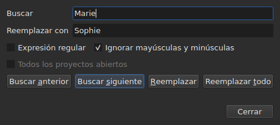
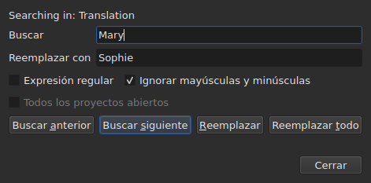

# Buscar y reemplazar

<!-- machine-translated -->
> Esta página es una traducción automática y todavía no la ha revisado ningún lector del idioma.

`Editar ▸ Buscar y reemplazar…`, o `Ctrl+F`, abre el cuadro de búsqueda.




**El cuadro no es modal**: sigue abierto mientras se mira la tabla,
se edita una celda o se vuelve a buscar. `Close` lo cierra; al volver a abrirlo,
aparece tal como se dejó, patrón y reemplazo incluidos.

| Campo | Lo que contiene |
| :---- | :-------------- |
| `Find` | el patrón buscado |
| `Replace with` | lo que lo reemplaza |
| `Regular expression` | el patrón es una expresión regular y no texto plano |
| `Ignore case` | «marie» encuentra «Marie» |
| `All open projects` | la búsqueda recorre todas las pestañas — [véase más abajo](#en-todos-los-proyectos-abiertos) |

La entrada está desactivada en un documento vacío: no hay nada que buscar.

## Los cuatro gestos

| Botón | Qué hace |
| :----- | :----------- |
| `Find Previous` | encuentra la coincidencia anterior, y la tabla va a ella |
| `Find Next` | encuentra la siguiente — es el botón que pulsa `Enter` |
| `Replace` | reemplaza la coincidencia encontrada y luego encuentra la siguiente |
| `Replace All` | reemplaza todas las del alcance |

Los cuatro están desactivados mientras `Find` esté vacío.

**La tabla va a la coincidencia** seleccionando su línea. Al llegar a la
última, `Find Next` vuelve a empezar por la primera; `Find Previous` hace lo mismo en
el otro sentido.

**`Replace` sin coincidencia encontrada busca primero**: la primera pulsación
muestra lo que se va a reemplazar, la siguiente lo reemplaza. Es lo que
hace Gaupol.

## Lo que abarca la búsqueda

**La selección, o el documento entero si no hay nada seleccionado** — la regla del
menú `Tools`. Véase [Las operaciones](operations.md#sobre-qué-actúan).

**El alcance se toma en el primer gesto y se conserva** mientras la búsqueda
continúa: `Find Next` selecciona la línea de una coincidencia, y esa
selección no reduce el alcance. **Seleccionar uno mismo otras líneas
cambia el alcance** para el gesto siguiente.

La búsqueda abarca el texto de los subtítulos; no se buscan ni las posiciones ni el
número.

### En todos los proyectos abiertos

La casilla **`All open projects`** amplía el alcance a todas las pestañas. **Desactivada con
un solo proyecto abierto** — no hay nada que ampliar —, se activa en cuanto se abre una
segunda pestaña, y se desmarca sola cuando solo queda una.

**Marcada, la selección ya no cuenta**: cada proyecto se busca entero,
en **el documento al que se apunta** — el de la columna actual, el principal o la
traducción, como para un solo proyecto.

- **`Find Next` y `Find Previous` van de pestaña en pestaña, en el orden de las
  pestañas.** Primero el proyecto mostrado; cuando no tiene más coincidencias, el
  siguiente, cuya pestaña muestra la ventana y cuya línea selecciona.
- **La vuelta termina donde empezó**: cuando la búsqueda pasa de la última
  pestaña para volver a la primera — o al revés subiendo —, la línea del
  cuadro lo dice, en lugar de volver a empezar sin decir nada:

  ```text
  Search wrapped around
  ```

  El paso siguiente es un paso corriente, y la línea se borra.
- **`Replace` reemplaza donde está la búsqueda**, y luego pasa a la siguiente
  coincidencia, que puede estar en otra pestaña.
- **`Replace All` recorre todos los proyectos**, y **hace una entrada del historial
  por proyecto tocado**: deshacer en una pestaña solo deshace lo que esa pestaña
  ha recibido. El recuento dice cuántos proyectos han cambiado, no solo cuántos
  reemplazos:

  ```text
  replaced 4 matches in 3 projects
  ```

  Un proyecto en el que el patrón no aparece no se toca, y no tiene nada que deshacer.
  **Ninguna pestaña pasa al primer plano**: cada proyecto recibe sus reemplazos
  detrás de su pestaña, que toma su asterisco, y la pestaña desde la que empezó el
  gesto sigue mostrada, con su película.

### En qué texto

**Con una traducción, la búsqueda solo abarca uno de los dos textos: el de
la columna de la celda actual** — la traducción si la celda actual está
en la columna `Translation`, el texto principal en todos los demás casos. Es la
regla de todas las operaciones de texto, y no hay ningún ajuste adicional:
véase [El texto al que se aplican las operaciones](table.md#el-texto-al-que-se-aplican-las-operaciones).

**El cuadro dice en qué texto busca**, en una línea encima de
`Find`, y la cambia cuando cambia la columna actual — incluso estando abierto:




| La celda actual está en | La línea dice |
| :--------------------- | :------------ |
| la columna `Translation` | `Searching in: Translation` |
| cualquier otra columna | `Searching in: Main` |
| — el proyecto no tiene traducción, o la columna se ha quitado | nada: la línea no está |

**Reemplazar escribe en ese texto, y solo en él.** `Replace` y `Replace
All` sobre la traducción dejan el texto principal como estaba, y
al revés; `Undo` devuelve lo que han escrito. **Las etiquetas son las del formato
del archivo de ese texto**: una traducción en Advanced SSA se lee con sus
`{\i1}`, aunque el texto principal sea un SubRip. `Replace with` se escribe ahí
con las mismas etiquetas.

**La tabla se queda en la columna en la que estaba.** `Find Next` selecciona la línea
de una coincidencia sin mover la celda actual de una columna a otra:
una búsqueda empezada en la traducción continúa en la traducción.

**Buscar en los dos textos a la vez no existe**: cada coincidencia
sería un par (subtítulo, texto), y la tabla que va a ella no tendría
un lugar claro al que ir. Se busca en uno, y luego se cambia de columna.

**Lo que vuelve a empezar de cero**:

| Gesto | Lo que se olvida |
| :------ | :---------------- |
| cambiar `Find`, `Replace with` o una opción | la coincidencia actual, y la línea de estado |
| seleccionar uno mismo otras líneas | el alcance y la coincidencia |
| mover la celda actual de un texto al otro — de `Text` a `Translation`, o al revés | la coincidencia: es un lugar en un texto |
| abrir otro archivo | el alcance y la coincidencia; el cuadro sigue abierto, patrón incluido |

## El texto buscado es el texto visible

**Las etiquetas no son texto.** Buscar `<i>` no encuentra nada, y buscar
`Bonjour` encuentra un `<i>Bon</i>jour` cortado por una etiqueta.

**El reemplazo se hace en el texto del archivo, sin romper las etiquetas**:

| Texto | Buscado → puesto en su lugar | Lo que se escribe |
| :--- | :-------------------------- | :-------------- |
| `<i>Bonjour</i>` | `Bonjour` → `Salut` | `<i>Salut</i>` |
| `<i>Bon</i>jour` | `Bonjour` → `Salut` | `<i>Salut</i>` |
| `<i>Bonjour</i> Marie` | `Bonjour Marie` → `Salut Sophie` | `<i>Salut Sophie</i>` |

Una etiqueta que corta una palabra abarca la palabra entera, y cualquier estilo que toque la
coincidencia cubre el reemplazo. **Las etiquetas que la coincidencia no
toca se quedan donde están**, incluso una que corte otra palabra del mismo
subtítulo: reemplazar `Marie` en `<i>Bon</i>jour Marie` da
`<i>Bon</i>jour Sophie`. Una palabra está hecha de letras y cifras — un espacio
de no separación o unas comillas no forman parte de ella. **`Replace with` se lee con las etiquetas del
texto al que se apunta**: teclear ahí `<b>Salut</b>` en un SubRip pone la palabra en negrita.

## Las dos opciones

| Opción | Por defecto | Lo que cambia |
| :----- | :------ | :-------------- |
| `Regular expression` | sin marcar | `.` ya no busca un punto sino cualquier carácter |
| `Ignore case` | marcada | mayúsculas y minúsculas no cuentan, letras acentuadas incluidas: `élise` encuentra `Élise` |

Son los valores por defecto de Gaupol. **Las dos se recuerdan** de una apertura a
la siguiente y de una sesión a la siguiente, en las opciones `search.regex` y
`search.ignore-case` del [archivo de preferencias](preferences.md#el-archivo).

### Una expresión regular

El patrón lo lee ICU. Como en Gaupol, `.` atraviesa un salto de línea, y `^`
y `$` se aplican al inicio y al final **de cada línea** de un subtítulo:
reemplazar `^` por `- ` pone una raya delante de cada línea.

En `Replace with`, y solo para una expresión regular:

| Escrito | Lo que pone |
| :------ | :----------- |
| `$1` a `$9` | el grupo de ese número; un grupo ausente no pone nada |
| `$0` | la coincidencia entera |
| `\n` | un salto de línea |
| `\$`, `\\` | un `$`, una barra invertida |
| `\` seguido de cualquier otro carácter | ese carácter: `\t` pone una `t` |

**`\1` no es un grupo**, y pone un `1`. Es la sintaxis de Gaupol, que lee
sus expresiones en Python; la de aquí es la de ICU, que lee el patrón.

## Lo que dice el cuadro

Bajo los botones, una línea dice lo que la búsqueda no ha podido hacer, o lo que ha hecho un
`Replace All`:

| Situación | Lo que se muestra |
| :-------- | :------------ |
| ninguna coincidencia en el alcance | `"Sophie" not found` |
| una expresión regular que no se puede leer | `not a regular expression (U_REGEX_MISMATCHED_PAREN)` |
| `Replace All` ha reemplazado | `replaced 3 matches` |
| `Replace All` ha encontrado el patrón, pero el reemplazo no cambia ningún texto | `nothing to change` |

**Una búsqueda que no encuentra nada no toca nada**: la selección se queda donde
estaba, y nada entra en el historial.

**`not found` y `nothing to change` no dicen lo mismo.** `not found`
dice que el patrón no está en ninguna parte del alcance. `nothing to change` dice que
está, pero que el reemplazo deja cada texto como estaba — reemplazar
`Marie` por `Marie`, por ejemplo. En los dos casos nada entra en
el historial. El número de `replaced N matches` cuenta las coincidencias de los
subtítulos cuyo texto ha cambiado.

## Lo que dice de ello la acción de deshacer

| Gesto | Lo que indica `Undo` |
| :------ | :---------------- |
| `Replace` | `Undo: replacing` — una por reemplazo |
| `Replace All` | `Undo: replacing all` — **una sola entrada**, sea cual sea el número de coincidencias |

Véase [Deshacer y rehacer](undo.md).
