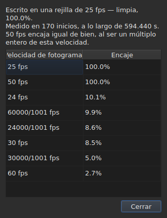

# La rejilla de fotogramas

<!-- machine-translated -->
> Esta página es una traducción automática y todavía no la ha revisado ningún lector del idioma.

Un archivo de subtítulos **no declara** la velocidad de fotogramas con
la que se calcularon sus posiciones: SubRip no tiene cabecera, la de
WebVTT es texto libre. La ventana la **deduce** de las propias posiciones,
al abrirlo, y la muestra en dos lugares que no responden a la misma
pregunta.

| Superficie | Lo que da |
| :------ | :------------ |
| la barra de estado | **la respuesta**, de forma permanente y sin que se pida |
| `Herramientas ▸ Análisis de la velocidad de fotogramas…` | **el razonamiento**, cuando se quiere verlo |

## Lo que muestra la barra de estado

A la derecha, entre lo que dice sobre la
[codificación](files.md#la-codificación-en-la-barra-de-estado) del archivo leído y lo que
dice sobre el [vídeo asociado](video.md#lo-que-muestra-la-barra-de-estado):

| Situación | Lo que se escribe |
| :-------- | :-------------- |
| las posiciones están en una rejilla | `Grid: 24 fps` |
| solo algunas de ellas | `Grid: 29.97 fps (partial)` |
| no encaja ninguna rejilla conocida | `No grid` |

**`No grid` no nombra ninguna velocidad de fotogramas, y es a propósito.** El conjunto de
candidatas es cerrado — las ocho que ofrece el cuadro de conversión — y
señalar la menos mala de ellas sería dar una respuesta falsa donde
«no lo sé» es la correcta.

**`No grid` tiene dos causas, y no son la misma respuesta.** O no encaja
ninguna rejilla, o el archivo tiene demasiado pocos subtítulos para que se pueda decir
nada de él — dos inicios siempre parecen perfectamente alineados, y eso no demuestra
nada. La barra de estado dice lo mismo de los dos casos;
**el análisis los distingue**, y da en el primer caso por cuánto falla la
mejor candidata.

La línea **se actualiza tras cada operación**. Alinear un archivo sobre otra
velocidad de fotogramas cambia la rejilla, y la barra de estado no debe seguir
anunciando la antigua.

### Un documento contado en fotogramas no tiene rejilla, tiene una velocidad de fotogramas

**MicroDVD es el único de los nueve que cuenta en fotogramas.** Cada una de sus líneas
lleva dos números de fotograma y nada más, y el archivo **no dice** a
qué velocidad de fotogramas leerlos. El mismo lugar de la barra de estado escribe entonces:

| Situación | Lo que se escribe |
| :-------- | :-------------- |
| el documento está contado en fotogramas | `Frames: 24000/1001 fps` |

**No es la rejilla, y la rejilla sería aquí circular.** Las posiciones
de un documento MicroDVD se calcularon *a partir de* sus fotogramas a esa misma
velocidad de fotogramas; deducir de ellas una rejilla devolvería ese número, es decir, un dato
disfrazado de medición.

**De dónde viene se dice una sola vez**, en la lectura, en la
[lista de diagnósticos](files.md#los-diagnósticos-de-una-lectura):
`counts in frames and states no rate; it was read at ("24000/1001")`. La línea de la barra
de estado, por su parte, dice lo que es, de forma permanente.

**Equivocarse de velocidad de fotogramas mueve el archivo entero**, y el
cuadro [`Convert Frame Rate…`](operations.md#convert-frame-rate) es donde se corrige:
se abre en la velocidad de fotogramas de lectura y dice que es esa.

## Lo que muestra el análisis

`Herramientas ▸ Análisis de la velocidad de fotogramas…` **no modifica nada.** Se abre con un resumen y
la clasificación de las ocho candidatas con su puntuación.




El resumen da la respuesta y luego lo que la matiza — cada frase solo aparece
si tiene algo que decir:

| Lo que puede leerse en él | Cuándo |
| :--------------------- | :--- |
| sobre cuántos inicios, y sobre qué lapso | siempre |
| cuánto se desfasa el archivo de su rejilla | sus posiciones están en ella salvo una constante |
| que otra velocidad de fotogramas encaja igual de bien | es un múltiplo entero de la elegida |
| que el lapso no permite distinguir dos velocidades de fotogramas | el archivo es demasiado corto para separarlas |
| cuántos inicios salen de la rejilla, **y en cuántas series** | el archivo es parcial |

**El número de series es lo que distingue dos historias** que el
porcentaje solo confunde. Muchas series de un solo inicio son posiciones
corregidas a mano, una a una. Unas pocas series largas son una sección
con los tiempos reajustados, o un archivo montado a partir de otros dos.

**Se muestra la clasificación completa en lugar de una sola respuesta.** Un archivo que
encaja con 25 al cien por cien y con 50 al cien por cien dice algo que un
veredicto solo ocultaría.

## Cuando la conversión fue errónea

Un archivo que no cae en ninguna rejilla es a veces un archivo que se **convirtió con la
velocidad de fotogramas equivocada**: está entonces en una rejilla muy real, pero desplazada por una razón que no es la de
ninguna de las ocho. Cuando la deducción devuelve `none` o `partial`, el análisis busca **entre los
cincuenta y seis pares ordenados de las ocho velocidades de fotogramas estándar** — ese es el conjunto, cerrado — aquel
cuya conversión vuelve a poner las posiciones en una rejilla. Cada razón se aplica a las posiciones, y
**es la propia deducción la que juzga el resultado**: la confianza es la que ella diría, nunca un
número inventado. Dos pares que dan la misma razón, como 30 a 25 y 60 a 50, son una sola
conversión.

La frase se añade al resumen:

```text
converting from 24 to 25 fps puts the positions on a 24 fps grid: 99.9%, against 11.8% as they are and 14.9% for the next best conversion
```

Da la conversión, la rejilla en la que caerían las posiciones y lo bien que caen en ella,
**y luego la diferencia con las posiciones tal como están y con la mejor de las demás
conversiones.** Un botón `Convert Frame Rate…` cierra el análisis y abre [el cuadro de
conversión](operations.md#convert-frame-rate) **rellenado con el par encontrado** — no se aplica nada
mientras no se acepte el cuadro, y basta con cancelar para volver atrás. El vídeo, abierto al lado,
permite juzgar sobre la imagen si la respuesta es la buena.

**Cuando dos pares son igual de buenos, no se propone ninguno, y la frase lo dice:**

```text
converting from 30 to 25 fps and converting from 25 to 24 fps fit equally well (99.7% and 99.6%), so none is proposed
```

Es el caso corriente más que la excepción: una rejilla a 28,8 fotogramas por segundo vuelve
a 24 igual que a 30, y un archivo cuyos tiempos se han duplicado todos sigue en la rejilla de 25.
El gesto que tiene una sola reparación es convertir un archivo **ya** a la velocidad de fotogramas de destino. En
caso de empate, decide el vídeo: se abre uno mismo `Convert Frame Rate…` con uno de los dos pares.

**No se dice nada** de un archivo que ya está en una rejilla, de un archivo demasiado corto para que un veredicto
valga algo, ni de un archivo que ninguna conversión del conjunto vuelve a poner en una rejilla — una deriva, una
razón fuera de las ocho velocidades de fotogramas, posiciones sin estructura.

## Lo que la tabla no muestra

**Ninguna línea de la tabla se marca a causa de la rejilla**, nunca.

En cuanto se corrige una posición a mano, deja de estar alineada. Un
marcado automático señalaría, por tanto, el trabajo del usuario como una
anomalía, en un archivo que precisamente está corrigiendo. La deducción
habla del **documento**, y el análisis es la única excepción — porque se
abrió para eso.

Las marcas de la tabla, por su parte, se refieren a lo que no se sostiene: un fin
antes de su inicio, un solapamiento, un orden roto. Véase [La tabla](table.md).
