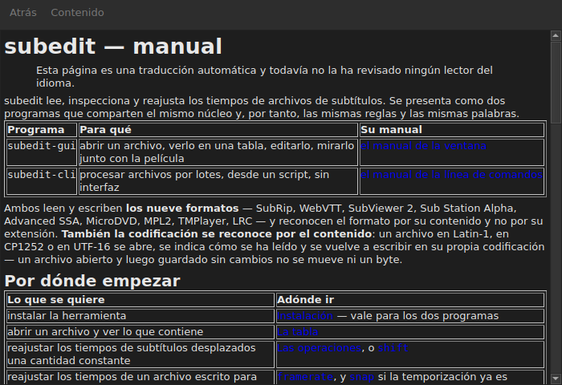

# El manual en la ventana

<!-- machine-translated -->
> Esta página es una traducción automática y todavía no la ha revisado ningún lector del idioma.

`Ayuda ▸ Manual`, o `F1`, abre **este mismo manual** en una ventana propia.




## Lo que abre, y por qué no una dirección

**El manual instalado junto al programa**, no una página de Internet.

Una dirección describiría la versión en desarrollo, no la que se tiene.
Quien lee el manual de una versión que no tiene está peor servido que
quien no tiene ningún manual — por eso la ventana lee los archivos colocados
por la instalación, en `<prefix>/share/subedit/manual`. Véase
[Instalación](../subedit-cli/installation.md).

Se abre en la [página de inicio](../index.md), la que dice por dónde empezar.

## En qué idioma

**En el idioma de la ventana.** El manual se abre en el idioma que habla la
interfaz: el elegido en `Editar ▸ Preferencias…`, o el del
entorno en caso contrario — véase
[El idioma de la interfaz](preferences.md#el-idioma-de-la-interfaz).

| La ventana habla | El manual se abre en |
| :---------------- | :------------------ |
| inglés | inglés |
| un idioma cuyo manual está instalado — catalán, checo, alemán, español, finés, francés, gallego, hebreo, húngaro, interlingue | ese idioma |
| un idioma cuyo manual no está instalado | inglés |

**Página a página, no todo o nada**: una página que la traducción no tiene
se abre en inglés, y todas las demás páginas siguen en el idioma de la ventana. Un
enlace lleva de una a otra de la misma manera.

Las traducciones se instalan junto al manual inglés, cada una en un directorio
con el nombre de su idioma: `<prefix>/share/subedit/manual/fr` para el francés. El
idioma es aquel con el que arrancó la ventana, así que un idioma elegido en las
preferencias se aplica también al manual en el siguiente inicio.

## Navegar

| Lo que se hace | Lo que ocurre |
| :---------- | :----------- |
| pulsar un enlace del manual | la página se abre en la misma ventana |
| pulsar un enlace que apunta a una sección | la página se abre, y la ventana se desplaza hasta ella |
| pulsar un enlace que apunta solo a una sección | la ventana se desplaza hasta ella, sin cambiar de página |
| `Back` | vuelve a la página anterior; desactivado en la primera |
| `Contents` | vuelve a la página de inicio; desactivado cuando ya se está en ella |

La ventana **no es modal**: sigue abierta mientras se trabaja, que es toda la
razón de tener el manual a mano. Volver a elegir la entrada no crea una
segunda ventana, sino que trae esta al frente.

## Lo que no puede abrir, y lo dice

El manual remite a veces a la **hoja de ruta** o a una **decisión de
arquitectura**. Son documentos del repositorio, no del paquete: no se
instalan, y la ventana lo dice con palabras claras en lugar de dejar el
clic sin efecto.

```
../../feuille-de-route.md is not part of the installed manual;
it lives in the project's repository.
```

Pueden leerse en el repositorio, cuya dirección figura en `Ayuda ▸ Acerca de subedit`.

## Cuando la entrada está desactivada

**`Ayuda ▸ Manual` está desactivada cuando no hay ningún manual junto al programa.** Dos
casos, y ninguno es un fallo:

| Caso | Por qué |
| :--- | :-- |
| el binario se ejecuta desde su árbol de compilación | allí no se instaló nada, así que no hay nada que leer |
| la instalación es parcial | el manual se eliminó, o nunca se copió |

Al pasar el puntero sobre la entrada se dice cuál de los dos: «No hay ningún manual instalado junto a
este programa».

Una página que falta mientras el manual está presente — un archivo eliminado a mano — no
cierra la ventana: nombra el archivo que no ha podido leer y mantiene en pantalla lo que
estaba mostrando.

## Dónde se busca el manual

**Junto al ejecutable**, en `../share/subedit/manual` — la disposición que produce toda
instalación, sea cual sea el prefijo. Eso es lo que permite que una instalación
en `~/.local` encuentre su manual igual que un paquete instalado en `/usr`.
