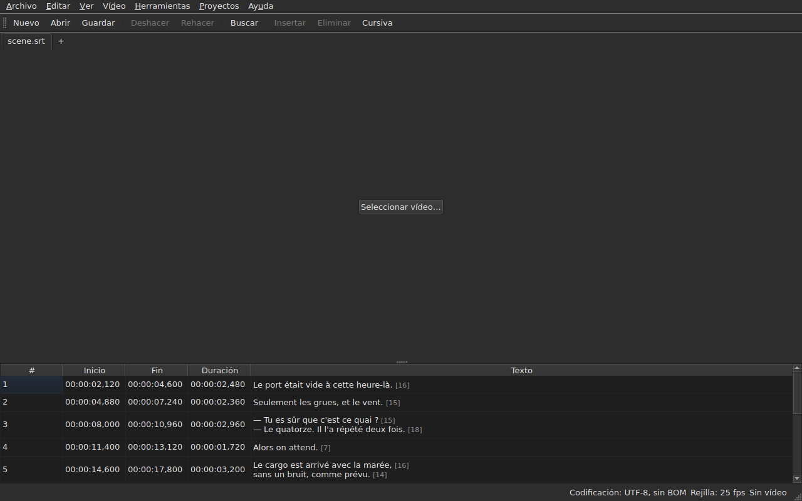

# subedit-gui — manual

<!-- machine-translated -->
> Esta página es una traducción automática y todavía no la ha revisado ningún lector del idioma.

La ventana de subedit: se abre un archivo de subtítulos y se ve en una tabla. Para el
otro programa y para saber por dónde empezar, véase [el manual](../index.md).

> **Estado actual.** La ventana **abre varios archivos, cada uno en su pestaña**, sea cual
> sea su codificación — mediante `Open…` o soltándolos sobre ella —, **los muestra**,
> **edita sus celdas**, **inserta y elimina líneas**,
> **deshace**, **guarda — eligiendo la codificación, los finales de línea y la
> marca de orden de bytes** — y **marca los subtítulos cuyas posiciones
> no son coherentes**. **Fusiona y divide** líneas, **corta,
> copia y pega** textos, y **busca y reemplaza** en el texto visible
> sin romper las etiquetas, en un proyecto o en todos. **Abre una traducción
> junto al archivo principal**, alineada por posición o por número, en una columna más,
> y la guarda por separado. El menú `Tools` reúne dieciséis operaciones y dos entradas de ortografía —
> desplazar, transformar, convertir la velocidad de fotogramas, ajustar duraciones,
> **añadir un archivo, dividir el proyecto en dos**, poner en
> cursiva, añadir rayas de diálogo, cambiar la capitalización de cuatro maneras,
> eliminar las anotaciones para sordos, **corregir textos con un
> asistente de varias páginas**, **comprobar la ortografía palabra por palabra**, alinear a una velocidad de fotogramas, devolver a
> la rejilla — y el análisis de la rejilla, que no modifica nada. El menú `Projects`
> **guarda y cierra todo** de un solo gesto. **Asocia un vídeo
> al documento**, elegido o adivinado, y **lo reproduce en la ventana**, con la línea
> actual dibujada sobre la imagen; **pone un inicio, un fin o un
> subtítulo a partir de la posición de la película**, **avanza fotograma a fotograma** y **mueve un extremo un fotograma**. La barra de reproducción **salta, ajusta el
> volumen y la posición**, la tabla **sigue la reproducción** sin deshacer un desplazamiento manual, las posiciones
> pueden mostrarse **en fotogramas**, y el menú `Video` **elige la pista de audio**. Dos detecciones
> **proponen sin aplicar nunca**: una traducción desplazada en una cantidad constante, que puede **volver a abrirse
> desplazada**, y la conversión de velocidad de fotogramas que devuelve un archivo a una rejilla. **Recuerda su geometría, el orden, la anchura y la presencia de sus
> columnas, y su configuración** de una
> sesión a la siguiente, y se muestra **clara u oscura** a elección. `Ayuda ▸ Manual`
> abre **este manual** en una ventana. Este manual describe lo que existe, nunca
> lo que está previsto; lo que viene después está en la
> [hoja de ruta](../../../../feuille-de-route.md).

> **Las imágenes de este manual se generan; la prosa, no.** Los ejemplos de
> `subedit-cli` se generan ejecutando el comando; las capturas de pantalla
> se generan construyendo la ventana real y fotografiándola — `make
> manual` hace ambas cosas. Una imagen no puede, por tanto, describir una interfaz que
> ya no existe, y una interfaz que cambia se ve en el diff
> del repositorio. Lo que queda sin red de seguridad es el texto que las rodea, cuya
> exactitud depende de la revisión.

**Cada pantalla se muestra dos veces, con las dos paletas que define la
aplicación** — `Light` y `Dark`, las que ofrecen
[las preferencias](preferences.md#el-tema). En un escritorio cuyo
tema manda, `System` da una u otra según lo que haya elegido el escritorio.

## Los menús

`File`, `Edit`, `View`, `Video`, `Tools`, `Projects`, `Help` — en el orden en
que se usan: el documento, lo que se le hace, cómo se mira, lo que
lo acompaña, lo que lo examina, lo que se aplica a todos los proyectos abiertos, lo que
lo explica.

`View` contiene un submenú, `Columns`, con una entrada marcable por columna salvo `Text`
— véase [La tabla](table.md#ocultar-y-mover-columnas) — y un ajuste, `Positions in Frames`, que muestra
`Start` y `End` como números de fotograma — véase [Posiciones en fotogramas](table.md#posiciones-en-fotogramas).

`Projects` contiene dos entradas, `Save All` y `Close All` — véase
[El menú Proyectos](files.md#el-menú-proyectos).

`Edit` contiene cinco bloques, cada uno bajo un separador: deshacer; el
portapapeles — cortar, copiar, pegar textos; `Find and Replace…`;
insertar, eliminar, fusionar y dividir líneas; por último
`Preferences…`. Deshacer es algo que se hace *a* una edición, mover un texto
no añade ni elimina ninguna línea, las cuatro del bloque siguiente cambian el número de
líneas, y elegir el tema no es una edición en absoluto.

**Las teclas se nombran como las muestra el menú**, en inglés como el resto
de la interfaz: `Ins`, `Del`, `Ctrl+Shift+Z`. Una tecla que se pulsa y
que ningún menú nombra conserva su nombre inglés: `Enter`, `Esc`, `Shift`.

`Help` contiene dos entradas, en el orden en que las muestra el menú. `Manual`, o
`F1`, abre este manual en una ventana — véase
[El manual en la ventana](help.md). `About subedit` indica la versión, la
licencia y las bibliotecas con las que funciona la ventana, con sus versiones — véase
[`--version`](invocation.md#--version).

## La barra de herramientas

Bajo los menús, una barra reúne **los gestos más frecuentes**, por grupos.
Cada botón lleva una palabra corta; el menú conserva la entrada completa, y el
atajo es el mismo.

| Botón | Entrada del menú | Atajo |
| :----- | :--------- | :------- |
| Nuevo | Archivo ▸ Nuevo proyecto | `Ctrl+N` |
| Abrir | Archivo ▸ Abrir… | `Ctrl+O` |
| Guardar | Archivo ▸ Guardar | `Ctrl+S` |
| Deshacer | Editar ▸ Deshacer | `Ctrl+Z` |
| Rehacer | Editar ▸ Rehacer | `Ctrl+Shift+Z` |
| Buscar | Editar ▸ Buscar y reemplazar… | `Ctrl+F` |
| Insertar | Editar ▸ Insertar subtítulos… | `Ins` |
| Eliminar | Editar ▸ Eliminar subtítulos | `Del` |
| Cursiva | Herramientas ▸ Cursiva | `Ctrl+I` |

**Un botón desactivado lo está por la misma razón que su entrada**: `Undo` sin
nada que deshacer, `Remove` sin ninguna línea elegida. Las entradas de la traducción
y las operaciones del menú `Tools`, salvo `Italic`, se quedan en sus
menús: se usan menos a menudo, o no todo el mundo las usa.

## Secciones

| Sección | Contenido |
| :------ | :------- |
| [Instalación](../subedit-cli/installation.md) | compilar e instalar — la página vale para los dos programas |
| [Invocación](invocation.md) | lanzar la ventana, argumentos, códigos de salida |
| [Abrir y guardar](files.md) | los comandos, las pestañas, el menú `Projects`, soltar archivos, la traducción y su reapertura desplazada, los diagnósticos, la codificación en la barra de estado, la ida y vuelta, el cierre |
| [La tabla](table.md) | lo que muestra cada columna, ocultarlas y moverlas, las posiciones en fotogramas, la columna de la traducción y el texto al que se aplican las operaciones |
| [Editar una celda](editing.md) | qué celdas pueden editarse, y cómo |
| [Cortar, copiar y pegar textos](clipboard.md) | las tres entradas, lo que viaja, las líneas añadidas, las etiquetas traducidas |
| [Buscar y reemplazar](find-and-replace.md) | el cuadro de diálogo, los cuatro gestos, las dos opciones, lo que abarca la búsqueda, en todos los proyectos abiertos |
| [Insertar, eliminar, fusionar y dividir líneas](lines.md) | las cuatro entradas, sus atajos, adónde van las líneas nuevas |
| [Deshacer y rehacer](undo.md) | el historial, las dos acciones, la marca de modificación |
| [La rejilla de fotogramas](frame-grid.md) | la velocidad de fotogramas deducida de las posiciones, el análisis y la conversión que devuelve un archivo a una rejilla |
| [Las operaciones](operations.md) | desplazar, transformar, convertir, ajustar duraciones, añadir un archivo, dividir el proyecto, poner en cursiva, la capitalización, las rayas, eliminar anotaciones, alinear, devolver a la rejilla, y lo que va más allá del final de la película |
| [Corregir textos…](correct-texts.md) | el asistente de corrección: el alcance y las tareas, la página de cada tarea, el progreso, la confirmación |
| [Comprobar ortografía…](check-spelling.md) | la comprobación ortográfica: su configuración, el recorrido, el cierre a mitad de camino, la ausencia de diccionario |
| [El vídeo asociado](video.md) | elegir un vídeo, la propuesta automática, la pista de audio, la barra de estado, `ffmpeg` |
| [El reproductor](player.md) | la vista del vídeo, la barra de reproducción, reproducir, desplazarse, el volumen, la tabla que sigue, la línea dibujada |
| [Temporizar a partir del vídeo](timing.md) | poner el inicio o el fin de un subtítulo, insertar, seleccionar a partir de la posición de la película, avanzar fotograma a fotograma, mover un extremo |
| [Las preferencias](preferences.md) | el tema, el archivo de preferencias, sus opciones, y lo que ocurre con un valor ilegible |
| [El manual en la ventana](help.md) | `Ayuda ▸ Manual`, lo que abre y cómo navegar por él |
