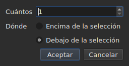

# Insertar, eliminar, fusionar, dividir, ordenar y hacer disjuntas las líneas

<!-- machine-translated -->
> Esta página es una traducción automática y todavía no la ha revisado ningún lector del idioma.

Ocho entradas del menú `Edit`, bajo un separador que las aparta de
`Find and Replace…`. Cuatro tienen en común que cambian el número de líneas, mientras que
cortar, copiar y pegar, más arriba, mueven textos; `Sort Subtitles` cambia
solo **el orden** de las líneas, `Join Repeated Subtitles` vuelve a hacer un solo
subtítulo de los trozos consecutivos de un mismo texto, y `Make Ranges Disjoint…`
los vuelve a cortar donde se solapan.

| Entrada | Atajo | Qué hace |
| :------ | :---- | :------- |
| Insertar subtítulos… | `Ins` | abre un cuadro de diálogo y luego añade líneas en blanco |
| Eliminar subtítulos | `Del` | elimina la selección, sin preguntar nada |
| Fusionar subtítulos | ninguno | hace una sola línea de un bloque de líneas vecinas |
| Dividir subtítulo | ninguno | corta una línea en dos en mitad de su duración |
| Unir subtítulos repetidos | ninguno | hace un solo subtítulo de los trozos consecutivos de un mismo texto |
| Ordenar subtítulos | ninguno | vuelve a poner las líneas en el orden de su inicio, en todo el proyecto |
| Hacer disjuntos los intervalos… | ninguno | corta las líneas que se solapan para que ningún intervalo se solape ya con otro |
| Reparar subtítulos… | ninguno | encadena las tres entradas anteriores — unir las repeticiones, ordenar, cortar los intervalos — de una vez |

Las ocho entran en el historial: `Ctrl+Z` las deshace como el resto.

## Insertar

| Campo | Lo que contiene | Por defecto |
| :---- | :-------------- | :---------- |
| `How many` | un número entero de 1 a 99 999 | `1` |
| `Where` | `Above the selection` o `Below the selection` | la última elección, `Below` en el primer inicio |

`OK` añade las líneas, `Cancel` no añade nada.

### Dónde van

**Junto a la última seleccionada**, no la primera. Seleccionar las líneas 1 y 3
y luego insertar debajo pone la nueva línea en la posición 4 — no en la
posición 2. Es lo que Gaupol hace desde hace veinte años, y lo que la mano
espera tras recorrer de arriba abajo.

`Above the selection` la pone justo antes de esa misma línea.

### Cuánto duran

Una línea en blanco no tiene texto, pero tiene posiciones. Se deducen
del espacio disponible:

| Situación | Inicio | Duración |
| :-------- | :----- | :------- |
| entre dos subtítulos | el fin del anterior | el espacio hasta el siguiente, repartido a partes iguales |
| después del último | el fin del último | tres segundos cada una |
| al principio de un archivo | el origen | el espacio hasta el primero, repartido |
| en un archivo vacío | el origen | tres segundos cada una |

Cuando el archivo se solapa en el lugar elegido, **no hay espacio que
repartir**: las líneas reciben una duración nula, que la tabla muestra, en lugar
de una duración inventada que invadiría la vecina.

### El documento vacío

**No se necesita ninguna selección**, y es la única forma de empezar un
archivo nuevo: las líneas van al índice cero. La elección del lado queda entonces desactivada
en el cuadro de diálogo — no hay selección respecto a la cual colocarlas.

En cuanto el documento contiene una línea, la entrada `Insert Subtitles…` **queda desactivada mientras
no haya nada seleccionado**: sin selección, el índice sería una suposición.

### Después

Las líneas añadidas quedan **seleccionadas**, y la tabla se desplaza hasta ellas. Pulsar
`Ins` una segunda vez inserta por tanto después de ellas, sin tener que hacer clic entre las
dos.

### El lado se recuerda

`Above` o `Below` se recuerda **de una inserción a la siguiente, y de una sesión a
la siguiente**: es la opción `edit.insert-placement` del
[archivo de preferencias](preferences.md#el-archivo). No se inserta una vez,
se insertan diez líneas seguidas, siempre del mismo lado.

## Eliminar

`Remove Subtitles`, o `Del`, elimina las líneas seleccionadas — incluida una
selección discontinua, y cada línea vuelve a su sitio si se deshace.

**No se pide confirmación**, y no es un olvido:
la operación se deshace con `Ctrl+Z`. Una ventana modal antes de un gesto que se puede deshacer
costaría un clic cada vez para ahorrar un `Ctrl+Z` de vez en cuando.

**La entrada está desactivada cuando no hay nada seleccionado.** En el resto de la ventana,
«nada seleccionado» significa «todo el archivo» — es lo que permite usar un
desplazamiento sin seleccionar cuatro mil líneas. Aquí, esa lectura
vaciaría un documento con un `Del` desafortunado, así que no se ofrece.

Tras la eliminación, **queda seleccionada la línea que ha ocupado el lugar de la primera eliminada**
— o la última que queda, si la eliminación se ha llevado el final del
archivo. Pulsar `Del` varias veces seguidas elimina por tanto las líneas una
a una.

Un archivo vaciado por completo deja la ventana utilizable: `Insert Subtitles…`
vuelve a estar activada, ya que en un documento vacío se inserta sin selección.

## Fusionar

`Merge Subtitles` hace **una sola línea** de las líneas seleccionadas:

| Lo que recibe la línea fusionada | De dónde viene |
| :------------------------------- | :------------- |
| su inicio | el inicio de la primera |
| su fin | el fin de la última |
| su texto | los textos de todas, en orden, con un salto de línea entre dos |
| su traducción | las traducciones, unidas de la misma forma |
| lo que el formato lleva además — un estilo, una capa, coordenadas | la primera |

**Un texto vacío no deja ninguna línea vacía**: fusionar `Un.`, una línea sin
texto y `Trois.` da dos líneas de texto, no tres.

Las líneas fusionadas desaparecen, y la línea que las sustituye ocupa el lugar
de la primera.

**La entrada está desactivada** mientras la selección no sea **un bloque de al menos
dos líneas vecinas**. Una sola línea no tiene nada con que fusionarse; las líneas
1 y 3 sin la 2 tampoco, ya que el resultado pasaría por encima de la 2 y
la taparía.

Tras la fusión, **la línea fusionada queda seleccionada**: `Split Subtitle` está
listo para volver a cortarla.

## Dividir

`Split Subtitle` corta la línea seleccionada **en mitad de su duración**, al
milisegundo:

| Mitad | Inicio | Fin | Texto |
| :---- | :----- | :-- | :---- |
| la primera | el inicio original | la mitad | **todo** el texto, y la traducción |
| la segunda | la mitad | el fin original | vacío |

**El texto no se corta en su salto de línea.** Eso sería correcto para un
subtítulo de dos líneas y erróneo para un subtítulo de una línea o de tres;
todo el texto se queda en la primera mitad, y uno mismo mueve lo que debe
ir a la segunda.

La primera mitad conserva lo que el formato llevaba además del texto; la segunda
nace como una línea insertada, sin nada.

**La entrada está desactivada** mientras la selección no cuente **exactamente una
línea**. Nada seleccionado no significa aquí «todo el archivo».

Tras la división, **ambas mitades quedan seleccionadas** — es lo que Gaupol
hace tras cualquier inserción, y `Merge Subtitles` queda entonces listo para deshacer el
gesto.

## Ordenar

`Sort Subtitles` vuelve a poner **todo el proyecto** en el orden de los inicios. Nunca la
selección: un orden es una propiedad del documento, y ordenar la mitad de un
archivo no tiene sentido. La ordenación es **estable**: dos subtítulos que
empiezan a la vez conservan el orden que les dio el archivo.

**Una barra avanza en la barra de estado durante la ordenación, y el cursor se convierte en un
reloj de arena**: en un archivo largo, la ventana deja de responder un rato — la
tabla se reconstruye línea a línea —, y sin eso no se sabe si hay algo
en curso. La barra no muestra ninguna fracción, la ordenación no la comunica,
y desaparece con ella.

La barra de estado dice cuántas líneas han cambiado de lugar — `3 subtitles moved`
— o, cuando todo estaba en orden, `already in order`. **Un proyecto que ya está en orden
no entra en el historial**: una operación que no cambia nada no es
una operación que deshacer. La entrada está desactivada para un proyecto de un solo subtítulo.

Un archivo **con algo que corregir al abrirse** lo ofrece por sí mismo,
[en un solo cuadro](#al-abrir-un-solo-cuadro): véase más abajo. Los subtítulos
mal colocados se [cuentan también con los diagnósticos](files.md#los-diagnósticos-de-una-lectura),
para encontrarlos sin recorrer la tabla.

En la línea de comandos, [`sort`](../subedit-cli/sort.md) hace lo mismo con
archivos, y `--sort` lo hace de paso en
[`convert`](../subedit-cli/convert.md#ordenar-al-escribir),
[`append`](../subedit-cli/append.md#ordenar-el-resultado) y
[`split-file`](../subedit-cli/split-file.md#cortar-en-orden-temporal).

## Unir los subtítulos repetidos

`Join Repeated Subtitles` hace **un solo subtítulo** de los subtítulos que muestran
lo mismo seguidos: un texto cortado en trozos consecutivos, tal como lo
dejan algunas herramientas de segmentación. Actúa sobre **todo el proyecto**.

**Una repetición** tiene el mismo texto, la misma traducción y los mismos ajustes de formato
(un estilo, una posición, ajustes de cue) que otro, **y empieza a más tardar
cuando ese termina**. Una serie de repeticiones se convierte en la que empieza
primero, con el fin mayor de la serie; las demás desaparecen.
`Alpha [1, 2]`, `Alpha [2, 4]` y `Alpha [4, 6]` dan `Alpha [1, 6]`.

- **El orden del archivo no cambia nada, y la unión no lo cambia**: el subtítulo que se conserva
  es el que empieza primero, estén donde estén los demás.
- **No se une nada por error**: otro texto, otros ajustes, una separación
  entre dos trozos, un subtítulo sin texto o cuyo fin precede a su inicio
  quedan separados.
- La barra de estado dice lo que se ha hecho — `2 repeated subtitles joined`, o
  `no repeated subtitles`.

**Hay que hacerlo antes de ordenar y cortar**, que leen mejor una serie limpia: un
texto en tres trozos, más otro texto sobre todo el intervalo, dados fuera
de orden, se ordena y se corta en líneas que saltan de un trozo a otro; unido
primero, queda en orden y se fusiona limpiamente. El cuadro de apertura, más abajo, hace
las tres cosas en ese orden.

## Hacer disjuntos los intervalos

`Make Ranges Disjoint…` corta los subtítulos que se solapan para que **ningún
intervalo `[start, end]` se solape ya con otro**. Actúa sobre **todo el
proyecto**, nunca sobre la selección: un grupo de subtítulos que se solapan
se corta donde se solapan, y la mitad de un grupo no tiene sentido.

**No se acorta ni se alarga nada.** En cada instante, la ventana muestra los
mismos textos que antes. Lo que cambia es cómo se corta la línea de tiempo:
se corta en cada inicio y cada fin de un grupo; un tramo cubierto
por un solo subtítulo sigue siendo ese subtítulo; un tramo cubierto por varios
se convierte en **un** subtítulo cuyas líneas son las suyas, **el más temprano en la línea 1**.
`A [0, 5]` y `B [3, 8]` dan `[0, 3] A`, `[3, 5] A / B`, `[5, 8] B`.

El cuadro de diálogo pide tres ajustes, recordados de una vez a la siguiente:

| Campo | Lo que contiene | Por defecto |
| :---- | :-------------- | :---------- |
| `Shortest interval kept` | de 0 a 10 000 ms: un tramo más corto lo absorbe un vecino | `80 ms` (unos dos fotogramas) |
| `Most lines in a subtitle` | de 0 a 10; `No limit` en 0 | `2` |
| `Put a dash before each subtitle's text` | una raya delante de lo que cada subtítulo aporta a un subtítulo fusionado | desmarcada |

`OK` corta, `Cancel` no hace nada. **Las líneas escritas quedan seleccionadas**
después, y la barra de estado dice lo que se ha hecho: `2 subtitles split, 1 merged`.
Una segunda pasada no cambia nada y lo dice: `already disjoint`.

- **Nunca se duplica una línea.** Dos subtítulos con el mismo texto dan una
  sola línea donde se solapan, y dos trozos vecinos que muestran
  lo mismo forman un solo subtítulo. Por lo demás, el texto de un subtítulo cortado en varios
  trozos se repite en cada uno: es lo que está en pantalla en ese instante.
- **Un tramo muy corto lo absorbe un vecino**: aquel cuyas líneas
  ya contienen las suyas, si no el más largo, extiende su intervalo para cubrirlo.
  Un subtítulo entero más corto que el umbral nunca se absorbe.
- **Más líneas que el límite: ventanas.** Tres líneas durante tres segundos
  se convierten en dos mitades, primero las dos primeras líneas y luego las dos últimas;
  cuatro líneas, tres tercios, y así sucesivamente. No se trunca nada.
- La traducción sigue los mismos cortes; se conservan el estilo y la posición del primer
  subtítulo que cubre el tramo.

**Lo que no se ha podido hacer por completo se dice en un cuadro que hay que cerrar**, no en
la barra de estado: ventanas, tramos absorbidos, subtítulos demasiado cortos
dejados enteros, estilos que difieren, subtítulos cuyo fin precede a su
inicio (dejados donde están).

**La entrada se rechaza, con el motivo, cuando los subtítulos no están en
el orden de su inicio**: los grupos son series de vecinos, y el núcleo nunca
ordena por sí mismo. Primero `Sort Subtitles` — o el cuadro de apertura, que
hace ambas cosas en ese orden.

### Todo a la vez: `Repair Subtitles…`

`Repair Subtitles…` hace las tres entradas anteriores **una tras otra**, en el único orden que funciona: se
unen las repeticiones, se ponen los subtítulos en el orden de su inicio y luego se hacen disjuntos los intervalos. Es la entrada
para un archivo mal segmentado, mal ordenado y con solapamientos, cuando se sabe que se quieren las tres cosas. El cuadro de diálogo pide los
ajustes de corte (los mismos que `Make Ranges Disjoint…`, recordados de una vez a la siguiente) y dice que antes une y
ordena. La barra de estado — o el cuadro que hay que cerrar, cuando algo no se ha podido hacer por completo — da **un solo informe**
de las tres: `2 repeated subtitles joined; already in order; 2 subtitles split, 1 merged`. Cada corrección es su propia
entrada del historial: `Ctrl+Z` las deshace una a una. En la línea de comandos: [`repair`](../subedit-cli/repair.md).

### Al abrir, un solo cuadro

Un archivo que se abre con algo que se sabe corregir **lo ofrece en
un solo cuadro**, `Problems found in this file`, en lugar de abrir uno por
problema. Cada problema encontrado es una línea con su casilla, marcada:

- `Join the repeated subtitles` — hay subtítulos que repiten otro al que
  tocan, con su número;
- `Sort the subtitles` — los subtítulos no están en el orden de su inicio,
  con su número;
- `Make the ranges disjoint` — hay subtítulos que empiezan antes del fin del anterior,
  contados **una vez que el archivo está en orden**, ya que es ahí donde se corrigen.

**Cada problema se cuenta donde se corrige**, sobre una copia a la que ya se han
aplicado las correcciones que lo preceden: un texto cortado en trozos es la
causa de cierto desorden, y unirlo primero puede no dejar ninguno — el cuadro
no ofrece entonces la ordenación.

Un problema que no se ha encontrado no tiene línea. Desmarcar la ordenación **pone en gris y
desmarca** la otra casilla: los intervalos solo se hacen disjuntos en orden.
`Fix` aplica lo marcado — la unión, luego la ordenación, luego el corte, con los
ajustes del último `Make Ranges Disjoint…` — y da **un solo informe** de ello;
`Keep as is` no toca nada. **No se hace nada sin un sí**, cada corrección
es una entrada del historial, y un archivo sin nada que corregir no es objeto
de ninguna pregunta.

En la línea de comandos, [`disjoint`](../subedit-cli/disjoint.md) hace lo mismo con archivos, y `--disjoint`
lo hace de paso en [`convert`](../subedit-cli/convert.md#hacer-disjuntos-los-intervalos),
[`append`](../subedit-cli/append.md#hacer-disjuntos-los-intervalos) y
[`split-file`](../subedit-cli/split-file.md#hacer-disjuntos-los-intervalos).

### Por qué no los atajos de Gaupol

Gaupol fusiona con `M` y divide con `S`. Una letra sola la capturaría la
tabla antes de llegar a una celda en edición, y `Ctrl+S`
ya guarda: a las dos entradas se llega por el menú.

## Lo que dice de ello la acción de deshacer

**Una entrada del historial por gesto.** Fusionar cinco líneas se deshace con un solo
`Ctrl+Z`, y devuelve las cinco líneas tal como estaban — posiciones, textos y
todo lo que el formato llevaba.

| Operación | Lo que indica `Undo` |
| :-------- | :------------------- |
| una inserción | `Undo: inserting` |
| una eliminación | `Undo: removing` |
| una fusión | `Undo: merging` |
| una división | `Undo: splitting` |
| una unión de repeticiones | `Undo: joining repeated subtitles` |
| un corte de los intervalos | `Undo: making the ranges disjoint` |

Una corrección ofrecida al abrir es una entrada del historial por corrección: la unión, la ordenación y luego el corte se deshacen uno tras otro.

Véase [Deshacer y rehacer](undo.md).

## Atajos mientras una celda está abierta

`Ins` y `Del` pertenecen al campo de entrada mientras haya un editor de celda
abierto: la tecla de borrado borra allí un carácter, no un
subtítulo. Cerrar el editor — `Enter` o `Esc` — les devuelve su sentido. Lanzada
desde el menú, `Remove Subtitles` valida primero la entrada, como los demás
gestos de [Editar una celda](editing.md).

Este manual nombra las teclas como las muestra el menú — véase
[Los menús](index.md#los-menús).
